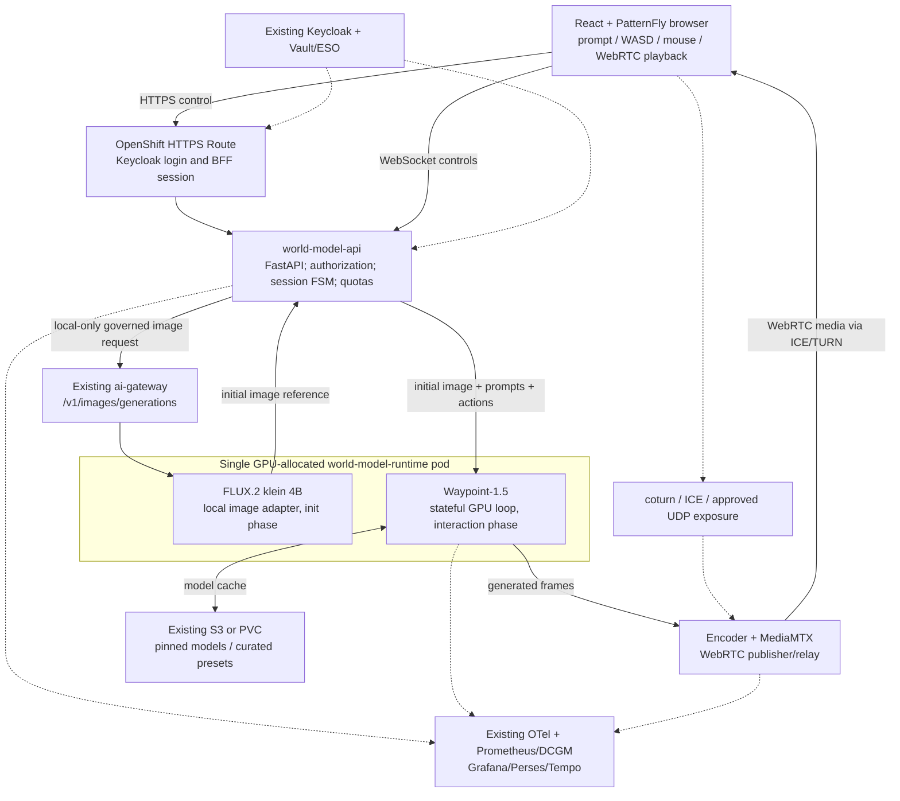

# ADR-0602: Introduce an interactive generative world-model experience on OpenShift AI and NVIDIA Blackwell

- **Status:** Accepted — architecture decision; implementation and performance qualification pending
- **Target:** v0.15 (proposed delivery target; no dependency on a specific OCP release branch)
- **Date:** 2026-11-07
- **Decision owners:** Zuno Demo architecture team
- **Repository:** [startxfr/zuno-demo](https://github.com/startxfr/zuno-demo)
- **Proposed repository path:** `docs/adr/0602-introduce-an-interactive-generative-world-model-experience.md`
- **Scope:** one interactive demonstration experience, one NVIDIA RTX PRO 6000 Blackwell Server Edition GPU (96 GB), existing Zuno platform services
- **Related:** [ADR-0012](0012-use-keycloak-as-the-central-identity-provider.md), [ADR-0019](0019-use-openshift-ai-model-serving-for-local-inference.md), [ADR-0021](0021-route-models-according-to-c1-c2-c3-classification.md), [ADR-0024](0024-use-vault-for-application-secrets.md), [ADR-0029](0029-instrument-model-usage-costs-and-distributed-traces.md), [ADR-0030](0030-use-a-command-dispatch-makefile-interface.md), [ADR-0035](0035-prevent-restricted-internal-context-from-reaching-external-models.md), [ADR-0053](0053-make-make-check-an-end-to-end-acceptance-and-security-gate.md), [ADR-0060](0060-restructure-day-0-day-1-day-2-day-3-deployment-sequencing.md), [ADR-0312](0312-route-operator-installs-through-argocd-applications.md), [ADR-0333](0333-separate-product-managed-ai-infrastructure-from-zuno-build-run-and-shared-platform-namespaces.md), [ADR-0351](0351-share-rtx-pro-6000-gpus-via-nvidia-mig-with-scale-from-zero-burst-capacity.md), [ADR-0414](0414-consolidate-zuno-ai-run-into-three-tiered-mig-predictors.md), [ADR-0415](0415-consume-stable-diffusion-xl-via-ovhcloud-ai-endpoints.md), [ADR-0522](0522-enable-openshift-ai-monitoring-stack-side-by-side.md), [ADR-0559](0559-follow-the-cluster-version-and-never-branch-by-ocp-version.md), [ADR-0560](0560-keep-the-ai-gateway-as-the-policy-router-in-front-of-unifai.md), [ADR-0587](0587-admit-additional-user-experiences-over-the-one-governed-backend.md), [ADR-0592](0592-declare-experience-clients-in-the-agents-release-apart-from-agents.md), [ADR-0593](0593-key-the-per-user-quota-and-telemetry-by-persona-across-experiences.md), [ADR-0601](0601-inject-client-credentials-tokens-for-experience-clients-without-oidc-passthrough.md)

> **Decision summary:** Add a browser-based, locally served, prompt-and-action-conditioned world-model demonstration to Zuno Demo. Start with **Overworld Waypoint-1.5-1B** for frame generation and **FLUX.2 [klein] 4B** for initial scene creation, executed **sequentially inside the same GPU-allocated inference pod**. Reuse the installed OpenShift, OpenShift AI, Keycloak, GitOps/Ansible, secrets, and observability foundations. Build a small stateful world-session runtime plus WebRTC media path, **initially on one unpartitioned 96 GB GPU**. Consider MIG and a custom KServe runtime **only after** real latency, encoder compatibility, licensing, and workload-interference tests. No performance figure or sophisticated prompt transformation is considered proven until tested on this exact GPU.

## 1. Context and business objective

Zuno Demo already provides a substantial OpenShift AI demonstration platform: GPU Operator and NFD, OpenShift AI, shared inference/model services, a governed `ai-gateway` in front of MaaS for conventional language/image inference, Keycloak identity, Vault/External Secrets, GitOps/Ansible/Make, Service Mesh, and Grafana/Perses/OpenTelemetry/Tempo monitoring. It also serves multiple end-user experiences, not just the UnifAI agent interface (ADR-0587).

The next use case must show a visually compelling **generative world model** through a web browser, using one NVIDIA RTX PRO 6000 Blackwell Server Edition GPU with 96 GB VRAM. A visitor should be able to:

1. Type a prompt describing a scene (e.g., “a snowy medieval village at dusk”).
2. See an initial image quickly, then enter the generated environment.
3. Move with **WASD / arrow keys and mouse** while the model generates corresponding successive frames.
4. Submit a **new prompt without leaving the session** (e.g., “the sky turns red and a volcano erupts”) and observe a visual response.
5. Understand, from on-screen indicators, whether the world is generating, reconditioning, or recovering.
6. Inspect the serving GPU, model, FPS, latency and platform monitoring in a secondary technical view.

This is **not** a requirement to create a persistent, metrically accurate 3D scene graph, physically exact digital twin, or multi-user shared simulation. The first version is an **interactive generative video world** with approximate temporal coherence. Its visual result can drift, hallucinate geometry, and fail to obey some requested transformations. These limitations must be demonstrated honestly.

### 1.1 Originating architectural proposal

The initial proposal selected NVIDIA Cosmos-1.0 Autoregressive 13B, FP8 quantization, a hypothetical 2 × 48 GB MIG split, KServe predictor backed by vLLM/TensorRT-LLM, a long-lived KV cache, FastAPI or Rust, WebSocket/gRPC, hardware NVENC, WebRTC, and Knative/Service Mesh. Its key assumptions were that a 13B model would fit on 48 GB and thus deliver continuous interactive video, and that each 48 GB MIG slice would provide NVENC.

The review rejects these **as starting assumptions**: fitting weights in VRAM does not prove real-time, controllable generation; general-purpose LLM serving engines do not inherently implement action-conditioned video; and standard MIG 2g.48gb has **no NVENC** on this GPU. Hardware video encoding needs an explicit capability test or a compatible media-engine MIG profile. See §4 and §9.

### 1.2 Existing Zuno constraints discovered in the repository

- ADR-0351 and ADR-0414 already allocate the two established RTX PRO 6000 GPU nodes to existing chat/embedding predictors using `all-balanced` MIG (`2 × 1g.24gb + 1 × 2g.48gb` on each). **Do not repurpose or repartition these nodes for this demo without a separate capacity decision.**
- A separate MIG-disabled scale-from-zero GPU training/burst pool is described in ADR-0351. It may be used for *scheduled qualification only* if reserved and otherwise idle; it is not a guaranteed, always-on world-demo capacity pool.
- ADR-0587 requires a new user experience to reuse the trusted identity and governed platform instead of standing up another independent LLM/RAG/agent stack. ADR-0560 preserves the `ai-gateway` as the policy router, with MaaS behind it for eligible models.
- ADR-0415 already adds an image-generation API (`/v1/images/generations`) in the `ai-gateway`, currently with an external-provider path. This is a **reusable contract**, but local FLUX support must be implemented and policy-checked; the current OVHcloud image backend must not silently be used as a substitute for local-only world creation.
- ADR-0587 defines user-experience namespaces as default-deny and **outside the mesh**. The world-model experience follows this admission model; the cluster's existing mesh remains in place and unchanged.
- ADR-0559 forbids OpenShift-version-specific Git branches. The integration must follow current cluster/operator discovery and pinned application dependencies, not fork the repository by OpenShift release.

## 2. Decision drivers

| Priority | Driver | Implication |
|---|---|---|
| P0 | Browser demo that is genuinely interactive | State must persist per world session; actions and prompt changes affect future frames |
| P0 | One Blackwell 96 GB GPU | Benchmark on the real GPU; initially use full GPU and one active session |
| P0 | Reuse Zuno platform | Extend existing GitOps, IAM, secrets and observability; no parallel infrastructure stack |
| P0 | Protect existing Zuno AI workloads | Explicit capacity reservation; no eviction or silent MIG repartition |
| P0 | Sovereignty and controlled exposure | Local model execution; policy-gated prompts; no direct internet model inference |
| P1 | High visual impact | Good initial-scene quality, responsive input, visible prompt transformation |
| P1 | Reproducible demo | Deterministic preset scenes, warm-up, reset, preflight and health gates |
| P1 | Maintainable open-source implementation | Pin and review all dependencies and licences, keep the renderer replaceable |
| P2 | Industrializable RHOAI integration | KServe serving can follow once streaming runtime and GPU scheduling are validated |
| P2 | Multi-user concurrency and MIG economics | Deferred until functional and performance baseline succeeds |

## 3. Decision

### D1 — Implement a new governed **experience client**, not a new agent platform

The browser application is a distinct experience named `world-model` with its own Keycloak client and namespace `zuno-world-model` (proposed), reusing the Zuno experience-client admission model. It is **not** an OKF/UnifAI agent, a new SaaS model provider, or a replacement for the ai-gateway. It uses existing shared platform services but owns its specific generation session state and WebRTC connection.

- Login via the existing `zuno` Keycloak realm; preserve the user's identity and use validated token claims for quotas and audit. No hardcoded browser-side tokens.
- Declare the `world-model` client in the **separate signed experience-client artifact** only if it actually needs MCP tools (ADR-0592); do not fabricate a UnifAI agent or give it default access to corporate knowledge.
- Reuse the ai-gateway **for ordinary OpenAI-compatible model calls**, including optional prompt rewriting and, after adding a local provider adapter, image creation.
- The stateful world engine is a **narrow, documented exception to ADR-0587's general “every model call to ai-gateway” convention**: action-conditioned frame generation is not a stateless OpenAI-compatible completion and is not to be forced through MaaS. The world gateway enforces the same identity/classification boundary and meters this **specialized video modality** itself. The exception does **not** allow direct external model providers or bypass of Keycloak.
- This ADR extends (but does not supersede) ADR-0587 and ADR-0560. A later platform decision would be needed to centralize all video-model governance in the ai-gateway.

### D2 — Use **Waypoint-1.5-1B** as the baseline interactive engine

Implement a versioned `WorldEngineAdapter` around [Overworld `world_engine`](https://github.com/Overworldai/world_engine), with checkpoint [`Overworld/Waypoint-1.5-1B`](https://huggingface.co/Overworld/Waypoint-1.5-1B). The upstream interface explicitly supports setting a prompt, action/controller input, appending an initial image, and emitting conditioned frames.

- One long-lived inference process owns **one active world session** in the initial release. Keep prompt, previous frames/model context, action queue and session metadata in memory; use in-memory session state only while the pod is alive.
- The actual temporal memory and implementation-specific KV/state cache are managed by the model adapter, not hardcoded as a 12–18 GB “LLM Paged KV Cache” requirement.
- Use upstream-supported quantization backends **only after comparison with the reference precision**, measuring both temporal stability and actual FPS/VRAM. Evaluate NVFP4/FP8 as supported by the installed build; no FP8-memory or quality guarantee is assumed.
- Pin model checkpoint **revision/digest**, Python dependencies, container image digest and tested CUDA/PyTorch stack. Do not build at runtime from moving `main` or `latest`.
- **Legal gate:** the Waypoint model checkpoint is labelled Apache-2.0, but the upstream `world_engine` code repository carries **GPL-3.0**. Before distributing a derived Zuno runtime image or linking proprietary code, confirm applicable source-distribution/corresponding-source obligations. Keep the engine behind a process/API boundary; this is an engineering separation, not legal exemption.

**Gate:** if the model does not meet the minimum interactive quality/latency envelope, do not compensate by inventing synthetic FPS or playing a pre-rendered “live” video. Qualify EdenLive 5B as the alternative (§5).

### D3 — Use **FLUX.2 [klein] 4B** to initialize the visual scene

Add a local image-generation provider using **FLUX.2 [klein] 4B**, selected for image quality, low resource footprint and Apache-2.0 licensing. Retain the existing `ai-gateway` image endpoint as the **governed entry point**; add a local `flux2-klein-4b` image backend to its provider routing instead of calling FLUX from the browser or falling through to OVHcloud.

- Initial prompt → local image generation → image validation/normalization → Waypoint `append_frame`/initialization → continuous interactive rendering.
- Return stored references/metadata, not base64 frames in chat logs or tracing spans.
- **Single-GPU scheduling contract:** the initial implementation runs the FLUX adapter and the Waypoint engine in **one GPU-allocated runtime pod/container**, under one `nvidia.com/gpu: 1` reservation. The ai-gateway's `local-image` provider calls a local internal image-generation endpoint on that **same runtime pod**. It must not deploy a separate FLUX pod also requesting `nvidia.com/gpu: 1`, because two exclusive GPU requests would not fit on one card.
- Initial **full-GPU** PoC executes FLUX initialization before the long-lived Waypoint loop; it may load/unload FLUX to guarantee predictable headroom. A second simultaneous image-generation request is rejected/queued while a world session is active. Keeping both models resident is an **optimization hypothesis**, not a baseline commitment.
- A mid-session prompt is applied to Waypoint using its prompt-control API. **Do not assume** mid-session FLUX image editing can be spliced into the video without breaking continuity; this is a separately gated experiment requiring a visible transition/reset if necessary.

### D4 — Deliver an asynchronous session-oriented browser experience

Use **React + PatternFly** to match Zuno's frontend conventions; **FastAPI** for the control plane; a dedicated `world-engine-runtime` container for GPU inference; and a **WebRTC media gateway** (initial candidate: MediaMTX, with TURN/coturn where needed). Transport roles are deliberately distinct:

- HTTPS/REST: create/reset world, create/close session, initial prompt and metadata.
- WebSocket: ordered, bounded action commands and events (key presses, relative mouse movements, prompt change notifications). A browser may sample controls at 30 Hz or more, but the renderer must **coalesce** inputs and apply the last valid state at each model inference step; 30-Hz inputs are *not* a 30-FPS guarantee.
- Internal bounded queue/stream: gateway to long-lived inference process; **gRPC streaming is optional** if direct internal WebSocket/IPC meets measured needs. Do not introduce Rust solely for theoretical speed.
- Media: generated frames → encoder → WebRTC → browser `RTCPeerConnection`. MediaMTX handles distribution; an encoder/bridge is still required. Do not assume that PyNVCodec, FFmpeg and NVENC work in every container/MIG setting.
- Keep media traffic and stateful inference off the generic stateless `ai-gateway` chat path.

### D5 — Start with **one unpartitioned GPU** and preserve existing MIG capacity

The baseline requires **one exclusive, unpartitioned** RTX PRO 6000 Blackwell GPU advertised by `nvidia.com/gpu: 1` for the world engine, image initializer and optional hardware media encoding. Physical capacity is one GPU card, not two 48 GB MIG slices.

1. Prefer a **dedicated demo GPU node or an explicitly reserved existing full-GPU node**; the choice is made at deploy time from current inventory and costs. No assumption that the two existing MIG production-style nodes have spare capacity.
2. When using a burst/training node, implement an explicit lease/taint/workload exclusion and scheduled event reservation; confirm node is running and scaled in advance, otherwise fail preflight. Do not preempt training or existing MaaS/chat models.
3. Compare full-GPU occupancy, SM utilization, VRAM, model cold-start and actual encoder throughput before exploring MIG. Repartitioning an in-use node is a disruptive **separate approval**.
4. An optional **2 × `2g.48gb`** experiment is valid only if (a) model performance remains acceptable with half the compute and (b) the encoder runs using an available media resource, CPU fallback, or a separately qualified profile. The plain `2g.48gb` profile exposes **zero NVENC engines** on this GPU; `2g.48gb+me.all` exposes NVENC but is only available **once** according to NVIDIA's profile table. A symmetrical pair of 48 GB media-enabled slices is **not** an accepted target.
5. MIG splits GPU memory and compute, **not hardware availability**; two slices on one card are no HA solution.

### D6 — Reuse OpenShift AI, but **do not make KServe/Knative a prerequisite**

- Day 0/1: reuse the installed GPU Operator, NFD, OpenShift AI, Keycloak, secrets and observability infrastructure. Verify Blackwell driver/CUDA/codec compatibility against the **actual** node image and operator channel.
- Day 2 initial runtime: use a plain `Deployment` with an explicitly selected GPU node and persistent model cache/PVC, plus `Service`, NetworkPolicies, Secret mounts, ServiceMonitor/OpenTelemetry where applicable.
- Consider **KServe custom ServingRuntime with RawDeployment** in a later integration track if its lifecycle and network behavior support this **stateful streaming** workload without unnecessary proxying, session loss or autoscaling. Model registry and model storage can be reused without asserting that generic vLLM/TensorRT-LLM supports Waypoint.
- Keep Knative scale-to-zero, KEDA, and a new Service Mesh control plane **out of scope**. The existing cluster mesh stays installed, but the browser experience namespace follows ADR-0587's outside-mesh policy unless a separately documented change is justified.
- Avoid auto-scaling or multiple world-engine replicas while sessions are stateful and the demo has one GPU; an HPA that adds GPU pods would merely create Pending workloads.

### D7 — Add deterministic operational and demonstrator gates

Use the existing Make → Ansible → Argo CD deployment workflow and observability stack. A “wow effect” must be reproducible and measurable, not dependent on invisible presenter intervention. Provide three well-tested scene presets, preflight and reset controls, a technical metrics view, clear “generative AI / not an exact 3D simulation” disclosure, and a prerecorded **explicitly labelled fallback** only for event resilience (never presented as live inference).

## 4. Architecture and boundaries



**Trust boundaries:** The internet-facing browser reaches only approved routes/signaling/media endpoints. It cannot access model GPU pods, S3 credentials, `ai-gateway` internals, or the OpenShift API. Keycloak and secrets remain platform-owned. WebRTC UDP/TURN exposure is explicitly configured and network-reviewed; an OpenShift HTTP Route alone is **not** a complete WebRTC/UDP ingress design.

### 4.1 Component ownership and reuse

| Component | Reuse or new? | Responsibility | Proposed placement |
|---|---|---|---|
| OCP / GPU Operator / NFD | Existing | Node GPU capability and GPU scheduling | Platform-managed namespaces |
| RHOAI 3.5 / storage / KServe | Existing, optional serving adapter | AI infrastructure, model assets, later custom runtime | Existing product namespaces |
| Keycloak realm `zuno` | Existing + client | SSO and group authorization | Existing Keycloak |
| Vault / External Secrets | Existing + secrets | OIDC client, TURN credentials, model access | Existing secret pipeline |
| `ai-gateway` | Extend image provider | Policy-gated local initial-image generation; optional LLM prompt rewriting | Existing gateway |
| `world-model-ui` | **New** | Prompts, control inputs, playback, stage/metrics view | `zuno-world-model` |
| `world-model-api` | **New** | REST/WS API, sessions, identity, quotas, prompt moderation | `zuno-world-model` |
| `world-model-runtime` | **New** | One GPU reservation; local FLUX initialization **and** stateful Waypoint generation in sequential phases | `zuno-world-model` (GPU node) |
| `world-model-media` | **New** | Encode/publish and WebRTC signaling/relay | `zuno-world-model` |
| coturn | **New only if needed** | ICE/TURN for reachable clients | Approved media ingress zone |
| Grafana/Perses/OTel/Tempo/DCGM | Existing + instrumentation | Latency/FPS/VRAM, model and user-experience metrics | Existing stacks |
| Mesh | Existing, **no new mesh for PoC** | Unchanged for other Zuno components | Existing mesh namespaces |
| UnifAI / MCP / RAG / MaaS | Existing, **not on video frame path** | Optional ordinary governed model/tool calls only | Existing platform services |

### 4.2 Runtime boundary and scaling model

One active world session owns one model loop and one GPU allocation. The FastAPI service may handle multiple authenticated HTTP sessions but **only one active video-generation lease** in v1. Excess session requests return a visible queue/busy response, not concurrent GPU overload. On pod restart the world state is lost and the UI must show `session_lost` with an explicit reset action. Persist presets and session metadata if needed; do **not** promise restoration of the model's exact hidden temporal state.

### 4.3 Session state machine

```text
NEW -> PREPARING_IMAGE -> WARMING_ENGINE -> READY -> STREAMING
                                                |        |
                                                |        +-> RECONDITIONING -> STREAMING
                                                |        +-> PAUSED -> STREAMING
                                                |        +-> DEGRADED -> RECOVERING -> STREAMING or FAILED
                                                +-> FAILED
STREAMING/PAUSED/FAILED -> CLOSED
```

A prompt update increments `prompt_version` and is applied **between generation steps**. Report `requested`, `applied`, and `visibly_observed` separately. Only the first two are deterministic system events; visual obedience is an evaluated model outcome, not something an API can guarantee.

## 5. Model choices and alternatives

| Candidate | Decision | Reason |
|---|---|---|
| **Waypoint-1.5-1B** | **Selected baseline** | Purpose-built action-conditioned interactive frame generation; prompt updates supported by upstream engine |
| **FLUX.2 [klein] 4B** | **Selected initializer** | Fast local text-to-image/image editing and Apache-2.0 model license |
| **EdenLive 5B** | **Qualified fallback / phase-2 experiment** | Attractive visual re-renderer with engine-managed world state; requires assessing a separate upstream world/control engine and significant GPU/runtime dependencies |
| Matrix-Game 4 | Not selected for baseline | Useful interaction patterns, but more constrained world presets and integration fit |
| Hy-Nomas | Research only | Text-conditioned world-change promise, but single-GPU interactive performance is not established for this hardware |
| Cosmos-1.0 AR 13B | **Rejected for this use case** | Model and serving assumptions do not establish responsive browser navigation; too much engineering risk for a first demo |
| Cosmos 3 | Future research track | Promising interactive/physical simulation; reported high FPS on other NVIDIA hardware cannot be transferred to this card |
| vLLM / TensorRT-LLM | Not mandated for video | Do not substitute a generic LLM runtime for a supported world-model engine |
| Two `2g.48gb` MIG partitions | **Deferred experiment** | Less compute per engine and plain profiles lack NVENC; not the default architecture |

**Proof obligation:** before code is considered accepted, capture a real GPU run showing checkpoint revision, model precision/quantization, resolution, measured frame cadence, total GPU memory, NVENC availability, and user-perceived action-to-photon latency. An isolated “model FPS” benchmark is insufficient.

## 6. Interfaces and data contracts (v0.1 proposal)

The interface contracts below are implementation requirements, **not claims that these endpoints already exist**. They are intentionally transport-independent on the GPU side.

### 6.1 Control-plane endpoints

| Method / route | Function | Key requirements |
|---|---|---|
| `POST /api/worlds` | Create a world from a prompt or preset | Authenticated; `prompt`, optional `preset_id`, `classification`; return `world_id` and processing status |
| `POST /api/worlds/{world_id}/sessions` | Acquire GPU session | Return `session_id`, state and lease expiry; 409/429 if GPU busy or quota exceeded |
| `GET /api/sessions/{session_id}` | Session status and metrics | Only the owner or authorized operator can read |
| `POST /api/sessions/{session_id}/prompts` | Change prompt in place | Validate payload; return monotonic `prompt_version` and `accepted` state |
| `POST /api/sessions/{session_id}/reset` | Reinitialize from chosen seed | Explicit reset/restart; no accidental hidden reset |
| `POST /api/sessions/{session_id}/webrtc/offer` | Exchange signaling/offer | Bound to authorized session, ICE and approved origin |
| `WS /api/sessions/{session_id}/controls` | Send actions and receive state events | Ordered sequence IDs; last-value input coalescing; heartbeat; bounded backpressure |
| `DELETE /api/sessions/{session_id}` | Release GPU lease | Idempotent release and media teardown |

Example (non-wire-binding design sketch):

```json
{
  "session_id": "<opaque-session-id>",
  "seq": 174,
  "type": "control",
  "keys_down": ["KeyW", "ShiftLeft"],
  "mouse_delta": {"x": 0.22, "y": -0.08},
  "client_ts_ms": 1720000000000
}
```

Do not accept arbitrary GPU kernel settings, raw file paths, arbitrary model URLs or per-user infrastructure overrides from the browser. Map browser controls to supported upstream `CtrlInput` actions **server-side**; the upstream keycode standard is not a browser `KeyboardEvent` schema.

### 6.2 Local image-generation contract

Re-use `ai-gateway`'s existing OpenAI-compatible `POST /v1/images/generations` where feasible, adding a `kind: local-image` provider and policy tests for C1/C2/C3. **Its internal provider points to the FLUX adapter inside the same exclusive-GPU `world-model-runtime` pod**, not to an independently scheduled GPU pod. The gateway must return an image reference/byte payload that the world BFF can validate, store temporarily and pass to Waypoint. No external fallback is permitted for an expressly **local-only** request. If the current gateway cannot yet carry the local backend without violating its architecture, land an explicitly reviewed image-adapter change before productionizing the demo.

### 6.3 Prompts, latency and continuity

- **Initial generation:** FLUX creates the first visual reference; then Waypoint takes control of succeeding frames.
- **Incremental conditioning:** `set_prompt` updates the desired world description for upcoming frames; an accepted prompt does not guarantee a literal object transformation.
- **Coherence:** prior frames/context remain in the engine during a session; an optional explicit reseed is user-visible.
- **Frame cadence:** do not equate 30-Hz controls with 30 rendered FPS. Waypoint-1.5's upstream implementation can return **four frames per generation step**; schedule and telemetry must measure *displayed frames* and *inference step timing* separately.
- **Streaming:** prototype browser-compatible H.264 first; AV1 is optional and depends on negotiated browser/device codec support. If NVENC unavailable, test a bounded CPU encoder fallback and report its quality/performance costs.

## 7. Integration in the current `zuno-demo` repository

The following is a **proposed change set**; these folders and targets are not asserted to exist yet. Use the repository's existing chart/ArgoCD/role conventions rather than adding a second installer.

```text
components/
  world-model/
    api/                 # FastAPI, session manager, Keycloak validation
    runtime/             # One GPU container: FLUX init adapter + WorldEngineAdapter, frame queue, loop
    media/               # publisher/codec bridge and media config
    ui/                  # React + PatternFly
    tests/               # protocol, session, policy, mock renderer
platform/
  world-model/
    README.md            # runtime contract, feature flags, model checksums
    config/              # profiles, presets (non-sensitive), policies
    tests/               # capability and acceptance fixtures
  ai-gateway/
    image-provider-routing.yaml  # extend existing file for local FLUX
  gpu/README.md          # document capacity/codec/MIG gates
  observability/         # existing dashboards/collectors, add WM metrics
gitops/
  charts/world-model/    # deployment, services, volumes, NetworkPolicies
  apps/world-model/      # ArgoCD Application
  charts/namespaces/     # declare zuno-world-model and quotas
  charts/machines/       # optional dedicated GPU pool; no silent changes
ansible/
  roles/world_model/     # check/install/uninstall/reconcile using existing pattern
  roles/world_model_build/ # optional build role if image flow requires it
docs/
  adr/0602-introduce-an-interactive-generative-world-model-experience.md
  architecture/world-model.md
  demo/world-model.md    # presenter runbook, preflight, reset, scenario
  testing/world-model-acceptance.md
```

### 7.1 Deployment stages and expected commands

- **Day 0:** add Keycloak client configuration, namespace, secrets, PVC/bucket parameters and optional dedicated GPU machineset using existing roles; keep manual credentials in `ansible/confidential.yml`/Vault only. Do **not** create a separate world-model-specific secret management system.
- **Day 1:** reuse installed NFD, GPU Operator, OpenShift AI and observability. No new Service Mesh or Knative operator.
- **Day 2:** build/scan/sign/push first-party images following existing supply-chain policy; deploy local image backend and the world-model chart through Argo CD; warm/cache models and validate the hardware video path.
- **Day 3:** run session, browser, security, performance, cleanup and reproducibility tests; implement demo preflight/reset and a presenter path.

Suggested CLI targets, to be added to the existing Make command dispatcher (not currently implemented):

```bash
make d2 check world-model
make d2 build world-model
make d2 install world-model
make d3 test world-model
make d3 demo-world-model-preflight
make d3 demo-world-model-reset
```

The exact Day-3 syntax must follow the current `Makefile` dispatcher rather than introduce incompatible top-level targets. Prefer existing image build, ArgoCD sync, `oc` readiness and security-check helpers.

### 7.2 Resource placement and configuration

**Full-GPU baseline** (illustrative `Deployment` fragment; not a complete resource):

```yaml
spec:
  template:
    spec:
      nodeSelector:
        zuno.io/gpu-workload: world-model  # label must be provisioned on selected node
      containers:
        - name: world-model-runtime
          resources:
            requests:
              cpu: "4"
              memory: 24Gi
            limits:
              nvidia.com/gpu: "1"
```

CPU/memory requests above are **starting test values**, not qualified sizing. A node taint/toleration is recommended to avoid accidental placement of other workloads; ensure it is compatible with existing GPU Operator DaemonSets. Quotas and node allocatable CPU/RAM must be verified, not assumed from VRAM alone.

**Optional, non-default MIG resource** after a separate test/approval:

```yaml
resources:
  limits:
    nvidia.com/mig-2g.48gb: "1"
```

The latter assumes NVIDIA device-plugin **mixed** MIG strategy and the unmodified plain profile. It does **not** imply NVENC availability or legal capacity to preempt an existing model. A `+me.all` profile requires its own discovered resource mapping and validation; never silently reuse `nvidia.com/mig-2g.48gb` for it.

## 8. Security, isolation and data handling

1. **Authentication:** reuse Keycloak `zuno`; opaque browser session / validated bearer token as appropriate. The backend—not user headers—derives identity, group rights, persona and allowed classification (ADRs 0012/0033/0593).
2. **Access:** world demo initially allows **C1/public synthetic prompts and presets only**. C2/C3 can be a future extension if all modalities remain local and their policy handling is audited. Never forward a C2/C3 image, text or session data to the existing OVHcloud image provider.
3. **Quota:** one GPU session at a time, session timeout, prompt/action input limits, start/stop limits, explicit 429/503 and resource cleanup; meter world **seconds, generated frames and GPU occupancy**, not fictitious LLM tokens. If classification or entitlement fails, **fail closed**.
4. **Network:** namespace default-deny; UI/API exposure via approved Route; only targeted in-cluster egress to image gateway, Keycloak and observability; model runtime and S3 endpoints are not externally exposed. WebRTC requires a separately reviewed UDP/TURN/ICE deployment and firewall policy. Avoid public unauthenticated TURN relays.
5. **Secrets:** Vault/ESO for service credentials and TURN auth; short-lived user tokens and no credential logging. Avoid exposing Hugging Face download tokens to the browser or embedding them in images.
6. **Containers:** `restricted-v2` SCC, non-root, read-only root file system where supported, dropped capabilities, image pinning/signing and SBOM/vulnerability scanning. GPU driver/container runtime compatibility may need documented security exceptions; never silently grant `privileged` to the whole application.
7. **Content:** curated safe prompts, prompt-length limits, basic content moderation, no real customers or nominative user data in presets, privacy-preserving logs. User-provided assets are out of scope initially.
8. **Persistence:** do not persist frame/video payloads by default. Keep short-lived session metadata and optional explicitly enabled demo recordings with retention and owner authorization. Do not send frames as OTel span attributes or put payloads into normal application logs.
9. **Licences:** verify the *model checkpoints*, *world-engine code*, *video encoder*, and *WebRTC infrastructure* separately. Apache-2.0 model weights do not make GPL-3.0 runtime code Apache-2.0.
10. **No implicit mesh requirement:** follow ADR-0587's outside-mesh experience policy for the PoC; preserve existing mesh for other Zuno apps. Any later mTLS insertion must be measured against WebSocket/WebRTC semantics.

## 9. GPU, codecs and feasibility gates

| Gate | Verification | Accept or stop condition |
|---|---|---|
| G0 — Node capacity | `oc get nodes`, allocatable GPUs/CPU/RAM, workload requests, taints, quota, running model placement | Real full-GPU slot is reserved without displacing existing workloads |
| G1 — Hardware | `nvidia-smi -L`, CUDA/PyTorch GPU test, current driver/GPU Operator support | Exact RTX PRO 6000 GPU usable from restricted OpenShift container |
| G2 — Waypoint | Run pinned checkpoint and reference script; track real VRAM/step time and coherence | Stable interactive frame generation on this GPU |
| G3 — FLUX | Local generator starts, creates a reference image, transfers it to engine | Initialization works without SaaS or browser-to-GPU access |
| G4 — Encoder | `nvidia-smi` media/codec availability, FFmpeg/PyNVCodec test **in the selected GPU or MIG profile** | Hardware path works **or** CPU encoding meets measured quality/latency |
| G5 — WebRTC | Remote browser ICE negotiation across demo network, TURN if needed | Real cross-network playback; no dependency on unsupported UDP via Route |
| G6 — Governance | Keycloak, NetworkPolicy, default-deny, C1-only, local-only, user quotas | Bypass requests denied and logged; no external model endpoint used |
| G7 — Show | End-to-end FPS/p95 input-to-photon and prompt-change tests | Accepted demo objectives and repeatable scripted scenario |

**NVIDIA capability correction:** the RTX PRO 6000 Blackwell Server Edition's normal `MIG 2g.48gb` profile exposes **zero NVENC**; `MIG 2g.48gb+me.all` has media access but supports only one such instance, according to NVIDIA's documented MIG-profile table. The initial “2 x 48 GB each with NVENC” proposal is therefore **rejected**, independently of VRAM sizing.

### 9.1 Proposed acceptance objectives (not vendor guarantees)

| Dimension | Preferred target | Minimum go/no-go approach |
|---|---|---|
| Browser rendering | 720p at ≥24 *displayed* FPS | Log real displayed FPS and stutters; a lower rate requires explicit demo-scope acceptance |
| Interaction latency | p95 action-to-visible-response <250 ms | Measure on representative external client; separate input/network/inference/encode/decode |
| Prompt change | Effect visible within ~5 seconds for curated prompts | Measure acceptance/first changed frame separately; manually score semantic obedience |
| Continuity | 2 minutes of navigable scene without catastrophic visual rupture | Repeat with ≥3 predetermined seeds and paths |
| Stability | 10-minute event session without OOM/crash | Record GPU memory high-water mark and reset behavior |
| Concurrency | One active GPU world session | Second visitor gets explicit busy/queue, never unbounded GPU overlap |
| Security | No unauthorized external model traffic | Egress test and classification test; forced failure is a pass |
| Reproducibility | Three curated demo scenes | Preflight, warm-up, reset and presenter runbook work without source edits |

Acceptance thresholds are **architectural goals**; the implementation must report actual results, including failures. Do not claim measured RTX PRO 6000 numbers from H100, RTX 5090, B200 or GB300 benchmarks.

### 9.2 Prompts and scene tests

1. **Create:** “Snow-covered medieval village at dusk, cinematic first-person view.” Check generated scene and clear starting frame.
2. **Navigate:** press forward, turn right, look upward, stop. Check action responsiveness and whether large structures persist coherently.
3. **Recondition:** “The sky turns red and a volcano erupts beyond the village.” Check whether visual changes occur without an unsolicited reset; separately judge spatial/semantic fidelity.
4. **Reset:** return to a pinned starting image and baseline prompt. Confirm cleanup of frame history and media session.
5. **Failure:** make engine unavailable. UI must report degraded/failed state rather than freezing an apparently live frame.

The volcano example is a **desired outcome, not a guaranteed model capability**. If Waypoint cannot perform a persuasive in-place transformation, test the alternate EdenLive pipeline or explicitly reset/reseed with a new image; never misrepresent a fresh scene as continuous world evolution.

## 10. Observability, operational SLOs and Day-3 evidence

Reuse the existing `zuno-monitoring` application stack and RHOAI's installed GPU/AI monitoring. Publish low-cardinality Prometheus metrics and OpenTelemetry spans with one stable run/correlation ID; **do not label metrics with raw session IDs or user prompts**.

Suggested metrics (new names, implementation pending):

```text
zuno_world_active_sessions
zuno_world_frame_generated_total{model,precision}
zuno_world_frames_dropped_total{reason}
zuno_world_engine_step_seconds_bucket{model}
zuno_world_action_to_display_seconds_bucket{client_type}
zuno_world_prompt_apply_seconds_bucket{result}
zuno_world_session_duration_seconds_bucket{result}
zuno_world_stream_disconnect_total{reason}
zuno_world_busy_rejected_total
zuno_world_reset_total{reason}
```

DCGM provides device-level VRAM/utilization metrics; record CUDA memory allocation and peak memory from the runtime as well. Keep client-reported displayed FPS and E2E latency separate from inference-side FPS. Trace `world.create`, `image.generate`, `session.acquire`, `engine.gen_frames`, `video.encode`, `prompt.apply`, and `session.close`, with the already established `zuno.run_id` context where possible. Create a **World Model** dashboard view in the existing Grafana/Perses landscape, not a third observability stack.

Operational guardrails: GPU lease timeout; media heartbeat; bounded queues; readiness only once models and video path are warmed; a liveness policy that does **not** kill the pod merely because generation is temporarily slow; cleanup of orphan sessions; operator-visible reset/prewarm controls. Use a real GPU preflight that reports readiness before a public demonstration.

## 11. Delivery work packages and dependencies

Identifiers `WM-01` through `WM-09` are **new proposed track-local work packages**, not existing Zuno WP numbers. Assign the canonical project WP identifiers when planning work; this ADR does not claim issues have been opened.

| WP | Work package | Deliverables | Dependency / exit gate |
|---|---|---|---|
| **WM-01** | Capacity, supported stack and licensing | Current GPU inventory; reserved node decision; NVIDIA codec/MIG test; model/code licences | **G0/G1/G4**; no interference with ADR-0351 |
| **WM-02** | Waypoint engine spike | Pinned runtime image, `WorldEngineAdapter`, 3 benchmark paths, VRAM/FPS/continuity report | WM-01, **G2** |
| **WM-03** | Local FLUX initializer | Image backend routed through ai-gateway to **the same GPU pod** as Waypoint, synthetic scene assets, policy tests | WM-01, **G3/G6** |
| **WM-04** | API/session control | REST/WS OpenAPI, Keycloak auth, leases, quota, session FSM, error/reset behavior | WM-02, **G6** |
| **WM-05** | Streaming/browser UX | WebRTC encoder/MediaMTX/TURN, React/PatternFly controls, prompt interface, browser metrics | WM-02/04, **G5** |
| **WM-06** | OpenShift/GitOps integration | Namespace, secrets, NetworkPolicies, charts, ArgoCD Application, Ansible Day-2 role, image signing | WM-01–05 |
| **WM-07** | Demo and observability | Curated presets, Grafana/Perses panels, presenter script, reset/preflight | WM-05/06 |
| **WM-08** | Day-3 automated acceptance | Security, stale-session, stream/network, sustained run, p95, visual-scoring evidence | WM-06/07, **G7** |
| **WM-09** | Optional phase 2: MIG / EdenLive / KServe | Trade-off report; separate decision on adoption | Only after WM-08; no unconditional scope commitment |

### 11.1 Implementation order / critical path

```text
WM-01 capacity + legal + codecs
       |
       +--> WM-02 Waypoint live engine --------+
       |                                       +--> WM-04 session API --> WM-05 streaming UX
       +--> WM-03 local FLUX image backend ----+                               |
                                                                               v
                                                     WM-06 GitOps integration and policies
                                                                               |
                                                     WM-07 demo + observability
                                                                               |
                                                     WM-08 automated acceptance
                                                                               |
                                           optional WM-09 (MIG/EdenLive/KServe)
```

**Do not spend the initial sprint implementing KServe, FP8 conversions, Service Mesh changes or a second GPU partition before the baseline browser-to-world latency is proven.**

## 12. Consequences

### Positive

- A visually distinctive interactive world-model scenario that complements Zuno's existing governed agents and MaaS model demos.
- Maximum reuse of deployed OpenShift, Keycloak, AI infrastructure, security, storage, GitOps and observability foundations.
- Explicit interfaces enable replacing Waypoint with a different engine without rebuilding the browser, identity or operations plane.
- Model weight and GPU-performance risk is isolated early in a hardware spike, rather than being hidden behind a large platform implementation.
- Honest and observable differentiation between a *video world model* and a true deterministic simulated game world.

### Costs and drawbacks

- A world-model runtime, WebRTC encoder bridge and interactive frontend are **new application code**; RHOAI/KServe does not supply them out of the box.
- A dedicated/reserved full GPU may add infrastructure cost; the current MIG nodes are already serving Zuno models.
- Stateful sessions limit multi-user scaling and make exact post-failure continuity impractical in v1.
- Open-source model/runtime licensing and CUDA/codec container compatibility require explicit review.
- Prompt-driven transformation can be visually unreliable; preset scenes and an alternate renderer may be required to achieve the intended show quality.
- The custom video path is a **governance exception** that must have its own quotas/telemetry and may be revisited if the Zuno ai-gateway evolves to support video streaming natively.

## 13. Explicit non-goals and deferred decisions

- Do not replace UnifAI, the ai-gateway, MaaS or the existing model fleet.
- Do not reprofile the two occupied production-style MIG nodes, autoscale stateful video pods, or claim hardware HA from MIG.
- Do not require OpenShift Serverless/Knative, KEDA, a separate mesh or new observability products.
- Do not promise accurate 3D topology, physics, persistent worlds or multi-user shared state.
- Do not treat prompt edits as guaranteed scene edits; these need image/model-specific acceptance tests.
- Do not add live fine-tuning, RL, training jobs or LLM-backed world validation to the first demo.
- Do not make model or prompt data public or send it to unapproved SaaS providers.
- Defer KServe custom-runtime adoption, alternative EdenLive integration, NVFP4/FP8 optimization, MIG partitioning, and multiple concurrent sessions until measured baseline evidence exists.

## 14. Decision checkpoints and reopen conditions

Revisit this ADR through a **new superseding ADR**, not by silently changing an implemented decision, if any of these holds:

1. Waypoint fails the agreed minimum FPS/latency/coherence score on RTX PRO 6000.
2. In-place prompt transformations are not convincing enough for the intended public demo.
3. Code/model licensing or NVIDIA codec access prevents the selected packaging.
4. No exclusive full-GPU reservation can be guaranteed without disrupting existing Zuno services.
5. OpenShift AI or the ai-gateway introduces a supported stateful video-model-serving interface that removes the need for the specialized dataplane.
6. Demo concurrency requirements exceed a single GPU session, requiring a revised GPU topology, explicit queues or more GPUs.

## 15. Implementation Definition of Done

The ADR is considered **implemented** only after the following evidence is stored under `docs/testing/` or in the repository's existing validation artifacts:

- [ ] At least one OpenShift GPU node is allocated without changing the existing MIG inference fleet.
- [ ] Driver/CUDA and media-engine or CPU-encoder path are verified on that exact node.
- [ ] Waypoint checkpoint and runtime are pinned; GPL-3.0 implications are reviewed.
- [ ] Local FLUX is connected through a governed image path to **the same GPU runtime pod**, with no second exclusive GPU allocation or unexpected external fallback.
- [ ] One Keycloak-authenticated browser visitor can create a world, navigate, re-prompt and reset it.
- [ ] WebRTC works for the intended remote visitor network; no false assumption about Route/UDP.
- [ ] The GPU/runtime, browser, session and prompt metrics are visible in existing dashboards.
- [ ] Default-deny, quota, token, local-only and session-ownership tests pass.
- [ ] Make/Ansible/ArgoCD can deploy and remove the feature repeatably and report health.
- [ ] Curated three-scene live-demo script works, with a clear fallback and documented limitations.
- [ ] Actual (not vendor-transposed) FPS, p95 latency, VRAM and image-to-world warm-up data are recorded.

## 16. References and verification notes (2026-11-07)

### Verified in `startxfr/zuno-demo`

- [Repository README](https://github.com/startxfr/zuno-demo/blob/main/README.md) — platform baseline and repository conventions.
- [ADR-0351 — GPU MIG / burst](https://github.com/startxfr/zuno-demo/blob/main/docs/adr/0351-share-rtx-pro-6000-gpus-via-nvidia-mig-with-scale-from-zero-burst-capacity.md) — current GPU scheduling and capacity constraints.
- [ADR-0414 — current MIG model allocation](https://github.com/startxfr/zuno-demo/blob/main/docs/adr/0414-consolidate-zuno-ai-run-into-three-tiered-mig-predictors.md) — updated workload distribution.
- [ADR-0415 — existing image generation](https://github.com/startxfr/zuno-demo/blob/main/docs/adr/0415-consume-stable-diffusion-xl-via-ovhcloud-ai-endpoints.md) — `ai-gateway` image-generation interface.
- [ADR-0587 — governed experience clients](https://github.com/startxfr/zuno-demo/blob/main/docs/adr/0587-admit-additional-user-experiences-over-the-one-governed-backend.md) — identity, local model access and isolation rules.
- [ADR-0592 — signed experience-client declarations](https://github.com/startxfr/zuno-demo/blob/main/docs/adr/0592-declare-experience-clients-in-the-agents-release-apart-from-agents.md).
- [ADR-0601 — token proxy for clients without OIDC passthrough](https://github.com/startxfr/zuno-demo/blob/main/docs/adr/0601-inject-client-credentials-tokens-for-experience-clients-without-oidc-passthrough.md).
- [Current Makefile](https://github.com/startxfr/zuno-demo/blob/main/Makefile) — actual Day-0/1/2/3 dispatcher.

### Model and hardware sources

- [Overworld `world_engine` API](https://github.com/Overworldai/world_engine) — `WorldEngine`, `set_prompt`, `gen_frame`, initial-frame injection, action controls and quantization variants.
- [Waypoint-1.5-1B model card](https://huggingface.co/Overworld/Waypoint-1.5-1B) — model purpose, licence, limitations.
- [Overworld `world_engine` GPL-3.0 licence](https://github.com/Overworldai/world_engine/blob/main/LICENSE) — separate from the model-weight licence.
- [Black Forest Labs FLUX.2 [klein] 4B](https://bfl.ai/models/flux-2-klein) and [official inference implementation](https://github.com/black-forest-labs/flux2) — Apache-2.0 4B variant and local image generation.
- [NVIDIA supported MIG profiles — RTX PRO 6000 Blackwell](https://docs.nvidia.com/datacenter/tesla/mig-user-guide/supported-mig-profiles.html) — exact per-profile NVENC resources and instance limits.
- [NVIDIA GPU Operator MIG config](https://github.com/NVIDIA/gpu-operator/blob/main/assets/state-mig-manager/0400_configmap.yaml) — named profiles including `all-balanced` and `all-2g.48gb`.
- [EdenLive official project](https://github.com/VAST-AI-Research/EdenLive) — proposed alternative neural renderer; published RTX 5090 figures are not RTX PRO 6000 measurements.
- [Red Hat OpenShift AI 3.5 model-serving documentation](https://docs.redhat.com/en/documentation/red_hat_openshift_ai_self-managed/3.5/html/deploying_models/deploying_models) — custom model-serving runtime concepts.

### Evidence still required

No live benchmark of the selected Waypoint/FLUX/WebRTC combination on the target Zuno RTX PRO 6000 GPU was available during this architecture review. Current repository files demonstrate design/implementation history, **not** the current live health or schedulability of every target cluster. Operator release compatibility, actual GPU capacity and legal distribution requirements must be rechecked at implementation time.
