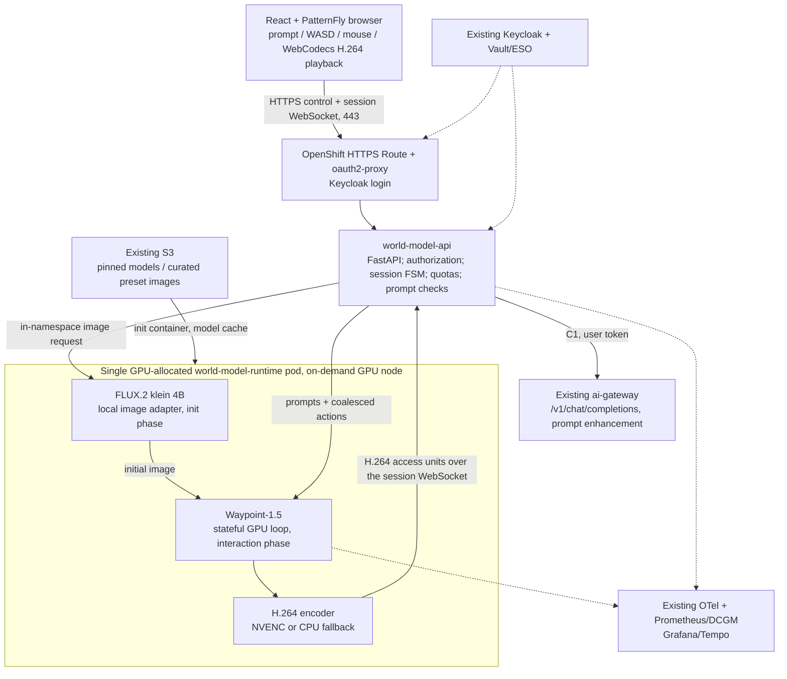

# ADR-0604: Introduce an interactive generative world-model experience on OpenShift AI and NVIDIA Blackwell

- **Status:** Accepted
- **Target:** v0.16
- **Date:** 2026-11-07
- **Decision owners:** Zuno Demo architecture team
- **Repository:** [startxfr/zuno-demo](https://github.com/startxfr/zuno-demo)
- **Repository path:** `docs/adr/0604-introduce-an-interactive-generative-world-model-experience.md`
- **Work packages:** WP-228 to WP-237 ([implementation roadmap](../roadmap/implementation-roadmap.md), Phase 51)
- **Scope:** one interactive demonstration experience, one NVIDIA RTX PRO 6000 Blackwell Server Edition GPU (96 GB) on a node that exists only while the demo is enabled, existing Zuno platform services
- **Related:** [ADR-0012](0012-use-keycloak-as-the-central-identity-provider.md), [ADR-0019](0019-use-openshift-ai-model-serving-for-local-inference.md), [ADR-0021](0021-route-models-according-to-c1-c2-c3-classification.md), [ADR-0024](0024-use-vault-for-application-secrets.md), [ADR-0029](0029-instrument-model-usage-costs-and-distributed-traces.md), [ADR-0030](0030-use-a-command-dispatch-makefile-interface.md), [ADR-0035](0035-prevent-restricted-internal-context-from-reaching-external-models.md), [ADR-0053](0053-make-make-check-an-end-to-end-acceptance-and-security-gate.md), [ADR-0060](0060-restructure-day-0-day-1-day-2-day-3-deployment-sequencing.md), [ADR-0312](0312-route-operator-installs-through-argocd-applications.md), [ADR-0333](0333-separate-product-managed-ai-infrastructure-from-zuno-build-run-and-shared-platform-namespaces.md), [ADR-0351](0351-share-rtx-pro-6000-gpus-via-nvidia-mig-with-scale-from-zero-burst-capacity.md), [ADR-0414](0414-consolidate-zuno-ai-run-into-three-tiered-mig-predictors.md), [ADR-0415](0415-consume-stable-diffusion-xl-via-ovhcloud-ai-endpoints.md), [ADR-0522](0522-enable-openshift-ai-monitoring-stack-side-by-side.md), [ADR-0559](0559-follow-the-cluster-version-and-never-branch-by-ocp-version.md), [ADR-0560](0560-keep-the-ai-gateway-as-the-policy-router-in-front-of-unifai.md), [ADR-0587](0587-admit-additional-user-experiences-over-the-one-governed-backend.md), [ADR-0592](0592-declare-experience-clients-in-the-agents-release-apart-from-agents.md), [ADR-0593](0593-key-the-per-user-quota-and-telemetry-by-persona-across-experiences.md), [ADR-0601](0601-inject-client-credentials-tokens-for-experience-clients-without-oidc-passthrough.md), [ADR-0605](0605-gate-every-live-demo-on-a-golden-path-check-and-a-freeze-window.md), [ADR-0606](0606-admit-new-experiences-with-a-definition-of-done-and-a-wip-limit.md)

> **Decision summary:** Add a browser-based, locally served, prompt-and-action-conditioned world-model demonstration to Zuno Demo. Start with **Overworld Waypoint-1.5-1B** for frame generation and **FLUX.2 [klein] 4B** for initial scene creation, executed **sequentially inside the same GPU-allocated inference pod**. Reuse the installed OpenShift, OpenShift AI, Keycloak, GitOps/Ansible, secrets, and observability foundations. Build a small stateful world-session runtime plus an **H.264-over-WebSocket media path** (browser WebCodecs decoder, through the existing HTTPS Route), **on one unpartitioned 96 GB GPU in a dedicated node that is provisioned only while the demo is enabled** (`zuno_world_model_enabled`, off by default). Consider WebRTC, MIG and a custom KServe runtime **only after** real latency, encoder compatibility, licensing, and workload-interference tests. No performance figure or sophisticated prompt transformation is considered proven until tested on this exact GPU.

> **Amendment note (2026-11-07, before any implementation):** this record was committed as a second "ADR-0602" (a380cc77), colliding with [ADR-0602](0602-harden-the-platform-trust-boundaries-before-a-customer-runs-it.md) (trust-boundary hardening). It is renumbered **ADR-0604**, targeted at v0.16 (the v0.15 band closes before the GPU acceptance can run; the 2026-11-09 demo shows the world model as roadmap, not live), and amended in place, since no clause had been implemented, with the user's decisions of the same day: D3 (FLUX is called inside the namespace, the ai-gateway `local-image` provider moves to phase 2), D4 (WebSocket + H.264/WebCodecs instead of WebRTC/MediaMTX for v1), D5 (a dedicated on-demand GPU node, its own taint, and a boolean switch), new D8 (LLM prompt enhancement through the ai-gateway), D2/D3 again after reading the checkpoint (Waypoint-1.5 takes no text, so a mid-session prompt is a FLUX edit spliced with `append_frame`) and §7/§9/§11 (the real Make commands, the gates and the canonical WP-228 to WP-237). Later changes of direction follow the normal superseding-ADR rule.

## 1. Context and business objective

Zuno Demo already provides a substantial OpenShift AI demonstration platform: GPU Operator and NFD, OpenShift AI, shared inference/model services, a governed `ai-gateway` in front of MaaS for conventional language/image inference, Keycloak identity, Vault/External Secrets, GitOps/Ansible/Make, Service Mesh, and Grafana/Perses/OpenTelemetry/Tempo monitoring. It also serves multiple end-user experiences, not just the UnifAI agent interface (ADR-0587).

The next use case must show a visually compelling **generative world model** through a web browser, using one NVIDIA RTX PRO 6000 Blackwell Server Edition GPU with 96 GB VRAM. A visitor should be able to:

1. Type a prompt describing a scene (e.g., “a snowy medieval village at dusk”).
2. See an initial image quickly, then enter the generated environment.
3. Move with **WASD / arrow keys and mouse** while the model generates corresponding successive frames.
4. Submit a **new prompt without leaving the session** (e.g., “the sky turns red and a volcano erupts”) and observe a visual response.
5. Understand, from on-screen indicators, whether the world is generating, reconditioning, or recovering.
6. Inspect the serving GPU, model, FPS, latency and platform monitoring in a secondary technical view.

This is **not** a requirement to create a persistent, metrically accurate 3D scene graph, physically exact digital twin, or multi-user shared simulation. The first version is an **interactive generative video world** with approximate temporal coherence. Its visual result can drift, hallucinate geometry, and fail to obey some requested transformations. These limitations must be demonstrated honestly.

### 1.1 Originating architectural proposal

The initial proposal selected NVIDIA Cosmos-1.0 Autoregressive 13B, FP8 quantization, a hypothetical 2 × 48 GB MIG split, KServe predictor backed by vLLM/TensorRT-LLM, a long-lived KV cache, FastAPI or Rust, WebSocket/gRPC, hardware NVENC, WebRTC, and Knative/Service Mesh. Its key assumptions were that a 13B model would fit on 48 GB and thus deliver continuous interactive video, and that each 48 GB MIG slice would provide NVENC.

The review rejects these **as starting assumptions**: fitting weights in VRAM does not prove real-time, controllable generation; general-purpose LLM serving engines do not inherently implement action-conditioned video; and standard MIG 2g.48gb has **no NVENC** on this GPU. Hardware video encoding needs an explicit capability test or a compatible media-engine MIG profile. See §4 and §9.

### 1.2 Existing Zuno constraints discovered in the repository

- ADR-0351 and ADR-0414 already allocate the two established RTX PRO 6000 GPU nodes to existing chat/embedding predictors using `all-balanced` MIG (`2 × 1g.24gb + 1 × 2g.48gb` on each). **Do not repurpose or repartition these nodes for this demo without a separate capacity decision.**
- A separate MIG-disabled scale-from-zero GPU training/burst pool is described in ADR-0351. It may be used for *scheduled qualification only* if reserved and otherwise idle; it is not a guaranteed, always-on world-demo capacity pool.
- ADR-0587 requires a new user experience to reuse the trusted identity and governed platform instead of standing up another independent LLM/RAG/agent stack. ADR-0560 preserves the `ai-gateway` as the policy router, with MaaS behind it for eligible models.
- ADR-0415 already adds an image-generation API (`/v1/images/generations`) in the `ai-gateway`, currently with an external-provider path. This is a **reusable contract**, but local FLUX support must be implemented and policy-checked; the current OVHcloud image backend must not silently be used as a substitute for local-only world creation.
- ADR-0587 defines user-experience namespaces as default-deny and **outside the mesh**. The world-model experience follows this admission model; the cluster's existing mesh remains in place and unchanged.
- ADR-0559 forbids OpenShift-version-specific Git branches. The integration must follow current cluster/operator discovery and pinned application dependencies, not fork the repository by OpenShift release.
- GPU MachineSets come from `gitops/charts/machines` through the Ansible-applied Application `zuno-machines-d0`, which ignores `/spec/replicas` after creation: a pool is switched on and off by **creating and deleting its MachineSet**, not by changing a replica count in Git. The AAP installer credential deliberately has **no Machine API rights** (`gitops/charts/aap-config/templates/clusterrole-installer.yaml`), so node provisioning is a locally run Day-0 action.
- The GPU Operator driver DaemonSet is `OnDelete` with `driver.upgradePolicy.autoUpgrade: true` (read live on demo333, 2026-11-07). Adding a toleration to the ClusterPolicy (`ansible/roles/nvidia_gpu/tasks/install.yml`) is therefore treated as a change that may restart the driver node by node on the MIG fleet, and runs in an announced maintenance window.
- The `zuno-demo` repository is licensed **GPL-3.0**, the same licence as Overworld's `world_engine` code (§3 D2, legal gate).

## 2. Decision drivers

| Priority | Driver | Implication |
|---|---|---|
| P0 | Browser demo that is genuinely interactive | State must persist per world session; actions and prompt changes affect future frames |
| P0 | One Blackwell 96 GB GPU | Benchmark on the real GPU; initially use full GPU and one active session |
| P0 | Reuse Zuno platform | Extend existing GitOps, IAM, secrets and observability; no parallel infrastructure stack |
| P0 | Protect existing Zuno AI workloads | Explicit capacity reservation; no eviction or silent MIG repartition |
| P0 | Sovereignty and controlled exposure | Local model execution; policy-gated prompts; no direct internet model inference |
| P1 | High visual impact | Good initial-scene quality, responsive input, visible prompt transformation |
| P1 | Reproducible demo | Deterministic preset scenes, warm-up, reset, preflight and health gates |
| P1 | Maintainable open-source implementation | Pin and review all dependencies and licences, keep the renderer replaceable |
| P2 | Industrializable RHOAI integration | KServe serving can follow once streaming runtime and GPU scheduling are validated |
| P2 | Multi-user concurrency and MIG economics | Deferred until functional and performance baseline succeeds |

## 3. Decision

### D1 — Implement a new governed **experience client**, not a new agent platform

The browser application is a distinct experience named `world-model` with its own Keycloak client and namespace `zuno-world-model` (proposed), reusing the Zuno experience-client admission model. It is **not** an OKF/UnifAI agent, a new SaaS model provider, or a replacement for the ai-gateway. It uses existing shared platform services but owns its specific generation session state and its media stream.

- Login via the existing `zuno` Keycloak realm through an oauth2-proxy front door (the kagent/dify pattern); preserve the user's identity and use validated token claims for quotas and audit. No hardcoded browser-side tokens. Access is limited to a dedicated group `zuno-world-model-users` plus `ocp-ai-ops` and `ocp-paas-ops`: a presenter drives, the audience watches.
- Declare the `world-model` client in the **separate signed experience-client artifact** only if it actually needs MCP tools or a declared task (ADR-0592, ADR-0596); do not fabricate a UnifAI agent or give it default access to corporate knowledge.
- Reuse the ai-gateway **for ordinary OpenAI-compatible model calls**: the prompt enhancement and safety check of D8, with the user's own token passed through.
- The stateful world engine is a **narrow, documented exception to ADR-0587's general “every model call to ai-gateway” convention**: action-conditioned frame generation is not a stateless OpenAI-compatible completion and is not to be forced through MaaS. The world gateway enforces the same identity/classification boundary and meters this **specialized video modality** itself. The exception does **not** allow direct external model providers or bypass of Keycloak.
- This ADR extends (but does not supersede) ADR-0587 and ADR-0560. A later platform decision would be needed to centralize all video-model governance in the ai-gateway.

### D2 — Use **Waypoint-1.5-1B** as the baseline interactive engine

Implement a versioned `WorldEngineAdapter` around [Overworld `world_engine`](https://github.com/Overworldai/world_engine), with checkpoint [`Overworld/Waypoint-1.5-1B`](https://huggingface.co/Overworld/Waypoint-1.5-1B). The upstream interface supports action/controller input, appending an image (`append_frame`) and emitting conditioned frames. **The Waypoint-1.5 checkpoints are not text-conditioned**: their `config.yaml` sets `prompt_conditioning: null`, so the engine loads no text encoder and `set_prompt()` raises (`world_engine` `src/world_engine.py`, commit 68b31639, checked 2026-11-07). Text reaches the world only through images (D3).

- One long-lived inference process owns **one active world session** in the initial release. Keep prompt, previous frames/model context, action queue and session metadata in memory; use in-memory session state only while the pod is alive.
- The actual temporal memory and implementation-specific KV/state cache are managed by the model adapter, not hardcoded as a 12–18 GB “LLM Paged KV Cache” requirement.
- Use upstream-supported quantization backends **only after comparison with the reference precision**, measuring both temporal stability and actual FPS/VRAM. Evaluate NVFP4/FP8 as supported by the installed build; no FP8-memory or quality guarantee is assumed.
- Pin model checkpoint **revision/digest**, Python dependencies, container image digest and tested CUDA/PyTorch stack. Do not build at runtime from moving `main` or `latest`.
- **Legal gate:** the Waypoint model checkpoint is labelled Apache-2.0, but the upstream `world_engine` code repository carries **GPL-3.0**. The `zuno-demo` repository is itself GPL-3.0 and public, and the runtime image stays in the cluster's internal registry, so the adapter code is GPL-compatible by construction; the remaining gate is the licence of the H.264 encoder library actually bundled (§8.9). Keep the engine behind a process/API boundary; this is an engineering separation, not legal exemption.

- **Not selected: Waypoint-1.1-Small**, the text-conditioned predecessor (native `set_prompt`, vendor figure about 35 FPS on this GPU): its autoencoder `OpenWorldLabs/owl_vae_f16_c16_distill_v0_nogan` is licensed CC-BY-NC-SA-4.0, non-commercial, which a customer-facing demo cannot rely on, and it needs the 15 GB UMT5-XL encoder shipped as pickle `.bin` files. User decision 2026-11-07.

**Gate:** if the model does not meet the minimum interactive quality/latency envelope, do not compensate by inventing synthetic FPS or playing a pre-rendered “live” video. Qualify EdenLive 5B as the alternative (§5).

### D3 — Use **FLUX.2 [klein] 4B** to initialize the visual scene

Add a local image-generation step using **FLUX.2 [klein] 4B**, selected for image quality, low resource footprint and Apache-2.0 licensing. In v1, `world-model-api` calls the FLUX adapter **inside its own namespace**, on the runtime pod's internal image endpoint; it never calls FLUX from the browser and never falls through to OVHcloud. The API enforces the same boundary the gateway would: C1 only, local only, owner-bound, metered.

- **Why not through the ai-gateway in v1:** the existing image path (`components/ai-gateway/app/image_providers.py`) only knows the OVHcloud provider and can fall back to it for C1/C2, and the FLUX backend exists only while the demo is enabled. Wiring an always-on central gateway to a provider that comes and goes adds failure modes for every other experience. A `kind: local-image` provider with a strict local-only mode stays the target for phase 2 (after WP-237), once a second consumer needs local images.
- Initial prompt → (D8 enhancement) → local image generation → image validation/normalization → Waypoint `append_frame`/initialization → continuous interactive rendering. The three curated presets ship pre-generated initial images (generated once on the target GPU and stored in S3) so a preset starts without a FLUX call.
- Return stored references/metadata, not base64 frames in chat logs or tracing spans.
- **Single-GPU scheduling contract:** the initial implementation runs the FLUX adapter and the Waypoint engine in **one GPU-allocated runtime pod/container**, under one `nvidia.com/gpu: 1` reservation. It must not deploy a separate FLUX pod also requesting `nvidia.com/gpu: 1`, because two exclusive GPU requests would not fit on one card.
- Initial **full-GPU** PoC executes FLUX initialization before the long-lived Waypoint loop; it may load/unload FLUX to guarantee predictable headroom. A second simultaneous image-generation request is rejected/queued while a world session is active. Keeping both models resident is an **optimization hypothesis**, not a baseline commitment.
- **A mid-session prompt is a world edit** (user decision 2026-11-07): FLUX.2 klein edits the current frame with the (enhanced) prompt, and the edited image is spliced into the session with `append_frame`, after which Waypoint continues from it with its context intact. The session shows `RECONDITIONING` for the edit (target 1 to 2 seconds) and the splice is a visible transition, not presented as a seamless evolution. Continuity across the splice is measured at G7; if it breaks the scene, the fallback is an explicit reseed from the edited image.

### D4 — Deliver an asynchronous session-oriented browser experience

Use **React + PatternFly** to match Zuno's frontend conventions; **FastAPI** for the control plane; a dedicated `world-model-runtime` container for GPU inference **and** video encoding; and an **H.264-over-WebSocket media path** decoded in the browser by **WebCodecs**. Transport roles are deliberately distinct:

- HTTPS/REST: create/reset world, create/close session, initial prompt and metadata.
- WebSocket (one per session, through the existing HTTPS Route on 443): upstream, ordered, bounded action commands and events (key presses, relative mouse movements, prompt change notifications); downstream, state events and the H.264 Annex-B access units (no B-frames, a keyframe on connect and on a short GOP). A browser may sample controls at 30 Hz or more, but the renderer must **coalesce** inputs and apply the last valid state at each model inference step; 30-Hz inputs are *not* a 30-FPS guarantee.
- Internal bounded queue/stream: `world-model-api` relays the session WebSocket to the runtime's internal WebSocket; **gRPC streaming is optional** if the internal WebSocket meets measured needs. Do not introduce Rust solely for theoretical speed.
- Media: generated frames → encoder (NVENC through PyNvVideoCodec on the full GPU, or a bounded CPU x264 fallback, chosen by a startup capability probe) → WebSocket → browser `VideoDecoder` → canvas. Do not assume that PyNvVideoCodec, FFmpeg and NVENC work in every container/MIG setting; the probe result is reported in the technical view.
- **Why not WebRTC in v1:** an OpenShift Route does not carry UDP, so WebRTC would need a new public AWS load balancer for the ICE port, a TURN relay, its credentials and a firewall review, for a demo that also has to cross venue and corporate networks. TCP 443 reaches every presenter network the platform already serves. The cost is head-of-line blocking under packet loss, measured by gate G5. WebRTC (MediaMTX, coturn) stays a phase-2 option if the measured latency is not good enough.
- Keep media traffic and stateful inference off the generic stateless `ai-gateway` chat path.

### D5 — Start with **one unpartitioned GPU** and preserve existing MIG capacity

The baseline requires **one exclusive, unpartitioned** RTX PRO 6000 Blackwell GPU advertised by `nvidia.com/gpu: 1` for the world engine, image initializer and hardware media encoding. Physical capacity is one GPU card, not two 48 GB MIG slices.

1. **A dedicated, on-demand GPU node.** A third GPU MachineSet, `zuno-gpu-world-model-a` (AWS `g7e.4xlarge`: 16 vCPU, 128 GiB, one 96 GB RTX PRO 6000; availability zone `a`; `nvidia.com/mig.config: all-disabled`; node label `zuno.io/gpu-workload: world-model`; group `gpu-world-model`; taint `zuno.io/gpu-world-model=true:NoSchedule`), **exists only while the demo is enabled**. It is rendered by a separate Application, `zuno-machines-world-model-d0`, from the same `gitops/charts/machines` chart, with no MachineAutoscaler and without the cluster-autoscaler singleton, so the GPU fleet's own Application is never re-applied to switch the demo. Deleting that Application deletes the MachineSet, its Machine and the EC2 instance. The two MIG nodes and the training burst pool are not touched.
2. **One switch.** `zuno_world_model_enabled` (boolean, default `false`, in `ansible/clusters/<cluster>.yml`; a local run may override it from `ansible/confidential.yml`) is the desired state of both the node and the application. The Day-0 component `world-model-gpu` (run locally, because only the operator's own credentials may create a MachineSet) and the Day-2 component `world-model` both **converge to it**: `install` with the switch on creates, `install` with the switch off removes what is left, so `make d0 install all` and `make d2 install all` cost nothing while the demo is off. The Day-2 install fails fast when the switch is on but the GPU node is absent; the Day-0 uninstall refuses while the application is still installed.
3. **Exclusivity.** Only the world-model runtime selects `zuno.io/gpu-workload: world-model` and tolerates `zuno.io/gpu-world-model`; the GPU Operator's DaemonSets get that toleration once (`ansible/roles/nvidia_gpu/tasks/install.yml`) in an announced maintenance window (§1.2). The `zuno-world-model` namespace carries a `requests.nvidia.com/gpu: "1"` quota.
4. **Cost guard.** A PrometheusRule alerts when a world-model Machine has existed for more than 8 hours, so a forgotten node is noticed. Nothing in the cluster deletes Machines by itself: that would require Machine API rights the platform deliberately keeps out of in-cluster credentials.
5. Compare full-GPU occupancy, SM utilization, VRAM, model cold-start and actual encoder throughput before exploring MIG. Repartitioning an in-use node is a disruptive **separate approval**.
6. An optional **2 × `2g.48gb`** experiment is valid only if (a) model performance remains acceptable with half the compute and (b) the encoder runs using an available media resource, CPU fallback, or a separately qualified profile. The plain `2g.48gb` profile exposes **zero NVENC engines** on this GPU; `2g.48gb+me.all` exposes NVENC but is only available **once** according to NVIDIA's profile table. A symmetrical pair of 48 GB media-enabled slices is **not** an accepted target.
7. MIG splits GPU memory and compute, **not hardware availability**; two slices on one card are no HA solution.

### D6 — Reuse OpenShift AI, but **do not make KServe/Knative a prerequisite**

- Day 0/1: reuse the installed GPU Operator, NFD, OpenShift AI, Keycloak, secrets and observability infrastructure. Verify Blackwell driver/CUDA/codec compatibility against the **actual** node image and operator channel.
- Day 2 initial runtime: use a plain `Deployment` (`strategy: Recreate`, because a rolling update cannot surge a second pod under a one-GPU quota) with an explicitly selected GPU node and a model cache filled from S3 by an init container into node-local storage (the node is ephemeral, so a zonal PVC brings nothing), plus `Service`, NetworkPolicies, Secret mounts, ServiceMonitor/OpenTelemetry where applicable.
- Consider **KServe custom ServingRuntime with RawDeployment** in a later integration track if its lifecycle and network behavior support this **stateful streaming** workload without unnecessary proxying, session loss or autoscaling. Model registry and model storage can be reused without asserting that generic vLLM/TensorRT-LLM supports Waypoint.
- Keep Knative scale-to-zero, KEDA, and a new Service Mesh control plane **out of scope**. The existing cluster mesh stays installed, but the browser experience namespace follows ADR-0587's outside-mesh policy unless a separately documented change is justified.
- Avoid auto-scaling or multiple world-engine replicas while sessions are stateful and the demo has one GPU; an HPA that adds GPU pods would merely create Pending workloads.

### D7 — Add deterministic operational and demonstrator gates

Use the existing Make → Ansible → Argo CD deployment workflow and observability stack. A “wow effect” must be reproducible and measurable, not dependent on invisible presenter intervention. Provide three well-tested scene presets (a logistics warehouse, a city at night, a snowy village that turns volcanic), preflight and reset controls, a technical metrics view, clear “generative AI / not an exact 3D simulation” disclosure, and a prerecorded **explicitly labelled fallback** only for event resilience (never presented as live inference).

All work that does not need the GPU is done and verified without it: a CPU `MockEngine` and `MockFlux` behind the same adapter interfaces drive the session, encoder, browser and policy tests locally. The GPU node is switched on twice before the event: a short smoke test once the runtime image exists (model, VRAM, encoder, and the provision/deprovision cycle itself), then the final acceptance and rehearsal.

### D8 — Enhance and screen prompts through the ai-gateway

A free-text prompt (initial scene or mid-session change) first passes local checks in `world-model-api` (length ceiling, deny list, C1 forced), then a short chat completion through the existing ai-gateway (`/v1/chat/completions`, `X-Zuno-Data-Classification: C1`, `X-Zuno-Local-Only: true`, the user's own token passed through, so a local model such as `gpt-oss-20b` answers). The model returns a JSON verdict: allowed or refused, and a rewritten prompt suited to FLUX and Waypoint. If the gateway is unavailable, the API keeps the locally filtered prompt and the UI says enhancement is off. The local checks never degrade. This is an ordinary OpenAI-compatible call and therefore stays on the governed path (ADR-0560, ADR-0587). It needs no task declared in the agents release: a call that names no known agent is routed by its classification and local-only flag alone (`components/ai-gateway/app/main.py` `chat_completions`; ADR-0596 task aliases apply only to the fail-closed clients), so the client is not declared under ADR-0592 unless it later needs MCP tools.

### D9 — Re-anchor the scene against drift (amendment 2026-11-09, after the first live use)

Measured on the GPU node (a bench driving the runtime with fixed controls, same seed): Waypoint-1.5 stays on its scene while the player stands still (35 s, intact) and loses it within about 10 s of walking: the picture turns into close-up wall, grass and cloth texture, then a repeating pattern. More denoising steps (3, 6, 7 or 8 against the shipped 4, which the model is distilled for) do not help, and the autoencoder is not the cause (`gen_frame` feeds the latent back to the KV cache; TAEHV only decodes for display). Laplacian-variance "sharpness" is a misleading metric here (hallucinated texture scores sharp): the verdict is read on frames.

Decision: the runtime **re-anchors** the world every `WORLD_MODEL_ANCHOR_SECONDS` (chart default 2) of *movement*, never while idle: FLUX.2 klein redraws the current frame from the scene prompt (the text the first image came from, plus the newest world edit) and `append_frame` splices it back. The frame is handed to FLUX at the autoencoder's native 1024x512 (`WORLD_MODEL_ANCHOR_EDIT_SIZE`): about 0.64 s of frozen picture per anchor instead of 1.17 s at 720p, shown to the visitor as "Stabilizing the world"; the camera jumps slightly because FLUX redraws the view.

The prompt, measured in a closed loop with Waypoint (42 s human-like walks, raw mode, several seeds): Waypoint itself hallucinates first-person hands, weapons and HUD icons while walking (it is trained on game footage) and FLUX keeps them. "first-person view" in the prompt makes this worse (hands on 6 of 6 frames) and the "restore detail", "same lighting as the input", "wide street view" and negation ("no hands") wordings either keep the collapsed texture or leave the hands. What works: the scene text without any "first-person" cue, plus a camera cue naming no character ("a camera at eye level moving through the scene, only the environment"), plus an explicit removal instruction ("Remove any hands, arms, weapons and interface elements."). With it, 0 of 48 sampled frames showed a hand or a weapon (2 s and 3 s, three seeds each); without the last sentence the hands came back as snow-covered lumps. At 2 s no sampled frame had collapsed into a wall close-up, at 3 s one had. A world created from an uploaded image alone has no text and is never anchored. Counter: `zuno_world_anchor_total{result}`.

Still visible: a bumpy grain on lit wooden walls seen at close range (Waypoint's own texture, a median filter only softens it a little), and the redraw may change the lighting toward deeper dusk.

`WORLD_MODEL_AE_RAW` (chart default true) also skips world_engine's bilinear 720p to 512x1024 to 720p round trip: the engine is fed 1024x512 and its output is upscaled bicubic on the GPU. Same step time, visibly sharper first frames.

Not solved: a real fix is a model that holds a scene while moving (EdenLive 5B, §5, remains the qualified alternative); the anchor is a mitigation, and a long walk still ends in a different place than it started.

## 4. Architecture and boundaries



**Trust boundaries:** The internet-facing browser reaches only the one Route, behind oauth2-proxy. It cannot access model GPU pods, S3 credentials, `ai-gateway` internals, or the OpenShift API. Keycloak and secrets remain platform-owned. No UDP, load balancer or TURN relay is exposed in v1.

### 4.1 Component ownership and reuse

| Component | Reuse or new? | Responsibility | Proposed placement |
|---|---|---|---|
| OCP / GPU Operator / NFD | Existing + one toleration | Node GPU capability and GPU scheduling | Platform-managed namespaces |
| `zuno-gpu-world-model-a` MachineSet | **New, on demand** | The one full GPU, present only while `zuno_world_model_enabled` | `openshift-machine-api`, Application `zuno-machines-world-model-d0` |
| RHOAI 3.5 / storage / KServe | Existing, optional serving adapter | AI infrastructure, model assets, later custom runtime | Existing product namespaces |
| Keycloak realm `zuno` | Existing + client + group | SSO and group authorization | Existing Keycloak |
| Vault / External Secrets | Existing + secrets | OIDC client, S3 read access | Existing secret pipeline |
| `ai-gateway` | Existing, **unchanged code** | Prompt enhancement and screening (D8); the local image provider is phase 2 | Existing gateway |
| `world-model-web` | **New** | React + PatternFly UI served by FastAPI: REST/WS API, sessions, identity, quotas, prompt checks, media relay | `zuno-world-model` |
| `world-model-runtime` | **New** | One GPU reservation; local FLUX initialization **and** stateful Waypoint generation in sequential phases; H.264 encoding | `zuno-world-model` (GPU node) |
| Grafana/OTel/Tempo/DCGM | Existing + instrumentation | Latency/FPS/VRAM, model and user-experience metrics; Perses copy in phase 2 | Existing stacks |
| Mesh | Existing, **no new mesh for PoC** | Unchanged for other Zuno components | Existing mesh namespaces |
| UnifAI / MCP / RAG / MaaS | Existing, **not on video frame path** | Optional ordinary governed model/tool calls only | Existing platform services |

### 4.2 Runtime boundary and scaling model

One active world session owns one model loop and one GPU allocation. The FastAPI service may handle multiple authenticated HTTP sessions but **only one active video-generation lease** in v1. Excess session requests return a visible queue/busy response, not concurrent GPU overload. On pod restart the world state is lost and the UI must show `session_lost` with an explicit reset action. Persist presets and session metadata if needed; do **not** promise restoration of the model's exact hidden temporal state.

### 4.3 Session state machine

```text
NEW -> PREPARING_IMAGE -> WARMING_ENGINE -> READY -> STREAMING
                                                |        |
                                                |        +-> RECONDITIONING -> STREAMING
                                                |        +-> PAUSED -> STREAMING
                                                |        +-> DEGRADED -> RECOVERING -> STREAMING or FAILED
                                                +-> FAILED
STREAMING/PAUSED/FAILED -> CLOSED
```

A prompt update increments `prompt_version` and is applied **between generation steps**. Report `requested`, `applied`, and `visibly_observed` separately. Only the first two are deterministic system events; visual obedience is an evaluated model outcome, not something an API can guarantee.

## 5. Model choices and alternatives

| Candidate | Decision | Reason |
|---|---|---|
| **Waypoint-1.5-1B** | **Selected baseline** | Purpose-built action-conditioned interactive frame generation at 720p; MIT autoencoder; no text conditioning, so prompts act through FLUX edits (D3) |
| Waypoint-1.1-Small | Not selected | Text-conditioned, but its autoencoder is CC-BY-NC-SA-4.0 (non-commercial) and it needs UMT5-XL (D2) |
| **FLUX.2 [klein] 4B** | **Selected initializer and editor** | Fast local text-to-image and image editing (the mid-session world edit), Apache-2.0 model license |
| **EdenLive 5B** | **Qualified fallback / phase-2 experiment** | Attractive visual re-renderer with engine-managed world state; requires assessing a separate upstream world/control engine and significant GPU/runtime dependencies |
| Matrix-Game 4 | Not selected for baseline | Useful interaction patterns, but more constrained world presets and integration fit |
| Hy-Nomas | Research only | Text-conditioned world-change promise, but single-GPU interactive performance is not established for this hardware |
| Cosmos-1.0 AR 13B | **Rejected for this use case** | Model and serving assumptions do not establish responsive browser navigation; too much engineering risk for a first demo |
| Cosmos 3 | Future research track | Promising interactive/physical simulation; reported high FPS on other NVIDIA hardware cannot be transferred to this card |
| vLLM / TensorRT-LLM | Not mandated for video | Do not substitute a generic LLM runtime for a supported world-model engine |
| Two `2g.48gb` MIG partitions | **Deferred experiment** | Less compute per engine and plain profiles lack NVENC; not the default architecture |

**Proof obligation:** before code is considered accepted, capture a real GPU run showing checkpoint revision, model precision/quantization, resolution, measured frame cadence, total GPU memory, NVENC availability, and user-perceived action-to-photon latency. An isolated “model FPS” benchmark is insufficient.

## 6. Interfaces and data contracts (v0.1 proposal)

The interface contracts below are implementation requirements, **not claims that these endpoints already exist**. They are intentionally transport-independent on the GPU side.

### 6.1 Control-plane endpoints

| Method / route | Function | Key requirements |
|---|---|---|
| `POST /api/worlds` | Create a world from a prompt or preset | Authenticated; `prompt`, optional `preset_id`, `classification`; return `world_id` and processing status |
| `POST /api/worlds/{world_id}/sessions` | Acquire GPU session | Return `session_id`, state and lease expiry; 409/429 if GPU busy or quota exceeded |
| `GET /api/sessions/{session_id}` | Session status and metrics | Only the owner or authorized operator can read |
| `POST /api/sessions/{session_id}/prompts` | Change prompt in place | Validate payload; return monotonic `prompt_version` and `accepted` state |
| `POST /api/sessions/{session_id}/reset` | Reinitialize from chosen seed | Explicit reset/restart; no accidental hidden reset |
| `WS /api/sessions/{session_id}/stream` | Send actions; receive state events and H.264 video | Bound to the authorized session and approved origin; ordered sequence IDs; last-value input coalescing; heartbeat; bounded backpressure (drop to the next keyframe rather than queue) |
| `DELETE /api/sessions/{session_id}` | Release GPU lease | Idempotent release and media teardown |

Example (non-wire-binding design sketch):

```json
{
  "session_id": "<opaque-session-id>",
  "seq": 174,
  "type": "control",
  "keys_down": ["KeyW", "ShiftLeft"],
  "mouse_delta": {"x": 0.22, "y": -0.08},
  "client_ts_ms": 1720000000000
}
```

Do not accept arbitrary GPU kernel settings, raw file paths, arbitrary model URLs or per-user infrastructure overrides from the browser. Map browser controls to supported upstream `CtrlInput` actions **server-side**; the upstream keycode standard is not a browser `KeyboardEvent` schema.

### 6.2 Local image-generation contract

In v1 the runtime pod exposes an internal, non-routed `POST /internal/image` (prompt, seed, size) on its cluster Service, reachable only from `world-model-api` by NetworkPolicy. The API validates the returned image, keeps it in memory for the session and hands it to Waypoint. There is no external fallback: if FLUX fails, the world is not created and the UI says so. Phase 2 may put the same backend behind the ai-gateway's `POST /v1/images/generations` as a `kind: local-image` provider with a strict local-only mode (D3).

### 6.3 Prompts, latency and continuity

- **Initial generation:** FLUX creates the first visual reference; then Waypoint takes control of succeeding frames.
- **Incremental conditioning:** a prompt change produces one FLUX edit of the current frame, spliced with `append_frame`; an accepted prompt does not guarantee a literal object transformation, and the edit is reported as `requested`, `applied` (frame spliced) and `visibly_observed` (scored).
- **Coherence:** prior frames/context remain in the engine during a session; an optional explicit reseed is user-visible.
- **Frame cadence:** do not equate 30-Hz controls with 30 rendered FPS. Waypoint-1.5's upstream implementation can return **four frames per generation step**; schedule and telemetry must measure *displayed frames* and *inference step timing* separately.
- **Streaming:** H.264 (constrained baseline or main profile, no B-frames) over the session WebSocket, decoded by WebCodecs `VideoDecoder` in Chrome/Edge (the presenter browser); AV1 is out of scope. If NVENC is unavailable, the bounded CPU x264 fallback is used and its quality/performance costs are reported. Waypoint's upstream context is 512 frames (about 10 s), so the demo script uses short navigation segments and explicit resets rather than promising long continuity.

## 7. Integration in the current `zuno-demo` repository

The following change set uses the repository's existing chart/ArgoCD/role conventions rather than adding a second installer.

```text
components/
  world-model-runtime/   # One GPU container: FLUX + WorldEngineAdapter (Waypoint | Mock), encoder (NVENC | x264), internal API
  world-model-web/       # FastAPI (REST/WS, sessions, identity, prompt checks, media relay) + React/PatternFly UI
platform/
  world-model/
    README.md            # runtime contract, switch, model checksums
    models.lock.yaml     # pinned HF repos, revisions, files, sha256 (mirrored to S3)
    config/presets.yaml  # three curated scenes (non-sensitive)
    tests/gpu-smoke-job.yaml  # GPU smoke/benchmark Job (JSON report)
  gpu/README.md          # document capacity/codec/MIG gates
gitops/
  charts/world-model/    # runtime + web Deployments, front door, Route, NetworkPolicies, ServiceMonitors
  apps/world-model/application-d1.yaml
  apps/machines-world-model/application-d0.yaml  # on-demand GPU MachineSet, same chart as the fleet
  charts/namespaces/     # declare zuno-world-model and its GPU quota
  charts/grafana/templates/dashboard-world-model.yaml
ansible/
  roles/world_model_gpu/   # Day 0, local: create/delete the GPU pool to match the switch
  roles/world_model/       # Day 2: install/precheck/uninstall to match the switch
  roles/world_model_build/ # in-cluster builds of the two images
docs/
  adr/0604-introduce-an-interactive-generative-world-model-experience.md
  architecture/world-model.md
  demo/world-model.md    # presenter runbook, preflight, reset, scenario
  testing/world-model-gpu-smoke-<date>.md, world-model-acceptance-<date>.md
```

### 7.1 Deployment stages and commands

- **Day 0:** the on-demand GPU pool (`world-model-gpu`), run locally; namespace and quota; keep manual credentials in `ansible/confidential.yml`/Vault only. Do **not** create a separate world-model-specific secret management system.
- **Day 1:** reuse installed NFD, GPU Operator, OpenShift AI and observability; one added toleration on the GPU Operator DaemonSets. No new Service Mesh or Knative operator.
- **Day 2:** build/sign first-party images following the existing supply-chain policy; deploy the world-model chart through Argo CD; warm/cache models and validate the hardware video path.
- **Day 3 / demo:** session, browser, security, performance, cleanup and reproducibility evidence; the presenter runbook.

```bash
# enable (switch on in ansible/clusters/<cluster>.yml, committed: AAP reads the SCM)
make d0 install world-model-gpu     # node Ready, mig.config=all-disabled, nvidia.com/gpu=1
make d2 build world-model           # only when the images change
make d2 install world-model
make d2 check world-model           # preflight: node, models, warm-up, encoder, auth, gateway
# disable
make d2 uninstall world-model
make d0 uninstall world-model-gpu   # Machine and EC2 instance deleted
```

Reset is a presenter control in the UI (and the API's operator endpoint); a full restart is `make d2 install world-model` after a runtime rollout. No new top-level Make targets are introduced.

### 7.2 Resource placement and configuration

**Full-GPU baseline** (illustrative `Deployment` fragment; not a complete resource):

```yaml
spec:
  strategy:
    type: Recreate
  template:
    spec:
      nodeSelector:
        zuno.io/gpu-workload: world-model  # set by the zuno-gpu-world-model-a MachineSet
      tolerations:
        - key: zuno.io/gpu-world-model
          operator: Exists
          effect: NoSchedule
      containers:
        - name: world-model-runtime
          env:
            - name: NVIDIA_DRIVER_CAPABILITIES
              value: compute,utility,video   # NVENC
          resources:
            requests:
              cpu: "6"
              memory: 48Gi
            limits:
              nvidia.com/gpu: "1"
```

CPU/memory requests above are **starting test values**, not qualified sizing (a `g7e.4xlarge` leaves about 15 allocatable vCPU). Quotas and node allocatable CPU/RAM must be verified, not assumed from VRAM alone.

**Optional, non-default MIG resource** after a separate test/approval:

```yaml
resources:
  limits:
    nvidia.com/mig-2g.48gb: "1"
```

The latter assumes NVIDIA device-plugin **mixed** MIG strategy and the unmodified plain profile. It does **not** imply NVENC availability or legal capacity to preempt an existing model. A `+me.all` profile requires its own discovered resource mapping and validation; never silently reuse `nvidia.com/mig-2g.48gb` for it.

## 8. Security, isolation and data handling

1. **Authentication:** reuse Keycloak `zuno`; opaque browser session / validated bearer token as appropriate. The backend—not user headers—derives identity, group rights, persona and allowed classification (ADRs 0012/0033/0593).
2. **Access:** world demo initially allows **C1/public synthetic prompts and presets only**. C2/C3 can be a future extension if all modalities remain local and their policy handling is audited. Never forward a C2/C3 image, text or session data to the existing OVHcloud image provider.
3. **Quota:** one GPU session at a time, session timeout, prompt/action input limits, start/stop limits, explicit 429/503 and resource cleanup; meter world **seconds, generated frames and GPU occupancy**, not fictitious LLM tokens. If classification or entitlement fails, **fail closed**.
4. **Network:** namespace default-deny; UI/API exposure through the one Route behind oauth2-proxy; only targeted egress to the ai-gateway, Keycloak, observability and (runtime init container) the S3 model bucket; model runtime and S3 endpoints are not externally exposed. No UDP, load balancer or TURN relay in v1; a phase-2 WebRTC path needs its own network review.
5. **Secrets:** Vault/ESO for the OIDC client and S3 read access; short-lived user tokens and no credential logging. Model weights are mirrored to S3 beforehand, so no Hugging Face token reaches the cluster, the browser or an image.
6. **Containers:** `restricted-v2` SCC, non-root, read-only root file system where supported, dropped capabilities, image pinning/signing and SBOM/vulnerability scanning. GPU driver/container runtime compatibility may need documented security exceptions; never silently grant `privileged` to the whole application.
7. **Content:** curated safe prompts, prompt-length limits, basic content moderation, no real customers or nominative user data in presets, privacy-preserving logs. User-provided assets are out of scope initially.
8. **Persistence:** do not persist frame/video payloads by default. Keep short-lived session metadata and optional explicitly enabled demo recordings with retention and owner authorization. Do not send frames as OTel span attributes or put payloads into normal application logs.
9. **Licences:** verify the *model checkpoints*, *world-engine code* and *video encoder library* separately. Apache-2.0 model weights do not make GPL-3.0 runtime code Apache-2.0; the repository being GPL-3.0 settles the engine code, not the encoder bundled in the image.
10. **No implicit mesh requirement:** follow ADR-0587's outside-mesh experience policy for the PoC; preserve existing mesh for other Zuno apps. Any later mTLS insertion must be measured against long-lived WebSocket semantics.

## 9. GPU, codecs and feasibility gates

| Gate | Verification | Accept or stop condition |
|---|---|---|
| G0 — Node capacity | `oc get nodes`, allocatable GPUs/CPU/RAM, workload requests, taints, quota, running model placement | Real full-GPU slot is reserved without displacing existing workloads |
| G1 — Hardware | `nvidia-smi -L`, CUDA/PyTorch GPU test, current driver/GPU Operator support | Exact RTX PRO 6000 GPU usable from restricted OpenShift container |
| G2 — Waypoint | Run pinned checkpoint and reference script; track real VRAM/step time and coherence | Stable interactive frame generation on this GPU |
| G3 — FLUX | Local generator starts, creates a reference image, transfers it to engine | Initialization works without SaaS or browser-to-GPU access |
| G4 — Encoder | `nvidia-smi` media/codec availability, FFmpeg/PyNVCodec test **in the selected GPU or MIG profile** | Hardware path works **or** CPU encoding meets measured quality/latency |
| G5 — Media path | Remote browser (Chrome/Edge) on the presenter network: session WebSocket through the Route, WebCodecs H.264 decode, frame drops and latency under real network conditions | Real cross-network playback over 443; if p95 latency misses the target, WebRTC becomes a phase-2 decision, not a silent switch |
| G6 — Governance | Keycloak, NetworkPolicy, default-deny, C1-only, local-only, user quotas | Bypass requests denied and logged; no external model endpoint used |
| G7 — Show | End-to-end FPS/p95 input-to-photon and prompt-change tests | Accepted demo objectives and repeatable scripted scenario |

**NVIDIA capability correction:** the RTX PRO 6000 Blackwell Server Edition's normal `MIG 2g.48gb` profile exposes **zero NVENC**; `MIG 2g.48gb+me.all` has media access but supports only one such instance, according to NVIDIA's documented MIG-profile table. The initial “2 x 48 GB each with NVENC” proposal is therefore **rejected**, independently of VRAM sizing.

### 9.1 Proposed acceptance objectives (not vendor guarantees)

| Dimension | Preferred target | Minimum go/no-go approach |
|---|---|---|
| Browser rendering | 720p at ≥24 *displayed* FPS | Log real displayed FPS and stutters; a lower rate requires explicit demo-scope acceptance |
| Interaction latency | p95 action-to-visible-response <250 ms | Measure on representative external client; separate input/network/inference/encode/decode |
| Prompt change | Effect visible within ~5 seconds for curated prompts | Measure acceptance/first changed frame separately; manually score semantic obedience |
| Continuity | 2 minutes of navigable scene without catastrophic visual rupture | Repeat with ≥3 predetermined seeds and paths |
| Stability | 10-minute event session without OOM/crash | Record GPU memory high-water mark and reset behavior |
| Concurrency | One active GPU world session | Second visitor gets explicit busy/queue, never unbounded GPU overlap |
| Security | No unauthorized external model traffic | Egress test and classification test; forced failure is a pass |
| Reproducibility | Three curated demo scenes | Preflight, warm-up, reset and presenter runbook work without source edits |

Acceptance thresholds are **architectural goals**; the implementation must report actual results, including failures. Do not claim measured RTX PRO 6000 numbers from H100, RTX 5090, B200 or GB300 benchmarks.

### 9.2 Prompts and scene tests

1. **Create:** “Snow-covered medieval village at dusk, cinematic first-person view.” Check generated scene and clear starting frame.
2. **Navigate:** press forward, turn right, look upward, stop. Check action responsiveness and whether large structures persist coherently.
3. **Recondition:** “The sky turns red and a volcano erupts beyond the village.” Check the FLUX edit of the current frame, the splice time, and whether navigation continues coherently from the edited frame; separately judge spatial/semantic fidelity.
4. **Reset:** return to a pinned starting image and baseline prompt. Confirm cleanup of frame history and media session.
5. **Failure:** make engine unavailable. UI must report degraded/failed state rather than freezing an apparently live frame.

The volcano example is a **desired outcome, not a guaranteed model capability**. If Waypoint cannot perform a persuasive in-place transformation, test the alternate EdenLive pipeline or explicitly reset/reseed with a new image; never misrepresent a fresh scene as continuous world evolution.

## 10. Observability, operational SLOs and Day-3 evidence

Reuse the existing `zuno-monitoring` application stack and RHOAI's installed GPU/AI monitoring. Publish low-cardinality Prometheus metrics and OpenTelemetry spans with one stable run/correlation ID; **do not label metrics with raw session IDs or user prompts**.

Suggested metrics (new names, implementation pending):

```text
zuno_world_active_sessions
zuno_world_frame_generated_total{model,precision}
zuno_world_frames_dropped_total{reason}
zuno_world_engine_step_seconds_bucket{model}
zuno_world_action_to_display_seconds_bucket{client_type}
zuno_world_prompt_apply_seconds_bucket{result}
zuno_world_session_duration_seconds_bucket{result}
zuno_world_stream_disconnect_total{reason}
zuno_world_busy_rejected_total
zuno_world_reset_total{reason}
```

DCGM provides device-level VRAM/utilization metrics; record CUDA memory allocation and peak memory from the runtime as well. Keep client-reported displayed FPS and E2E latency separate from inference-side FPS. Trace `world.create`, `image.generate`, `session.acquire`, `engine.gen_frames`, `video.encode`, `prompt.apply`, and `session.close`, with the already established `zuno.run_id` context where possible. Create a **World Model** dashboard view in the existing Grafana/Perses landscape, not a third observability stack.

Operational guardrails: GPU lease timeout; media heartbeat; bounded queues; readiness only once models and video path are warmed; a liveness policy that does **not** kill the pod merely because generation is temporarily slow; cleanup of orphan sessions; operator-visible reset/prewarm controls. Use a real GPU preflight that reports readiness before a public demonstration.

## 11. Delivery work packages and dependencies

The canonical work packages are tracked in the [implementation roadmap](../roadmap/implementation-roadmap.md) (Phase 51). Only WP-232 and WP-237 need the GPU node; every other package is built and verified without it.

| WP | Work package | Deliverables | Dependency / exit gate | GPU |
|---|---|---|---|---|
| **WP-228** | ADR-0604 and tracking | Renumbering, amendments, index, change log, briefs | none | no |
| **WP-229** | On-demand GPU pool | `world-model-gpu` Day-0 role and Application, GPU Operator toleration (maintenance window), namespace and quota, switch, cost alert | WP-228; **G0** | no (window only) |
| **WP-230** | Model weights mirror | Waypoint, its dependencies and FLUX.2 klein in S3, pinned in `platform/world-model/models.lock.yaml` | WP-228 | no |
| **WP-231** | GPU runtime image | `components/world-model-runtime` (Waypoint/Mock, FLUX/Mock, NVENC/x264), smoke Job, build role, mock tests | WP-230 | no |
| **WP-232** | GPU smoke test | One short enable/disable cycle: driver, CUDA, Waypoint FPS/VRAM per quantization, NVENC, FLUX, preset images | WP-229, WP-231; **G1–G4** | **yes, ~3 h** |
| **WP-233** | Experience client | Keycloak client and group, ai-gateway client registration, ADR-0596 task check, agents declaration if needed | WP-228; **G6** | no |
| **WP-234** | Web/API and UI | `components/world-model-web`: REST/WS, FSM, lease, prompt checks + D8, media relay, React/PatternFly WebCodecs UI, local e2e | WP-231, WP-233 | no |
| **WP-235** | GitOps integration | `gitops/charts/world-model`, Application, Day-2 role converging to the switch, Makefile/AAP/CI registration | WP-229, WP-234 | no |
| **WP-236** | Observability and demo kit | Grafana dashboard, three presets, presenter runbook, architecture note | WP-235 | no |
| **WP-237** | Final acceptance and rehearsal | Full enable/disable cycle, G0–G7 and §9.1 measurements, negative security tests, labelled fallback recordings | WP-232, WP-236; **G7** | **yes, ~1 day** |

Phase 2, each a separate decision after WP-237: WebRTC media, the ai-gateway `local-image` provider, MIG, EdenLive, KServe RawDeployment, a Perses copy of the dashboard, `make d3 test world-model` automation, concurrent sessions.

### 11.1 Implementation order / critical path

```text
WP-228 ADR + tracking
   |
   +--> WP-233 experience client (Keycloak client + group, ai-gateway label)
   +--> WP-229 on-demand GPU pool (+ toleration window)
   +--> WP-230 weights to S3 --> WP-231 runtime image
                                        |
                  WP-229 + WP-231 --> WP-232 GPU smoke test (go/no-go)
                                        |
             WP-231 + WP-233 --> WP-234 web/API/UI --> WP-235 GitOps --> WP-236 dashboard + demo kit
                                                                              |
                                                     WP-232 + WP-236 --> WP-237 final acceptance (GPU)
```

**Do not spend the initial sprint implementing KServe, FP8 conversions, Service Mesh changes or a second GPU partition before the baseline browser-to-world latency is proven.**

## 12. Consequences

### Positive

- A visually distinctive interactive world-model scenario that complements Zuno's existing governed agents and MaaS model demos.
- Maximum reuse of deployed OpenShift, Keycloak, AI infrastructure, security, storage, GitOps and observability foundations.
- Explicit interfaces enable replacing Waypoint with a different engine without rebuilding the browser, identity or operations plane.
- Model weight and GPU-performance risk is isolated early in a hardware spike, rather than being hidden behind a large platform implementation.
- Honest and observable differentiation between a *video world model* and a true deterministic simulated game world.

### Costs and drawbacks

- A world-model runtime, its video encoder path and an interactive frontend are **new application code**; RHOAI/KServe does not supply them out of the box.
- A GPU node that comes and goes takes 8 to 10 minutes to boot and build its driver, plus the model cache fill: the demo is enabled well ahead of use, and a forgotten node costs money until someone disables it (the 8-hour alert only reports it).
- A dedicated/reserved full GPU may add infrastructure cost; the current MIG nodes are already serving Zuno models.
- Stateful sessions limit multi-user scaling and make exact post-failure continuity impractical in v1.
- Open-source model/runtime licensing and CUDA/codec container compatibility require explicit review.
- Prompt-driven transformation can be visually unreliable; preset scenes and an alternate renderer may be required to achieve the intended show quality.
- The custom video path is a **governance exception** that must have its own quotas/telemetry and may be revisited if the Zuno ai-gateway evolves to support video streaming natively.

## 13. Explicit non-goals and deferred decisions

- Do not replace UnifAI, the ai-gateway, MaaS or the existing model fleet.
- Do not reprofile the two occupied production-style MIG nodes, autoscale stateful video pods, or claim hardware HA from MIG.
- Do not require OpenShift Serverless/Knative, KEDA, a separate mesh or new observability products.
- Do not promise accurate 3D topology, physics, persistent worlds or multi-user shared state.
- Do not treat prompt edits as guaranteed scene edits; these need image/model-specific acceptance tests.
- Do not add live fine-tuning, RL, training jobs or LLM-backed world validation to the first demo.
- Do not make model or prompt data public or send it to unapproved SaaS providers.
- Defer WebRTC media, the ai-gateway local image provider, KServe custom-runtime adoption, alternative EdenLive integration, NVFP4/FP8 optimization beyond the smoke-test comparison, MIG partitioning, and multiple concurrent sessions until measured baseline evidence exists.
- Do not keep the GPU node running while the demo is off, and do not give any in-cluster credential the right to create or delete Machines.

## 14. Decision checkpoints and reopen conditions

Revisit this ADR through a **new superseding ADR**, not by silently changing an implemented decision, if any of these holds:

1. Waypoint fails the agreed minimum FPS/latency/coherence score on RTX PRO 6000.
2. In-place prompt transformations are not convincing enough for the intended public demo.
3. Code/model licensing or NVIDIA codec access prevents the selected packaging.
4. No exclusive full-GPU reservation can be guaranteed without disrupting existing Zuno services.
5. OpenShift AI or the ai-gateway introduces a supported stateful video-model-serving interface that removes the need for the specialized dataplane.
6. Demo concurrency requirements exceed a single GPU session, requiring a revised GPU topology, explicit queues or more GPUs.

## 15. Implementation Definition of Done

The ADR is considered **implemented** only after the following evidence is stored under `docs/testing/` or in the repository's existing validation artifacts:

- [ ] The on-demand GPU node is created by enabling the switch and deleted (Machine and EC2 instance gone) by disabling it, without changing the existing MIG inference fleet.
- [ ] Driver/CUDA and media-engine or CPU-encoder path are verified on that exact node.
- [ ] Waypoint checkpoint and runtime are pinned; GPL-3.0 implications are reviewed.
- [ ] Local FLUX runs in **the same GPU runtime pod**, called only from `world-model-api`, with no second exclusive GPU allocation and no external fallback.
- [ ] One Keycloak-authenticated browser visitor can create a world, navigate, re-prompt (with D8 enhancement, and with it switched off) and reset it.
- [ ] The H.264-over-WebSocket media path works from the intended presenter network through the Route.
- [ ] The GPU/runtime, browser, session and prompt metrics are visible in existing dashboards.
- [ ] Default-deny, quota, token, local-only and session-ownership tests pass.
- [ ] Make/Ansible/ArgoCD can deploy and remove the feature repeatably and report health.
- [ ] Curated three-scene live-demo script works, with a clear fallback and documented limitations.
- [ ] Actual (not vendor-transposed) FPS, p95 latency, VRAM and image-to-world warm-up data are recorded.
- [ ] ADR-0606 definition of done: the world-model golden-path probe (ADR-0605 clause 1: sign in as the presenter, create a world from a preset, receive decoded frames, apply one world edit, close the session) passes on the target cluster; the rollback (switch off: `make d2 uninstall world-model`, then `make d0 uninstall world-model-gpu`) is written in the runbook and tested once; the demo step and its limits are in `docs/demo/`; `world-model` is in the ai-gateway's `experienceClients`.

## 16. References and verification notes (2026-11-07)

### Verified in `startxfr/zuno-demo`

- [Repository README](https://github.com/startxfr/zuno-demo/blob/main/README.md) — platform baseline and repository conventions.
- [ADR-0351 — GPU MIG / burst](https://github.com/startxfr/zuno-demo/blob/main/docs/adr/0351-share-rtx-pro-6000-gpus-via-nvidia-mig-with-scale-from-zero-burst-capacity.md) — current GPU scheduling and capacity constraints.
- [ADR-0414 — current MIG model allocation](https://github.com/startxfr/zuno-demo/blob/main/docs/adr/0414-consolidate-zuno-ai-run-into-three-tiered-mig-predictors.md) — updated workload distribution.
- [ADR-0415 — existing image generation](https://github.com/startxfr/zuno-demo/blob/main/docs/adr/0415-consume-stable-diffusion-xl-via-ovhcloud-ai-endpoints.md) — `ai-gateway` image-generation interface.
- [ADR-0587 — governed experience clients](https://github.com/startxfr/zuno-demo/blob/main/docs/adr/0587-admit-additional-user-experiences-over-the-one-governed-backend.md) — identity, local model access and isolation rules.
- [ADR-0592 — signed experience-client declarations](https://github.com/startxfr/zuno-demo/blob/main/docs/adr/0592-declare-experience-clients-in-the-agents-release-apart-from-agents.md).
- [ADR-0601 — token proxy for clients without OIDC passthrough](https://github.com/startxfr/zuno-demo/blob/main/docs/adr/0601-inject-client-credentials-tokens-for-experience-clients-without-oidc-passthrough.md).
- [Current Makefile](https://github.com/startxfr/zuno-demo/blob/main/Makefile) — actual Day-0/1/2/3 dispatcher.

### Model and hardware sources

- [Overworld `world_engine` API](https://github.com/Overworldai/world_engine) — `WorldEngine`, `set_prompt`, `gen_frame`, initial-frame injection, action controls and quantization variants.
- [Waypoint-1.5-1B model card](https://huggingface.co/Overworld/Waypoint-1.5-1B) — model purpose, licence, limitations.
- [Overworld `world_engine` GPL-3.0 licence](https://github.com/Overworldai/world_engine/blob/main/LICENSE) — separate from the model-weight licence.
- [Black Forest Labs FLUX.2 [klein] 4B](https://bfl.ai/models/flux-2-klein) and [official inference implementation](https://github.com/black-forest-labs/flux2) — Apache-2.0 4B variant and local image generation.
- [NVIDIA supported MIG profiles — RTX PRO 6000 Blackwell](https://docs.nvidia.com/datacenter/tesla/mig-user-guide/supported-mig-profiles.html) — exact per-profile NVENC resources and instance limits.
- [NVIDIA GPU Operator MIG config](https://github.com/NVIDIA/gpu-operator/blob/main/assets/state-mig-manager/0400_configmap.yaml) — named profiles including `all-balanced` and `all-2g.48gb`.
- [EdenLive official project](https://github.com/VAST-AI-Research/EdenLive) — proposed alternative neural renderer; published RTX 5090 figures are not RTX PRO 6000 measurements.
- [Red Hat OpenShift AI 3.5 model-serving documentation](https://docs.redhat.com/en/documentation/red_hat_openshift_ai_self-managed/3.5/html/deploying_models/deploying_models) — custom model-serving runtime concepts.

### Evidence still required

No live benchmark of the selected Waypoint/FLUX/encoder combination on the target Zuno RTX PRO 6000 GPU was available during this architecture review (vendor figure for Waypoint-1.5-1B: 56 FPS at 720p on an RTX 5090, not transferable). Current repository files demonstrate design/implementation history, **not** the current live health or schedulability of every target cluster. Operator release compatibility, actual GPU capacity and legal distribution requirements must be rechecked at implementation time.
