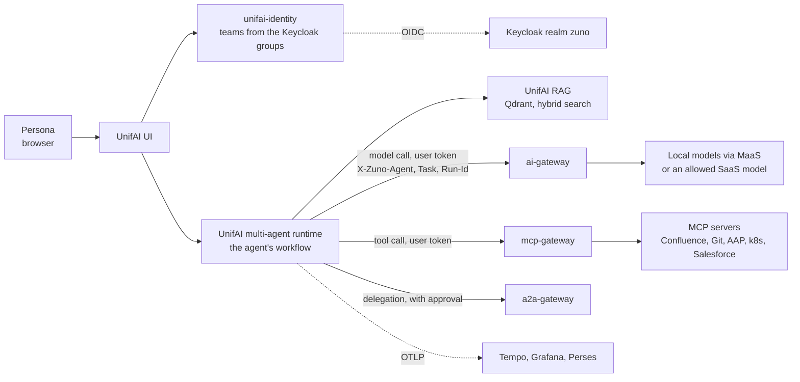
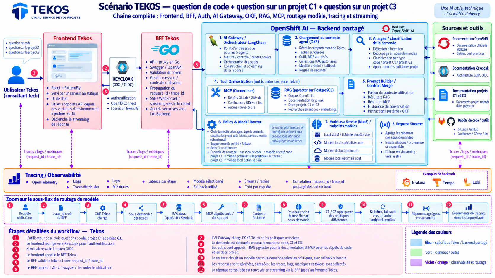
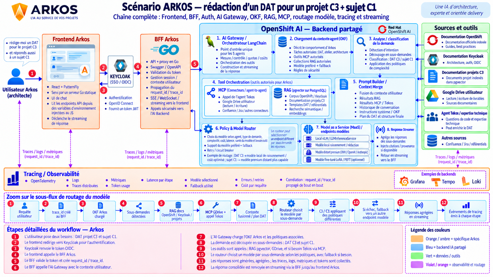
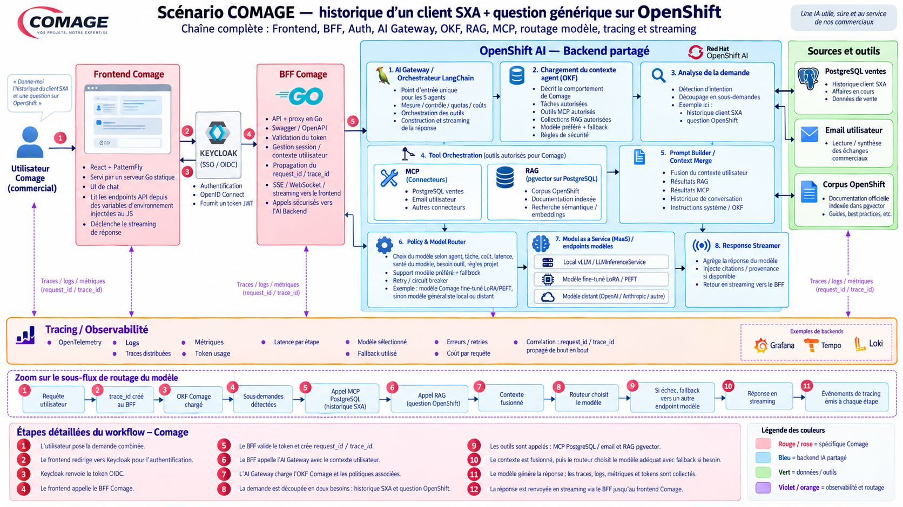

# Agent Request Workflow

Last reviewed: 2026-11-19

How a user request reaches an agent and comes back as an answer. This page is the reader's view; the step-by-step sequences with every
participant are in [sequence flows](../architecture/sequence-flows.md) ("A Tekos turn through UnifAI", "An approved A2A delegation") and the
components in [agent platform architecture](../architecture/agent-platform-architecture.md). The per-agent pages are
[Tekos](tekos.md), [Arkos](arkos.md), [Comage](comage.md) and the others in the [catalogue](README.md).

## The path of one request

1. **Sign in.** The user signs in with Keycloak. UnifAI computes the workspaces the person sees from the groups in the token; the
   `agent_<name>` group decides which agents are reachable ([identity architecture](../architecture/identity-architecture.md)).
2. **The agent.** Its prompts, tasks, tools and data level come from the signed release of `zuno-demo-agents`, admitted by digest
   ([agents release integration](../platform/agents-release-integration.md)); the workflow runs in the UnifAI multi-agent runtime.
3. **Knowledge.** Retrieval goes to the UnifAI RAG service (Qdrant, hybrid search) with a fail-closed filter on the caller's groups.
4. **Model.** Every model call goes to the ai-gateway with the user's own token. The gateway sets the data classification (it can only
   be raised), picks a local or SaaS model by class and readiness, applies guardrails and charges the persona's budget
   ([gateways architecture](../architecture/gateways-architecture.md)).
5. **Tools.** Every tool call goes to the mcp-gateway, which shows and allows only the tools of the caller's groups.
6. **Delegation.** An agent may delegate one hop to another through the a2a-gateway; a write the target asks for goes to the user as an
   approval card ([scenario](../demo/scenarios/governance/a2a-delegation-approval.md)).
7. **Trace.** Each step carries a run id; one turn can be followed from UnifAI through the gateways in Tempo
   ([observability trace](../demo/scenarios/foundation/observability-trace.md)).

## Three example requests

- **Tekos, a technical question with sources.** The consultant asks a code question and a question on two projects in one message. Tekos
  searches the technical documentation and the project spaces it is allowed to read and answers with citations.
- **Arkos, a Design & Architecture Testimonial.** An architect asks for a DAT for a project plus an unrelated question. Arkos reads the
  documentation, Confluence and the Git repositories, may ask Tekos one read-only technical question, and runs on local models only for code
  (its classification floor is C3).
- **Comage, a sales question.** A salesperson asks for the history of a client together with a generic platform question. Comage answers
  from indexed and live Salesforce data and from the platform documentation.

## Using an agent correctly

- What an agent can answer or do is bounded by its signed definition: its tasks, its tools and its knowledge domains. A question outside that
  scope is not answered, even if the underlying model could.
- One message can carry several needs; the workflow splits them and the gateway may route each to a different model.
- A fallback to another model is expected behaviour, not an error; it is visible in the trace (`zuno.run_id`).

## Before UnifAI

Until WP-156 (2026-10-23) each agent had its own frontend and BFF and shared an Agent Runtime. The three diagrams below show that
earlier path for the same three requests and are kept as history only; do not use them to operate the platform.

