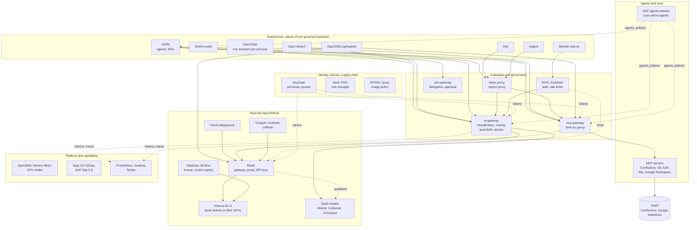

# Architecture Documentation

The high-level design below is the platform map used by every demo scenario (Appendix A of each page), without a highlighted
brick. Plain arrows carry requests, dotted arrows carry identity, policy or telemetry. Each page of this section drills into
one slice of the map. It replaces the earlier hand-drawn image, which predated UnifAI, the experiences and the OKF release chain. The other hand-drawn low-level images are replaced by Mermaid in the domain pages.

Last reviewed: 2026-11-18, against ADR-0001 to ADR-0623. The diagrams are copied from, and kept in step with, the
[demo scenarios](../demo/README.md); where a page and a scenario disagree, the chart or code named in the scenario's
Appendix B is the source.

## Views

- [functional-architecture.md](functional-architecture.md) - personas, experiences, agents and what they may read.
- [logical-architecture.md](logical-architecture.md) - the request path and the shared platform services.
- [physical-architecture.md](physical-architecture.md) - OpenShift namespaces, node pools and deployment boundaries.
- [security-architecture.md](security-architecture.md) - trust boundaries, secrets, policy and data classification.
- [identity-architecture.md](identity-architecture.md) - Keycloak realm, personas, groups and identity propagation.
- [network-architecture.md](network-architecture.md) - mesh, routes, gateways, NetworkPolicies and controlled egress.
- [data-architecture.md](data-architecture.md) - business data, vector stores, memory and backups.
- [ai-architecture.md](ai-architecture.md) - OpenShift AI, MaaS, model serving and evaluation.
- [sequence-flows.md](sequence-flows.md) - representative runtime sequences.
- [world-model.md](world-model.md) - the on-demand interactive generative world-model experience (ADR-0604).
- [aap-hld.md](aap-hld.md) - Ansible Automation Platform design.

Domain pages:

- [agent-platform-architecture.md](agent-platform-architecture.md) - UnifAI, the OKF agents release and the A2A gateway.
- [experiences-architecture.md](experiences-architecture.md) - the clients of the one governed backend.
- [gateways-architecture.md](gateways-architecture.md) - ai-gateway, mcp-gateway, MaaS and the alternative gateways.
- [mlops-architecture.md](mlops-architecture.md) - pipelines, MLflow, Kueue, model registry and LoRA.
- [supply-chain-architecture.md](supply-chain-architecture.md) - signing, Quay, the release ledger and admission.
- [observability-architecture.md](observability-architecture.md) - metrics, traces and dashboards.
- [operations-architecture.md](operations-architecture.md) - GitOps, AAP Day 0-3 and the demo lifecycle.
