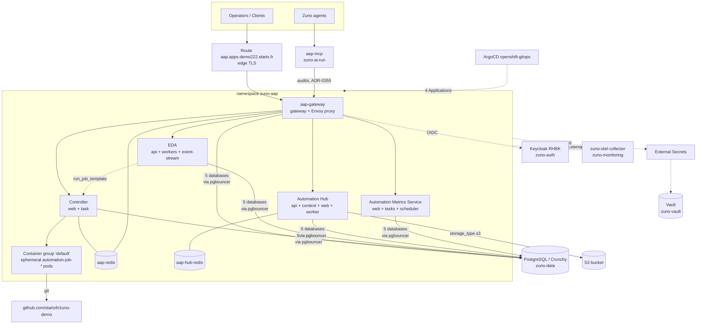

# AAP High Level Design

Ansible Automation Platform 2.7 runs as a Day 1 component (ADR-0354) and is the
execution and audit surface for every Day 0 → Day 3 operation (ADR-0418). This
document describes the deployed topology on `demo222` and the platform services
AAP depends on.

## Topology

## Components

| Layer | Deployed objects |
| --- | --- |
| Entry | Route `aap.apps.demo222.startx.fr`, `edge`/Redirect, single service `aap` |
| Gateway | `aap-gateway` — gateway + `gateway-proxy` (Envoy); registers 5 service clusters: gateway, controller, hub, eda, metrics |
| Controller | `aap-controller-web` (3 containers), `aap-controller-task` (task + ee + rsyslog + redis); version 4.8.6 |
| Execution | Instance group `controlplane` (capacity 1277) and container group `default` — each job runs as a throw-away `automation-job-<id>-<x>` pod in `zuno-aap` |
| EDA | `aap-eda-api`, `aap-eda-activation-worker`, `aap-eda-default-worker`, `aap-eda-event-stream` |
| Hub | `aap-hub-api`, `-content`, `-web`, `-worker`, `aap-hub-redis`; `storage_type: s3` |
| Metrics | `aap-automationmetricsservice-web`, `-tasks`, `-scheduler`; database `externally_managed`, read-only AWX user |
| Cache | `aap-redis-0`, `redis_mode: standalone` |

All operands are single-replica by design — this is a demonstration cluster, not
an HA deployment (ADR-0354, non-HA sizing).

## Dependencies

| Dependency | Where | What breaks without it |
| --- | --- | --- |
| PostgreSQL (Crunchy PGO) | `zuno-data`, via pgbouncer | 5 separate databases — gateway, controller, eda, hub, metrics. Nothing starts. |
| Vault + External Secrets | `zuno-vault` | 10 `ExternalSecrets` in `zuno-aap` materialise every DB credential, the admin password and the S3 keys. Already-materialised Secrets survive a sealed Vault, so breakage is silent until the next refresh. |
| Keycloak (RHBK) | `zuno-auth` | The gateway's `Keycloak zuno` authenticator. The `Local Database` authenticator remains as a fallback, so admin access survives a Keycloak outage. |
| S3 | external | Hub content storage (`object_storage_s3_secret`). |
| ArgoCD | `openshift-gitops` | `zuno-aap-d0`/`-d1` (operator, operand) and `zuno-aap-config-d0`/`-d1`. The `AnsibleAutomationPlatform` CR carries sync-wave `-15`. |
| Git | `github.com/startxfr/zuno-demo@main` | Controller project `zuno-demo` → 18 job templates covering Day 0 to Day 3. |
| `aap-mcp` | `zuno-ai-run` | Exposes AAP audit history to the agents (ADR-0355). It is the only namespace the `zuno-aap` NetworkPolicy admits on ingress. |

### Observability caveat

`zuno-aap` currently holds **no** `ServiceMonitor`, `PodMonitor` or
`OpenTelemetryCollector`. The Automation Metrics Service collects AAP's own
analytics into its externally-managed database, but AAP telemetry does not yet
reach `zuno-otel-collector` in `zuno-monitoring`. The link is drawn dashed above
because it is target state, not an active flow.

## References

- ADR-0354 — Add Ansible Automation Platform as a new Day 1 component
- ADR-0418 — Execute Day 0 and Day 1 operations as AAP job templates
- ADR-0421 — Reshape Day 0 / Day 1 boundaries around always-on infra
- ADR-0355 — Expose AAP audits to agents through an mcp-aap server

## 45-minute demonstration walkthrough

A single pass from infrastructure to function. Timings are cumulative minutes.

| Time | Segment | What to show |
| --- | --- | --- |
| 0–3 | Framing | Why AAP is here: before it, "who ran `make d1 install`, when, with what result" lived only in an operator's terminal scrollback (ADR-0354). AAP makes that a first-class, audited platform service. |
| 3–12 | Infrastructure | The HLD diagram above. `oc get aap,automationcontroller,eda,automationhub -n zuno-aap` → the operator pattern. The 4 ArgoCD Applications (everything is GitOps-declared). `oc get externalsecrets -n zuno-aap` → 10 secrets sourced from Vault. The 5 PostgreSQL databases. |
| 12–18 | Gateway | One route, one login, 5 services behind it: `curl .../api/gateway/v1/ping/` → `status: good`, `db_connected`, `proxy_connected`. The two authenticators — local fallback + Keycloak SSO. Log in as a persona, show RBAC. |
| 18–29 | Controller & execution | Project `zuno-demo` synced from git. The 18 job templates, Day 0 → Day 3. **Launch `zuno-day1-check` live.** In a second terminal `oc get pods -n zuno-aap -w` → the `automation-job-<id>-*` pod appears, runs, and vanishes. Stream the job output in the UI. This is the whole value proposition in one screen: git-defined automation, ephemeral isolated execution, permanent audit trail. |
| 29–37 | EDA | The event-driven model: decision environment, project, rulebook, activation. The activation running. **`curl` the webhook** → the event lands, the rule fires. Close the loop back to the controller. |
| 37–42 | Automation Hub | Collections and execution environments, content served from S3 (`storage_type: s3`) — the supply side that feeds the execution pods shown at 18–29. |
| 42–45 | Closing & Q&A | The Automation Metrics Service. `aap-mcp`: AAP's audit history exposed to the Zuno agents (ADR-0355) — automation history becomes queryable in natural language. |

### Presenter notes

- `zuno-postgresql-d0` shows **Progressing** in the ArgoCD console. It is
  cosmetic: an ArgoCD health check on a `Subscription` whose package vanished
  from the `:v5.0` catalog index while the installed operator keeps running.
  Avoid the ArgoCD console, or explain it deliberately.
- Job templates whose name ends in `check` are read-only and safe to run live.
  Do **not** launch `install`, `reconcile`, `release`, `restore` or
  `stresstest` in front of an audience.
- A Day-level check job takes several minutes. Launch it, then keep talking
  over the streaming output rather than waiting in silence.
