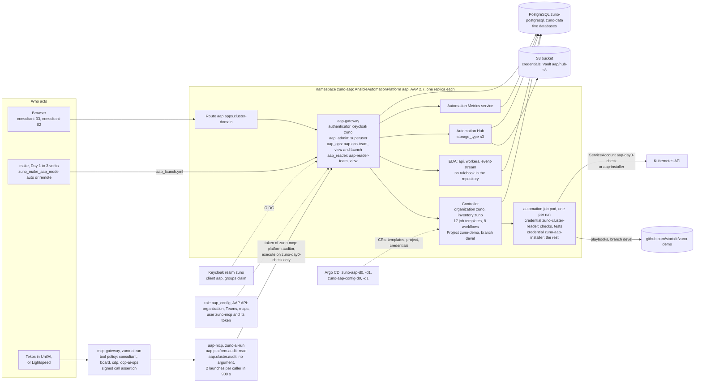

# AAP High Level Design

Last reviewed: 2026-11-19

Ansible Automation Platform 2.7 runs as a Day 0 component (ADR-0354 added it as Day 1; ADR-0421 moved it to Day 0 with
PostgreSQL and Keycloak) and is the execution and audit surface for the `make` operations of Day 0 to Day 3 (ADR-0418).
This document describes the topology declared by `gitops/charts/aap`, `gitops/charts/aap-config` and
`gitops/charts/mcp-aap` for the cluster `demo333`, the only cluster since `demo222` was retired on 2026-10-23 (ADR-0573), and the
platform services AAP depends on. The presenter's scenario is
[AAP audited operations](../demo/scenarios/foundation/aap-audited-operations.md); how `make` routes into AAP is in
[operations-architecture.md](operations-architecture.md).

## Topology

Three ways in (a person, `make`, an agent) and the identities each uses. `<cluster-domain>` stands for the cluster's apps
domain.

## Components

| Layer | Deployed objects |
| --- | --- |
| Entry | Route `aap.<cluster-domain>` (`route_host` in `gitops/charts/aap/templates/aap.yaml`), one service |
| Gateway | `aap-gateway`: authenticator `Keycloak zuno` (groups claim), plus the `Local Database` fallback |
| Controller | Organization `zuno`, inventory `zuno`, Project `zuno-demo` on the branch the cluster follows (`zuno_gitops_target_revision`, `devel` on demo333; the chart default is `main`) |
| Job templates | 17 `JobTemplate` and 8 `WorkflowTemplate` declared in `gitops/charts/aap-config/values.yaml`: the Day 0 check, the Day 1 and Day 2 check, build, install and reconcile (Day 2 has no reconcile template), the Day 3 test, stresstest, backup, restore, check, run, release and the node failover drill |
| Execution | One throw-away `automation-job` pod per run. Two credentials: `zuno-cluster-reader` (checks, tests; ServiceAccount `aap-day0-check`) and `zuno-aap-installer` (the rest; ServiceAccount `aap-installer`) |
| EDA | `aap-eda-api`, activation and default workers, event stream. No rulebook, decision environment or activation is declared in the repository |
| Hub | `aap-hub-api`, content, web, worker, own Redis; `storage_type: s3` |
| Metrics | Automation Metrics Service (web, tasks, scheduler); its database is externally managed |
| Agent access | `aap-mcp` in `zuno-ai-run`, tools `aap.platform.audit` (read) and `aap.cluster.audit` (launches one read-only job, 2 launches per caller in 900 s by default) |

All operands are single-replica by design: a demonstration cluster, not an HA deployment (ADR-0354, non-HA sizing).

## Dependencies

| Dependency | Where | What breaks without it |
| --- | --- | --- |
| PostgreSQL (Crunchy PGO) | `zuno-data`, via pgbouncer | Separate databases for gateway, controller, EDA, hub and metrics. Nothing starts. |
| Vault + External Secrets | `zuno-vault` | ExternalSecrets in `zuno-aap` (nine in the `aap` chart, one more in `aap-config` for the controller token) materialise the database credentials, the admin password, the S3 keys and the Red Hat subscription credentials. Already-materialised Secrets survive a sealed Vault, so breakage is silent until the next refresh. |
| Keycloak (RHBK) | `zuno-auth` | The gateway's `Keycloak zuno` authenticator. The `Local Database` authenticator remains, so admin access survives a Keycloak outage. Groups `aap_admin` (superuser), `aap_ops` (view and launch), `aap_reader` (view) decide who sees and launches what (WP-103). |
| S3 | external | Hub content storage. |
| ArgoCD | `openshift-gitops` | `zuno-aap-d0`/`-d1` (operator, operand), `zuno-aap-config-d0`/`-d1` (the Controller objects) and `zuno-mcp-aap-d0`/`-d1`. The `AnsibleAutomationPlatform` CR carries sync-wave `-15`. |
| Git | `github.com/startxfr/zuno-demo` | Project `zuno-demo`: the playbooks every job template runs. |
| `zuno-aap` NetworkPolicy | `gitops/charts/namespaces` | `zuno-ai-run` is the only namespace admitted on ingress (for `aap-mcp`); `aap-config` reaches the Controller API over the external Route. |

### Observability caveat

`gitops/charts/aap`, `aap-config` and `mcp-aap` hold no `ServiceMonitor`, `PodMonitor` or `OpenTelemetryCollector`. The
Automation Metrics Service collects AAP's own analytics into its externally managed database, but AAP telemetry does not
reach `zuno-otel-collector` in `zuno-monitoring` (see [observability-architecture.md](observability-architecture.md)).

## References

- ADR-0354 - Add Ansible Automation Platform as a new Day 1 component (Implemented)
- ADR-0418 - Execute Day 0 and Day 1 operations as AAP job templates (Implemented)
- ADR-0421 - Reshape Day 0 / Day 1 boundaries around always-on infra (Implemented)
- ADR-0355 - Expose AAP audits to agents through an mcp-aap server (Implemented)
- ADR-0573 - Pilot UnifAI on demo333 with Tekos before cutting demo222 over (Implemented)
- ADR-0409 - Human approval for delegated operations (Implemented)

## Demonstration walkthrough (45 minutes)

A single pass from infrastructure to function. Timings are cumulative minutes. The 5-minute and 15-minute versions that
the `make demo` lifecycle plays are in the scenario page.

| Time | Segment | What to show |
| --- | --- | --- |
| 0-3 | Framing | Why AAP is here: before it, "who ran `make d1 install`, when, with what result" lived only in an operator's terminal scrollback (ADR-0354). AAP makes that a first-class, audited platform service. |
| 3-12 | Infrastructure | The topology above. `oc get aap,automationcontroller,eda,automationhub -n zuno-aap`. The Argo CD Applications (everything is GitOps-declared). `oc get externalsecrets -n zuno-aap`. |
| 12-18 | Gateway | One route, one login, the services behind it. The two authenticators: local fallback and Keycloak SSO. Log in as a persona, show RBAC by group. |
| 18-29 | Controller and execution | Project `zuno-demo` synced from git. The job templates, Day 0 to Day 3. **Launch `zuno-day1-check` live.** In a second terminal `oc get pods -n zuno-aap -w`: the `automation-job-*` pod appears, runs and vanishes. Stream the job output in the UI. |
| 29-37 | EDA | EDA is deployed (API, workers, event stream) but no rulebook is declared in the repository: show it as available capacity, not as a live flow. |
| 37-42 | Automation Hub | Collections and execution environments, content served from S3 (`storage_type: s3`). |
| 42-45 | Closing and Q&A | The Automation Metrics Service. `aap-mcp`: AAP's audit history exposed to the Zuno agents (ADR-0355), queryable in natural language. |

### Presenter notes

- Job templates whose name ends in `check` are read-only and safe to run live. Do **not** launch `install`, `reconcile`,
  `build`, `release`, `restore`, `backup`, `run` or `stresstest` in front of an audience.
- A Day-level check job takes several minutes. Launch it, then keep talking over the streaming output.
- A launch requested by an agent through a delegation waits for the person's approval (ADR-0409).
