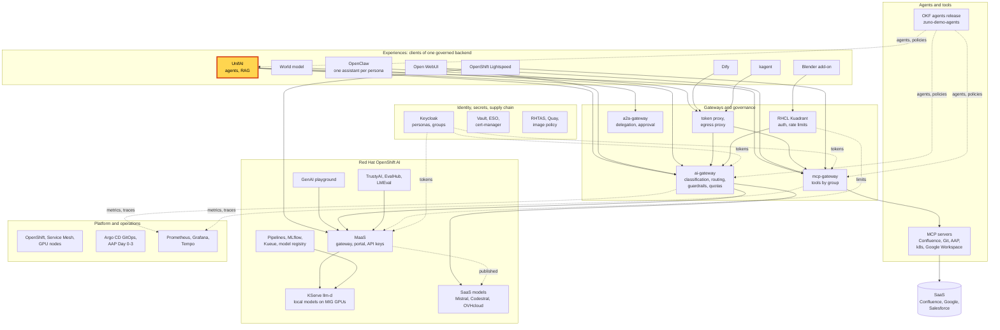
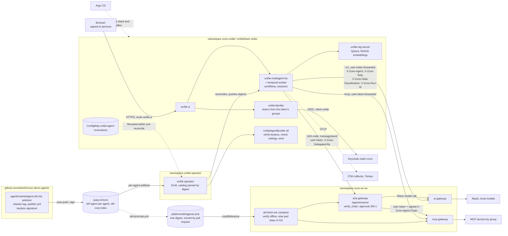

# Agent Platform Architecture

Last reviewed: 2026-11-19

UnifAI is the agent platform of Zuno. It runs the agents, the chats, the workflows and the document library, but it
decides nothing on its own. The agents themselves (prompts, tasks, tools, data level, who may use them) are not in this
repository: they live in `startxfr/zuno-demo-agents` and reach the platform as a **signed release**, pinned by one
digest in `platform/okf/agents.lock` and moved by pull request. Every component that reads the release verifies its
keyless signature offline first. The unifai-operator checks each agent bundle against the corp ceilings before it emits
any UnifAI object. At run time UnifAI holds no model key and no tool credential: it forwards the signed-in user's own
Keycloak token, with the agent, task, data-classification and run headers, to the ai-gateway (models) and the
mcp-gateway (tools). Agents can ask other agents for help only through the a2a-gateway, only to targets declared in
their own signed sheet, with the caller's identity, and a write waits for a human approval. An agent has a lifecycle
state (`placeholder`, `active`, `deprecated`, `retired`) and an incident revocation list read by the operator.

Related pages: [gateways](gateways-architecture.md), [supply chain](supply-chain-architecture.md),
[identity](identity-architecture.md), [experiences](experiences-architecture.md),
[sequence flows](sequence-flows.md).

## HLD

Where the agent platform sits in Zuno. The highlighted box is the subject of this page. Plain arrows carry requests,
dotted arrows carry identity, policy or telemetry.

## LLD

UnifAI's namespaces, the path of a turn and of a delegation, and the release that feeds them. Adapted from the
[UnifAI agents](../demo/scenarios/experiences/unifai-agents.md),
[A2A delegation](../demo/scenarios/governance/a2a-delegation-approval.md) and
[OKF signed release](../demo/scenarios/foundation/okf-signed-agent-release.md) scenarios (Appendix B of each), drawn
there from `gitops/charts/unifai/`, `gitops/charts/a2a-gateway/`, `components/a2a-gateway/` and
`platform/supply-chain/admit_okf_bundle.py`.

## Decisions

Status read from [docs/adr/README.md](../adr/README.md). None of the ADRs below is Deferred.

- [ADR-0560](../adr/0560-keep-the-ai-gateway-as-the-policy-router-in-front-of-unifai.md) (Implemented): the ai-gateway stays the policy router in front of UnifAI.
- [ADR-0561](../adr/0561-adopt-unifai-as-the-agent-platform.md) (Implemented): UnifAI is the agent platform; the agent definition, model path, tool authorization and identity stay Zuno's.
- [ADR-0562](../adr/0562-authenticate-unifai-against-the-zuno-keycloak-realm.md) and [ADR-0563](../adr/0563-forward-caller-identity-and-zuno-context-headers-from-unifai.md) (Implemented): Keycloak sign-in; the user's token and the Zuno headers are forwarded.
- [ADR-0564](../adr/0564-deliver-okf-bundles-to-unifai-operator-as-signed-oci-artifacts.md) (Superseded in part by ADR-0577 and ADR-0578): signed OCI artifacts delivered to the operator.
- [ADR-0565](../adr/0565-derive-data-classification-from-okf-and-only-allow-raising-it.md) (Implemented): the data classification comes from OKF and can only be raised.
- [ADR-0566](../adr/0566-instrument-unifai-with-opentelemetry.md), [ADR-0568](../adr/0568-adopt-unifai-rag-on-qdrant-with-hybrid-search-and-rhoai-embeddings.md), [ADR-0569](../adr/0569-close-unifai-parity-gaps-generically.md) (Implemented): traces, RAG on Qdrant, parity gaps.
- [ADR-0573](../adr/0573-pilot-unifai-on-demo333-with-tekos-before-cutting-demo222-over.md), [ADR-0574](../adr/0574-deploy-unifai-through-argocd-from-a-pinned-olm-catalog.md), [ADR-0575](../adr/0575-upstream-generic-unifai-changes-and-isolate-zuno-specific-code.md), [ADR-0586](../adr/0586-verify-the-unifai-runtime-images-by-digest-signature-and-attestations-before-deploying-them.md) (Implemented): pilot, Argo CD from a pinned catalog, upstreaming, image verification.
- [ADR-0576](../adr/0576-extract-agent-definitions-and-corp-policies-into-the-zuno-demo-agents-repository.md), [ADR-0577](../adr/0577-publish-okf-as-per-agent-artifacts-plus-a-corp-index-artifact.md), [ADR-0578](../adr/0578-sign-okf-artifacts-keyless-with-github-oidc-and-verify-them-offline-by-identity.md), [ADR-0580](../adr/0580-consume-the-corp-okf-bundle-by-a-single-digest-pin-promoted-by-pull-request.md), [ADR-0581](../adr/0581-derive-stack-configuration-from-the-admitted-corp-bundle.md), [ADR-0582](../adr/0582-serve-a-per-agent-entry-and-descriptive-sheet-from-the-admitted-bundle.md), [ADR-0583](../adr/0583-require-group-visibility-and-object-level-authorisation-before-per-agent-entries.md) (Implemented): the agents repository, signed per-agent artifacts, one digest pin, derived configuration, sheets, object-level authorisation.
- [ADR-0579](../adr/0579-extend-okf-to-v0-3-with-skills-model-roles-guardrails-and-limits.md) (Superseded in part by ADR-0615) and [ADR-0615](../adr/0615-align-the-zuno-okf-profile-with-upstream-okf-0-2-and-freeze-it-as-profile-1-0.md) (Accepted): the OKF profile.
- [ADR-0584](../adr/0584-define-agent-lifecycle-states-roles-and-incident-revocation.md) (Implemented): lifecycle states, roles, incident revocation.
- [ADR-0585](../adr/0585-serve-zuno-agents-over-a2a-from-a-gateway-answering-with-the-callers-identity.md) (Implemented), with [ADR-0401](../adr/0401-introduce-agent-delegation-limited-to-targets-an-agent-declares.md), [ADR-0403](../adr/0403-propagate-the-users-identity-and-the-delegation-chain-across-a2a-calls.md), [ADR-0406](../adr/0406-limit-agent-delegation-by-depth-cycle-and-budget.md), [ADR-0409](../adr/0409-introduce-human-approval-for-delegated-operations-resumable-from-persisted-checkpoints.md) (Implemented): the a2a-gateway and the delegation rules.

Fork documentation (read-only reference): [operator OKF page](https://github.com/startxfr/UnifAI/blob/devel/fork/unifai-operator/docs/okf-agent-bundles.md), [RELEASING.md and its tag policy](https://github.com/startxfr/UnifAI/blob/devel/fork/RELEASING.md). Agents repository: [zuno-demo-agents](https://github.com/startxfr/zuno-demo-agents/tree/main/docs).

Scenarios: [UnifAI agents](../demo/scenarios/experiences/unifai-agents.md),
[A2A delegation with approval](../demo/scenarios/governance/a2a-delegation-approval.md),
[OKF signed agent release](../demo/scenarios/foundation/okf-signed-agent-release.md),
[image signing and admission](../demo/scenarios/foundation/image-signing-admission.md).
