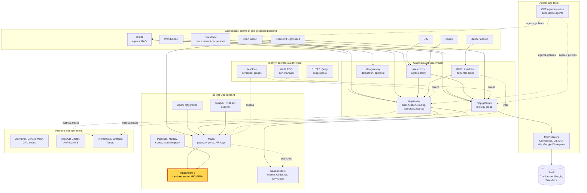
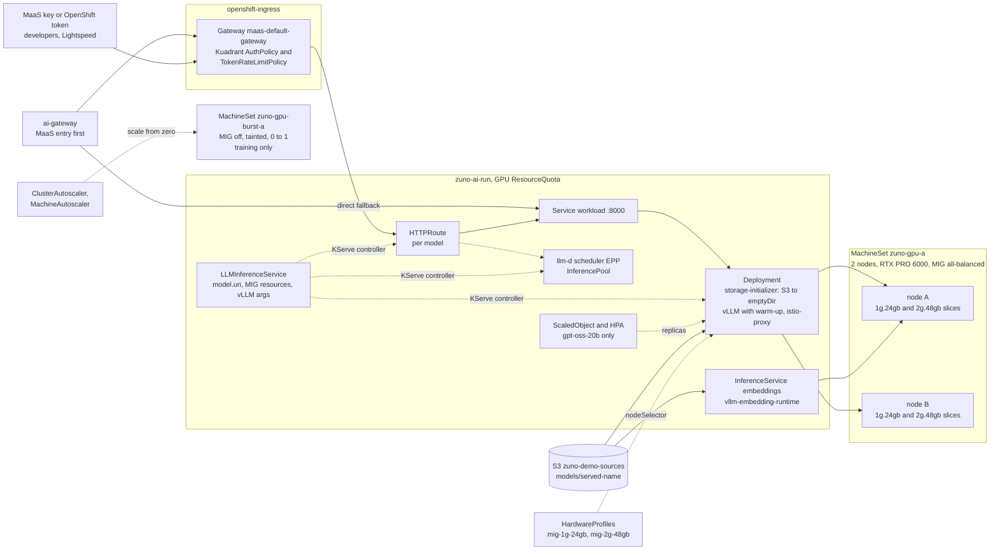
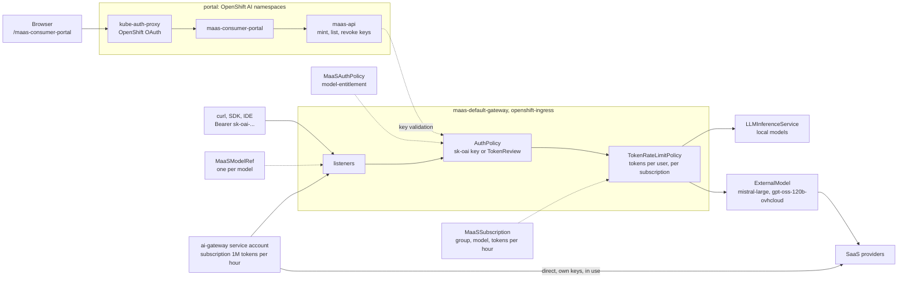
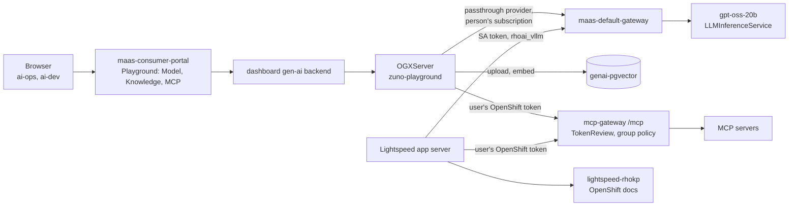

# AI Architecture

Red Hat OpenShift AI 3.5 is the primary AI platform. The design separates agent orchestration (UnifAI, see [agent-platform-architecture.md](agent-platform-architecture.md)) from inference governance (the ai-gateway, see [gateways-architecture.md](gateways-architecture.md)). This page covers what sits behind the gateway: model roles, serving, MaaS, external models, evaluation and the OpenShift AI tools around them. Training and the registry are in [mlops-architecture.md](mlops-architecture.md).

## Model roles

`platform/ai-gateway/provider-routing.yaml` declares 14 providers, each with a `role`, the data levels it may serve (`eligible_for`), a timeout and, for local models, the `inference_service` whose readiness the gateway watches. Each local model has two entries: through MaaS first, then direct.

| Role | Model | Where | Levels |
|---|---|---|---|
| `default` | qwen3.5-9b, fleet-wide default ([ADR-0531](../adr/0531-promote-qwen3-5-9b-as-the-fleet-wide-default-and-extend-ovhcloud-reasoning-access.md)) | local | C1 to C3 |
| `quality` | qwen3.6-27b-instruct ([ADR-0518](../adr/0518-modernize-local-models-qwen36-chat-qwen3-embeddings-qwen35-training.md)) | local | C1 to C3 |
| `reasoning` | gpt-oss-20b ([ADR-0414](../adr/0414-consolidate-zuno-ai-run-into-three-tiered-mig-predictors.md)) | local | C1 to C3 |
| `specialized` | qwen3.5-9b-wesh, French urban register ([ADR-0526](../adr/0526-fine-tune-and-serve-a-french-urban-register-model-variant.md)) | local | C1 to C3 |
| `code` | Mistral Codestral ([ADR-0417](../adr/0417-consume-codestral-via-mistral-api.md)) | SaaS | C1, C2 |
| `reasoning-external` | gpt-oss-120b on OVHcloud | SaaS | C1, C2 |
| `general-external` | OpenAI, Gemini, Anthropic, Mistral | SaaS | C1 or C1, C2 |

The embedding model `qwen3-embedding-0.6b` (1024 dimensions) serves RAG. Which provider answers is decided per agent and task by the gateway, not by the model list. C3 never leaves the cluster ([ADR-0021](../adr/0021-route-models-according-to-c1-c2-c3-classification.md)). Which models a given persona may reach is set by the OKF release.

## Local serving

Local chat models are `LLMInferenceService` objects (KServe with llm-d) on MIG slices of RTX PRO 6000 96 GB GPUs ([ADR-0351](../adr/0351-share-rtx-pro-6000-gpus-via-nvidia-mig-with-scale-from-zero-burst-capacity.md), [ADR-0537](../adr/0537-integrate-rhoai-hardware-profiles-and-maas-external-models.md)). Weights are staged in the shared S3 bucket `zuno-demo-sources` ([ADR-0546](../adr/0546-introduce-a-cross-cluster-source-bucket-and-per-cluster-s3-bucket-convention.md)). Only gpt-oss-20b is autoscaled, through `spec.scaling` with minimum and maximum 1 ([ADR-0542](../adr/0542-autoscale-one-served-model-through-llminferenceservice-spec-scaling.md)). A burst node (full GPU, tainted, scale from zero) is for training only.

## MaaS and external models

MaaS is the access plane: `maas-default-gateway` (Authorino key or TokenReview check, Limitador token limits), the portal for API keys, and the CRs `MaaSSubscription`, `MaaSAuthPolicy` and `MaaSModelRef` ([ADR-0201](../adr/0201-complete-the-openshift-ai-maas-governance-plane-integration.md)). All local traffic of the ai-gateway goes through it ([ADR-0521](../adr/0521-route-local-model-traffic-through-maas.md)); keys, per-subscription limits and exposure belong to MaaS, per-persona budgets stay in the ai-gateway ([ADR-0570](../adr/0570-slim-the-ai-gateway-by-delegating-quotas-keys-and-exposure-to-maas.md)).

Mistral and OVHcloud gpt-oss-120b are also published as MaaS `ExternalModel` objects ([ADR-0541](../adr/0541-integrate-mistral-and-gpt-oss-120b-as-maas-externalmodels.md)). The ai-gateway still calls the chat SaaS providers directly, with its own keys, as a named exception of ADR-0570; the MaaS path is proven and not switched on (`MAAS_EXTERNAL_EGRESS_ENABLED=false`).

## OpenShift AI tools

- **GenAI playground.** A ready-made OGX server (`OGXServer`, [ADR-0322](../adr/0322-migrate-from-llama-stack-configuration-to-the-openshift-ai-ogx-operator.md), Superseded in part by ADR-0561 and ADR-0568) in `zuno-playground`: chat goes to MaaS under the person's subscription, uploaded documents go to a small dedicated pgvector, tools go to the mcp-gateway `/mcp` front door with the person's OpenShift token. It is an operator tool, not an end-user experience ([ADR-0587](../adr/0587-admit-additional-user-experiences-over-the-one-governed-backend.md)). Zuno's own RAG is on Qdrant, see [data-architecture.md](data-architecture.md).
- **Lightspeed.** OpenShift Lightspeed is a consumer: inference through MaaS (provider `rhoai_vllm`, subscription `gpt-oss-20b-lightspeed`), official documentation untouched, Zuno tools through the mcp-gateway, per-user identity ([ADR-0524](../adr/0524-integrate-openshift-lightspeed-with-the-zuno-ai-platform.md)).
- **Evaluation.** TrustyAI runs RAGAS, Garak and LM-Eval, and EvalHub gives a self-service path; guardrails moved out of TrustyAI into the ai-gateway ([ADR-0534](../adr/0534-integrate-trustyai-for-ai-evaluation-and-guardrails.md), Superseded in part by [ADR-0567](../adr/0567-move-trustyai-guardrails-into-the-ai-gateway.md)). Detail in [mlops-architecture.md](mlops-architecture.md).
- **Platform CRDs.** Kueue, JobSet and LeaderWorkerSet are installed as charts (`kueue`, `jobset`, `lws`); the `DataScienceCluster` carries notebooks, pipelines, KServe, the model registry and OGX.

Scenarios: [model serving with llm-d and MIG](../demo/scenarios/rhoai/model-serving-llmd-mig.md), [external models](../demo/scenarios/rhoai/external-models.md), [MaaS portal and API keys](../demo/scenarios/rhoai/maas-portal-api-keys.md), [GenAI playground](../demo/scenarios/rhoai/genai-playground.md), [Lightspeed](../demo/scenarios/experiences/lightspeed.md), [evaluation](../demo/scenarios/rhoai/evaluation-trustyai-evalhub.md).
