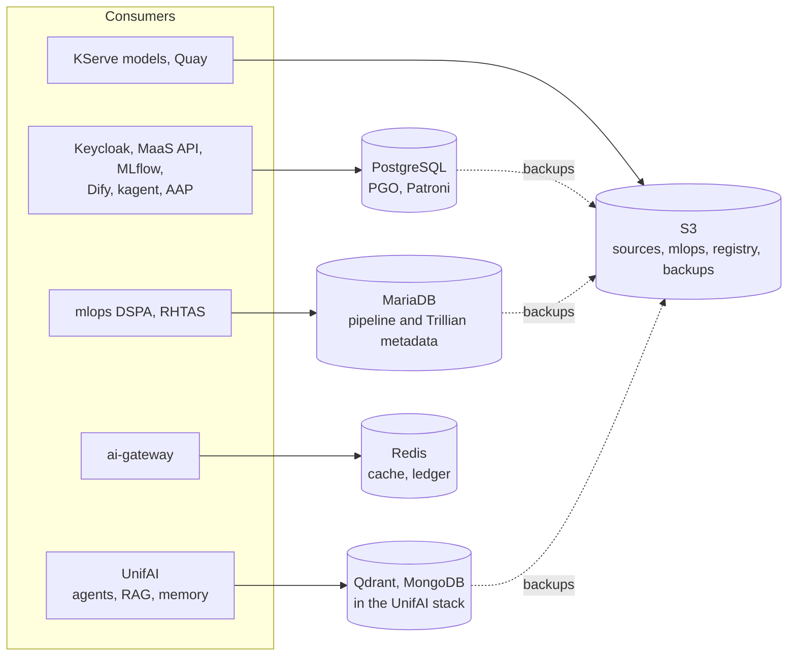
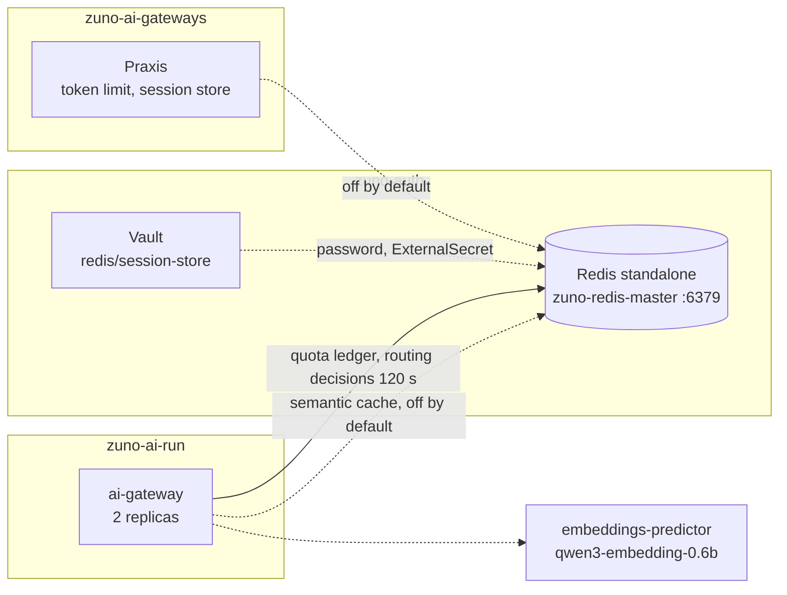
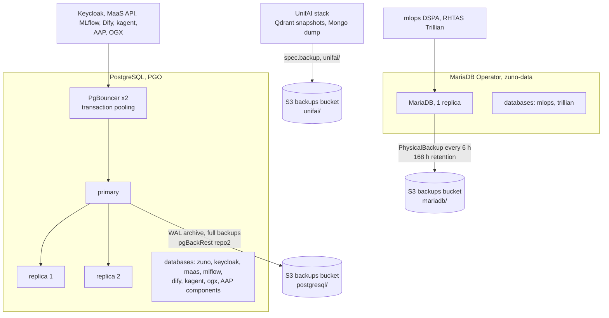

# Data Architecture

The platform keeps four kinds of data apart: relational state of the platform products (PostgreSQL), metadata that does not belong there (MariaDB), knowledge and memory vectors (Qdrant inside the UnifAI stack), and objects (S3). Redis holds short-lived gateway state only. Everything that matters is backed up off-cluster.

## Knowledge and vectors

SXA is the company's commercial record from before 2021. [ADR-0219](../adr/0219-serve-sxa-only-as-a-historical-rag-corpus.md) (listed as Deprecated in the ADR index) settled how it is served: as a read-only historical RAG corpus (`knowledge.sxa-legacy`), with no live SXA database and no structured-query path. The structured MariaDB import of [ADR-0216](../adr/0216-import-real-sxa-content-via-s3-into-mariadb-served-through-mcp-and-rag.md) is Superseded by ADR-0219.

RAG now runs on UnifAI's RAG service with Qdrant ([ADR-0568](../adr/0568-adopt-unifai-rag-on-qdrant-with-hybrid-search-and-rhoai-embeddings.md), Implemented): one collection per logical knowledge domain (`knowledge.tech`, `knowledge.sxa-legacy`), dense and sparse vectors fused at query time, and a fail-closed `acl_groups` filter taken from the caller's identity. Embeddings stay on OpenShift AI: `qwen3-embedding-0.6b`, 1024 dimensions, behind the `embeddings-predictor` service in `zuno-ai-run` (`gitops/charts/unifai/values.yaml`). The agent memory tool reads the same Qdrant. The earlier `rag-service`, `rag-ingestion` and `pgvector` RAG schema were to be retired at cutover under ADR-0568; no chart for them remains in `gitops/charts`.

pgvector is still present in two places: the PostgreSQL operand image bundles it, and the OpenShift AI playground runs its own small `genai-pgvector` for uploaded documents (see [ai-architecture.md](ai-architecture.md)).

## PostgreSQL, MariaDB and Redis

- **PostgreSQL** (`zuno-postgresql`, PGO with Patroni): 1 primary and 2 async replicas, fronted by PgBouncer (2 replicas), TimescaleDB preloaded. Dedicated databases and roles serve Keycloak, MaaS (API keys, subscriptions), MLflow, Dify, kagent, the OGX provider and the AAP components, each with a Vault-backed secret.
- **MariaDB** (MariaDB Operator, single node, `zuno-data`): the pipeline database `mlops` for the DSPA, and the Trillian database of the RHTAS transparency log ([ADR-0535](../adr/0535-adopt-rhtas-as-the-artifact-trust-and-supply-chain-service.md) lineage, see [supply-chain-architecture.md](supply-chain-architecture.md)).
- **Redis** (`gitops/charts/redis`, namespace `zuno-auth`, standalone Bitnami chart): it first held the browser sessions of the agent frontends ([ADR-0042](../adr/0042-use-opaque-browser-sessions-with-server-side-token-storage.md), Superseded by [ADR-0561](../adr/0561-adopt-unifai-as-the-agent-platform.md)). Today the ai-gateway uses it for the optional semantic cache ([ADR-0104](../adr/0104-introduce-controlled-semantic-caching.md); `semanticCache.enabled` is false by default and no provider opts in), for the quota ledger when `quotaLedger.store` is `redis`, and for the 120 second routing-decision side channel. Praxis, the alternative gateway, can keep its token limit there ([ADR-0619](../adr/0619-run-praxis-ai-as-an-alternative-ai-gateway-next-to-the-default-zuno-ai-gateway.md)). It is a cache, not a store of record, and the gateway falls back to its local counter if Redis fails.

## PostgreSQL and MariaDB layout

## S3 buckets and backups

[ADR-0546](../adr/0546-introduce-a-cross-cluster-source-bucket-and-per-cluster-s3-bucket-convention.md) (Implemented) splits object storage in two. `zuno-demo-sources` is shared by all clusters and holds model weights (`models/`), the raw SXA dump and training corpora. Each cluster has its own `zuno-<cluster>-<purpose>` buckets; the cluster variables in `ansible/clusters/` name `mlops` (MLflow artifacts, pipeline objects), `registry` (Quay) and `backups`. A normalized RAG corpus is not shared: each cluster re-ingests from the raw sources.

The `backups` bucket carries three prefixes, each written by its own job: `postgresql/` (pgBackRest, repo2, on-demand and scheduled), `mariadb/` (PhysicalBackup, schedule `0 */6 * * *`, retention `168h`) and `unifai/` (Qdrant snapshots and a Mongo dump, `UnifaiStack` `spec.backup`, default schedule `0 2 * * *`, retention 7). In the chart defaults all three S3 backups are disabled; clusters switch them on with Ansible variables. `make d3 backup|restore|check` drives the Day-3 runs ([ADR-0112](../adr/0112-implement-production-grade-backup-and-recovery.md)).

Scenario with the playground's own vector store: [GenAI playground](../demo/scenarios/rhoai/genai-playground.md). UnifAI data stores (MongoDB, Redis, RabbitMQ, Temporal, Qdrant): [UnifAI agents](../demo/scenarios/experiences/unifai-agents.md).
