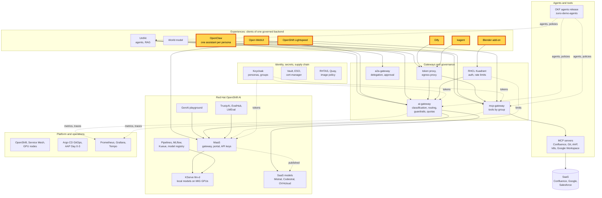
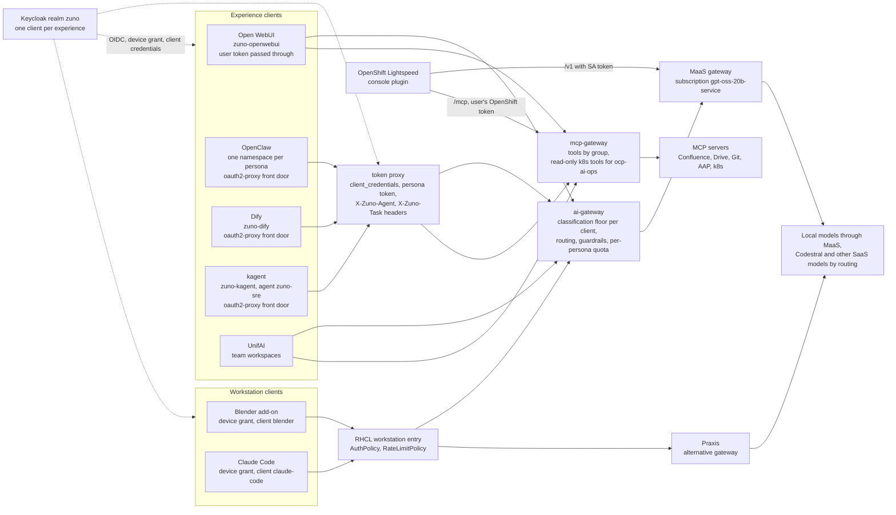

# Experiences Architecture

Last reviewed: 2026-11-19

An experience is a client of the platform: the screen a person uses. Zuno admits several, and all of them reach the
same governed backend: models through the ai-gateway, tools through the mcp-gateway, with the person's own Keycloak
identity, one per-persona quota and one telemetry stream. The client holds no model key, no policy and no tool
credential. UnifAI and Open WebUI call the gateways directly with the user's token (the World model is drawn calling the ai-gateway in the platform map). OpenClaw, Dify and
kagent cannot pass a user token, so each calls through a token proxy that fetches a client-credentials token for its
persona. The Blender add-on and Claude Code run on a workstation; the first enters through a Connectivity Link entry
into the ai-gateway, the second through the alternative gateway Praxis. OpenShift Lightspeed is a consumer, not an
experience client of the ai-gateway: it calls the model through MaaS under its own subscription, and the mcp-gateway
with the console user's token. Experience clients are declared in the agents release, apart from the agents.

Related pages: [agent platform](agent-platform-architecture.md), [gateways](gateways-architecture.md),
[identity](identity-architecture.md), [network](network-architecture.md).

## HLD

Where the experiences sit in Zuno. The highlighted box groups the experience clients; each client is detailed in its
own scenario page.

## LLD

The experience clients and their one governed backend, summarised from Appendix B of the
[Open WebUI](../demo/scenarios/experiences/open-webui.md), [OpenClaw](../demo/scenarios/experiences/openclaw.md),
[Dify](../demo/scenarios/experiences/dify.md), [kagent](../demo/scenarios/experiences/kagent.md),
[Lightspeed](../demo/scenarios/experiences/lightspeed.md) and
[Claude Code](../demo/scenarios/experiences/claude-code-sovereign.md) scenarios and the
[Blender](../demo/blender-3d.md) page (charts `open-webui`, `openclaw`, `dify`, `kagent`, `lightspeed-config`,
`zuno-token-proxy`, `connectivity-link`, `praxis`).

## Decisions

Status read from [docs/adr/README.md](../adr/README.md). None of these ADRs is Deferred.

- [ADR-0587](../adr/0587-admit-additional-user-experiences-over-the-one-governed-backend.md) (Implemented): the rule of one governed backend; [ADR-0606](../adr/0606-admit-new-experiences-with-a-definition-of-done-and-a-wip-limit.md) (Implemented): definition of done and WIP limit for new experiences.
- [ADR-0588](../adr/0588-serve-a-general-purpose-chat-experience-with-open-webui.md) (Implemented): Open WebUI.
- [ADR-0589](../adr/0589-serve-per-persona-openclaw-assistants-via-claw-operator-behind-a-token-injecting-egress-proxy.md) (Superseded in part by ADR-0590) and [ADR-0590](../adr/0590-front-openclaw-with-oauth2-proxy-and-an-egress-firewall-one-claw-operator-per-persona-namespace.md) (Implemented): OpenClaw per persona.
- [ADR-0591](../adr/0591-route-only-to-ready-local-models-and-fail-fast-on-stalled-candidates.md), [ADR-0596](../adr/0596-let-experience-clients-pick-a-declared-code-model-routed-to-codestral-first.md) (Implemented): routing to ready local models; the declared code model.
- [ADR-0592](../adr/0592-declare-experience-clients-in-the-agents-release-apart-from-agents.md), [ADR-0593](../adr/0593-key-the-per-user-quota-and-telemetry-by-persona-across-experiences.md), [ADR-0594](../adr/0594-give-the-three-experiences-the-same-mcp-tools-behind-signed-classification-markers.md) (Implemented): clients declared in the release; per-persona quota; the same MCP tools.
- [ADR-0597](../adr/0597-declare-unifai-built-in-resources-through-the-operator.md), [ADR-0598](../adr/0598-give-every-persona-default-unifai-team-workspaces-and-a-shared-catalog.md) (Implemented): UnifAI built-ins and team workspaces.
- [ADR-0599](../adr/0599-serve-a-no-code-workflow-canvas-with-dify-as-an-experience-client.md) (Implemented): Dify.
- [ADR-0600](../adr/0600-govern-kubernetes-read-tools-in-the-mcp-gateway-and-admit-kagent-as-a-thin-operations-client.md) and [ADR-0601](../adr/0601-inject-client-credentials-tokens-for-experience-clients-without-oidc-passthrough.md) (Implemented): kagent and the governed cluster reads; client-credentials token injection.
- [ADR-0610](../adr/0610-generate-blender-objects-as-bpy-scripts-from-a-local-model-through-the-ai-gateway.md) (Implemented): the Blender add-on.
- [ADR-0524](../adr/0524-integrate-openshift-lightspeed-with-the-zuno-ai-platform.md) (Implemented, Lightspeed as a consumer) and [ADR-0619](../adr/0619-run-praxis-ai-as-an-alternative-ai-gateway-next-to-the-default-zuno-ai-gateway.md) (Accepted, not yet Implemented: Praxis, used by Claude Code).

Scenarios: [Open WebUI](../demo/scenarios/experiences/open-webui.md), [OpenClaw](../demo/scenarios/experiences/openclaw.md),
[Dify](../demo/scenarios/experiences/dify.md), [kagent](../demo/scenarios/experiences/kagent.md),
[Lightspeed](../demo/scenarios/experiences/lightspeed.md),
[Claude Code](../demo/scenarios/experiences/claude-code-sovereign.md), [Blender](../demo/blender-3d.md),
[UnifAI agents](../demo/scenarios/experiences/unifai-agents.md).
