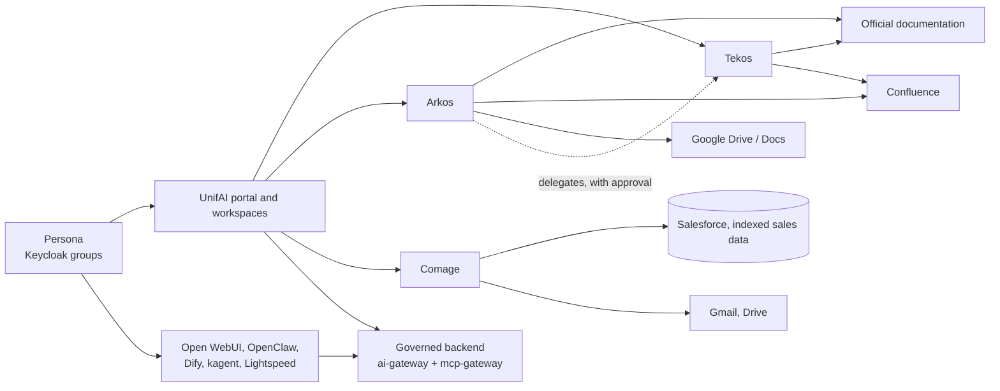

# Functional Architecture

What users can do with Zuno: who they are, which experience they use, which agents answer, and what those agents may read
or call. The platform that makes this possible is in [logical-architecture.md](logical-architecture.md).

## Users, experiences and agents

A user is a persona of the Keycloak realm `zuno` ([ADR-0349](../adr/0349-restructure-demo-personas-cluster-access-groups-and-new-agents.md)).
Its groups decide which agents it may call (`agent_<name>`), which tools it gets, which model budget it holds and what it may
see on the cluster. The persona table is in the [demo catalogue](../demo/README.md#personas); the mechanism is in
[identity-architecture.md](identity-architecture.md).

Every experience is a client of the same governed backend ([ADR-0587](../adr/0587-admit-additional-user-experiences-over-the-one-governed-backend.md)):
the agents are served by UnifAI, and no experience holds a model key, a document store or a tool credential of its own.
The experiences are described in [experiences-architecture.md](experiences-architecture.md).

## Agent catalogue

The agent definitions live in [startxfr/zuno-demo-agents](https://github.com/startxfr/zuno-demo-agents) as OKF bundles
([ADR-0576](../adr/0576-extract-agent-definitions-and-corp-policies-into-the-zuno-demo-agents-repository.md)), signed and
admitted before they reach a pod ([agent-platform-architecture.md](agent-platform-architecture.md)). Per-agent pages are in
[the agent catalogue](../agents/README.md).

| Agent | Role | Status in the release |
|---|---|---|
| Tekos | Technical consultant assistant: official documentation and Confluence, with citations | `active` |
| Arkos | Architecture assistant: drafts DAT and workshop documents; code work floored at C3, local models only | `active` |
| Comage | Sales assistant: indexed and live Salesforce data, opportunity updates, own Drive/Gmail | `active` |
| Advantage, Finage | Sales administration reporting, finance and invoicing reporting | `draft` ([ADR-0532](../adr/0532-accept-knowledge-adv-as-sourceless-pending-a-replacement-adapter.md), [ADR-0533](../adr/0533-consolidate-advantage-and-finage-non-promotion-into-a-dedicated-decision.md)) |
| Naveo, Soursage, Cognos | Onboarding, recruiting (Workday, LinkedIn), board-level finance and strategy | `draft` |

Status is read from `agents/*/agent.okf.md` in the agents repository (2026-11-18); a release can change it.
