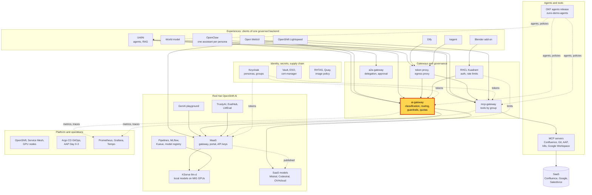
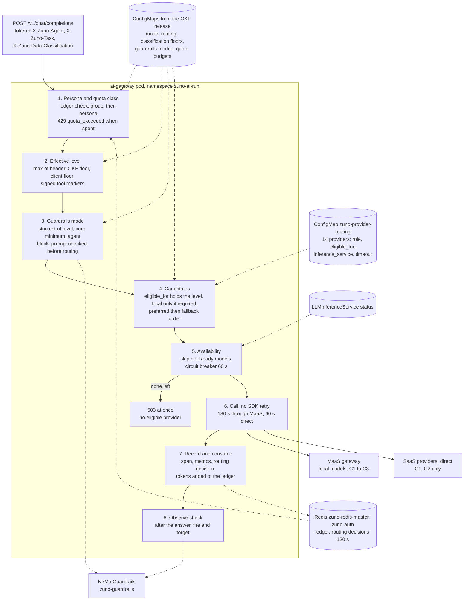
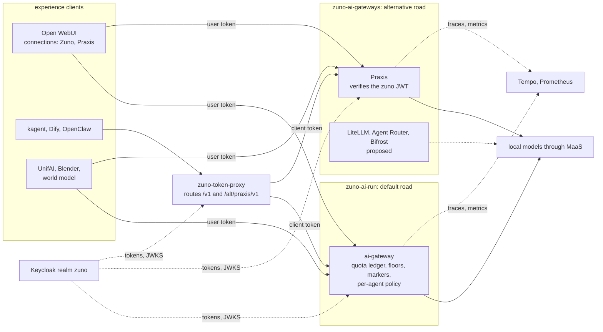

# Gateways Architecture

Every experience reaches models and tools through gateways that own policy. The experiences never choose a provider or call a tool server directly. This page covers the gateways and the model-access plane behind them. The agents and the A2A gateway are in [agent-platform-architecture.md](agent-platform-architecture.md).

The highlighted box is the ai-gateway. Plain arrows carry requests, dotted arrows carry identity, policy or telemetry.

## What each gateway owns

- **ai-gateway** (`zuno-ai-run`) is the policy router in front of the models ([ADR-0560](../adr/0560-keep-the-ai-gateway-as-the-policy-router-in-front-of-unifai.md)). It derives the data level (C1, C2, C3) from the OKF floor and tool markers, and the level can only rise ([ADR-0565](../adr/0565-derive-data-classification-from-okf-and-only-allow-raising-it.md)). It orders the candidate providers by the `preferred` and `fallback` lists of each agent and task, and it skips local models that are not Ready and providers that just failed ([ADR-0591](../adr/0591-route-only-to-ready-local-models-and-fail-fast-on-stalled-candidates.md)). It never reads the question: the task decides.
- **Guardrails** run inside the ai-gateway ([ADR-0567](../adr/0567-move-trustyai-guardrails-into-the-ai-gateway.md)). The mode (`off`, `observe`, `block`) is set per effective level; every level ships as `observe`. The detector is NeMo Guardrails with pattern rails and no model ([ADR-0540](../adr/0540-express-guardrail-policy-as-nemo-rails-configuration.md)).
- **Quotas** are a per-persona and per-group token ledger in the ai-gateway. It is in-process by default and Redis-backed when `quotaLedger.store` is `redis`, which two replicas need ([ADR-0593](../adr/0593-key-the-per-user-quota-and-telemetry-by-persona-across-experiences.md)). MaaS keeps the per-subscription limits ([ADR-0570](../adr/0570-slim-the-ai-gateway-by-delegating-quotas-keys-and-exposure-to-maas.md)).
- **MaaS** is the access plane in front of the local models: gateway, portal, API keys ([ADR-0201](../adr/0201-complete-the-openshift-ai-maas-governance-plane-integration.md), [ADR-0521](../adr/0521-route-local-model-traffic-through-maas.md)). Details are in [ai-architecture.md](ai-architecture.md).
- **mcp-gateway** is the one door to MCP tools ([ADR-0010](../adr/0010-introduce-a-central-mcp-gateway.md)). A call passes only if the person's groups, the agent, the task, the tool policy and the data level all allow it ([ADR-0036](../adr/0036-enforce-the-complete-mcp-authorization-intersection-in-the-gateway.md)), and the result carries a signed classification marker ([ADR-0594](../adr/0594-give-the-three-experiences-the-same-mcp-tools-behind-signed-classification-markers.md)).

## LLD: decisions of the ai-gateway for one call

Adapted from the routing, sovereignty, guardrails and quotas scenarios (Appendix B of each), drawn from `components/ai-gateway/app/*` and `gitops/charts/ai-gateway`. The stage order is the one of the scenario diagrams.

## LLD: alternative gateways

[ADR-0619](../adr/0619-run-praxis-ai-as-an-alternative-ai-gateway-next-to-the-default-zuno-ai-gateway.md) (Accepted) runs other AI gateways in `zuno-ai-gateways` so the same clients can be shown on another road. The Zuno ai-gateway stays the default for every demo. LiteLLM ([ADR-0621](../adr/0621-run-litellm-as-an-alternative-ai-gateway.md)), Agent Router ([ADR-0622](../adr/0622-run-agent-router-as-an-alternative-ai-gateway.md)) and Bifrost ([ADR-0623](../adr/0623-run-bifrost-as-an-alternative-ai-gateway.md)) are Proposed. None of the four carries the signed delegation chain, OKF bundles, classification floors that only rise, or per-(agent, task) policy. Those stay in the Zuno gateways. Praxis has a chart in `gitops/charts/praxis`.

Scenarios: [AI gateway routing](../demo/scenarios/governance/ai-gateway-routing.md), [sovereignty](../demo/scenarios/governance/ai-gateway-sovereignty.md), [guardrails](../demo/scenarios/governance/guardrails.md), [quotas](../demo/scenarios/governance/quotas.md), [MCP tools by group](../demo/scenarios/governance/mcp-tools-by-group.md), [multi-gateway](../demo/scenarios/governance/multi-gateway.md), [agents on an alternative gateway](../demo/scenarios/governance/agents-alt-gateway.md).
