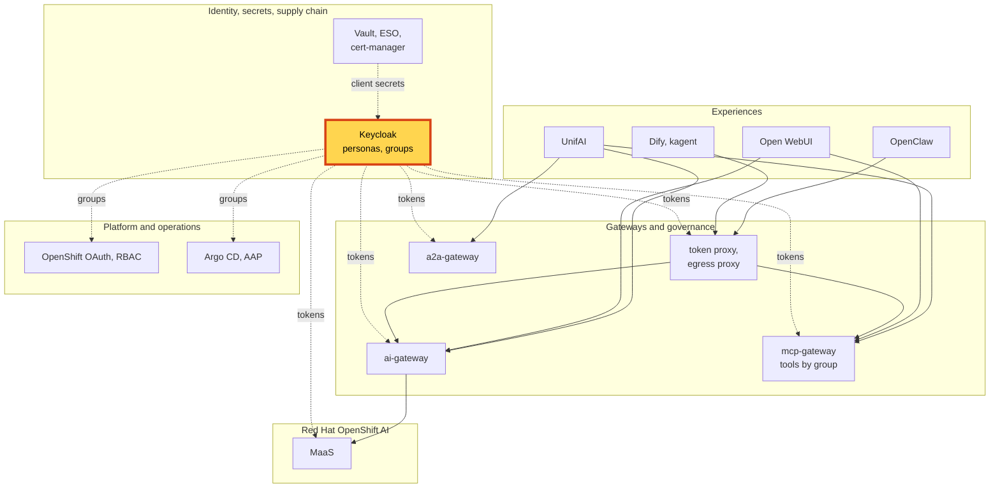
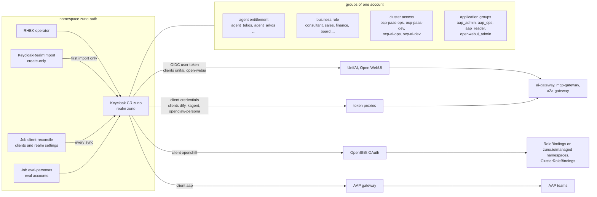
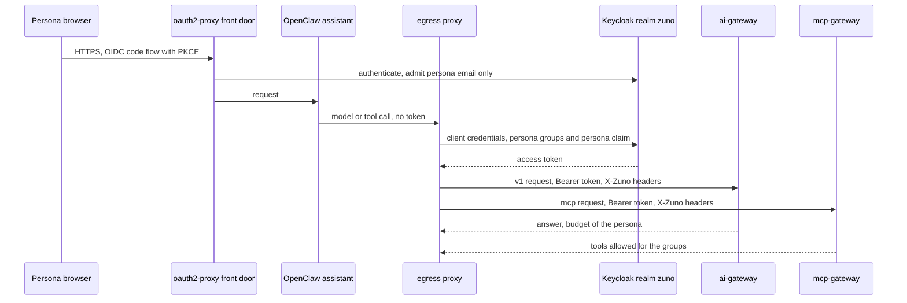

# Identity Architecture

Keycloak (realm `zuno`) is the one identity provider. Its groups drive four things: which agent a user may use, which tools and data a business role may reach, which quota a persona spends, and which OpenShift, Argo CD and AAP rights an operator gets. The diagrams are adapted from the scenarios [identity and personas](../demo/scenarios/governance/identity-personas.md) and [OpenClaw](../demo/scenarios/experiences/openclaw.md).

## Where this sits in the platform

## Keycloak

Keycloak runs from the Red Hat build of Keycloak operator as a `Keycloak` custom resource in `zuno-auth`, with realm `zuno` stored in PostgreSQL (`zuno-data`) and client secrets synced from Vault by the External Secrets Operator ([ADR-0012](../adr/0012-use-keycloak-as-the-central-identity-provider.md) records the choice; [ADR-0352](../adr/0352-run-day-0-platform-services-in-internal-or-external-mode.md), Partially implemented, allows an external Keycloak). The chart sets `spec.instances: 1`; the earlier text of this page, which described two replicas in `zuno-keycloak`, no longer matches. The realm declares a `google` identity provider (Google Workspace, scopes include Drive and Gmail read-only) that is switched by `googleOAuth` in the chart values; Google tools use the delegated user token so source ACLs apply.

The realm import runs once and is create-only. A Job reconciles the clients and eight brute-force settings on every sync ([ADR-0530](../adr/0530-reconcile-keycloak-clients-instead-of-relying-on-a-create-only-realm-import.md), Implemented), so a change to `realm-zuno.json` reaches live clients but not other realm content. Brute-force protection is temporary lock-out, never permanent ([ADR-0602](../adr/0602-harden-the-platform-trust-boundaries-before-a-customer-runs-it.md) clause 3, Accepted; [ADR-0603](../adr/0603-close-the-medium-severity-security-gaps-found-in-the-2026-11-06-review.md) M5, Accepted).

## Personas and groups

The realm holds fictional persona accounts (32 users in `realm-zuno.json`, including service accounts), all created from the demo persona model of [ADR-0349](../adr/0349-restructure-demo-personas-cluster-access-groups-and-new-agents.md) (Implemented) and described in the [persona catalogue](../demo/README.md#personas). Groups fall into four dimensions that are never merged:

| Dimension | Examples in the realm | Decides |
|---|---|---|
| Agent entitlement | `agent_tekos`, `agent_comage`, `agent_arkos`, `agent_finage`, `agent_naveo`, `agent_soursage`, `agent_cognos`, `agent_advantage` | Which agent a user may see and run |
| Business role | `consultant` (with `confluence-*` subgroups), `sales`, `sales/sales_admin`, `finance`, `board`, `adv`, `cdp`, `recrut` | Which tools and data |
| Cluster access | `ocp-paas-ops`, `ocp-paas-dev`, `ocp-ai-ops`, `ocp-ai-dev` | OpenShift RoleBindings; Argo CD roles |
| Application | `aap_admin`, `aap_ops`, `aap_reader`, `openwebui_admin`, `zuno-world-model-users` | AAP teams, Open WebUI admin, world-model access |

Entitlement and role are separate on purpose ([ADR-0040](../adr/0040-separate-agent-entitlement-from-business-role-authorization.md), Implemented). OpenShift's OAuth server is federated to Keycloak and creates `User` and `Group` objects at sign-in ([ADR-0320](../adr/0320-pre-provision-openshift-users-rbac-and-console-favorites-via-keycloak.md), Superseded in part; the OAuth configuration and static RBAC stay in effect). The `openshift-rbac-groups` chart binds `ocp-paas-ops` to `cluster-admin` and `ocp-paas-dev` to `cluster-reader`, and gives `ocp-ai-dev` edit and `ocp-ai-ops` admin on namespaces labelled `zuno.io/managed` (ADR-0349 and the namespaces chart). Argo CD maps `ocp-paas-ops` to `role:admin` and `ocp-paas-dev` to a read-and-sync role.

## Token flows

| Client | Identity at the gateways | Notes |
|---|---|---|
| UnifAI | User's own token, forwarded | UnifAI authenticates against realm `zuno`, never its own realm ([ADR-0562](../adr/0562-authenticate-unifai-against-the-zuno-keycloak-realm.md), Implemented); caller identity and Zuno context headers are forwarded ([ADR-0563](../adr/0563-forward-caller-identity-and-zuno-context-headers-from-unifai.md), Implemented) |
| Open WebUI | User's own token, forwarded | Client `open-webui` |
| Dify, kagent | One persona's service account through `zuno-token-proxy` | They cannot forward a user token; the proxy is the only pod holding a client secret ([ADR-0601](../adr/0601-inject-client-credentials-tokens-for-experience-clients-without-oidc-passthrough.md), Implemented) |
| OpenClaw | One persona's service account per namespace, injected by the assistant's egress proxy | Clients `openclaw-<persona>`; front door is oauth2-proxy with OIDC and PKCE ([ADR-0589](../adr/0589-serve-per-persona-openclaw-assistants-via-claw-operator-behind-a-token-injecting-egress-proxy.md) Superseded in part, [ADR-0590](../adr/0590-front-openclaw-with-oauth2-proxy-and-an-egress-firewall-one-claw-operator-per-persona-namespace.md) Implemented) |

Gateways then decide per call: agent groups say which agent, business roles say which tools and data, the persona says which budget ([ADR-0593](../adr/0593-key-the-per-user-quota-and-telemetry-by-persona-across-experiences.md), Implemented). Inside UnifAI, an agent is hidden from users without its entitlement group and every object read is checked against the caller ([ADR-0583](../adr/0583-require-group-visibility-and-object-level-authorisation-before-per-agent-entries.md), Implemented). Tool access through the mcp-gateway is filtered by group ([mcp tools by group](../demo/scenarios/governance/mcp-tools-by-group.md)); the same tools are offered to the three first experiences behind signed classification markers ([ADR-0594](../adr/0594-give-the-three-experiences-the-same-mcp-tools-behind-signed-classification-markers.md), Implemented).

Related pages: [security-architecture.md](security-architecture.md), [gateways-architecture.md](gateways-architecture.md), [experiences-architecture.md](experiences-architecture.md), [agent-platform-architecture.md](agent-platform-architecture.md).
