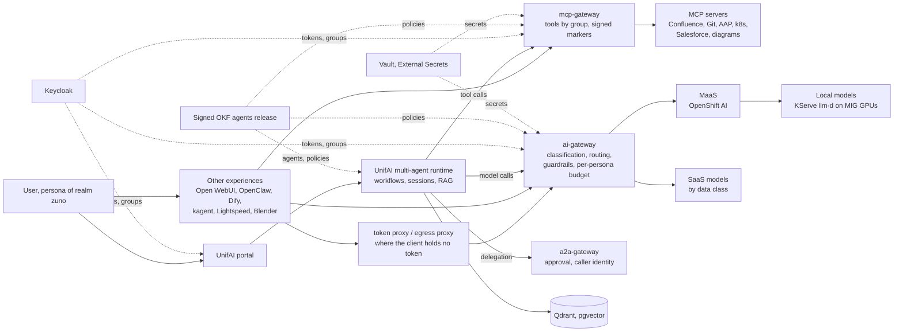

# Logical Architecture

The reusable platform services and their responsibilities. What users and agents see is in
[functional-architecture.md](functional-architecture.md); where each service runs is in
[physical-architecture.md](physical-architecture.md).

## Request path

Every experience reaches models and tools through the same two gateways, with the caller's own token
([ADR-0587](../adr/0587-admit-additional-user-experiences-over-the-one-governed-backend.md),
[ADR-0563](../adr/0563-forward-caller-identity-and-zuno-context-headers-from-unifai.md)). Agents are run by UnifAI
([ADR-0561](../adr/0561-adopt-unifai-as-the-agent-platform.md)); the ai-gateway stays the policy router in front of it
([ADR-0560](../adr/0560-keep-the-ai-gateway-as-the-policy-router-in-front-of-unifai.md)).

Per-brick diagrams are in the domain pages: [agent-platform](agent-platform-architecture.md),
[gateways](gateways-architecture.md), [experiences](experiences-architecture.md), [ai](ai-architecture.md),
[data](data-architecture.md), [identity](identity-architecture.md), [observability](observability-architecture.md).

## Shared services

| Service | Responsibility | Shared by |
|---|---|---|
| UnifAI | Agent portal, workflows, sessions, RAG; runs the admitted OKF bundles | UnifAI portal; other experiences call the same backend |
| ai-gateway | Data classification (it can only be raised), routing by class and readiness, guardrails, semantic cache, per-persona token budget | All experiences and agents |
| MaaS | Model publication, API keys, rate limits on local and external models | ai-gateway, Lightspeed, playground |
| mcp-gateway | Tool catalogue filtered by the caller's groups, signed classification markers, audit | All experiences and agents |
| a2a-gateway | Agent-to-agent delegation under the caller's identity, with human approval of writes | UnifAI agents |
| Keycloak | Personas, groups, token issuing | Every service |
| Vault, External Secrets, cert-manager | Secrets and certificates | Every service |
| Redis | The ai-gateway's optional controlled semantic cache, quota ledger and routing side channel ([ADR-0104](../adr/0104-introduce-controlled-semantic-caching.md)) | ai-gateway |
| Argo CD | Applies Git as the only source of cluster state ([ADR-0608](../adr/0608-keep-the-repository-the-only-source-of-cluster-state.md)) | Every chart |

Dedicated agent frontends and BFFs (ADR-0042) were retired with the move to UnifAI, which keeps its own server-side
session; Redis no longer backs browser sessions.

## Where it is shown live

[Appendix A of any demo scenario](../demo/README.md) draws the same map with one brick highlighted, and its Appendix B
draws that brick's internals, for example [UnifAI](../demo/scenarios/experiences/unifai-agents.md) and
[the ai-gateway](../demo/scenarios/governance/ai-gateway-sovereignty.md).
