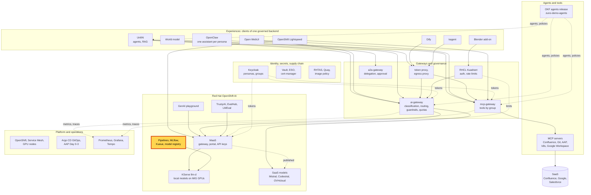
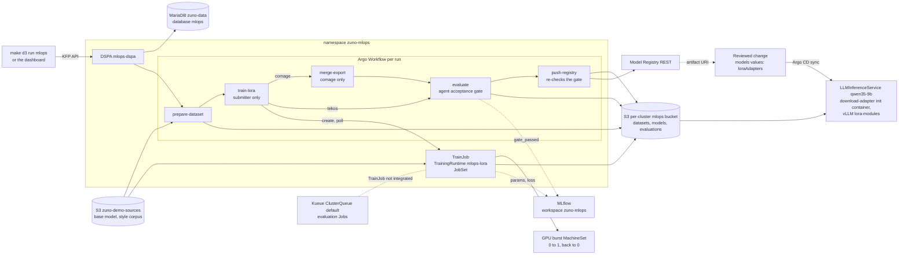
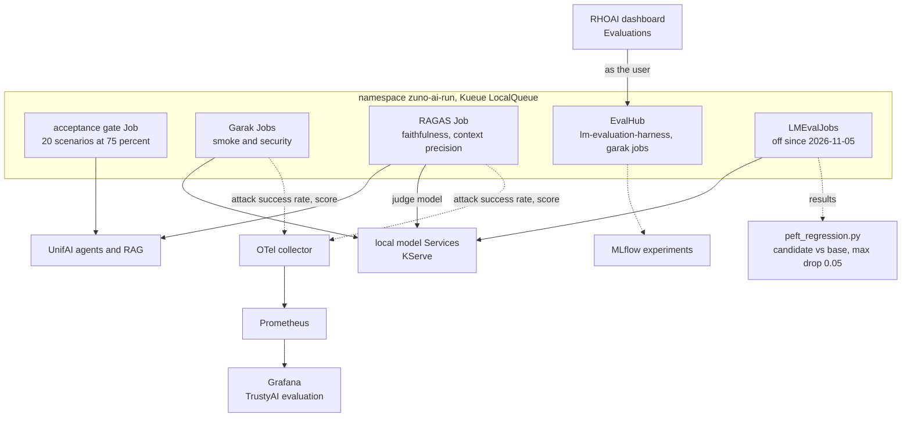

# MLOps Architecture

Last reviewed: 2026-11-19

The MLOps path turns a dataset into a served, evaluated model. KFP orchestrates, a Kubeflow TrainJob does the GPU work, MLflow tracks the run, an evaluation gate decides, and a human-reviewed Git change promotes the result to serving. The serving side is in [ai-architecture.md](ai-architecture.md).

The highlighted box groups the build tools: pipelines, MLflow, Kueue and the model registry.

## Building blocks

- **Pipeline.** A KFP pipeline in `zuno-mlops` (DSPA `mlops-dspa`, metadata in MariaDB) runs prepare-dataset, train-lora, evaluate and push-registry; comage adds a merge-export step ([ADR-0302](../adr/0302-build-dataset-to-model-mlops-pipelines.md), Superseded in part by ADR-0526).
- **Training.** The train step only submits a TrainJob to a namespaced TrainingRuntime and polls it ([ADR-0539](../adr/0539-delegate-lora-training-compute-to-a-kfp-submitted-trainjob.md)). The job lands on a tainted burst GPU MachineSet that scales from zero ([ADR-0351](../adr/0351-share-rtx-pro-6000-gpus-via-nvidia-mig-with-scale-from-zero-burst-capacity.md)).
- **Tracking.** MLflow in `redhat-ods-applications` records parameters, loss and the gate result; tracking never fails a run ([ADR-0538](../adr/0538-adopt-rhoai-35-workload-surfaces-mlflow-kueue-trainingjobs.md)).
- **Queues.** Kueue (Red Hat build, [ADR-0321](../adr/0321-delegate-kueue-lifecycle-to-the-red-hat-build-of-kueue-operator.md)) admits the evaluation Jobs; TrainJobs are not admitted by it today.
- **Serving a fine-tune.** An adapter reaches the base model through a reviewed change to `loraAdapters` ([ADR-0301](../adr/0301-introduce-lora-and-peft-model-customization.md)). The French fine-tune is served as merged weights, as its own model ([ADR-0526](../adr/0526-fine-tune-and-serve-a-french-urban-register-model-variant.md)).
- **Registry.** push-registry writes to the Model Registry only after the gate passes. The catalog and registry pages run in the RHOAI dashboard; the scenario records that demo333 had no registry instance on 2026-11-16.
- **Evaluation.** Acceptance gates (20 scenarios, 75 percent, [ADR-0027](../adr/0027-evaluate-every-agent-with-twenty-acceptance-scenarios.md), [ADR-0028](../adr/0028-require-a-seventy-five-percent-evaluation-threshold.md)), Garak, RAGAS, LM-Eval and EvalHub ([ADR-0534](../adr/0534-integrate-trustyai-for-ai-evaluation-and-guardrails.md)).

## LLD: one LoRA pipeline run

Adapted from the LoRA scenario (Appendix B), drawn from `gitops/charts/mlops`, `components/mlops`, `gitops/charts/mlflow` and `gitops/charts/kueue`.

## LLD: evaluation paths

Adapted from the evaluation scenario (Appendix B).

Scenarios: [LoRA pipeline, MLflow and Kueue](../demo/scenarios/rhoai/lora-pipeline-mlflow-kueue.md), [model catalog and registry](../demo/scenarios/rhoai/model-catalog-registry.md), [evaluation with TrustyAI and EvalHub](../demo/scenarios/rhoai/evaluation-trustyai-evalhub.md).
