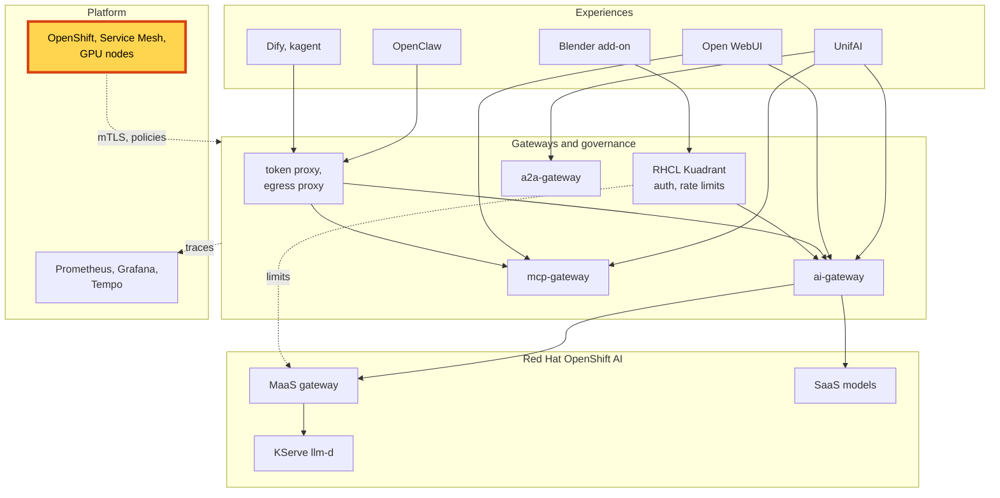
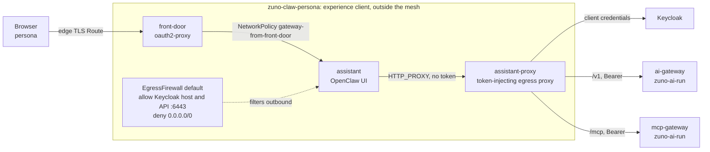
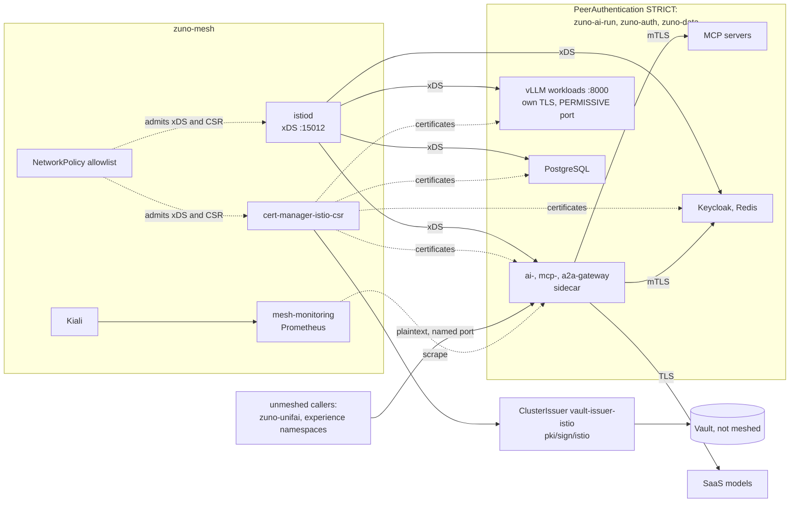

# Network Architecture

Four layers bound traffic: NetworkPolicies (always on, coarse), OVN `EgressFirewall`s (outbound allowlists), the Istio mesh (mutual TLS and workload identity) and Kuadrant (authentication and rate limits at Gateway API entry points). Diagrams are adapted from the scenarios [service mesh and Kiali](../demo/scenarios/foundation/service-mesh-kiali.md), [OpenClaw](../demo/scenarios/experiences/openclaw.md) and [multi-gateway](../demo/scenarios/governance/multi-gateway.md).

## Where this sits in the platform

## NetworkPolicy and EgressFirewall

- **Baseline.** Each platform namespace gets `zuno-default-deny-other-namespaces`: same-namespace and router traffic are allowed, and `allowedFromNamespaces` adds named callers (`gitops/charts/namespaces/templates/networkpolicy-platform.yaml`). `zuno-ai-run` is deliberately excluded (`skipNetworkPolicy`): the baseline would let every pod reach every port of its neighbours and defeat per-workload policies such as the one around `mcp-confluence` ([ADR-0037](../adr/0037-protect-mcp-servers-with-network-and-workload-identity-boundaries.md), Implemented).
- **Experience clients.** Namespaces labelled `zuno.io/experience-client=true` (Open WebUI, Dify, kagent, world model, the per-persona OpenClaw namespaces) are outside the mesh and reach the ai-gateway and mcp-gateway through their NetworkPolicy peers on that label; the label is the grant, so it is set only on a namespace that holds nothing but an experience client ([ADR-0587](../adr/0587-admit-additional-user-experiences-over-the-one-governed-backend.md), Implemented).
- **Mesh control plane allowlist.** `zuno-mesh` admits the namespaces whose sidecars need istiod xDS (:15012) and istio-csr: `zuno-data`, `zuno-auth`, `zuno-ai-run`, `zuno-ai-gateways`, `zuno-ai-build`, `redhat-ods-applications`, `openshift-console`, `zuno-monitoring`, `zuno-mlops`, `rhoai-model-registries` and `openshift-ingress`. A missing entry shows up as a sidecar stuck at startup; several of these were added after such failures (comments in `gitops/charts/namespaces/values.yaml`).
- **EgressFirewall.** Where a namespace declares `egressFirewall`, the chart renders one OVN `EgressFirewall` named `default` that allows only listed hosts (Keycloak's public host, the API server on :6443, named Routes, S3 ranges) and ends with `Deny 0.0.0.0/0` ([ADR-0602](../adr/0602-harden-the-platform-trust-boundaries-before-a-customer-runs-it.md) with WP-224, following [ADR-0590](../adr/0590-front-openclaw-with-oauth2-proxy-and-an-egress-firewall-one-claw-operator-per-persona-namespace.md)). Praxis may reach only the two SaaS model hosts it needs. Accepted residual risks, from the chart: a name rule on a shared load balancer or CDN admits every name behind the same IPs, and DNS stays open.

The egress proxy of [ADR-0589](../adr/0589-serve-per-persona-openclaw-assistants-via-claw-operator-behind-a-token-injecting-egress-proxy.md) (Superseded in part by ADR-0590 for namespaces and exposure) holds the persona's token so the assistant never sees it; the Dify and kagent equivalent is `zuno-token-proxy` ([ADR-0601](../adr/0601-inject-client-credentials-tokens-for-experience-clients-without-oidc-passthrough.md), Implemented). See [identity-architecture.md](identity-architecture.md) and [experiences-architecture.md](experiences-architecture.md).

## Service mesh

Istio runs through the Sail Operator with its control plane in `zuno-mesh`; certificates come from `cert-manager-istio-csr` through the Vault-backed `ClusterIssuer` `vault-issuer-istio` (one-hour workload certificates). Vault itself is deliberately not meshed, since it is the trust root.

[ADR-0602](../adr/0602-harden-the-platform-trust-boundaries-before-a-customer-runs-it.md) clause 4 (as summarised in the scenario; the ADR is Accepted): `STRICT` applies to `zuno-data`, `zuno-auth` and `zuno-ai-run`, not mesh-wide; each exception is one workload's port with a stated reason, and `platform/security/check_mesh_mtls.py` enforces both. The chart values also declare `STRICT` for `zuno-ai-gateways`, with an exception for unmeshed callers of Praxis. No fine-grained AuthorizationPolicy is used (decision of 2026-11-06, per the scenario). Open items: [ADR-0603](../adr/0603-close-the-medium-severity-security-gaps-found-in-the-2026-11-06-review.md) M2 (databases in the mesh with `DISABLE` rules) and M7 (one PKI root), planned by [ADR-0613](../adr/0613-close-the-three-remaining-live-hardening-items-of-adr-0603-in-mid-december.md) (Proposed, so open).

### Mesh timeouts

Envoy closes an idle TCP connection after one hour by default. Redis never closes an idle client, so a client that kept one long-lived connection (Praxis's token limit) failed its next call after an idle hour (WP-292, 2026-11-18). Two knobs exist in the charts, both defaulting to `0s` (no idle timeout): a `DestinationRule` `tcp.idleTimeout` on the Praxis sidecar (`gitops/charts/praxis`) and an `EnvoyFilter` on the Redis sidecar's inbound TCP proxy (`gitops/charts/redis`), because a `Sidecar` `inboundConnectionPool` setting did not reach the TCP proxy on the Istio version in use. An `EnvoyFilter` whose match no longer applies is silently ignored, so it is checked in the sidecar's `config_dump` after each Istio upgrade.

## Connectivity Link (Kuadrant)

Red Hat Connectivity Link installs the Kuadrant operand ([ADR-0317](../adr/0317-install-connectivity-link-and-leaderworkerset-operators.md), Implemented). Two uses are live in the charts:

- **MaaS in front of local models.** `maas-default-gateway` in `openshift-ingress` carries Kuadrant `AuthPolicy` and `TokenRateLimitPolicy`; the ai-gateway sends local-model traffic to it first ([ADR-0521](../adr/0521-route-local-model-traffic-through-maas.md), Implemented), and quotas, keys and exposure are delegated to MaaS ([ADR-0570](../adr/0570-slim-the-ai-gateway-by-delegating-quotas-keys-and-exposure-to-maas.md), Implemented).
- **Request-rate quotas.** One generated `RateLimitPolicy` (`zuno-quota`) per target route, with demo Gateway-fronted HTTPRoutes, from `policies/quotas/quota-policy.yaml` ([ADR-0511](../adr/0511-define-okf-quota-policy-enforced-via-kuadrant.md), Implemented). Kuadrant policies need a Gateway API target, so plain OpenShift Routes cannot carry them. Token budgets are enforced in the gateway and MaaS, not here.

Only one policy of a kind may target a given route: two `RateLimitPolicy` objects on the same `HTTPRoute` do not merge and the second is reported `Overridden`, hence the single merged `zuno-quota` object (connectivity-link chart README).

## Gateways and alternatives

The default road is client to ai-gateway; clients that cannot forward a user token go through a token proxy first. An alternative gateway (Praxis in `zuno-ai-gateways`) sits beside it and verifies the same Keycloak JWT ([ADR-0619](../adr/0619-run-praxis-ai-as-an-alternative-ai-gateway-next-to-the-default-zuno-ai-gateway.md), Accepted). The scenario states that the client wiring work packages (WP-296 to WP-303) were not done when it was written. See [gateways-architecture.md](gateways-architecture.md) and the scenario [multi-gateway](../demo/scenarios/governance/multi-gateway.md).
