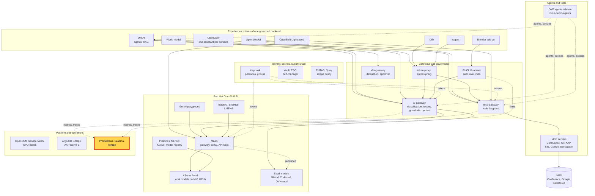
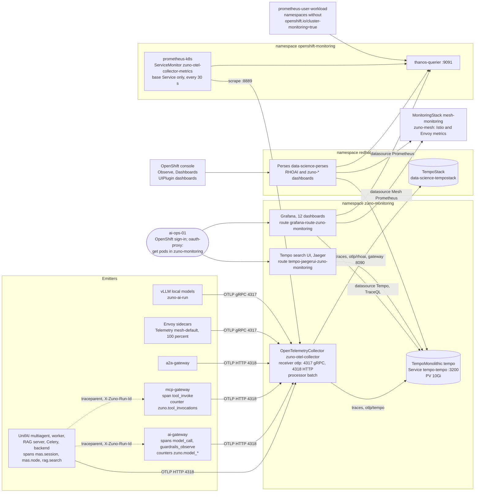

# Observability architecture

Every Zuno service sends traces and metrics over OTLP to one OpenTelemetry collector in `zuno-monitoring`. Traces are
stored in Tempo, with a copy in OpenShift AI's own TempoStack. Metrics are scraped by the cluster's platform Prometheus
and read by Grafana through Thanos; a third Prometheus (the mesh `MonitoringStack`) holds Istio and Envoy metrics. The
gateways stamp spans with the caller's persona, the agent and the run id of the turn, so one TraceQL query finds a whole
turn (`zuno.run_id` on the Zuno services, `mas.run.id` on UnifAI spans). Counters carry labels such as provider, model,
outcome, agent and client, never a person or a run. The demonstration is the scenario
[Observability: one turn traced, every call counted](../demo/scenarios/foundation/observability-trace.md).

## HLD: where it sits

The highlighted box is "Prometheus, Grafana, Tempo". Gateways and UnifAI emit; the collector and the three metric
stores sit in the platform group.

## LLD: how a span and a counter reach a screen

## Reading notes

- **Run id.** One id per turn lets Tempo answer "what did this turn cost and where did the time go" (ADR-0543); UnifAI
  emits OpenTelemetry itself and passes `traceparent` to the gateways (ADR-0566). The per-run Grafana dashboard is
  TraceQL only, because Prometheus cannot filter on an unbounded label.
- **Two dashboard surfaces.** Grafana holds twelve dashboards declared in `gitops/charts/grafana`. The same views exist as
  `PersesDashboard` objects in `gitops/charts/perses` (eleven templates), attached to the Perses instance that OpenShift
  AI already runs and placed in `redhat-ods-monitoring`; Zuno runs no Perses server of its own (ADR-0552, ADR-0553).
- **Three Prometheus instances.** `prometheus-k8s` (namespaces labelled `openshift.io/cluster-monitoring=true`),
  user-workload monitoring (the others), and the mesh stack in `zuno-mesh`. RHOAI's monitoring stack is widened to
  `zuno-ai-run` for the model targets (ADR-0554).
- **Not wired.** `zuno-aap` carries no ServiceMonitor, PodMonitor or collector in `gitops/charts/aap`,
  `aap-config` or `mcp-aap`: AAP telemetry does not reach the collector.
- Mesh tracing is sampled at 100 percent (`randomSamplingPercentage: 100` in
  `gitops/charts/service-mesh/templates/telemetry.yaml`).

## ADRs

| ADR | Status | Role here |
|---|---|---|
| [0029](../adr/0029-instrument-model-usage-costs-and-distributed-traces.md) | Implemented | Usage, cost and traces by user, agent, task, model, provider |
| [0413](../adr/0413-consolidate-grafana-dashboards-into-six-platform-views.md) | Implemented | Dashboards as platform views declared in Git |
| [0523](../adr/0523-dual-export-traces-into-the-rhoai-monitoring-stack.md) | Implemented | Copy of every trace to RHOAI's Tempo |
| [0543](../adr/0543-propagate-a-per-run-id-across-every-service-span.md) | Implemented | Run id on every service span |
| [0551](../adr/0551-add-namespace-scoped-perses-dashboards-alongside-grafana.md) | Superseded in part by 0552 and 0553 | Perses next to Grafana |
| [0552](../adr/0552-reuse-rhoais-perses-instance-instead-of-running-an-independent-one.md) | Implemented | Reuse RHOAI's Perses instance |
| [0553](../adr/0553-collocate-perses-dashboards-in-redhat-ods-monitoring-for-visibility.md) | Implemented | Dashboards in `redhat-ods-monitoring` |
| [0554](../adr/0554-widen-rhoais-monitoringstack-to-observe-zuno-ai-run.md) | Implemented | RHOAI monitoring stack observes `zuno-ai-run` |
| [0566](../adr/0566-instrument-unifai-with-opentelemetry.md) | Implemented | UnifAI emits OpenTelemetry |

Related pages: [gateways-architecture.md](gateways-architecture.md), [agent-platform-architecture.md](agent-platform-architecture.md),
[network-architecture.md](network-architecture.md).
