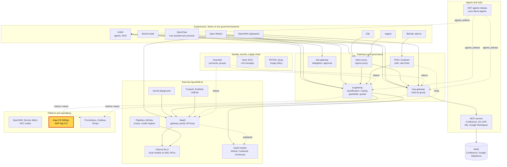
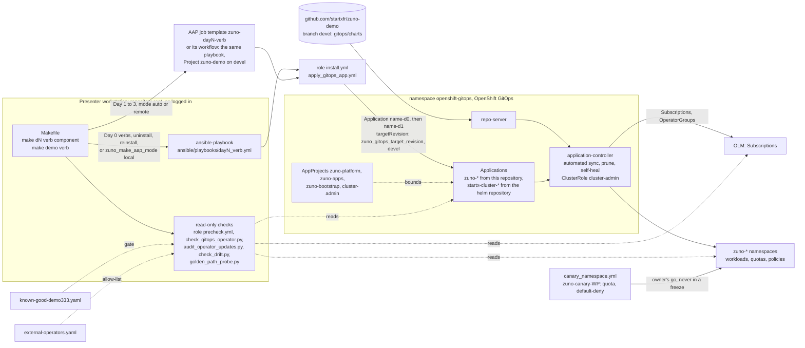

# Operations architecture

Last reviewed: 2026-11-19

Zuno is installed and operated from one entry point: `make`, then a day, a verb and a component. Ansible runs the verb;
for each component a role applies two Argo CD Applications, `<component>-d0` (operator, cluster-scoped objects) then
`<component>-d1` (the service). From then on Argo CD keeps the cluster equal to the branch the Applications follow
(`zuno_gitops_target_revision`, `devel` on demo333), so a push is a deployment. Day 1 to Day 3 verbs may run as AAP job
templates for an audit trail (`zuno_make_aap_mode`). The demonstrations are
[GitOps and Day 0-3](../demo/scenarios/foundation/gitops-day0-3.md) and
[AAP audited operations](../demo/scenarios/foundation/aap-audited-operations.md); the AAP topology is in
[aap-hld.md](aap-hld.md).

## HLD: where it sits

The highlighted box is "Argo CD GitOps, AAP Day 0-3" in the platform group.

## LLD: how a verb reaches the cluster

## The four days

| Day | Holds | Source of the lists |
|---|---|---|
| 0 | Prerequisites and always-on infra: Argo CD, namespaces, Vault, ESO, cert-manager, machines, PostgreSQL, Keycloak, AAP, the world-model GPU node | `DAY0_COMPONENTS` in the `Makefile` |
| 1 | AI platform operator stack (mesh, Kiali, Grafana, Perses, Tempo, Kueue, OpenShift AI, RHTAS, Pipelines ...); build-only: ai-gateway, supply-chain-signer, AAP execution environment | `DAY1_*` |
| 2 | AI infrastructure and content: models, Quay, MCP, agents, mlops, UnifAI, experiences, world model, Praxis | `DAY2_*` |
| 3 | Operations: test, stresstest, backup, restore, check (including operators, drift, recovery), admit, run, release | `DAY3_*` |

## Rules that shape the design

- **Repository is the only source of state (ADR-0608).** Every Subscription is declared by a role or chart, or listed
  with an owner in `platform/drift/external-operators.yaml`; hand-applied objects carry `zuno.io/applied-by-hand`;
  `make d3 check drift` reports the gaps. `make d3 check operators` gates operator versions against
  `platform/olm/known-good-demo333.yaml` (ADR-0607).
- **Canary namespaces (ADR-0609).** Rehearsals use `zuno-canary-<wp>` namespaces (quota, default-deny NetworkPolicy,
  teardown); cluster-scoped operators, Vault, mesh-wide settings and GPU pools are not rehearsable there.
- **Demo lifecycle (ADR-0616).** `make demo` verbs (`use`, `status`, `check`, `install`, `start`, `step`, `stop`, `rehearse`,
  `freeze`) run one Ansible file per action from `ansible/demos/<id>/`; steps are read-only.
- **zuno operator.** ADR-0556 (Foundation, Infra and Stack CRDs) was deprecated on 2026-11-07 and nothing was built. The
  roles above, Argo CD and the UnifAI operator carry its job; ADR-0572 is implemented at the level of the component lists
  and the `unifai` chart only.
- **Node pools (ADR-0614).** Infra pool `zuno-infra-a/b/c` (Red Hat infra-eligible components only, each behind its own
  switch, off by default), general workers `zuno-worker-a/b/c` plus Spot overflow, GPU nodes unchanged and never scaled
  down without the owner's double approval; masters run no workload once `zuno_masters_schedulable` is set.
- **S3 (ADR-0546).** One cross-cluster bucket for model weights and raw sources (`zuno_models_s3_bucket`), and per-cluster
  buckets `zuno-<cluster>-<purpose>` (mlops, backups, registry), one IAM user and Vault path each. Any AWS write needs the
  owner's go.

## ADRs

| ADR | Status | Role here |
|---|---|---|
| [0060](../adr/0060-restructure-day-0-day-1-day-2-day-3-deployment-sequencing.md) | Implemented | Four deployment days |
| [0312](../adr/0312-route-operator-installs-through-argocd-applications.md) | Implemented | Operators installed through Applications |
| [0418](../adr/0418-execute-day-0-and-day-1-operations-as-aap-job-templates.md) | Implemented | Verbs as AAP job templates |
| [0546](../adr/0546-introduce-a-cross-cluster-source-bucket-and-per-cluster-s3-bucket-convention.md) | Implemented | S3 bucket convention |
| [0556](../adr/0556-introduce-a-zuno-operator-with-foundation-infra-and-stack-crds.md) | Deprecated | zuno operator, not built |
| [0572](../adr/0572-scope-the-zuno-operator-to-the-platform-foundation.md) | Implemented (playbook and chart level) | Foundation scope |
| [0607](../adr/0607-pin-gate-and-schedule-pre-ga-dependencies.md) | Implemented | Known-good gate for operators |
| [0608](../adr/0608-keep-the-repository-the-only-source-of-cluster-state.md) | Implemented | Repository is the only source of state |
| [0609](../adr/0609-rehearse-on-canary-namespaces-of-demo333.md) | Implemented | Canary namespaces |
| [0614](../adr/0614-split-the-cluster-into-infra-general-worker-and-gpu-node-pools.md) | Implemented | Node pools |
| [0616](../adr/0616-prepare-and-play-every-catalogue-demo-through-one-make-demo-lifecycle.md) | Implemented | `make demo` lifecycle |

Related pages: [physical-architecture.md](physical-architecture.md), [supply-chain-architecture.md](supply-chain-architecture.md),
[observability-architecture.md](observability-architecture.md), [mlops-architecture.md](mlops-architecture.md).
