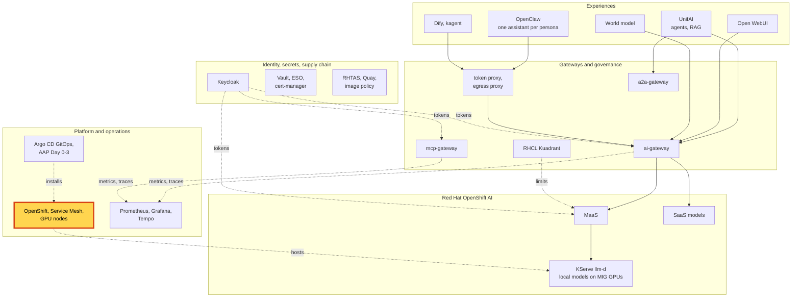
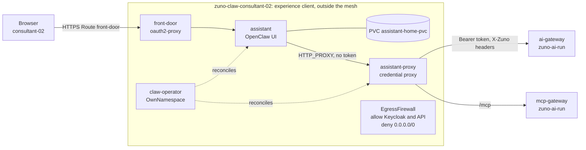
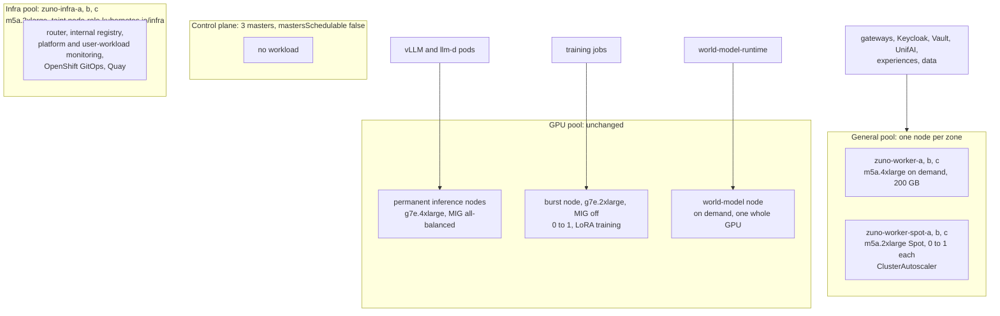
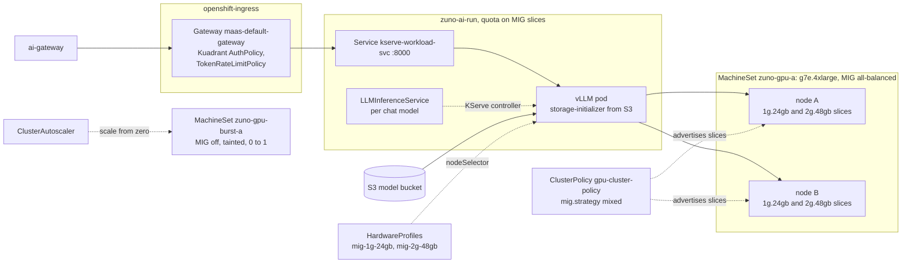
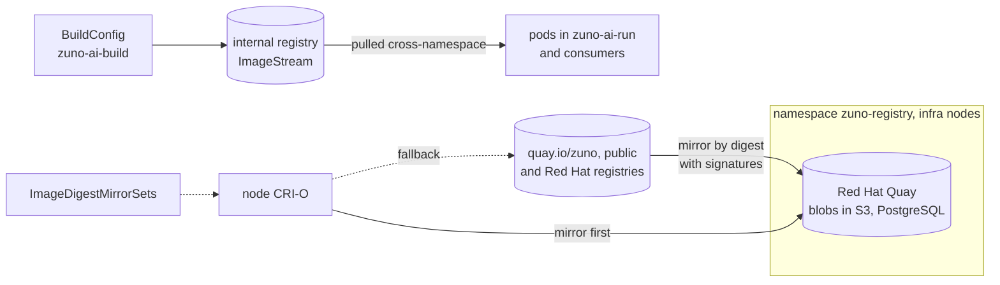

# Physical Architecture

Last reviewed: 2026-11-19

Where Zuno runs: OpenShift on AWS IPI, a fixed set of namespaces, three node pools, GPU nodes for model serving, and two image registries. Diagrams are adapted from the demo scenarios ([GitOps and Day 0-3](../demo/scenarios/foundation/gitops-day0-3.md), [image signing and admission](../demo/scenarios/foundation/image-signing-admission.md), [model serving on MIG](../demo/scenarios/rhoai/model-serving-llmd-mig.md), [OpenClaw](../demo/scenarios/experiences/openclaw.md)).

## Where this sits in the platform

The highlighted box is the subject of this page. Plain arrows carry requests, dotted arrows carry identity, policy or telemetry.

## Cluster and namespaces

Target: OpenShift on AWS IPI, installed and operated through `make` and Argo CD ([ADR-0003](../adr/0003-use-ansible-and-make-as-the-deployment-entry-point.md), [ADR-0060](../adr/0060-restructure-day-0-day-1-day-2-day-3-deployment-sequencing.md)). Namespaces are declared in `gitops/charts/namespaces/values.yaml`; the build/run split and the rule that product-managed namespaces stay product-managed come from [ADR-0333](../adr/0333-separate-product-managed-ai-infrastructure-from-zuno-build-run-and-shared-platform-namespaces.md) (Superseded in part: the `zuno-ai-platform` namespace was removed by [ADR-0548](../adr/0548-remove-the-unused-zuno-ai-platform-reserved-namespace.md)).

| Group | Namespaces | Holds |
|---|---|---|
| Governed backend | `zuno-ai-run`, `zuno-ai-gateways` | ai-gateway, mcp-gateway, a2a-gateway, MCP servers, vLLM workloads and the llm-d schedulers; `zuno-ai-gateways` is the namespace of the alternative gateway Praxis ([ADR-0619](../adr/0619-run-praxis-ai-as-an-alternative-ai-gateway-next-to-the-default-zuno-ai-gateway.md), Accepted) |
| Agents and RAG | `zuno-unifai` | UnifAI stack reconciled by `unifai-operator`, not meshed ([ADR-0561](../adr/0561-adopt-unifai-as-the-agent-platform.md), Implemented) |
| Experiences | `zuno-openwebui`, `zuno-dify`, `zuno-kagent`, `zuno-world-model`, `zuno-claw-<persona>` | Experience clients, outside the mesh; the label `zuno.io/experience-client` is their grant to reach the gateways ([ADR-0587](../adr/0587-admit-additional-user-experiences-over-the-one-governed-backend.md)) |
| Build | `zuno-ai-build`, `zuno-mlops` | In-cluster `BuildConfig`s, signing Jobs, pipelines |
| Identity, secrets, trust | `zuno-auth`, `zuno-vault`, `zuno-rhtas`, `zuno-registry`, `policy-controller-operator` | Keycloak, Vault and ESO, RHTAS, Quay, the image-policy webhook |
| Data and operations | `zuno-data`, `zuno-monitoring`, `zuno-mesh`, `zuno-aap` | PostgreSQL, telemetry, Istio control plane, AAP |
| Product-managed | `redhat-ods-applications`, `redhat-ods-operator`, `rhoai-model-registries`, `openshift-lightspeed`, `models-as-a-service` | OpenShift AI, Model Registry, Lightspeed, MaaS |
| Playgrounds | `zuno-playground` | OGX playgrounds created from the MaaS portal |

Each persona that uses OpenClaw gets its own namespace and its own operator (`zuno-claw-consultant-02`, `zuno-claw-sale-01` in the chart values), because the operator supports `OwnNamespace` only ([ADR-0590](../adr/0590-front-openclaw-with-oauth2-proxy-and-an-egress-firewall-one-claw-operator-per-persona-namespace.md), Implemented). The Praxis, OpenClaw and world-model namespaces appear in the same `platformNamespaces` list as the rest, so they inherit the quotas and policies described in [network-architecture.md](network-architecture.md).

## Node pools

[ADR-0614](../adr/0614-split-the-cluster-into-infra-general-worker-and-gpu-node-pools.md) (Implemented, rolled out on 2026-11-13, WP-260) splits the cluster into three pools. Before it, the three control-plane nodes ran workloads; a master reached 97% CPU and many operators lost their leader election the same day.

Rules of the ADR: the infra pool runs only the Red Hat infra-eligible set (each component has its own switch, off by default); Spot never counts for the one-zone-lost sizing; the running GPU nodes are never scaled down, replaced or drained without the owner's double approval; the major stateless components (mcp-gateway, ai-gateway, MaaS) run two replicas spread over zones, while a2a-gateway stays at one replica, and single-replica components with a zone-bound volume are down while their zone is down, by decision. The chart values confirm two replicas for ai-gateway and mcp-gateway and one for a2a-gateway.

## GPU workers

The permanent inference nodes are g7e.4xlarge instances with one RTX PRO 6000 Blackwell 96 GB each, partitioned by NVIDIA MIG `all-balanced` (2 x 1g.24gb and 1 x 2g.48gb) and a ClusterPolicy with `mig.strategy mixed`; a scale-from-zero g7e.2xlarge node with MIG off serves training only ([ADR-0351](../adr/0351-share-rtx-pro-6000-gpus-via-nvidia-mig-with-scale-from-zero-burst-capacity.md), Implemented). Node Feature Discovery labels the hardware and the NVIDIA GPU Operator installs drivers, toolkit, device plugin and MIG manager, exposing the slices to OpenShift AI.

The world-model demo adds a third, on-demand GPU node (label `zuno.io/gpu-workload=world-model`, from `gitops/apps/machines-world-model`). The `world-model` chart exists only while `zuno_world_model_enabled` is on and keeps one whole GPU in `zuno-world-model` ([ADR-0604](../adr/0604-introduce-an-interactive-generative-world-model-experience.md), Accepted); see [world-model.md](world-model.md). Serving details: [ai-architecture.md](ai-architecture.md).

## Image registries

Two registries coexist ([ADR-0612](../adr/0612-serve-every-zuno-image-from-an-internal-red-hat-quay-backed-by-an-s3-bucket.md), Partially implemented).

- **OpenShift internal registry.** `BuildConfig`s in `zuno-ai-build` push first-party images to it; consumers pull cross-namespace. The ADR's family (b), first-party images, and the retirement of this registry (clause 9) are not started. It cannot hold the signatures of OCI artifacts ([ADR-0611](../adr/0611-mirror-the-admitted-okf-release-into-the-internal-registry.md), Superseded in part by ADR-0612).
- **Red Hat Quay in `zuno-registry`.** Blobs in S3, PostgreSQL for metadata. It serves the OKF release, the UnifAI images, public images and the large Red Hat product images through `ImageDigestMirrorSet`s (nodes try the mirror first, then fall back to the source).

Signing, ledger and admission are covered in [security-architecture.md](security-architecture.md) and [supply-chain-architecture.md](supply-chain-architecture.md).

## Operations and observability

Argo CD (OpenShift GitOps) keeps the cluster equal to the Git branch it follows; Ansible Automation Platform in `zuno-aap` wraps the Day 0-3 playbooks as job templates ([ADR-0418](../adr/0418-execute-day-0-and-day-1-operations-as-aap-job-templates.md), Implemented). See [operations-architecture.md](operations-architecture.md), [aap-hld.md](aap-hld.md) and [observability-architecture.md](observability-architecture.md); the scenario is [GitOps and Day 0-3](../demo/scenarios/foundation/gitops-day0-3.md).
