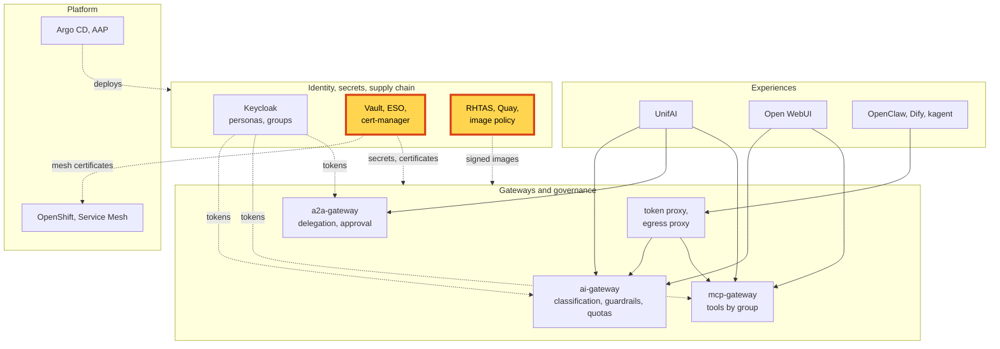
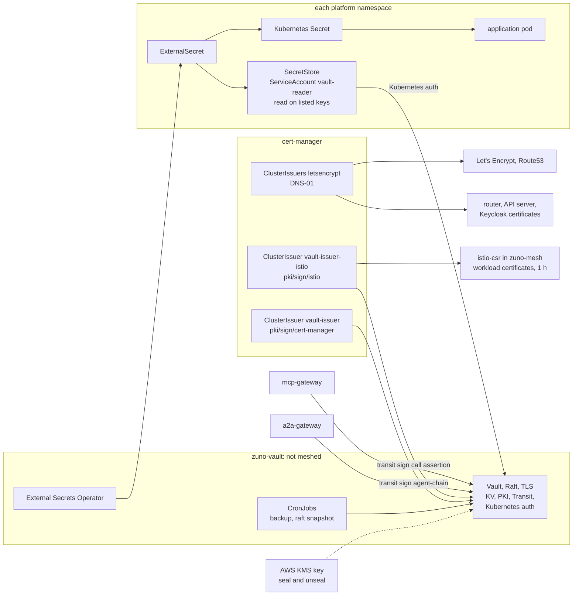
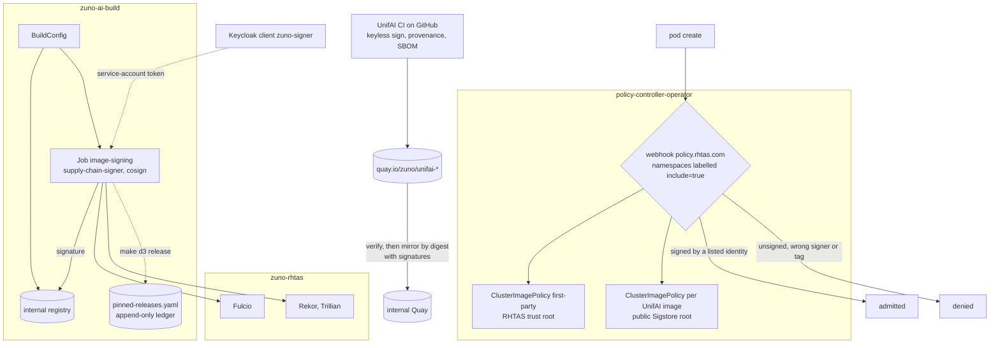

# Security Architecture

Security rests on explicit identity propagation, least privilege and policy intersection, with secrets, certificates and signatures each owned by one component. Diagrams are adapted from the scenarios [Vault and PKI](../demo/scenarios/foundation/vault-pki.md) and [image signing and admission](../demo/scenarios/foundation/image-signing-admission.md).

## Where this sits in the platform

## Principles

Effective authorization combines `agent definition ∩ user/group rights ∩ task rights ∩ data classification ∩ platform policy`. Agent entitlement and business role are separate group dimensions ([ADR-0040](../adr/0040-separate-agent-entitlement-from-business-role-authorization.md), Implemented). C3 content never leaves local inference; C2 content may use external models only after the relevant context restrictions are satisfied (carried over from the previous version of this page, enforced by the ai-gateway; see [gateways-architecture.md](gateways-architecture.md)). Where a call crosses a boundary the caller's identity travels with it: the user token for UnifAI and Open WebUI, a persona's client-credentials token for experiences that cannot forward one ([identity-architecture.md](identity-architecture.md)).

The platform-wide hardening is recorded in [ADR-0602](../adr/0602-harden-the-platform-trust-boundaries-before-a-customer-runs-it.md) (Accepted) and [ADR-0603](../adr/0603-close-the-medium-severity-security-gaps-found-in-the-2026-11-06-review.md) (Accepted); the three items of ADR-0603 left for mid-December are in [ADR-0613](../adr/0613-close-the-three-remaining-live-hardening-items-of-adr-0603-in-mid-december.md) (Proposed, so open). Those two ADRs also define the `demo` and `hardened` security profiles (ADR-0602 clauses 3 and 12, as summarised in the Vault scenario).

| Boundary | Control | Source |
|---|---|---|
| Between namespaces | Default-deny NetworkPolicy plus allowlist; OVN EgressFirewall | [network-architecture.md](network-architecture.md) |
| Between workloads | Istio mTLS, `STRICT` on `zuno-ai-run`, `zuno-auth`, `zuno-data` | ADR-0602 clause 4 |
| Secrets | One `SecretStore` per namespace, reading only listed Vault keys | ADR-0602 clause 2 |
| Vault unseal | AWS KMS auto-unseal, Raft, TLS, root token revoked after bootstrap, UI Route off | ADR-0602 clause 1, ADR-0603 M8 |
| Argo CD | AppProjects `zuno-platform`, `zuno-apps`, `zuno-bootstrap`; the application controller keeps `cluster-admin` (still open) | ADR-0602 clause 5 |
| Gateway assertions | Agent chain and MCP call assertions signed with Vault Transit | ADR-0603 M14, WP-247 |
| Images | Keyless signature, admission policy, release ledger | below |

## Secrets and PKI

Vault (one replica in the chart values, Raft storage, auto-unseal with AWS KMS) in `zuno-vault` is the source of secrets and PKI material. It is not meshed and workloads never call it directly: the External Secrets Operator reads it through a per-namespace `SecretStore`, and cert-manager signs through Vault-backed `ClusterIssuer`s. Let's Encrypt (DNS-01 through Route53) issues the public wildcard and API certificates ([ADR-0211](../adr/0211-publicly-trusted-wildcard-tls-via-lets-encrypt-and-route53.md), Implemented). Credentials stay out of Git ([ADR-0024](../adr/0024-use-vault-for-application-secrets.md), Implemented; its text still names a single `ClusterSecretStore`, replaced by ADR-0602 clause 2).

Seeding writes only the Vault paths that are missing, so a re-run never rotates a value ([ADR-0345](../adr/0345-make-self-generated-vault-credentials-idempotent.md), Implemented). Backups run daily ([ADR-0112](../adr/0112-implement-production-grade-backup-and-recovery.md), Implemented). The PKI root is still a single root with one ServiceAccount for all Vault issuers (ADR-0603 M7, open, planned in ADR-0613). ESO and cert-manager can also run in external mode ([ADR-0352](../adr/0352-run-day-0-platform-services-in-internal-or-external-mode.md), Partially implemented; rehearsed in external mode, internal on the current cluster per the Vault scenario).

## Supply chain trust

Three paths, drawn from the image-signing scenario: what the cluster builds, what UnifAI publishes from CI, and admission.

- **Signing in the cluster.** Red Hat Trusted Artifact Signer signs first-party images keyless with the `zuno-signer` Keycloak identity, replacing the Vault Transit signer ([ADR-0535](../adr/0535-adopt-rhtas-as-the-artifact-trust-and-supply-chain-service.md), Implemented; [ADR-0420](../adr/0420-sign-supply-chain-artifacts-in-cluster-with-vault-transit.md), Superseded by ADR-0535 for images; the Transit pattern is reused for gateway assertions).
- **Release ledger.** `make d3 release` rebuilds, signs and records every component in an append-only ledger ([ADR-0549](../adr/0549-close-the-secnumcloud-supply-chain-gap-with-an-in-cluster-release-ledger.md), Implemented); `make d2 check supply-chain` verifies signatures and the ledger.
- **OKF bundles.** Agent bundles are signed keyless by the GitHub publish workflow and verified by identity, never by key ([ADR-0578](../adr/0578-sign-okf-artifacts-keyless-with-github-oidc-and-verify-them-offline-by-identity.md), Implemented). See [agent-platform-architecture.md](agent-platform-architecture.md).
- **UnifAI images.** Pinned by digest and verified (signature, provenance, SBOM) before deployment, then checked again at admission ([ADR-0586](../adr/0586-verify-the-unifai-runtime-images-by-digest-signature-and-attestations-before-deploying-them.md), Implemented). Admission does not check provenance and SBOM, which the offline verifier checks first (chart comment).
- **Admission.** Policy mode is a value: `warn` first, then `enforce` ([ADR-0603](../adr/0603-close-the-medium-severity-security-gaps-found-in-the-2026-11-06-review.md) M16 and M17). On the cluster described by the scenario (page status, 2026-11-15) all nine policies are `enforce`. The webhook has `failurePolicy Ignore` and only affects namespaces carrying the label `policy.rhtas.com/include=true`, so a namespace that is not opted in is not checked.
- **Registry.** Mirroring into the internal Quay is covered by [ADR-0612](../adr/0612-serve-every-zuno-image-from-an-internal-red-hat-quay-backed-by-an-s3-bucket.md) (Partially implemented) and [ADR-0611](../adr/0611-mirror-the-admitted-okf-release-into-the-internal-registry.md) (Superseded in part). Third-party images built from source in the cluster are the subject of [ADR-0620](../adr/0620-build-third-party-images-from-source-with-openshift-pipelines-and-push-them-to-quay-io.md) (Accepted).

[supply-chain-architecture.md](supply-chain-architecture.md) has the full chain. The change, sign, deploy, consume flow of OKF bundles is in [OKF Workflow](../agents/okf-workflow.md) and the scenario [OKF signed agent release](../demo/scenarios/foundation/okf-signed-agent-release.md).
