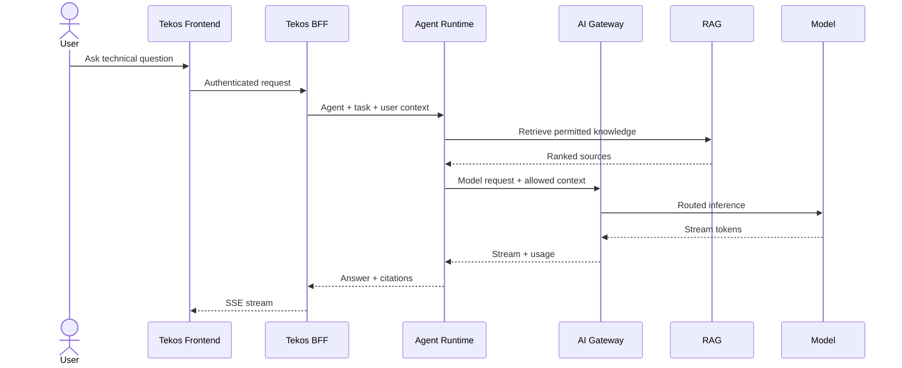
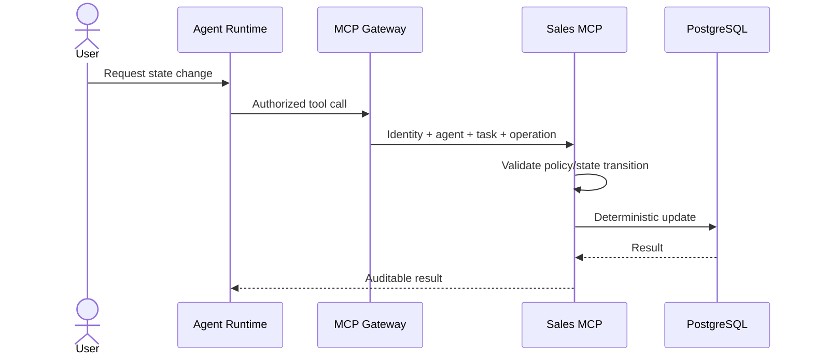
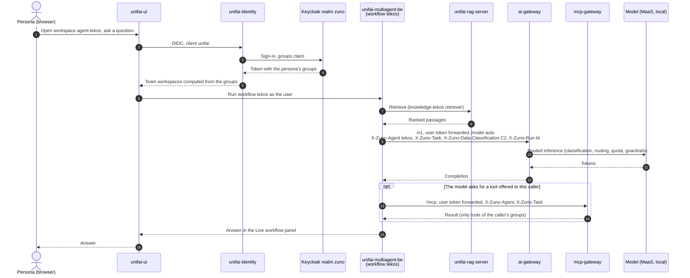
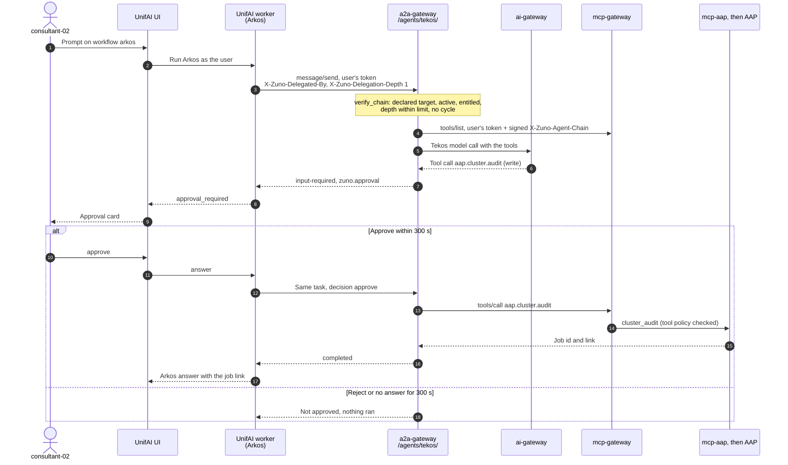
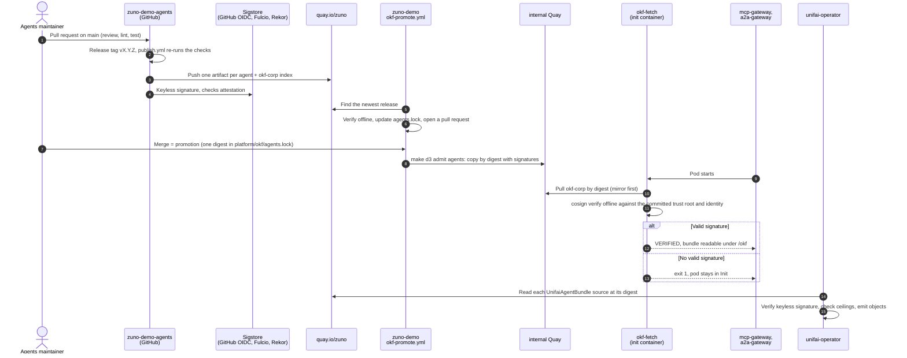

# Sequence Flows

Last reviewed: 2026-11-19

Five flows. The first two are the original request flows of the platform. They predate UnifAI (ADR-0561): the
Tekos frontend, BFF and Agent Runtime they name were superseded by UnifAI, and the "Sales MCP" box has no counterpart
under `components/mcp-servers/` today (the Salesforce server is `salesforce`). They are kept for the legs that still
hold: the user's identity travels with the call, the model goes through the ai-gateway, tools go through the
mcp-gateway, and a write is a deterministic, audited state change. The next three flows are the current ones.

## Tekos RAG request

## Controlled sales write

## A Tekos turn through UnifAI

Scenario: [UnifAI agents](../demo/scenarios/experiences/unifai-agents.md). Decisions:
[ADR-0561](../adr/0561-adopt-unifai-as-the-agent-platform.md),
[ADR-0562](../adr/0562-authenticate-unifai-against-the-zuno-keycloak-realm.md),
[ADR-0563](../adr/0563-forward-caller-identity-and-zuno-context-headers-from-unifai.md),
[ADR-0568](../adr/0568-adopt-unifai-rag-on-qdrant-with-hybrid-search-and-rhoai-embeddings.md).

## An approved A2A delegation

Scenario: [A2A delegation with approval](../demo/scenarios/governance/a2a-delegation-approval.md). Decisions:
[ADR-0401](../adr/0401-introduce-agent-delegation-limited-to-targets-an-agent-declares.md),
[ADR-0403](../adr/0403-propagate-the-users-identity-and-the-delegation-chain-across-a2a-calls.md),
[ADR-0406](../adr/0406-limit-agent-delegation-by-depth-cycle-and-budget.md),
[ADR-0409](../adr/0409-introduce-human-approval-for-delegated-operations-resumable-from-persisted-checkpoints.md),
[ADR-0585](../adr/0585-serve-zuno-agents-over-a2a-from-a-gateway-answering-with-the-callers-identity.md).

## A signed release to a pod

Scenario: [OKF signed agent release](../demo/scenarios/foundation/okf-signed-agent-release.md). Decisions:
[ADR-0576](../adr/0576-extract-agent-definitions-and-corp-policies-into-the-zuno-demo-agents-repository.md),
[ADR-0578](../adr/0578-sign-okf-artifacts-keyless-with-github-oidc-and-verify-them-offline-by-identity.md),
[ADR-0580](../adr/0580-consume-the-corp-okf-bundle-by-a-single-digest-pin-promoted-by-pull-request.md),
[ADR-0564](../adr/0564-deliver-okf-bundles-to-unifai-operator-as-signed-oci-artifacts.md).

For a fuller, scenario-based walkthrough of the same pipeline (AI Gateway, OKF, RAG, MCP, model routing and tracing) with per-agent diagrams, see [Agent Request Workflow](../agents/request-workflow.md).
