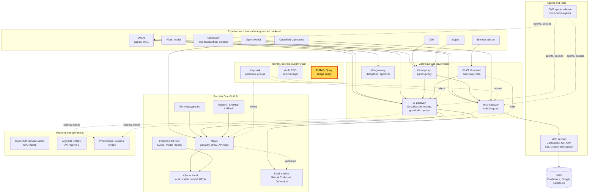
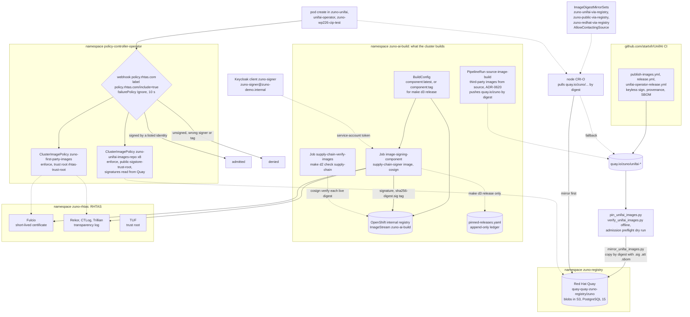

# Supply chain architecture

Last reviewed: 2026-11-19

What runs on Zuno is signed, the signer is named, and the cluster checks the signature before a pod starts. Four
mechanisms carry this: Red Hat Trusted Artifact Signer (RHTAS) signs the images built in the cluster; a release
ledger records every named release; an internal Red Hat Quay serves the images, so most pod starts do not depend on a
public registry; and the Sigstore policy controller refuses an unsigned or wrongly signed image in the namespaces that
opted in. This page is the map; the demonstration is the scenario
[Supply chain: signed images, admission policy and the internal Quay](../demo/scenarios/foundation/image-signing-admission.md),
and the agents release chain is in
[OKF agents release](../demo/scenarios/foundation/okf-signed-agent-release.md).

## HLD: where it sits

The highlighted box is the trust group "RHTAS, Quay, image policy". Plain arrows carry requests, dotted arrows carry
identity, policy or telemetry.

## LLD: signing, mirroring and admission

Three paths. **Build and sign**: each image a BuildConfig builds in `zuno-ai-build` is signed keyless by a Job that gets a
short-lived Fulcio certificate for the Keycloak service identity `zuno-signer`, and Rekor records the signature.
`make d3 release` rebuilds every component from a tag, signs and verifies it, then appends to the ledger
`platform/supply-chain/pinned-releases.yaml`. **Verify and mirror**: the UnifAI images are built and signed by CI of
the UnifAI fork, verified offline by digest, then copied with their signatures to Quay; node-level
ImageDigestMirrorSets read from Quay first and fall back to the public registry. **Admit**: the policy controller
webhook checks `ClusterImagePolicy` objects at pod creation, only in namespaces labelled `policy.rhtas.com/include=true`.

## Reading notes

- Trust is decided by digest and signer identity, never by the registry that serves the bytes (ADR-0612 clause 5).
- The webhook uses `failurePolicy: Ignore` in `gitops/charts/rhtas-config`, so a webhook outage does
  not block pods; the policies themselves are in `enforce`.
- Quay is one replica of each component, with blobs in an S3 bucket (`zuno-<cluster>-registry`) and its own PostgreSQL;
  it is on the pod-start path for images a node does not hold yet. Clair is limited to Red Hat sources (ADR-0612).
- First-party images (family b of ADR-0612) still come from the OpenShift internal registry; that migration has not
  started. Third-party images built from source (Praxis) go through Tekton to `quay.io/zuno` and are pinned by digest
  but not signed (ADR-0620, Accepted).
- Day-3 operations: `make d3 release supply-chain`, `make d2 check supply-chain`, `make d3 admit agents`, `make d3 backup quay-registry`.

## ADRs

| ADR | Status | Role here |
|---|---|---|
| [0535](../adr/0535-adopt-rhtas-as-the-artifact-trust-and-supply-chain-service.md) | Implemented (qualified) | RHTAS signs images built in the cluster |
| [0549](../adr/0549-close-the-secnumcloud-supply-chain-gap-with-an-in-cluster-release-ledger.md) | Implemented | Named release, signed, append-only ledger |
| [0586](../adr/0586-verify-the-unifai-runtime-images-by-digest-signature-and-attestations-before-deploying-them.md) | Implemented | UnifAI images pinned by digest and verified (signature, provenance, SBOM) |
| [0611](../adr/0611-mirror-the-admitted-okf-release-into-the-internal-registry.md) | Superseded in part by 0612 | Admitted OKF release mirrored; the registry part moved to Quay |
| [0612](../adr/0612-serve-every-zuno-image-from-an-internal-red-hat-quay-backed-by-an-s3-bucket.md) | Partially implemented (open) | One internal Quay; families a, c, d, e live; first-party images not started |
| [0620](../adr/0620-build-third-party-images-from-source-with-openshift-pipelines-and-push-them-to-quay-io.md) | Accepted (open) | Third-party images built by Tekton, pushed to quay.io |
| [0115](../adr/0115-use-immutable-and-verifiable-software-supply-chain-artifacts.md) | Deferred (open) | Original goal of verifiable artifacts published by CI |

Related pages: [security-architecture.md](security-architecture.md), [agent-platform-architecture.md](agent-platform-architecture.md),
[operations-architecture.md](operations-architecture.md).
