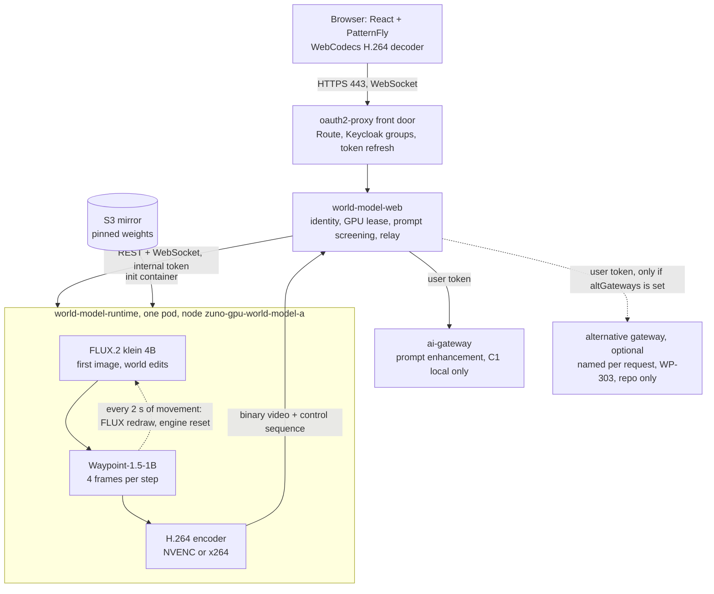

# World model

Last reviewed: 2026-11-19

The interactive generative world-model experience of ADR-0604: a browser demo in which a visitor describes a place, walks into it
and changes it while inside, on one RTX PRO 6000 Blackwell that exists only while the demo is on. This page is the one-screen map;
the decisions, their reasons and the gates are in
[ADR-0604](../adr/0604-introduce-an-interactive-generative-world-model-experience.md) (status Accepted, so still open), the presenter's steps in
[the demo script](../demo/world-model.md).

## What is where

| Piece | Where | Lifetime |
|---|---|---|
| GPU node (one RTX PRO 6000 Blackwell on a `g7e` instance, no MIG; MachineSets for `g7e.4xlarge`, `g7e.2xlarge` and `g7e.8xlarge` in zones a and b are searched together because capacity comes and goes, and only the zone that gets a node is kept) | `gitops/apps/machines-world-model`, role `world_model_gpu` | only while `zuno_world_model_enabled` is true (`false` in the committed `ansible/inventories/demo333/cluster.yml`) |
| Runtime, web tier, front door | `gitops/charts/world-model`, role `world_model` | same switch |
| Namespace, GPU quota, SecretStore | `gitops/charts/namespaces`, `gitops/charts/external-secrets` | always (empty while off) |
| Keycloak client `world-model` and its group | realm import, created live by the role | always |
| Model weights, pinned | S3 `zuno-demo-sources/models/world-model`, `platform/world-model/models.lock.yaml` | always |
| Dashboard, cost alert | `gitops/charts/grafana`, `gitops/charts/observability` | always (empty while off) |

## Rules worth knowing

- **One switch** (`zuno_world_model_enabled`, in `ansible/inventories/<cluster>/cluster.yml`) drives both the node (Day 0, run locally: the
  AAP credential has no Machine API rights) and the application (Day 2). Install converges to it; off removes what is left.
- **One world per GPU.** The lease is taken before the slow image generation; a second visitor is told busy. A tab left open
  frees the GPU after 60 seconds, a quiet session after 3 minutes, any session after 30. The Sign out button frees the GPU first, then ends the Keycloak session.
- **Waypoint-1.5 takes no text.** A visitor's prompt is a FLUX edit of the current frame spliced into the world (`append_frame`).
- **Drift is contained by re-anchoring** (ADR-0604 D9, 2026-11-09). Waypoint loses its scene within about 10 s of walking, so
  every `anchorSeconds` (chart default 2) of movement, never while idle, FLUX redraws the current frame at 1024x512 and the
  engine is reset from it; the browser shows "Stabilizing the world". It is a mitigation: a long walk still ends elsewhere.
- **Images.** The runtime and web tier are built in-cluster and signed by the existing chain (ADR-0535); the oauth2-proxy front door
  is third-party, unsigned and pinned by digest (`gitops/charts/world-model/values.yaml`).
- **Identity is the validated token.** The front door forwards and refreshes it (the access token lives 15 minutes); the API
  checks signature, issuer, audience, expiry and group again, and a header never grants anything.
- **Governed prompts.** Local rules always; the ai-gateway rewrites and screens when it can, with C1 and local-only, and the demo
  degrades to the filtered text when it cannot. The chart can name an alternative AI gateway for this call (`altGateways`,
  WP-303, empty by default, nothing deployed; ADR-0619); the visitor's own token goes to it. There is no path to an external
  model provider.
- **Honest measurements.** Frames carry the last control sequence they reflect, so the browser measures real input-to-display
  latency; the engine step, VRAM and displayed frames come from this GPU, never from a vendor figure.

## Not in v1

WebRTC (the video runs over the HTTPS Route), the ai-gateway image provider for FLUX, MIG, several concurrent worlds, a persistent
world, and a Perses copy of the dashboard (ADR-0604 §13).
