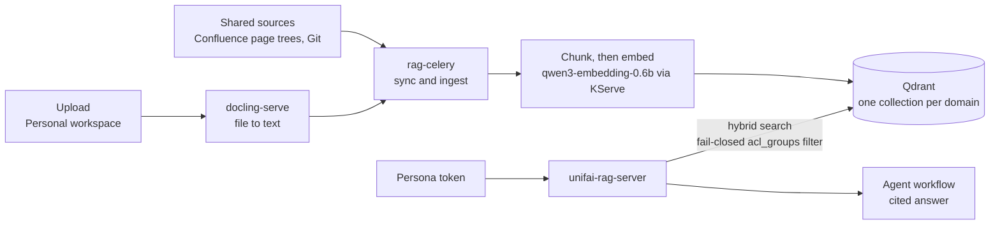

# RAG Data Flow

Last reviewed: 2026-11-19

From a source to a cited answer, as it runs today in the UnifAI stack ([ADR-0568](../adr/0568-adopt-unifai-rag-on-qdrant-with-hybrid-search-and-rhoai-embeddings.md)).
The earlier KFP `rag-ingestion` pipeline (fetch, detect changes, normalize, chunk, embed, write to pgvector) was retired with it; its diagram and
the history of its decisions ([ADR-0330](../adr/0330-integrate-the-rag-ingestion-pipeline-as-a-day1-component.md), [ADR-0519](../adr/0519-parallelize-and-shortcut-the-rag-ingestion-fetch-stages.md),
[ADR-0046](../adr/0046-make-rag-retrieval-metadata-aware-and-bilingual.md)) are in the ADRs, which are marked Superseded.

1. **Sources.** A person uploads files in the Personal workspace (private to them); shared sources are page trees synced from Confluence or
   repositories, readable by the groups listed on each source. The platform-wide domains and which agents may read them are in the signed
   agents release.
2. **Ingestion.** docling converts a file to text, the rag-celery worker chunks it, and the embeddings are computed by
   `qwen3-embedding-0.6b` on OpenShift AI. The chunks are written to Qdrant, one collection per knowledge domain.
3. **Retrieval.** The agent workflow calls `unifai-rag-server` with the user's token; hybrid search runs with a fail-closed `acl_groups` filter taken
   from the caller's groups, so a person finds only their own uploads and the sources their groups allow.
4. **Answer.** The model call goes through the ai-gateway; the answer cites the sources it used ([agent request workflow](../agents/request-workflow.md)).
5. **Observability.** Each turn carries a run id and one trace in Tempo; UnifAI's incremental sync exposes no lag metric
   ([SLO](../platform/slo.md)).

## Evaluation

Evaluation of the RAG corpora runs through TrustyAI and EvalHub ([ADR-0534](../adr/0534-integrate-trustyai-for-ai-evaluation-and-guardrails.md),
[evaluation scenario](../demo/scenarios/rhoai/evaluation-trustyai-evalhub.md)). The blue/green corpus promotion of the earlier target design was
never built and is not part of the UnifAI RAG.

## Earlier target design

The [full RAG training workflow diagram](../assets/img/Workflow-trainingRAG.png) of the retired pipeline is kept as history; it showed a target shape, not what runs.

## Related

[Vector data model](vector-data-model.md), [data architecture](../architecture/data-architecture.md), [live RAG scenario](../demo/unifai-live-rag.md).
