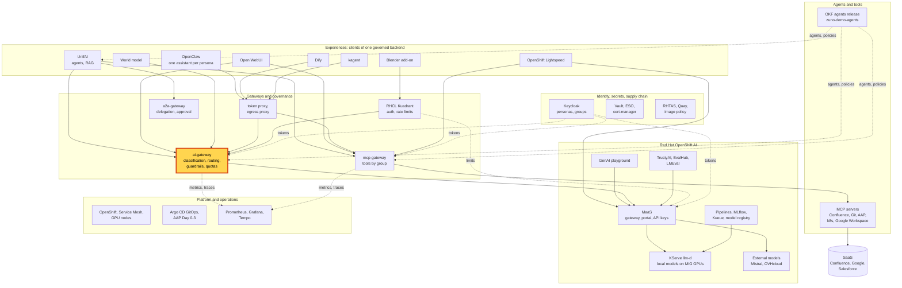
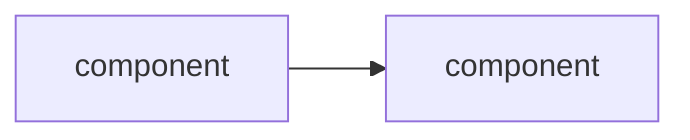

# Scenario: &lt;Brick&gt; - &lt;feature&gt;

> **Status:** Not rehearsed. Prerequisites checked read-only on demo333 on YYYY-MM-DD: &lt;what was checked&gt;.
> **Show-ready ([ADR-0606](../adr/0606-admit-new-experiences-with-a-definition-of-done-and-a-wip-limit.md)):**
> Yes, golden-path probe `<name>` - or - No golden-path probe: rehearse before showing it to an audience.
> **Personas:** see [Personas](#personas).
> **Used in workshops:** &lt;links&gt;

How to use this template (delete this paragraph in a real page):

- One brick, or one feature of a brick, per page. One proof per step.
- The 5-minute version is the message and one visible proof, for any audience. The 15-minute version starts where the
  5-minute version stops and goes into the mechanism, for a technical audience. It never repeats the 5-minute steps.
- Every step has a "You should see" checkpoint. If you do not see it, go to "If something goes wrong".
- Prompts are given verbatim, in the language they were tested in. A translation that was never run is marked
  *(untested translation)*.
- Credentials are never written here: give the Vault path.
- The Personas section lists every account the page signs in with, and the ones only named in the story. Each row
  says who the persona is, what it is entitled to in this scenario, and what the presenter does with it.
- Copy Appendix A unchanged and move the `class ... focus` line to the brick of the page.
- An experience that needs its own installation or preflight on the presenter's side (an add-on, a GPU node switched
  on) may add **Appendix C - Setup** after Appendix B. Keep the scenario sections free of installation steps.
- Paths below are relative to `docs/demo/`. A page under `scenarios/<layer>/` adds `../../` to every link.

## Introduction

&lt;Two to four sentences: what the brick is and why Zuno has it. Where it sits in the platform:
see [Appendix A](#appendix-a---hld). What is inside it: see [Appendix B](#appendix-b---lld).&gt;

**The message:** &lt;one sentence the audience should repeat after the demo&gt;.

**Decisions:** [ADR-NNNN](../adr/TEMPLATE.md) &lt;one line each&gt;.

## Personas

The personas are fictional role accounts of the Keycloak realm `zuno`
([ADR-0349](../adr/0349-restructure-demo-personas-cluster-access-groups-and-new-agents.md)). They share one password,
kept in Vault at `keycloak/demo-personas`. The [catalogue](README.md#personas) lists all of them.

| Persona | Profile | What it can do here | Role in this demo |
|---|---|---|---|
| **&lt;persona&gt;** | &lt;job, office, the Keycloak groups that matter here&gt; | &lt;entitlements: tools, models, budget, RBAC&gt; | &lt;what the presenter does with it, and in which version&gt; |

Other identities: &lt;service accounts, probe identities, the presenter's `oc` session&gt;.

## Before you start

- [ ] &lt;Account and where its password is (Vault path)&gt;
- [ ] &lt;URL to open, in which browser profile&gt;
- [ ] &lt;Warm-up: a first request to wake a cold model, a page to pre-load&gt;
- [ ] &lt;Known warning on screen that is not a failure, and what to say about it&gt;
- [ ] Golden-path probe `<name>` passed within the last hour (`ONLY=<name> make demo golden-path`), see
  [golden-path.md](golden-path.md).

## 5-minute version

| Time | Do | Say | You should see |
|---|---|---|---|
| 0:00 | &lt;action&gt; | &lt;sentence&gt; | &lt;checkpoint&gt; |
| 1:30 | | | |
| 4:00 | Close | &lt;the message&gt; | |

## 15-minute version

Run the 5-minute version, then:

| Time | Do | Say | You should see |
|---|---|---|---|
| 5:00 | &lt;deep-dive: configuration, dashboard, trace, internals&gt; | | |
| 14:00 | Close | | |

## If something goes wrong

| Symptom | Fallback | Say |
|---|---|---|
| &lt;what the presenter sees&gt; | &lt;what to do instead&gt; | &lt;one honest sentence&gt; |

## Limits

- &lt;What this scenario does not show, and why&gt;
- &lt;Named limits of the brick (ADR-0606 clause 1)&gt;

## Appendix A - HLD

Where the brick sits in Zuno. The highlighted box is the subject of this page. Plain arrows carry requests, dotted
arrows carry identity, policy or telemetry.

## Appendix B - LLD

&lt;The brick's internals: pods, custom resources, ports, the request path and where the decision is made. Drawn from
its chart and component in this repository. Name the files the diagram was drawn from.&gt;

