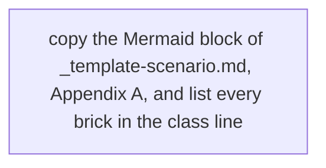

# Workshop: &lt;title&gt;

> **Status:** Built from &lt;n&gt; scenarios, linked in the agenda. Not rehearsed as a whole. Each block keeps the status of
> its scenario page.
> **Show-ready:** only if every probe of its blocks passed within the last hour:
> `ONLY=<probe>,<probe> make demo golden-path`. A block without a probe is rehearsed the same day.
> **Duration:** &lt;NN&gt; minutes, presenter-led. **Audience:** &lt;who&gt;.
> **Personas:** see [Personas](#personas).

How to use this template (delete this paragraph in a real page):

- A workshop tells one story with several scenarios. It does not copy their steps: every block links the scenario page
  and says which version to play (5 or 15 minutes). The presenter opens that page for the steps, the checkpoints and the
  fallbacks.
- A block whose scenario is not written yet is described inline, under "Inline blocks", and marked "(planned)" in the
  agenda. It moves to a link when the scenario exists.
- Appendix A is the same platform map as in the scenarios, with every brick of the workshop highlighted
  (`class A,B,C focus;`). The internals of each brick stay in Appendix B of its scenario page.
- Paths below are relative to `docs/demo/`. A page under `workshops/` adds `../` to every link.

## Introduction

&lt;The story in three to five sentences: what the audience will see, in which order, and why that order. Where the bricks
sit in the platform: see [Appendix A](#appendix-a---hld).&gt;

**The message:** &lt;one sentence&gt;.

**Decisions:** &lt;the ADRs the story rests on&gt;.

## Personas

The personas are fictional role accounts of the Keycloak realm `zuno`
([ADR-0349](../adr/0349-restructure-demo-personas-cluster-access-groups-and-new-agents.md)). They share one password,
kept in Vault at `keycloak/demo-personas`. The [catalogue](README.md#personas) lists all of them.

| Persona | Profile | Blocks |
|---|---|---|
| **&lt;persona&gt;** | &lt;job, groups that matter&gt; | &lt;the blocks where it signs in&gt; |

## Agenda

| Time | Block | Play | Transition to the next block |
|---|---|---|---|
| 0:00 | Opening | The message, then Appendix A on screen | &lt;sentence&gt; |
| 0:05 | &lt;block&gt; | a link to `scenarios/<layer>/<page>.md#5-minute-version`, then "5-minute version" | &lt;sentence&gt; |
| 0:50 | Questions | | |

## Before you start

- [ ] The "Before you start" checklist of every scenario in the agenda, done once. The items they share:
  - [ ] &lt;browser profiles, one per persona&gt;
  - [ ] &lt;tabs to open&gt;
  - [ ] &lt;dashboards&gt;
- [ ] `ONLY=<probe>,<probe> make demo golden-path` passed within the last hour.

## Inline blocks

&lt;Only for agenda blocks whose scenario is not written yet. Same table as a scenario: Time | Do | Say | You should see.&gt;

## If time runs short

Drop blocks in this order: &lt;least important first&gt;. The story still holds with &lt;the minimum set&gt;.

## If something goes wrong

| Symptom | What to do |
|---|---|
| A block's probe failed on the morning | Skip the block; say what it would have shown. |
| A block fails on stage | Use the fallback of its scenario page, then move on. Do not debug on stage. |

## Limits

- &lt;What the workshop does not show, and where it is shown instead&gt;

## Appendix A - HLD

The platform map with every brick of this workshop highlighted.

