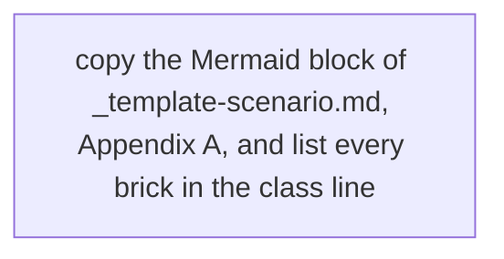

# Workshop: &lt;title&gt;

How to use this template (delete this paragraph in a real page):

- A workshop tells one story with several scenarios. It does not copy their steps: every block links the scenario page
  and says which version to play (5 or 15 minutes). The presenter opens that page for the steps, the checkpoints and the
  fallbacks.
- A block whose scenario is not written yet is described inline, under "Inline blocks", and marked "(planned)" in the
  agenda. It moves to a link when the scenario exists.
- Appendix A is the same platform map as in the scenarios, with every brick of the workshop highlighted
  (`class A,B,C focus;`). The internals of each brick stay in Appendix B of its scenario page.
- The sections come in this order: Introduction, Personas, Agenda, Presenter lifecycle, the workshop's own sections
  (inline blocks, a short story block), If time runs short, If something goes wrong, Limits, Appendix A, References, and
  Page status last ([ADR-0617](../adr/0617-record-the-demos-and-publish-them-as-gifs-with-the-owners-go.md)). The
  Introduction, Personas and Presenter lifecycle name no ADR and no work package and link nothing under `docs/adr/` or
  `docs/roadmap/`: those go in References. A workshop has no GIF of its own: its page links the scenarios' pages.
- Paths below are relative to `docs/demo/`. A page under `workshops/` adds `../` to every link.

## Introduction

&lt;The story in three to five sentences: what the audience will see, in which order, and why that order. Where the bricks
sit in the platform: see [Appendix A](#appendix-a---hld).&gt;

**The message:** &lt;one sentence&gt;.

## Personas

The personas are fictional role accounts of the Keycloak realm `zuno`. They share one password, kept in Vault at
`keycloak/demo-personas`. The [catalogue](README.md#personas) lists all of them.

| Persona | Profile | Blocks |
|---|---|---|
| **&lt;persona&gt;** | &lt;job, groups that matter&gt; | &lt;the blocks where it signs in&gt; |

## Agenda

| Time | Block | Play | Transition to the next block |
|---|---|---|---|
| 0:00 | Opening | The message, then Appendix A on screen | &lt;sentence&gt; |
| 0:05 | &lt;block&gt; | a link to `scenarios/<layer>/<page>.md#5-minute-version`, then "5-minute version" | &lt;sentence&gt; |
| 0:50 | Questions | | |

## Presenter lifecycle

`make demo use <workshop-id>` selects this workshop.
Its actions chain the actions of the scenarios in the agenda (status, check, install and start in agenda order; stop
and uninstall in reverse), then run the workshop's own file. Each section says only what is the workshop's own, or
"Nothing to do.".

### Status

&lt;Nothing to do, or what the workshop adds to its scenarios' status.&gt;

### Check

&lt;The merged probes (`<probe>,<probe>`) and browser checks; what to do when one block is red. `make demo rehearse
<workshop-id>` lists them and asks for the workshop id, or `DEMO_CONFIRM=<workshop-id>`, before it runs them.&gt;

### Install

Nothing to do.

### Start

&lt;What the scenarios' start sections share: browser profiles, one per persona; tabs; dashboards.&gt;

### Stop

Nothing to do.

### Uninstall

Nothing to do.

## Inline blocks

&lt;Only for agenda blocks whose scenario is not written yet. Same table as a scenario: Time | Do | Say | You should see.&gt;

## If time runs short

Drop blocks in this order: &lt;least important first&gt;. The story still holds with &lt;the minimum set&gt;.

## If something goes wrong

| Symptom | What to do |
|---|---|
| A block's probe failed on the morning | Skip the block; say what it would have shown. |
| A block fails on stage | Use the fallback of its scenario page, then move on. Do not debug on stage. |

## Limits

- &lt;What the workshop does not show, and where it is shown instead&gt;

## Appendix A - HLD

The platform map with every brick of this workshop highlighted.

## References

The decisions this workshop rests on:

- [ADR-NNNN](../adr/TEMPLATE.md): &lt;one line each&gt;.
- [ADR-0349](../adr/0349-restructure-demo-personas-cluster-access-groups-and-new-agents.md): the demo personas, their
  groups and their shared password.
- [ADR-0616](../adr/0616-prepare-and-play-every-catalogue-demo-through-one-make-demo-lifecycle.md): the `make demo`
  lifecycle that the Presenter lifecycle section follows.

Evidence: &lt;work-package evidence links, one line each, with what each proves&gt;.

## Page status

> **Status:** Built from &lt;n&gt; scenarios, linked in the agenda. Not rehearsed as a whole. Each block keeps the status of
> its scenario page.
> **Show-ready:** only if every probe of its blocks passed within the last hour:
> `ONLY=<probe>,<probe> make demo golden-path`. A block without a probe is rehearsed the same day.
> **Duration:** &lt;NN&gt; minutes, presenter-led. **Audience:** &lt;who&gt;.
> **Personas:** see [Personas](#personas).
