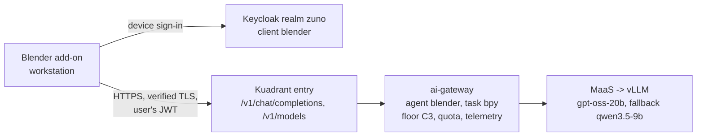

# Demo script: Blender 3D objects from text, on the platform's local model

Audience: the presenter, and the platform team preparing a workstation. Decision:
[ADR-0610](../adr/0610-generate-blender-objects-as-bpy-scripts-from-a-local-model-through-the-ai-gateway.md)
(Target v0.17), under [ADR-0587](../adr/0587-admit-additional-user-experiences-over-the-one-governed-backend.md) and
[ADR-0606](../adr/0606-admit-new-experiences-with-a-definition-of-done-and-a-wip-limit.md).

> **Status: live on demo333, in the 2026-11-09 demonstration (moment 4 of
> [demo-day-2026-11-09.md](demo-day-2026-11-09.md)).** [WP-244](../roadmap/work-packages/wp-244-blender-workstation-experience-client.md)
> built the chain, [WP-245](../roadmap/work-packages/wp-245-blender-prompt-set-and-golden-path-probe.md) measured the
> prompts (23 of 24 runs build a scene with the add-on's system prompt v2) and added the `blender` golden-path moment.

## The message

A 3D artist types a sentence in Blender and gets editable objects: real primitives, modifiers and materials, not a
frozen mesh. The prompt, the generated code and the scene never leave the company: the model is `gpt-oss-20b` on the
platform's own GPUs, reached through the same governed chain as every other experience, under the artist's own
identity, counted in the same dashboards.



## Day 0: prerequisites

Workstation:

- Blender 4.0 or newer (it ships Python with `certifi`, which the add-on uses for TLS).
- HTTPS reach to the ai-gateway hostname `https://ai-gateway.apps.<cluster-domain>` and to Keycloak
  `https://keycloak.apps.<cluster-domain>`.
- A `zuno` account in an admitted group (demo333: `ocp-ai-dev`); for the demo, the persona **ai-dev-01**.
- Only on a cluster whose routes do not serve the Let's Encrypt wildcard (ADR-0211): the cluster's CA certificate as a
  PEM file. Never disable certificate verification instead.

Platform:

- `gpt-oss-20b` and `qwen3.5-9b` served in `zuno-ai-run` (already the case; nothing to deploy for the models).
- The ADR-0610 work package rolled out.

## Day 1: platform changes (WP-244, through GitOps)

Everything below lands as commits and is synced by ArgoCD (ADR-0608). Nothing is applied by hand.

| Change | Where | Applied by |
|---|---|---|
| Public Keycloak client `blender`, device authorization grant only, `maas-gateway-audience` mapper | `gitops/charts/keycloak/files/realm-zuno.json` | the push (client-reconcile Job) |
| `blender` in `experienceClients` | `gitops/charts/ai-gateway/values.yaml` | the push |
| `classification.clientFloors: {blender: C3}`, NetworkPolicy peer for zuno-agent-gateway | `ansible/clusters/<cluster>.yml` (`zuno_ai_gateway_classification_client_floors`, `zuno_ai_gateway_workstation_entry`) | `make d2 install llm` |
| Route `ai-gateway.apps.<domain>`, HTTPRoute (two paths), AuthPolicy (issuer, audience, `azp: blender`, group `ocp-ai-dev`), RateLimitPolicy (60 requests per user per 5 min) | `gitops/charts/connectivity-link/templates/workstation-entry.yaml`, on in `gitops/apps/connectivity-link/application-d1.yaml` | `make d1 install connectivity-link` |
| Experience client `blender`, task `bpy`, `models.preferred: [reasoning]` (`gpt-oss-20b` first), no tools, C3 | `experience-clients/blender/` in zuno-demo-agents | the agents release and its promotion |

The ai-gateway's per-persona token budgets apply on top of the entry's request rate.

Read-only checks once synced:

```bash
oc get llminferenceservice -n zuno-ai-run                       # gpt-oss-20b and qwen35-9b Ready
oc get httproute,authpolicy,ratelimitpolicy -n zuno-ai-run | grep workstation   # Accepted and Enforced
```

## Day 2: the presenter's workstation and the demonstration

### Who prepares what, and when

- **The presenter prepares their own workstation** (the laptop on stage, with a screen): Blender and the add-on,
  once, before the Sunday 20:00 freeze or at the latest at the 08:30 preflight. Nothing is installed on the cluster
  for this step.
- **The platform is ready** when `make demo golden-path` passes, its `blender` moment included (device sign-in of
  `eval-ai-dev-01`, one generation, C3 floor and `gpt-oss-20b` in the ai-gateway log).

### Install (once, about 10 minutes)

1. Install **Blender 4.2 LTS or newer** (measured headless on 4.2.3; run by the presenter on 5.2.0 LTS on
   2026-11-07, where the add-on shows as a Legacy (User) add-on, version 0.2.0).
2. Download the add-on [evaluations/blender/zuno_3d_generator.py](../../evaluations/blender/zuno_3d_generator.py)
   (on GitHub, branch `devel`: open the file, **Raw**, save it).
3. Blender: **Edit > Preferences > Add-ons**, menu at the top right, **Install from Disk**, pick the file, tick
   **Zuno 3D generator (demo)**.
4. In the 3D Viewport press **N**, tab **Zuno 3D**. **Cluster domain** is already `apps.demo333.startx.fr`.

Details, tests and the measurement: [evaluations/blender/README.md](../../evaluations/blender/README.md).

### Preflight (08:30, about 3 minutes)

1. In the browser, sign out of any Keycloak session
   (`https://keycloak.apps.demo333.startx.fr/realms/zuno/protocol/openid-connect/logout`): the device sign-in reuses
   an open session, and a session of a user outside `ocp-ai-dev` gets 403.
2. Blender, tab **Zuno 3D**: **Sign in**, **Open sign-in page**, sign in as **ai-dev-01**, accept the grant page. The
   panel shows **Signed in**. The session holds for the morning (the access token is refreshed by the add-on).
3. Generate the first stage prompt once (it warms the model), **Run script**, then **Ctrl+Z** and clear the text: the
   scene is empty again, the add-on stays signed in.
4. Set the 3D Viewport's shading to **Material Preview** (Z, then Material Preview): the generated materials show
   their colours there. Do not render (F12): the scripts add no light, so a render comes out dark.
5. Leave Blender open on the 3D Viewport with the **Zuno 3D** tab and the **Scripting** workspace one click away.

### On stage (about 3 minutes)

Stage prompts, measured 2/2 on `gpt-oss-20b` with the add-on's system prompt v2 (2026-11-07, ADR-0610 clause 8):

| Order | Prompt | Measured | What the audience sees |
|---|---|---|---|
| 1 | A wooden table with 4 cylindrical legs and a small desk lamp on top | 2/2, about 13 s | a wooden table, four legs, a lamp on top, 8 objects |
| 2 | A coffee mug with a handle on a saucer | 2/2, about 7 s | a mug with a torus handle on a saucer |
| Backup | A cartoon rocket with three fins on a launch pad | 2/2, about 10 s | a rocket with a cone tip and fins |
| Backup | A low-poly pine tree on a small grassy hill | 2/2, about 8 s | a stacked-cone tree on green ground |

Do not use prompts outside this table on stage. The full results are in `evaluations/blender/results/`.

#### Scenario (about 3 minutes)

The starting state: Blender full screen, Layout workspace, empty scene, Material Preview shading, tab **Zuno 3D** open
and **Signed in**, prompt 1 already typed in the prompt field.

| Time | The presenter does | The presenter says | The audience sees |
|---|---|---|---|
| 0:00 | Points at the Zuno 3D panel. | "A 3D artist wants help from AI without sending a design brief to a public cloud. This is Blender on my laptop, with a small add-on. I am signed in with my company account, nothing else: no API key in Blender." | The panel: cluster domain, "Status: Signed in". |
| 0:20 | Clicks **Generate script**. | "My sentence leaves Blender with my own identity. The platform classifies the call C3, so only the models on our own GPUs may answer: here gpt-oss-20b. No public model can see it." | "Working..." for about 13 seconds. |
| 0:40 | Waits for "Check passed", switches to **Scripting**. | "The model does not draw a mesh. It writes a Blender Python script. The add-on checks it before anything runs: only Blender's own modules, no file or system calls, no network imports. And I can read it." | The script `zuno_3d_script.py`, about 50 lines, object names such as `Leg_1`, `LampStand`, `LampShade`. |
| 1:10 | Back to **Layout**, clicks **Run script**. | "Nothing runs until I click. Now it runs, in one undo step." | The table, its four legs and the lamp appear. |
| 1:30 | Selects the table top, changes **Scale X** in the properties, then **Ctrl+Z**. | "These are real Blender objects, with names, dimensions and materials. The artist keeps working on them; it is not a frozen mesh." | The table top stretches, then comes back. |
| 2:00 | Clears the scene (A, X), types prompt 2, **Generate script**, then **Run script**. | "A second one, a coffee mug: about seven seconds." | The mug on its saucer. |
| 2:40 | Optional: Grafana, **Zuno Platform / Five experiences**, `client="blender"`. | "On the platform side, Blender is one more experience: same quotas, same telemetry, same rules as the chat and the agents." | The `client="blender"` series. |

The sentences to keep if time is short: the call leaves with the user's identity, it stays on the company's own GPUs,
the script is shown and checked, and nothing runs before the click.

### Fallbacks on stage

| What happens | What to do |
|---|---|
| The answer is slow (more than 30 s) or the panel shows an error from the gateway | Say that the request is queued on the platform's GPUs; retry once; then switch to a backup prompt. If `gpt-oss-20b` is down, `qwen3.5-9b` answers, slower. |
| The panel says "session expired" or "Signed out" | **Sign in** again (the code shows in the panel, about 20 s in the browser), then retry. |
| A script fails when it runs ("Script failed, nothing kept") | Nothing is left in the scene. Say it: the model wrote an API call that does not exist, the add-on refused to keep half an object. Switch to the mug. |
| The panel says "Refused: ..." | The static check stopped the script before it ran. Show that line, it is the safety the demonstration is about, then switch to a backup prompt. |

### Rollback

Switching Blender off on the platform side is described in [docs/demo/rollback.md](rollback.md) and in
[WP-244](../roadmap/work-packages/wp-244-blender-workstation-experience-client.md) (workstation entry off, Keycloak
client removed). On the workstation: **Sign out**, untick the add-on.

### Named limits to say out loud

- The static check catches a confused model; it is not a sandbox. The code runs with the artist's rights, after the
  artist has read it and clicked.
- The model sometimes invents a Blender API call: one in 24 measured runs still fails with the v2 prompt, and Run keeps
  nothing when it does.

## Day 3: monitoring and decommissioning

Monitoring during a session:

- Grafana, dashboard **Zuno Platform / Five experiences**, `client="blender"`: calls, tokens, errors per persona.
- Tempo: `model_call` spans of the session (provider, floor, latency).
- ai-gateway logs with a time window, not a line count: `oc logs -n zuno-ai-run deploy/ai-gateway --since=30m`.

Decommissioning the platform side: revert or disable the work package's change in the repository and let ArgoCD prune
the Kuadrant entry and the client settings (ADR-0608); the Keycloak client is removed by the same reconcile path that
created it. Do not `oc delete` the objects: ArgoCD would recreate them, or the repository and the cluster would drift.

Workstation cleanup: click **Sign out** (drops the tokens from memory), then remove the add-on (**Edit > Preferences >
Add-ons**) or close Blender without saving. Tokens are never written to the `.blend` file.
