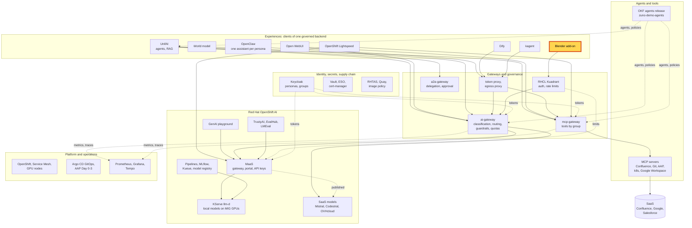
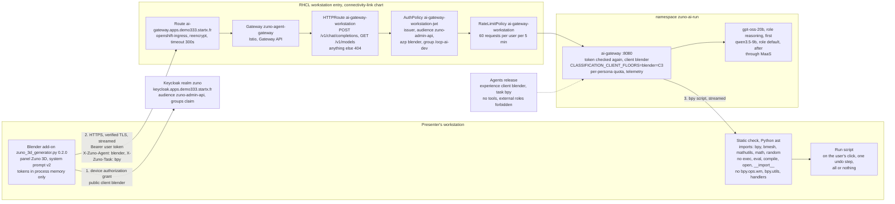

# Scenario: Blender add-on - a sentence becomes editable 3D objects on a local model

> **Status:** Not rehearsed in this format. Prerequisites checked read-only on demo333 on 2026-11-12: Route
> `zuno-agent-gateway-workstation-ai-gateway` (`ai-gateway.apps.demo333.startx.fr`, reencrypt), HTTPRoute
> `ai-gateway-workstation` (`POST /v1/chat/completions`, `GET /v1/models`), AuthPolicy `ai-gateway-workstation-jwt`
> (issuer `https://keycloak.apps.demo333.startx.fr/realms/zuno`, `azp` `blender`, group `/ocp-ai-dev`) and
> RateLimitPolicy `ai-gateway-workstation` (60 requests per user per 5 minutes) all Accepted and Enforced; Deployment
> `ai-gateway` 1/1 with `CLASSIFICATION_CLIENT_FLOORS=blender=C3` and `blender` in `EXPERIENCE_CLIENTS`; `gpt-oss-20b`
> and `qwen35-9b` Ready; Keycloak route `keycloak.apps.demo333.startx.fr` in `zuno-auth`; Applications
> `zuno-connectivity-link-d1` and `zuno-ai-gateway-d1` Synced and Healthy. The entry was removed and restored the same
> morning in a rollback test, with the `blender` probe passing after it
> ([WP-249 evidence](../roadmap/evidence/wp-249-blender-edge-rollback-2026-11-12.md)).
> **Show-ready ([ADR-0606](../adr/0606-admit-new-experiences-with-a-definition-of-done-and-a-wip-limit.md)):**
> yes, golden-path probe `blender`.
> **Personas:** see [Personas](#personas).
> **Used in workshops:** [One governed backend, many experiences](five-experiences.md).

## Introduction

The Blender add-on is the first experience client that runs on a **workstation**: a desktop application with no
namespace of its own. A 3D artist types a sentence. A local model writes a Blender Python (`bpy`) script. The add-on
shows the script, checks it and runs it only when the artist clicks. The result is real Blender objects: primitives,
modifiers and materials that the artist can edit, not a frozen mesh.

The call reaches the ai-gateway through one Red Hat Connectivity Link (Kuadrant) entry, with the artist's own Keycloak
token (see [Appendix A](#appendix-a---hld)). The ai-gateway puts every call of the client `blender` at C3, so only the
models on the platform's own GPUs may answer: `gpt-oss-20b` first. The entry, the floor and the add-on's check are in
[Appendix B](#appendix-b---lld).

**The message:** "A 3D artist gets editable objects from a sentence. The prompt, the code and the scene never leave the
company, and the call is governed like every other experience."

**Decisions:**
- [ADR-0610](../adr/0610-generate-blender-objects-as-bpy-scripts-from-a-local-model-through-the-ai-gateway.md): text
  to a `bpy` script, the C3 floor on the client `blender`, one entry limited to two paths, show, check, then run.
- [ADR-0587](../adr/0587-admit-additional-user-experiences-over-the-one-governed-backend.md): experiences are clients
  of the one governed backend; ADR-0610 extends it to a workstation.
- [ADR-0565](../adr/0565-derive-data-classification-from-okf-and-only-allow-raising-it.md): the classification level
  can only be raised.
- [ADR-0593](../adr/0593-key-the-per-user-quota-and-telemetry-by-persona-across-experiences.md): quota and telemetry
  are keyed by the person, across experiences.

## Personas

The personas are fictional role accounts of the Keycloak realm `zuno`
([ADR-0349](../adr/0349-restructure-demo-personas-cluster-access-groups-and-new-agents.md)). They share one password,
kept in Vault at `keycloak/demo-personas`. The [catalogue](README.md#personas) lists all of them.

| Persona | Profile | What it can do here | Role in this demo |
|---|---|---|---|
| **ai-dev-01** | AI developer, back office. Groups `ocp-ai-dev` (edit on the Zuno namespaces), `agent_tekos`. | Passes the workstation entry: client `blender`, group `/ocp-ai-dev`. 60 requests per 5 minutes at the entry, then its own token budget in the ai-gateway. Every call at C3, local models only. No tools. | The 3D artist of both versions. Signs in to the add-on by the device flow at the preflight, then generates and runs the scripts on stage. |
| **ai-ops-01** | AI platform operator, back office. Group `ocp-ai-ops` (admin on the Zuno namespaces, `zuno-monitoring` included). | Opens Grafana. Refused at the Blender entry (403): not in `ocp-ai-dev`. | Shows the `client="blender"` series in Grafana in the 15-minute version, from a separate browser profile. |
| **paas-ops-01** | Platform operator, back office. Group `ocp-paas-ops` (cluster-admin). | Reads the entry objects in `openshift-ingress` and `zuno-ai-run`, and the ai-gateway log. | The presenter's `oc` terminal in the 15-minute version. |

Other identities: `eval-ai-dev-01`, an evaluation copy with the groups `/ocp-ai-dev` and `/zuno-evaluation` only. The
golden-path probe `blender` signs it in by the device flow with no human
([`evaluations/blender/device_login.py`](../../evaluations/blender/device_login.py)). It never signs in on stage.

## Before you start

- [ ] The add-on is installed on the presenter's laptop and the preflight is done: see
  [Appendix C - Setup](#appendix-c---setup).
- [ ] **ai-dev-01**, password in Vault at `keycloak/demo-personas`. Use one browser profile for the device sign-in and
  sign out of any other Keycloak session in it first:
  `https://keycloak.apps.demo333.startx.fr/realms/zuno/protocol/openid-connect/logout`. The device sign-in reuses an
  open session, and a session of a user outside `ocp-ai-dev` gets 403.
- [ ] Starting state: Blender full screen, Layout workspace, empty scene, **Material Preview** shading, tab **Zuno 3D**
  open and **Signed in**, prompt 1 in the prompt field (it is the add-on's default text).
- [ ] The model is warm: the preflight generated prompt 1 once. `gpt-oss-20b` is Ready:
  `oc get llminferenceservice gpt-oss-20b -n zuno-ai-run`.
- [ ] Known on screen: an F12 render comes out dark. The scripts add no light. Stay in the viewport.
- [ ] Golden-path probe `blender` passed within the last hour (`ONLY=blender make demo golden-path`), see
  [golden-path.md](golden-path.md).
- [ ] 15-minute version:
  - [ ] a second browser profile with Grafana, signed in as **ai-ops-01**, dashboard **Zuno Platform / Five
    experiences**, time range last 1 hour, `client` = `blender`;
  - [ ] a terminal logged in with `oc` as **paas-ops-01**, large font;
  - [ ] the task sheet opened at
    [experience-clients/blender/tasks/bpy.md](https://github.com/startxfr/zuno-demo-agents/blob/main/experience-clients/blender/tasks/bpy.md).

## 5-minute version

Stage prompts, measured 2/2 each on `gpt-oss-20b` with the add-on's system prompt v2 (2026-11-07, ADR-0610 clause 8):

| Order | Prompt | Measured | What the audience sees |
|---|---|---|---|
| 1 | `A wooden table with 4 cylindrical legs and a small desk lamp on top` | 2/2, about 13 s | a wooden table, four legs, a lamp on top, 8 objects |
| 2 | `A coffee mug with a handle on a saucer` | 2/2, about 7 s | a mug with a torus handle on a saucer |
| Backup | `A cartoon rocket with three fins on a launch pad` | 2/2, about 10 s | a rocket with a cone tip and fins |
| Backup | `A low-poly pine tree on a small grassy hill` | 2/2, about 8 s | a stacked-cone tree on green ground |

With system prompt v2, 23 of 24 measured runs build a scene (12 prompts, twice each). Do not use prompts outside this
table on stage. The full results are in
[`evaluations/blender/results/`](../../evaluations/blender/results/prompt-set-gpt-oss-20b-2026-11-07-v2.json).

| Time | Do | Say | You should see |
|---|---|---|---|
| 0:00 | Point at the **Zuno 3D** panel. | "A 3D artist wants help from AI without sending a design brief to a public cloud. This is Blender on my laptop, with a small add-on. I am signed in with my company account, nothing else: no API key in Blender." | The panel: cluster domain, "Status: Signed in". |
| 0:20 | Click **Generate script**. | "My sentence leaves Blender with my own identity. The platform classifies the call C3, so only the models on our own GPUs may answer: here gpt-oss-20b. No public model can see it." | "Working..." for about 13 seconds. |
| 0:40 | Wait for "Check passed", switch to **Scripting**. | "The model does not draw a mesh. It writes a Blender Python script. The add-on checks it before anything runs: only Blender's own modules, no file or system calls, no network imports. And I can read it." | The script `zuno_3d_script.py`, about 50 lines, object names such as `Leg_1`, `LampStand`, `LampShade`. |
| 1:10 | Back to **Layout**, click **Run script**. | "Nothing runs until I click. Now it runs, in one undo step." | The table, its four legs and the lamp appear. |
| 1:30 | Select the table top, change **Scale X** in the properties, then **Ctrl+Z**. | "These are real Blender objects, with names, dimensions and materials. The artist keeps working on them; it is not a frozen mesh." | The table top stretches, then comes back. |
| 2:00 | Clear the scene (A, X), type prompt 2, **Generate script**, then **Run script**. | "A second one, a coffee mug: about seven seconds." | The mug on its saucer. |
| 2:40 | Close | "The call leaves with my identity, it stays on the company's own GPUs, the script is shown and checked, and nothing runs before the click." | |

The sentences to keep if time is short: the call leaves with the user's identity, it stays on the company's own GPUs,
the script is shown and checked, and nothing runs before the click.

## 15-minute version

Run the 5-minute version, then:

| Time | Do | Say | You should see |
|---|---|---|---|
| 5:00 | Clear the scene (A, X). Type the backup prompt `A cartoon rocket with three fins on a launch pad`, **Generate script**, then open **Scripting** and scroll the script. | "Here is what the check refuses: imports other than bpy, bmesh, mathutils, math and random; exec, eval, open and import tricks; window-manager, script, preferences and handler calls. It catches a confused model. It is not a sandbox." | "Check passed: review the script, then Run" after about 10 s. |
| 6:15 | Back to **Layout**, **Run script**. | "Run is all or nothing: when a script fails half-way, the add-on removes what it created." | A rocket with a cone tip and fins on a launch pad. |
| 7:00 | Tick **Advanced** in the **Zuno 3D** panel, then untick it. | "No key and no secret in Blender. The add-on finds the gateway and Keycloak from the cluster domain. I signed in with the device flow: a public Keycloak client called blender, no password stored. The token stays in Blender's memory, never in the .blend file." | **Gateway override**, **Issuer override** and **CA file** are empty. |
| 8:00 | Terminal: `oc get route zuno-agent-gateway-workstation-ai-gateway -n openshift-ingress` then `oc get httproute,authpolicy,ratelimitpolicy -n zuno-ai-run \| grep workstation` | "The ai-gateway has one door for workstations, built with Red Hat Connectivity Link. It opens two paths: list the models and ask for a completion. Everything else answers 404." | Route on `ai-gateway.apps.demo333.startx.fr`; HTTPRoute `ai-gateway-workstation`, AuthPolicy `ai-gateway-workstation-jwt`, RateLimitPolicy `ai-gateway-workstation`. |
| 9:00 | `oc get authpolicy ai-gateway-workstation-jwt -n zuno-ai-run -o yaml` | "Kuadrant checks the token before the gateway sees it: our Keycloak, the platform audience, the client blender, the group of AI developers. An operator outside that group got 403 in our test. Each user gets 60 requests per 5 minutes." | `issuerUrl: https://keycloak.apps.demo333.startx.fr/realms/zuno`, `azp` `blender`, `groups` `/ocp-ai-dev`. |
| 10:30 | `oc get deploy ai-gateway -n zuno-ai-run -o jsonpath='{.spec.template.spec.containers[*].env[?(@.name=="CLASSIFICATION_CLIENT_FLOORS")].value}'` | "Behind the door the ai-gateway checks the token again and puts a floor on the client: everything from blender is C3. C3 means local models only, whatever the routing table gains later." | `blender=C3` |
| 11:30 | `oc logs -n zuno-ai-run deploy/ai-gateway -c ai-gateway --since=15m \| grep 'client=blender'` | "Each call leaves the proof: raised from C1 to C3 because of the client." | `classification raised by floor: C1 -> C3 agent=blender task=bpy client=blender`, one line per generation. |
| 12:30 | Grafana (profile 2, **ai-ops-01**), row **Same models, same routing**, panel **Which provider served each experience (over range)** | "On the platform side, Blender is one more experience: same quotas, same telemetry, same rules as the chat and the agents." | `blender` served by a local provider (`local-...`) only. |
| 13:30 | Open the task sheet `experience-clients/blender/tasks/bpy.md` in the agents release | "The model choice is declared in the signed agents release: gpt-oss-20b first, qwen3.5-9b after it, every external model role forbidden, no tools." | `allowed_tools: []`, `preferred: [reasoning, default]`, `forbidden: [general-external, reasoning-external, code]`. |
| 14:30 | Close | Repeat the message. | |

## If something goes wrong

| Symptom | Fallback | Say |
|---|---|---|
| The answer is slow (more than 30 s), or the panel shows an error from the gateway | Retry once, then switch to a backup prompt. If `gpt-oss-20b` is down, `qwen3.5-9b` answers, slower. | "The request is queued on the platform's own GPUs. It never goes to a public model." |
| The panel says "session expired: sign in again" or "Signed out" | **Sign in** again: the code shows in the panel, about 20 s in the browser. Then retry. | |
| "Script failed, nothing kept" | Nothing is left in the scene. Switch to the mug. | "The model wrote an API call that does not exist. The add-on refused to keep half an object." |
| "Refused: ..." | Show that line, then switch to a backup prompt. | "The check stopped the script before it ran: this is the safety the demonstration is about." |
| 403 after signing in | The device sign-in reused a browser session of a persona outside `ocp-ai-dev`. Not fixable on stage: show the scene built at the preflight. Afterwards, sign out of Keycloak (URL in "Before you start") and sign in again as **ai-dev-01**. | "The door admits AI developers only. I signed in with the wrong account." |
| The device sign-in or the workstation network fails | Sign in during the preflight, not on stage. Fallback: the scene built at the preflight. | |
| 429 | The entry's limit of 60 requests per user per 5 minutes is reached. Wait, or show the scene built at the preflight. | "That is the rate limit at the door." |
| 503 from `ai-gateway.apps.demo333.startx.fr` | The workstation entry is switched off (rollback). Check `oc get httproute ai-gateway-workstation -n zuno-ai-run`. Not fixable on stage. | |
| A dark render | Do not render (F12). Stay in the viewport, **Material Preview**. | |

## Limits

- **The static check catches a confused model; it is not a sandbox.** The code runs with the artist's rights, after
  the artist has read it and clicked.
- **The model sometimes invents a Blender API call.** One in 24 measured runs still fails with the v2 prompt, and Run
  keeps nothing when it does.
- **Only measured prompts on stage** (ADR-0610 clause 8). A prompt outside the table is untested.
- **The scripts add no light.** The scene is shown in the viewport, not rendered.
- **One admitted group on demo333:** `ocp-ai-dev`. A public device-grant client lets any realm user mint a token, so
  the entry narrows by group. Other personas get 403.
- **No tools and no RAG.** The add-on never calls the mcp-gateway.
- **Measured on Blender 4.2.3** (headless). The presenter's laptop runs 5.2.0 LTS, where the add-on shows as a Legacy
  (User) add-on, version 0.2.0; it was accepted there on 2026-11-07, not re-measured.

## Appendix A - HLD

Where the Blender add-on sits in Zuno. The highlighted box is the subject of this page. Plain arrows carry requests,
dotted arrows carry identity, policy or telemetry.



## Appendix B - LLD

The add-on, the workstation entry and the decision that keeps the call local. Drawn from
`evaluations/blender/zuno_3d_generator.py`, `gitops/charts/connectivity-link/templates/workstation-entry.yaml` with the
values of `gitops/charts/connectivity-link/values.yaml` and `gitops/apps/connectivity-link/application-d1.yaml`, the
client `blender` in `gitops/charts/keycloak/files/realm-zuno.json`, `gitops/charts/ai-gateway/values.yaml`, the floor
`zuno_ai_gateway_classification_client_floors` in `ansible/clusters/demo333.yml`, and
[experience-clients/blender/](https://github.com/startxfr/zuno-demo-agents/blob/main/experience-clients/blender/client.okf.md)
in the agents release.



## Appendix C - Setup

Installation and preflight on the presenter's side. The platform side is already live on demo333.

### Platform changes (WP-244, through GitOps)

Everything below lands as commits and is synced by Argo CD
([ADR-0608](../adr/0608-keep-the-repository-the-only-source-of-cluster-state.md)). Nothing is applied by hand.

| Change | Where | Applied by |
|---|---|---|
| Public Keycloak client `blender`, device authorization grant only, `maas-gateway-audience` mapper (audience `zuno-admin-api`) | `gitops/charts/keycloak/files/realm-zuno.json` | the push (client-reconcile Job) |
| `blender` in `experienceClients` | `gitops/charts/ai-gateway/values.yaml` | the push |
| `classification.clientFloors: {blender: C3}`, NetworkPolicy peer for `zuno-agent-gateway` | `ansible/clusters/<cluster>.yml` (`zuno_ai_gateway_classification_client_floors`, `zuno_ai_gateway_workstation_entry`) | `make d2 install llm` |
| Route `ai-gateway.apps.<domain>`, HTTPRoute (two paths), AuthPolicy (issuer, audience, `azp: blender`, group `ocp-ai-dev`), RateLimitPolicy (60 requests per user per 5 min) | `gitops/charts/connectivity-link/templates/workstation-entry.yaml`, turned on in `gitops/apps/connectivity-link/application-d1.yaml` | `make d1 install connectivity-link` |
| Experience client `blender`, task `bpy`, `models.preferred: [reasoning, default]` (`gpt-oss-20b` first), no tools, C3 | [`experience-clients/blender/`](https://github.com/startxfr/zuno-demo-agents/blob/main/experience-clients/blender/client.okf.md) in zuno-demo-agents | the agents release and its promotion |

The ai-gateway's per-persona token budgets apply on top of the entry's request rate.

Read-only checks once synced:

```bash
oc get llminferenceservice -n zuno-ai-run                       # gpt-oss-20b and qwen35-9b Ready
oc get httproute,authpolicy,ratelimitpolicy -n zuno-ai-run | grep workstation   # Accepted and Enforced
```

### Workstation prerequisites

- Blender 4.2 LTS or newer (4.0 works). It ships Python with `certifi`, which the add-on uses for TLS. Measured
  headless on 4.2.3; run by the presenter on 5.2.0 LTS on 2026-11-07.
- HTTPS reach to `https://ai-gateway.apps.<cluster-domain>` and to Keycloak `https://keycloak.apps.<cluster-domain>`.
- A `zuno` account in an admitted group (demo333: `ocp-ai-dev`); for the demo, the persona **ai-dev-01**.
- Only on a cluster whose routes do not serve the Let's Encrypt wildcard
  ([ADR-0211](../adr/0211-publicly-trusted-wildcard-tls-via-lets-encrypt-and-route53.md)): the cluster's CA
  certificate as a PEM file, set in **CA file**. Never disable certificate verification instead. demo333 needs none.

### Install the add-on (once, about 10 minutes)

The presenter prepares their own laptop. Nothing is installed on the cluster for this step.

1. Install Blender (see above).
2. Download the add-on [evaluations/blender/zuno_3d_generator.py](../../evaluations/blender/zuno_3d_generator.py) (on
   GitHub, branch `devel`: open the file, **Raw**, save it).
3. Blender: **Edit > Preferences > Add-ons**, menu at the top right, **Install from Disk**, pick the file, tick
   **Zuno 3D generator (demo)**.
4. In the 3D Viewport press **N**, tab **Zuno 3D**. **Cluster domain** is already `apps.demo333.startx.fr`.
5. Keep the add-on current: `bash evaluations/blender/install_addon.sh` fetches `origin/devel`, copies the add-on into
   the Blender user folder and prints its version and checksum (`--dry-run` copies nothing). Then close Blender
   completely and reopen it.
6. Leave **Gateway override** and **Issuer override** empty (tick **Advanced** to see them). Keycloak runs in internal
   mode on demo333 since 2026-11-09, so the defaults are right. The overrides live in the scene, not in the
   preferences.

Details, tests and the measurement: [evaluations/blender/README.md](../../evaluations/blender/README.md).

### Preflight (about 3 minutes, before the session)

1. In the browser profile used for the device sign-in, sign out of any Keycloak session:
   `https://keycloak.apps.demo333.startx.fr/realms/zuno/protocol/openid-connect/logout`. The device sign-in reuses an
   open session, and a session of a user outside `ocp-ai-dev` gets 403.
2. Blender, tab **Zuno 3D**: **Sign in**, **Open sign-in page**, sign in as **ai-dev-01**, accept the grant page. The
   panel shows **Signed in**. The session holds for the morning: the add-on refreshes the access token.
3. Generate the first stage prompt once (it warms the model), **Run script**, then **Ctrl+Z** and clear the text. The
   scene is empty again and the add-on stays signed in.
4. Set the 3D Viewport's shading to **Material Preview** (Z, then Material Preview): the generated materials show
   their colours there. Do not render (F12): the scripts add no light, so a render comes out dark.
5. Leave Blender open on the 3D Viewport with the **Zuno 3D** tab, and the **Scripting** workspace one click away.

### Monitoring during a session

- Grafana, dashboard **Zuno Platform / Five experiences**, `client` = `blender`: calls, tokens, errors per persona.
- Tempo: `model_call` spans of the session, with `zuno.client`, `zuno.classification`, `zuno.provider`.
- ai-gateway logs with a time window, not a line count:
  `oc logs -n zuno-ai-run deploy/ai-gateway -c ai-gateway --since=30m`.

### Rollback and decommissioning

- **Platform side:** set `workstationEntry.enabled: false` in `gitops/apps/connectivity-link/application-d1.yaml` and
  run `make d1 install connectivity-link`. The role applies that Application, so a push alone does nothing. Argo CD
  prunes the four entry objects and the edge answers 503. Back with `true` and the same command. Each way takes 2 to 3
  minutes, tested on 2026-11-12 ([WP-249 evidence](../roadmap/evidence/wp-249-blender-edge-rollback-2026-11-12.md)).
  The Keycloak client `blender` stays: without the entry it reaches nothing from outside the cluster. See
  [rollback.md](rollback.md) and [WP-244](../roadmap/work-packages/wp-244-blender-workstation-experience-client.md).
- Do not `oc delete` the objects: Argo CD would recreate them, or the repository and the cluster would drift.
- **Workstation:** click **Sign out** (drops the tokens from memory), then remove the add-on (**Edit > Preferences >
  Add-ons**) or close Blender without saving. Tokens are never written to the `.blend` file.
