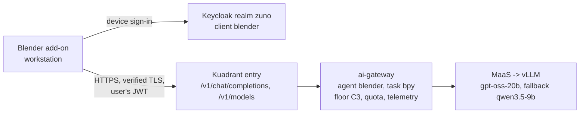

# Demo script: Blender 3D objects from text, on the platform's local model

Audience: the presenter, and the platform team preparing a workstation. Decision:
[ADR-0610](../adr/0610-generate-blender-objects-as-bpy-scripts-from-a-local-model-through-the-ai-gateway.md)
(Target v0.17), under [ADR-0587](../adr/0587-admit-additional-user-experiences-over-the-one-governed-backend.md) and
[ADR-0606](../adr/0606-admit-new-experiences-with-a-definition-of-done-and-a-wip-limit.md).

> **Status: live on demo333 (2026-11-07, [WP-244](../roadmap/work-packages/wp-244-blender-workstation-experience-client.md)).**
> Signed in as ai-dev-01 through the device flow, three prompts went through `ai-gateway.apps.demo333.startx.fr`,
> were floored to C3 and answered by `gpt-oss-20b` in 6.6 to 9.4 s; the scripts were replayed in Blender 4.2.3 LTS
> (headless): two built their objects, one used an invented `bpy` argument and was rolled back (Run keeps nothing when
> a script fails). Use only prompts known to work on stage (ADR-0610 clause 8).

## The message

A 3D artist types a sentence in Blender and gets editable objects: real primitives, modifiers and materials, not a
frozen mesh. The prompt, the generated code and the scene never leave the company: the model is `gpt-oss-20b` on the
platform's own GPUs, reached through the same governed chain as every other experience, under the artist's own
identity, counted in the same dashboards.



## Day 0: prerequisites

Workstation:

- Blender 4.0 or newer (it ships Python with `certifi`, which the add-on uses for TLS).
- HTTPS reach to the ai-gateway hostname `https://ai-gateway.apps.<cluster-domain>` and to Keycloak
  `https://keycloak.apps.<cluster-domain>`.
- A `zuno` account in an admitted group (demo333: `ocp-ai-dev`); for the demo, the persona **ai-dev-01**.
- Only on a cluster whose routes do not serve the Let's Encrypt wildcard (ADR-0211): the cluster's CA certificate as a
  PEM file. Never disable certificate verification instead.

Platform:

- `gpt-oss-20b` and `qwen3.5-9b` served in `zuno-ai-run` (already the case; nothing to deploy for the models).
- The ADR-0610 work package rolled out.

## Day 1: platform changes (WP-244, through GitOps)

Everything below lands as commits and is synced by ArgoCD (ADR-0608). Nothing is applied by hand.

| Change | Where | Applied by |
|---|---|---|
| Public Keycloak client `blender`, device authorization grant only, `maas-gateway-audience` mapper | `gitops/charts/keycloak/files/realm-zuno.json` | the push (client-reconcile Job) |
| `blender` in `experienceClients` | `gitops/charts/ai-gateway/values.yaml` | the push |
| `classification.clientFloors: {blender: C3}`, NetworkPolicy peer for zuno-agent-gateway | `ansible/clusters/<cluster>.yml` (`zuno_ai_gateway_classification_client_floors`, `zuno_ai_gateway_workstation_entry`) | `make d2 install llm` |
| Route `ai-gateway.apps.<domain>`, HTTPRoute (two paths), AuthPolicy (issuer, audience, `azp: blender`, group `ocp-ai-dev`), RateLimitPolicy (60 requests per user per 5 min) | `gitops/charts/connectivity-link/templates/workstation-entry.yaml`, on in `gitops/apps/connectivity-link/application-d1.yaml` | `make d1 install connectivity-link` |
| Experience client `blender`, task `bpy`, `models.preferred: [reasoning]` (`gpt-oss-20b` first), no tools, C3 | `experience-clients/blender/` in zuno-demo-agents | the agents release and its promotion |

The ai-gateway's per-persona token budgets apply on top of the entry's request rate.

Read-only checks once synced:

```bash
oc get llminferenceservice -n zuno-ai-run                       # gpt-oss-20b and qwen35-9b Ready
oc get httproute,authpolicy,ratelimitpolicy -n zuno-ai-run | grep workstation   # Accepted and Enforced
```

## Day 2: install the add-on and run the demo

1. In Blender, open the **Scripting** workspace, create a new text named `zuno_3d_generator.py`, paste the add-on
   below and click **Run Script**. To keep it across sessions instead, save it as a file and install it from
   **Edit > Preferences > Add-ons > Install from Disk**.
2. In the 3D Viewport press **N**, open the **Zuno 3D** tab and fill in **Gateway**
   (`https://ai-gateway.apps.<cluster-domain>`), **Issuer** (`https://keycloak.apps.<cluster-domain>/realms/zuno`) and,
   only for a private CA, **CA file**.
3. Click **Sign in**, then **Open sign-in page**: the browser shows Keycloak with the code displayed in the panel. Sign
   in as ai-dev-01. The panel turns to **Signed in**. No password and no key is ever typed into Blender.
4. Enter a prompt, for example "A wooden table with 4 cylindrical legs and a small desk lamp on top" (measured: 8
   objects) or "A low-poly pine tree on a small grassy hill" (3 objects and a modifier), and click **Generate script**.
   Blender stays responsive; the answer streams in about 10 seconds.
5. The script appears in the Text Editor as `zuno_3d_script.py`, with the result of the static check in the panel.
   Show the code: this is the point of the demonstration, the artist sees what will run.
6. Click **Run script**. The objects appear as one undo step (a script that fails keeps nothing); select one and show its modifiers and dimensions in the
   properties: they are editable, not a frozen mesh.
7. Show the platform side: Grafana, dashboard **Zuno Platform / Five experiences** filtered on `client="blender"`
   (tokens counted against ai-dev-01), and in Tempo the `model_call` span with the C3 floor and the local
   provider.

Named limits to say out loud:

- The static check catches a confused model; it is not a sandbox. The code runs with the artist's rights, after the
  artist has read it and clicked.
- Only prompts from the measured set (ADR-0610 clause 8) are used live.
- If `gpt-oss-20b` is not Ready, `qwen3.5-9b` answers, slower and less accurate.

### The add-on

```python
bl_info = {
    "name": "Zuno 3D generator (demo)",
    "author": "Zuno Demo",
    "version": (0, 1, 0),
    "blender": (4, 0, 0),
    "location": "View3D > Sidebar > Zuno 3D",
    "description": "Generates editable objects from a prompt with a local model through the Zuno ai-gateway (ADR-0610)",
    "category": "Object",
}

import ast
import json
import math
import random
import re
import ssl
import threading
import time
import urllib.error
import urllib.parse
import urllib.request
import webbrowser

import bmesh
import bpy
import mathutils

# ADR-0610: the ai-gateway routes on (agent, task); the model name is not a routing input.
MODEL = "auto"
AGENT = "blender"
TASK = "bpy"
CLIENT_ID = "blender"
TEXT_NAME = "zuno_3d_script.py"
SYSTEM_PROMPT = (
    "You are an expert Blender 4 Python (bpy) developer. Return ONLY executable Python code for Blender, "
    "with no Markdown fences and no explanation. Use only the modules bpy, bmesh, mathutils, math and random. "
    "Create new objects in the current scene; never delete existing objects, save files, or quit Blender."
)
ALLOWED_IMPORTS = {"bpy", "bmesh", "mathutils", "math", "random"}
FORBIDDEN_CALLS = {"exec", "eval", "compile", "open", "__import__", "getattr", "setattr", "delattr",
                   "globals", "locals", "vars", "input", "breakpoint"}
FORBIDDEN_PREFIXES = ("bpy.ops.wm", "bpy.ops.script", "bpy.ops.preferences", "bpy.utils", "bpy.app.handlers")

# Tokens and job results live in process memory only (ADR-0610 clause 4).
_state = {"access": None, "refresh": None, "expires_at": 0.0, "user_code": "", "verify_url": "",
          "status": "Signed out", "busy": False, "result": None, "error": None, "check": ""}


# ---------- pure helpers ----------

def extract_code(text):
    """Return the first fenced block if the model added fences, else the text."""
    match = re.search(r"```(?:python|py)?\s*\n(.*?)```", text, re.DOTALL)
    return (match.group(1) if match else text).strip()


def _dotted(node):
    parts = []
    while isinstance(node, ast.Attribute):
        parts.append(node.attr)
        node = node.value
    if isinstance(node, ast.Name):
        parts.append(node.id)
        return ".".join(reversed(parts))
    return None


def check_script(code):
    """Static guard against a confused model. Not a sandbox. Returns a list of problems."""
    try:
        tree = ast.parse(code)
    except SyntaxError as exc:
        return [f"syntax error line {exc.lineno}: {exc.msg}"]
    problems = []
    for node in ast.walk(tree):
        if isinstance(node, ast.Import):
            for alias in node.names:
                if alias.name.split(".")[0] not in ALLOWED_IMPORTS:
                    problems.append(f"line {node.lineno}: import {alias.name}")
        elif isinstance(node, ast.ImportFrom):
            if (node.module or "").split(".")[0] not in ALLOWED_IMPORTS or node.level:
                problems.append(f"line {node.lineno}: from {node.module} import ...")
        elif isinstance(node, ast.Call) and isinstance(node.func, ast.Name) and node.func.id in FORBIDDEN_CALLS:
            problems.append(f"line {node.lineno}: call to {node.func.id}()")
        elif isinstance(node, ast.Name) and node.id.startswith("__"):
            problems.append(f"line {node.lineno}: name {node.id}")
        elif isinstance(node, ast.Attribute):
            if node.attr.startswith("__"):
                problems.append(f"line {node.lineno}: attribute {node.attr}")
            dotted = _dotted(node)
            if dotted and dotted.startswith(FORBIDDEN_PREFIXES):
                problems.append(f"line {node.lineno}: {dotted}")
    return sorted(set(problems))


def _ssl_context(ca_file):
    ctx = ssl.create_default_context()  # verification stays on (ADR-0610 clause 7)
    try:
        import certifi
        ctx.load_verify_locations(certifi.where())
    except ImportError:
        pass
    if ca_file:
        ctx.load_verify_locations(bpy.path.abspath(ca_file))
    return ctx


def _post(url, data, ctx, headers=None, form=True, timeout=30):
    body = urllib.parse.urlencode(data).encode() if form else json.dumps(data).encode()
    hdrs = {"Content-Type": "application/x-www-form-urlencoded" if form else "application/json"}
    hdrs.update(headers or {})
    req = urllib.request.Request(url, data=body, headers=hdrs, method="POST")
    try:
        with urllib.request.urlopen(req, context=ctx, timeout=timeout) as resp:
            return resp.status, json.loads(resp.read().decode())
    except urllib.error.HTTPError as err:
        try:
            return err.code, json.loads(err.read().decode())
        except ValueError:
            return err.code, {"error": f"HTTP {err.code}"}


def _store_tokens(tok):
    _state["access"] = tok["access_token"]
    _state["refresh"] = tok.get("refresh_token")
    _state["expires_at"] = time.time() + int(tok.get("expires_in", 300)) - 30


# ---------- background jobs (no bpy calls in threads) ----------

def _sign_in_job(issuer, ctx):
    status, dev = _post(f"{issuer}/protocol/openid-connect/auth/device",
                        {"client_id": CLIENT_ID, "scope": "openid"}, ctx)
    if status != 200:
        _state.update(busy=False, error=f"device sign-in refused: {dev.get('error', status)}")
        return
    _state.update(user_code=dev["user_code"],
                  verify_url=dev.get("verification_uri_complete") or dev["verification_uri"],
                  status="Waiting for browser sign-in")
    interval = int(dev.get("interval", 5))
    deadline = time.time() + int(dev.get("expires_in", 600))
    while time.time() < deadline:
        time.sleep(interval)
        status, tok = _post(f"{issuer}/protocol/openid-connect/token",
                            {"grant_type": "urn:ietf:params:oauth:grant-type:device_code",
                             "device_code": dev["device_code"], "client_id": CLIENT_ID}, ctx)
        if status == 200:
            _store_tokens(tok)
            _state.update(busy=False, user_code="", verify_url="", status="Signed in")
            return
        err = tok.get("error")
        if err == "slow_down":
            interval += 5
        elif err != "authorization_pending":
            _state.update(busy=False, user_code="", error=f"sign-in failed: {err}")
            return
    _state.update(busy=False, user_code="", error="sign-in timed out")


def _token(issuer, ctx):
    if _state["access"] and time.time() < _state["expires_at"]:
        return _state["access"]
    if _state["refresh"]:
        status, tok = _post(f"{issuer}/protocol/openid-connect/token",
                            {"grant_type": "refresh_token", "refresh_token": _state["refresh"],
                             "client_id": CLIENT_ID}, ctx)
        if status == 200:
            _store_tokens(tok)
            return _state["access"]
    _state.update(access=None, refresh=None, status="Signed out")
    return None


def _stream_chat(url, payload, ctx, token, timeout=240):
    """POST with stream=true and join the content deltas. Streaming keeps bytes flowing, so a load balancer's idle
    timeout (60 s on demo333's AWS ELB) cannot cut a long generation. Returns (status, text or error dict)."""
    body = json.dumps(dict(payload, stream=True)).encode()
    req = urllib.request.Request(url, data=body, method="POST", headers={
        "Content-Type": "application/json", "Accept": "text/event-stream", "Authorization": f"Bearer {token}",
        "X-Zuno-Agent": AGENT, "X-Zuno-Task": TASK})
    try:
        resp = urllib.request.urlopen(req, context=ctx, timeout=timeout)
    except urllib.error.HTTPError as err:
        try:
            return err.code, json.loads(err.read().decode())
        except ValueError:
            return err.code, {"error": f"HTTP {err.code}"}
    parts = []
    with resp:
        for raw in resp:
            line = raw.decode("utf-8", "replace").strip()
            if not line.startswith("data:"):
                continue
            data = line[5:].strip()
            if data == "[DONE]":
                break
            try:
                chunk = json.loads(data)
            except ValueError:
                continue
            if chunk.get("error"):
                return 502, chunk
            for choice in chunk.get("choices") or []:
                parts.append((choice.get("delta") or {}).get("content") or "")
    return 200, "".join(parts)


def _generate_job(gateway, issuer, ctx, prompt):
    token = _token(issuer, ctx)
    if not token:
        _state.update(busy=False, error="session expired: sign in again")
        return
    payload = {"model": MODEL, "temperature": 0.2,
               "messages": [{"role": "system", "content": SYSTEM_PROMPT},
                            {"role": "user", "content": f"Create this 3D object or scene: {prompt}"}]}
    try:
        status, res = _stream_chat(f"{gateway.rstrip('/')}/v1/chat/completions", payload, ctx, token)
    except Exception as exc:  # network, TLS, a cut stream
        _state.update(busy=False, error=f"gateway unreachable: {exc}")
        return
    if status != 200:
        _state.update(busy=False, error=f"gateway answered {status}: {res.get('error', res)}")
        return
    if not res.strip():
        _state.update(busy=False, error="the model returned an empty answer")
        return
    _state.update(busy=False, result=res)


def _poll():
    """Main-thread timer: hands results back to Blender."""
    if _state["result"] is not None:
        code = extract_code(_state["result"])
        _state["result"] = None
        text = bpy.data.texts.get(TEXT_NAME) or bpy.data.texts.new(TEXT_NAME)
        text.clear()
        text.write(code)
        problems = check_script(code)
        _state["check"] = "Check passed: review the script, then Run" if not problems else \
            "Refused: " + "; ".join(problems[:3])
    for window in bpy.context.window_manager.windows:
        for area in window.screen.areas:
            if area.type in {"VIEW_3D", "TEXT_EDITOR"}:
                area.tag_redraw()
    return 0.5 if (_state["busy"] or _state["user_code"]) else None


def _start(job, *args):
    _state.update(busy=True, error=None)
    threading.Thread(target=job, args=args, daemon=True).start()
    if not bpy.app.timers.is_registered(_poll):
        bpy.app.timers.register(_poll, first_interval=0.5)


# ---------- Blender UI ----------

class ZUNO3D_Settings(bpy.types.PropertyGroup):
    gateway_url: bpy.props.StringProperty(name="Gateway", default="https://ai-gateway.apps.example.com")
    issuer_url: bpy.props.StringProperty(name="Issuer", default="https://keycloak.apps.example.com/realms/zuno")
    ca_file: bpy.props.StringProperty(name="CA file", subtype="FILE_PATH",
                                      description="Only for a cluster whose routes use a private CA")
    prompt: bpy.props.StringProperty(name="Prompt", default="A wooden table with four cylindrical legs")


class ZUNO3D_OT_sign_in(bpy.types.Operator):
    bl_idname = "zuno3d.sign_in"
    bl_label = "Sign in"

    def execute(self, context):
        s = context.scene.zuno3d
        _start(_sign_in_job, s.issuer_url.rstrip("/"), _ssl_context(s.ca_file))
        return {"FINISHED"}


class ZUNO3D_OT_open_browser(bpy.types.Operator):
    bl_idname = "zuno3d.open_browser"
    bl_label = "Open sign-in page"

    def execute(self, context):
        webbrowser.open(_state["verify_url"])
        return {"FINISHED"}


class ZUNO3D_OT_sign_out(bpy.types.Operator):
    bl_idname = "zuno3d.sign_out"
    bl_label = "Sign out"

    def execute(self, context):
        _state.update(access=None, refresh=None, expires_at=0.0, status="Signed out")
        return {"FINISHED"}


class ZUNO3D_OT_generate(bpy.types.Operator):
    bl_idname = "zuno3d.generate"
    bl_label = "Generate script"

    def execute(self, context):
        s = context.scene.zuno3d
        if not s.prompt.strip():
            self.report({"WARNING"}, "The prompt is empty")
            return {"CANCELLED"}
        _state["check"] = ""
        _start(_generate_job, s.gateway_url, s.issuer_url.rstrip("/"), _ssl_context(s.ca_file), s.prompt)
        self.report({"INFO"}, "Asking the platform's local model...")
        return {"FINISHED"}


class ZUNO3D_OT_run(bpy.types.Operator):
    bl_idname = "zuno3d.run"
    bl_label = "Run script"
    bl_options = {"REGISTER", "UNDO"}

    def execute(self, context):
        text = bpy.data.texts.get(TEXT_NAME)
        if text is None:
            self.report({"WARNING"}, "Generate a script first")
            return {"CANCELLED"}
        code = text.as_string()  # the user's edits count
        problems = check_script(code)
        if problems:
            self.report({"ERROR"}, "Refused: " + "; ".join(problems[:3]))
            return {"CANCELLED"}
        scope = {"__name__": "__zuno3d__", "bpy": bpy, "bmesh": bmesh, "mathutils": mathutils,
                 "math": math, "random": random}
        before = set(bpy.data.objects)
        try:
            exec(compile(code, TEXT_NAME, "exec"), scope)  # after the check and the user's click only
        except Exception as exc:
            # All or nothing: a script that fails half-way (an invented API argument) leaves no partial objects.
            for obj in set(bpy.data.objects) - before:
                bpy.data.objects.remove(obj, do_unlink=True)
            self.report({"ERROR"}, f"Script failed, nothing kept: {exc}")
            return {"CANCELLED"}
        self.report({"INFO"}, f"{len(set(bpy.data.objects) - before)} objects created")
        return {"FINISHED"}


class ZUNO3D_PT_panel(bpy.types.Panel):
    bl_space_type = "VIEW_3D"
    bl_region_type = "UI"
    bl_category = "Zuno 3D"
    bl_label = "Zuno 3D (local model)"

    def draw(self, context):
        s = context.scene.zuno3d
        col = self.layout.column()
        box = col.box()
        box.prop(s, "gateway_url")
        box.prop(s, "issuer_url")
        box.prop(s, "ca_file")
        col.label(text=f"Task: {AGENT}/{TASK}   Status: {_state['status']}")
        if _state["user_code"]:
            col.label(text=f"Code: {_state['user_code']}")
            col.operator("zuno3d.open_browser", icon="URL")
        row = col.row()
        row.enabled = not _state["busy"]
        row.operator("zuno3d.sign_in", icon="USER")
        row.operator("zuno3d.sign_out")
        col.prop(s, "prompt", text="")
        row = col.row()
        row.enabled = bool(_state["access"]) and not _state["busy"]
        row.operator("zuno3d.generate", icon="TEXT")
        if _state["busy"]:
            col.label(text="Working...", icon="TIME")
        if _state["check"]:
            col.label(text=_state["check"])
        col.operator("zuno3d.run", icon="PLAY")
        if _state["error"]:
            col.label(text=_state["error"], icon="ERROR")


CLASSES = (ZUNO3D_Settings, ZUNO3D_OT_sign_in, ZUNO3D_OT_open_browser, ZUNO3D_OT_sign_out,
           ZUNO3D_OT_generate, ZUNO3D_OT_run, ZUNO3D_PT_panel)


def register():
    for cls in CLASSES:
        bpy.utils.register_class(cls)
    bpy.types.Scene.zuno3d = bpy.props.PointerProperty(type=ZUNO3D_Settings)


def unregister():
    if bpy.app.timers.is_registered(_poll):
        bpy.app.timers.unregister(_poll)
    del bpy.types.Scene.zuno3d
    for cls in reversed(CLASSES):
        bpy.utils.unregister_class(cls)
    _state.update(access=None, refresh=None)


if __name__ == "__main__":
    register()
```

## Day 3: monitoring and decommissioning

Monitoring during a session:

- Grafana, dashboard **Zuno Platform / Five experiences**, `client="blender"`: calls, tokens, errors per persona.
- Tempo: `model_call` spans of the session (provider, floor, latency).
- ai-gateway logs with a time window, not a line count: `oc logs -n zuno-ai-run deploy/ai-gateway --since=30m`.

Decommissioning the platform side: revert or disable the work package's change in the repository and let ArgoCD prune
the Kuadrant entry and the client settings (ADR-0608); the Keycloak client is removed by the same reconcile path that
created it. Do not `oc delete` the objects: ArgoCD would recreate them, or the repository and the cluster would drift.

Workstation cleanup: click **Sign out** (drops the tokens from memory), then remove the add-on (**Edit > Preferences >
Add-ons**) or close Blender without saving. Tokens are never written to the `.blend` file.
