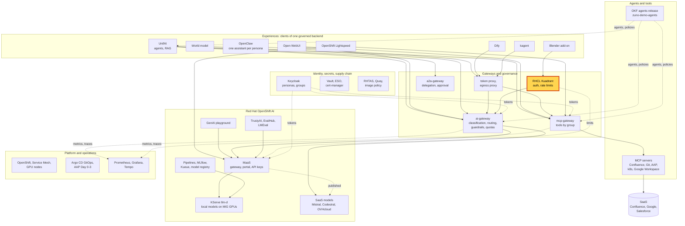
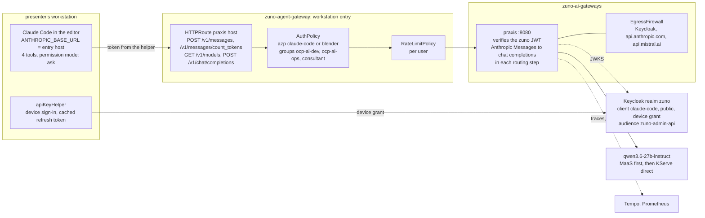

# Scenario: Claude Code on sovereign models - a coding agent that stays in the cluster

Last reviewed: 2026-11-20

## Introduction

Claude Code is a coding agent made by a SaaS vendor. By default it sends its model calls to that vendor's API. Here it
runs on the presenter's workstation, in VS Code (or VSCodium), and talks to an alternative gateway, Praxis AI. Praxis
translates Claude Code's calls for the platform's own model, `qwen3.6-27b-instruct`. The developer signs in with
Keycloak through a device code. The gateway therefore knows who is asking, and no API key is stored on the laptop. See
[Appendix A](#appendix-a---hld) for where it sits and [Appendix B](#appendix-b---lld) for the road of one request.

The proof has two parts:
- the gateway's log and trace name a local model as the one that answered;
- the namespace's firewall bounds what can leave the cluster.

**The message:** "A coding agent on the developer's laptop, on our own models, under the developer's own identity.
The model calls never go to a SaaS provider."

## Personas

The personas are fictional role accounts of the Keycloak realm `zuno`. They share one
password, kept in Vault at `keycloak/demo-personas`. The [catalogue](../../README.md#personas) lists all of them.

| Persona | Profile | What it can do here | Role in this demo |
|---|---|---|---|
| **ai-dev-01** | AI developer. Group `ocp-ai-dev`. | Signs in with the device code of the Keycloak client `claude-code`. The same persona uses the Blender add-on. | Signs in on the workstation and codes in both versions. |
| **ai-ops-01** | AI platform operator, back office. Group `ocp-ai-ops`. | Opens Grafana and its Tempo explorer. Can also use Claude Code through the entry. | Shows the trace and the metrics. |
| **paas-ops-01** | Platform operator, back office. Group `ocp-paas-ops` (cluster-admin). | Reads the objects of the alternative gateways' namespace. Its group is not admitted by the entry. | The presenter's `oc` terminal, in the 15-minute version. |

Other identities:
- The Keycloak client `claude-code` is public and uses the device grant. It has no secret.
- The workstation entry admits the tokens of that client (and of `blender`) whose groups include `ocp-ai-dev`,
  `ocp-ai-ops` or `consultant`. Any other persona gets a 403.

## Presenter lifecycle

`make demo use claude-code-sovereign 5|15` selects this page.
Each section below is printed after its action's Ansible file (`ansible/demos/claude-code-sovereign/<action>.yml`) has
run, and says what is left to the presenter.

### Status

Nothing to do. The file reads the Deployment `praxis` in `zuno-ai-gateways`. If it is missing or not Ready, stop and
tell the platform owner. The workstation entry is read by hand: `oc get httproute,authpolicy,ratelimitpolicy -n
zuno-ai-gateways`.

### Check

Nothing to do when it passes. This page has no golden-path probe yet: rehearse it the same day, on the workstation,
with the task of the 5-minute version. Read by hand that the entry's AuthPolicy and RateLimitPolicy are Accepted and
Enforced. If something fails, see [If something goes wrong](#if-something-goes-wrong).

### Install

Nothing to do on the cluster. Prepare the workstation once, the day before, never in front of the audience. The files
and the reason for each setting are in `evaluations/claude-code/` (its README).

- **The sign-in helper `zuno_claude_token.py`.** It runs the device sign-in, caches the refresh token and prints an
  access token for Claude Code. It never writes a token to the screen or to a log, except when it is run without
  an argument, which is Claude Code's own call.
- **Two one-line wrappers,** for example `~/.config/zuno/praxis-login.sh` and `praxis-logout.sh`. Each runs the
  helper with `login` or `logout` and `ZUNO_CLUSTER_DOMAIN` set. Use them in front of the audience: they can never
  print a token.
- **A settings file** made from `settings.example.json`, in a Claude configuration directory of its own
  (`CLAUDE_CONFIG_DIR`). The everyday `~/.claude` is not touched. It holds:
  - Praxis's workstation host as base URL, and `apiKeyHelper` set to the helper;
  - the local models for every alias, with 8192 output tokens and a 32768-token context;
  - no system message after the first turn;
  - only the tools `Bash`, `Read`, `Edit` and `Write`;
  - the permission mode `default` (ask), and Claude Code's telemetry and update checks off.
- **An editor window of its own:** a separate VS Code or VSCodium profile with the Claude Code extension.
  - Its settings pass `ANTHROPIC_BASE_URL` and `CLAUDE_CONFIG_DIR` to the extension, set
    `claudeCode.initialPermissionMode` to `default`, and turn the login prompt off.
  - A start script opens that profile on an empty project folder, with `settings.json` in a tab.

Then rehearse once (see [Check](#check)): sign in, ask `Reply with exactly: pong`, then run the task of the 5-minute
version.

### Start

The file prepares nothing on the cluster. What only a person does:

- [ ] The project folder is empty and the editor window is closed.
- [ ] Run the logout wrapper, so the sign-in is shown from the start.
- [ ] Close every private browser window. The sign-in uses a new private window, which keeps the browser's saved
  passwords and bookmarks out of the picture.
- [ ] Turn on "Do not disturb". Close every window that shows a secret, a home path or a personal file.
- [ ] Make the terminal and editor text larger: the GIF and the room see less detail than the screen.
- [ ] 15-minute version:
  - a terminal logged in with `oc` as **paas-ops-01**;
  - Grafana in a normal (not private) window as **ai-ops-01**, with the Tempo explorer on the service `praxis`.
- [ ] Type only the prompts of this page. They contain no data of the company.

### Stop

Nothing to do on the cluster. Run the logout wrapper, then empty the project folder.

### Uninstall

Nothing to do on the cluster. Remove the settings directory, the wrappers and the helper from the workstation if it
was lent.

## 5-minute version

Profile **ai-dev-01**, on the workstation.

| Time | Do | Say | You should see |
|---|---|---|---|
| 0:00 | Terminal: run the login wrapper (`~/.config/zuno/praxis-login.sh`) | "No key is stored on this laptop. The helper asks Keycloak for a one-time code." | A Keycloak address and a short code, then the terminal waits. |
| 0:15 | Open the link in a new private window. Sign in as **ai-dev-01**, then accept the consent | "I sign in as myself, in the browser. The gateway will receive my token, not a shared key." | The sign-in page, "Grant Access to Claude Code on sovereign models", "Device Login Successful". The terminal prints "Signed in. Claude Code can start." |
| 0:45 | Run the start script of the editor window. Stay on the `settings.json` tab | "Claude Code is a SaaS product's client. Here it points at our own gateway, with local models only." | `ANTHROPIC_BASE_URL` with the Praxis host, `qwen3.6-27b-instruct` for the main, opus and sonnet aliases and `qwen3.5-9b` for haiku, `apiKeyHelper`, and no key. |
| 1:15 | Claude Code panel: new conversation, `/status` | "Claude Code confirms where it sends its calls and with which model." | The Praxis host as Anthropic base URL, `apiKeyHelper` as auth token, `qwen3.6-27b-instruct` as model. The mode selector reads "Manual". |
| 1:45 | Send: `Write a Python function that returns the n-th Fibonacci number in fib.py, and a unittest test in test_fib.py. Run the test with python3 -m unittest.` | "A small coding task, on our own model. It thinks first: about 30 seconds." | Claude Code thinks, then proposes the file `fib.py`. |
| 2:30 | Accept each request: write `fib.py`, write `test_fib.py`, run `python3 -m unittest` | "The tools run here, on the laptop, and each one waits for my approval. Only the model calls leave the laptop, and they stay in the cluster." | Three approval prompts, then "Ran 4 tests" and a summary. The wording and the number of tests differ at each run. |
| 3:45 | Optional: Grafana, Tempo explorer, service `praxis`, the trace of the last request | "The gateway recorded the call. It names the route that answered: the MaaS gateway of the cluster, in front of the local model." | A trace of `praxis` with its routing step. Praxis samples one request in ten: if the latest is missing, take an earlier one. |
| 4:30 | Close | "A coding agent on our models, under my identity, with no model call leaving the cluster." | |

## 15-minute version

Run the 5-minute version, then:

| Time | Do | Say | You should see |
|---|---|---|---|
| 5:00 | Ask a follow-up in the same conversation: `Add a docstring to the test class.` Accept the edit | "The same road for every turn: Praxis, our model, my approval." | An edit of `test_fib.py`. *(not rehearsed)* |
| 6:15 | Terminal: `oc get httproute,authpolicy,ratelimitpolicy -n zuno-ai-gateways` | "The workstation entry is three objects: a route, an authentication policy, and a rate limit per user." | The three objects, Accepted and Enforced. The route admits `POST /v1/messages`, `POST /v1/messages/count_tokens`, `GET /v1/models` and `POST /v1/chat/completions`. |
| 7:30 | Terminal: `curl -s -o /dev/null -w '%{http_code}\n' https://praxis.<domain>/v1/models` (the host of the entry) | "Without a token, the entry answers 401. It admits tokens of its two clients, for three groups of people." | `401`. |
| 8:30 | Terminal: `oc get egressfirewall -n zuno-ai-gateways` and show its rules | "What can leave this namespace is written down: Keycloak and two SaaS hosts, the two the gateway may use for Claude and Codestral. Nothing else." | The rules: allow Keycloak, `api.anthropic.com` and `api.mistral.ai`, deny the rest. |
| 10:00 | Grafana: the Praxis metrics, requests by model, last 1 hour | "The count by model shows the local model only. Not one request to a SaaS provider during this demo." | Requests for `qwen3.6-27b-instruct`, none for Claude or Codestral. The panel names are to confirm. |
| 11:15 | Say how the translation works | "Claude Code speaks the Anthropic message format. The gateway translates it to the chat format our models serve, and back, streaming and tool calls included." | |
| 12:15 | Say what is missing compared to the Zuno gateway | "On this road, my calls are not counted in the persona budget, there is no classification floor, and no per-agent policy. We send public code only." | |
| 13:15 | Optional, if a second persona is at hand: sign in as **paas-ops-01**, whose group is not admitted | "The entry checks the client and the group." | Keycloak accepts the sign-in, but the entry answers 403. Claude Code retries silently for about 4 minutes before it shows the error: say it, do not wait for it. |
| 14:30 | Close | Repeat the message. | |

## If something goes wrong

| Symptom | Fallback | Say |
|---|---|---|
| The login wrapper prints "set ZUNO_CLUSTER_DOMAIN" | The wrapper is missing or does not set the domain. Run the helper with `ZUNO_CLUSTER_DOMAIN` set. | |
| No answer for minutes, then "Failed to authenticate. API Error: 403" | The persona is not in an admitted group, or the token is from another client. Sign out, sign in as ai-dev-01, start a new conversation. | "The entry only accepts the client made for it, for the admitted groups." |
| 401 after the sign-in | The helper's cache is empty: sign in again with the login wrapper. | "No token, no call." |
| `API Error: 400 tool_result requires string tool_use_id and text content` | A tool failed or a request was refused, and the conversation is now stuck on it. Start a new conversation and accept every request. | "Our gateway does not yet translate a tool error. We say so." |
| `400 System message must be at the beginning`, or `maximum context length is 32768 tokens` | The settings file is not the one of this page. Check `CLAUDE_CODE_MODEL_CAPABILITIES`, `CLAUDE_CODE_MAX_OUTPUT_TOKENS` and the denied tools, then restart the editor window. | |
| "… is temporarily unavailable, so auto mode cannot determine the safety" | The mode selector is on "Auto". Switch it to "Manual" (ask before acting) and start a new conversation. | |
| 429 | The per-user rate limit is reached. Wait one window, or show the GIF. | "The limit is per user." |
| The model loops, or does not call its tools | A local model is less steady than a hosted one on long tasks. Start a new conversation with the same short task. | "Our models are smaller. We say so." |
| The answer is slow | A 27B model thinks before it answers: about 30 seconds on the first turn. Talk over it. | |
| No trace in Tempo | Widen the time range to 1 hour. Praxis samples one request in ten and exports after about a minute. If there is still none, say that the trace was not verified. | |

## Limits

- **Rehearsed once.** The 5-minute version was played on 2026-11-18 on the owner's workstation, from sign-in to the
  passing tests. The trace row was not played. The 15-minute version is not rehearsed.
- **A failed tool ends the turn.** Praxis does not yet translate a tool result marked as an error, so a command that
  fails, or a request the presenter refuses, gives a 400. Then only a new conversation helps.
- **A smaller model and a smaller kit.** `qwen3.6-27b-instruct` is not Claude, and its window is 32768 tokens.
  Claude Code therefore runs with four tools (`Bash`, `Read`, `Edit`, `Write`) and 8192 output tokens. The "Auto"
  permission mode does not work on this road. Long tasks are less steady.
- **Only C1 content is shown.** The alternative gateway has no classification floor. Source code and files of the
  company must not be typed in. The project folder holds a toy task.
- **The alternative gateway does not enforce:**
  - the persona quota ledger: the calls are not counted in the persona's budget; the entry has its own rate limit per
    user;
  - the classification floors and the signed tool-result markers;
  - the per-agent routing policy;
  - the Zuno cost metrics.
- **"Nothing leaves the cluster" is about the model calls of this demo.** Nothing in the platform stops the
  alternative gateway from calling Claude or Codestral if a client asks for them: the firewall allows those two
  hosts. The `claude-code` client is refused the SaaS models by Praxis's own policy. Claude Code's telemetry and
  update checks are a setting of the workstation, outside this proof.
- **The tools run on the laptop.** File edits and commands happen on the presenter's workstation, with the presenter's
  rights, not in the cluster.
- **Praxis is alpha.** Its configuration can change between releases.

## Appendix A - HLD

Where the brick sits in Zuno. The highlighted box is the subject of this page. Plain arrows carry requests, dotted
arrows carry identity, policy or telemetry.

## Appendix B - LLD

The road of one request from the workstation, as rehearsed on 2026-11-18. The entry is
`gitops/charts/connectivity-link/templates/praxis-workstation-entry.yaml`. The gateway is `gitops/charts/praxis`.

## References

The decisions this page rests on:

- [ADR-0619](../../../adr/0619-run-praxis-ai-as-an-alternative-ai-gateway-next-to-the-default-zuno-ai-gateway.md):
  Praxis as an alternative gateway; clause 8 makes Claude Code the second experience of the workstation band; what the
  alternative road loses.
- [ADR-0610](../../../adr/0610-generate-blender-objects-as-bpy-scripts-from-a-local-model-through-the-ai-gateway.md):
  the Blender add-on, which the workstation entry and the device sign-in are modelled on.
- [ADR-0606](../../../adr/0606-admit-new-experiences-with-a-definition-of-done-and-a-wip-limit.md): the definition of
  done and the WIP limit of a new experience.
- [ADR-0349](../../../adr/0349-restructure-demo-personas-cluster-access-groups-and-new-agents.md): the demo personas,
  their groups and their shared password.
- [ADR-0616](../../../adr/0616-prepare-and-play-every-catalogue-demo-through-one-make-demo-lifecycle.md): the `make demo`
  lifecycle that the Presenter lifecycle section follows.
- [ADR-0618](../../../adr/0618-give-every-catalogue-scenario-a-gif-with-real-terminal-sessions-checked-as-text-first.md):
  the GIF of each scenario, here cut from a take assembled from the owner's screen recording.

Evidence: [WP-298](../../../roadmap/work-packages/wp-298-run-claude-code-on-sovereign-models-through-praxis.md): the
work package of the client, the entry and the sign-in, with the rehearsal of 2026-11-18 and the four fixes it needed.

## Page status

> **Status:** Rehearsed: the 5-minute version on 2026-11-18, on the owner's workstation (ai-dev-01,
> `qwen3.6-27b-instruct`, the tests pass), without the optional trace row. The 15-minute version is not rehearsed.
> **Show-ready ([ADR-0606](../../../adr/0606-admit-new-experiences-with-a-definition-of-done-and-a-wip-limit.md)):**
> No golden-path probe: rehearse before showing it to an audience.
> **Personas:** see [Personas](#personas).
> **Used in workshops:** none.
