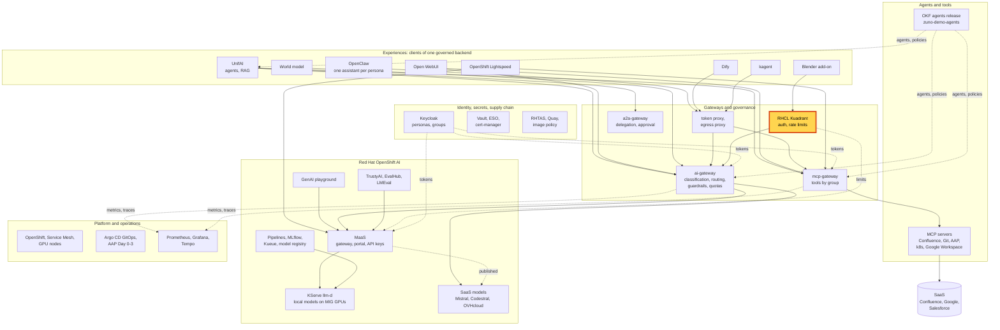
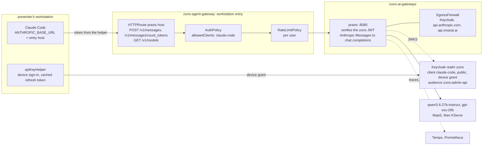

# Scenario: Claude Code on sovereign models - a coding agent that stays in the cluster

## Introduction

Claude Code is a coding agent that runs in the terminal. By default it sends its model calls to a SaaS API. Here it runs
on the presenter's workstation and talks to an alternative gateway, Praxis AI, which translates its calls for the
platform's own models: `qwen3.6-27b-instruct` and `gpt-oss-20b`. The developer signs in with Keycloak through a device
code, so the gateway knows who is asking and no key is stored on the laptop. See [Appendix A](#appendix-a---hld) for
where it sits and [Appendix B](#appendix-b---lld) for the road of one request.

The proof has two parts: the Praxis trace names a local model as the provider, and the namespace's firewall bounds
what can leave the cluster.

**The message:** "A coding agent on the developer's laptop, on our own models, under the developer's own identity.
The model calls never go to a SaaS provider."

## Personas

The personas are fictional role accounts of the Keycloak realm `zuno`. They share one
password, kept in Vault at `keycloak/demo-personas`. The [catalogue](../../README.md#personas) lists all of them.

| Persona | Profile | What it can do here | Role in this demo |
|---|---|---|---|
| **ai-dev-01** | AI developer. Group `ocp-ai-dev`. | Signs in with the device code of the Keycloak client `claude-code`. The same persona uses the Blender add-on. | Signs in on the workstation and codes in both versions. |
| **ai-ops-01** | AI platform operator, back office. Group `ocp-ai-ops`. | Opens Grafana and its Tempo explorer. | Shows the trace and the metrics. |
| **paas-ops-01** | Platform operator, back office. Group `ocp-paas-ops` (cluster-admin). | Reads the objects of the alternative gateways' namespace. | The presenter's `oc` terminal, in the 15-minute version. |

Other identities:
- The Keycloak client `claude-code` is public and uses the device grant. It has no secret.
- The entry of the workstation host admits tokens of that client only. The group of the persona is not checked by the
  entry in the current design: any realm user could sign in. This is a limit, written below.

## Presenter lifecycle

`make demo use claude-code-sovereign 5|15` selects this page.
Each section below is printed after its action's Ansible file (`ansible/demos/claude-code-sovereign/<action>.yml`) has
run, and says what is left to the presenter.

### Status

Nothing to do. The file reads the Deployment `praxis` in `zuno-ai-gateways`. If it is missing or not Ready, stop and
tell the platform owner. The workstation entry is read by hand: `oc get route,httproute -n
zuno-ai-gateways`.

### Check

Nothing to do when it passes. This page has no golden-path probe yet: rehearse it the same day, on the workstation,
with one real question. Read by hand that the entry's AuthPolicy and RateLimitPolicy are Accepted and Enforced. If
something fails, see [If something goes wrong](#if-something-goes-wrong).

### Install

Nothing to do on the cluster. The workstation needs three things, once. Do them the day before, never in front of the
audience:

- Claude Code, installed on the workstation.
- The sign-in helper. It starts the device sign-in, caches the refresh token and prints an access token. The token is
  never written to this page or to a log.
- The settings file: the entry host of the alternative gateway as base URL, `apiKeyHelper` set to the helper, the model
  names `qwen3.6-27b-instruct` and `gpt-oss-20b`, and Claude Code's telemetry and update checks off.

Then run `claude` once in a practice folder and sign in. These files are not written yet; the work package of the
client creates them.

### Start

The file prepares nothing on the cluster. What only a person does:

- [ ] On the workstation, an empty practice folder and a terminal in it.
- [ ] The settings of the Install section are in place: the base URL of the entry and the two model names. Check that Claude Code's own telemetry and update checks are off, so that the only traffic is the one
  this page talks about.
- [ ] A browser profile for **ai-dev-01**, for the device sign-in. Clear the cached sign-in of the helper to show the
  sign-in from the start, or keep it to skip it.
- [ ] 15-minute version:
  - a terminal logged in with `oc` as **paas-ops-01**;
  - Grafana in the ai-ops-01 profile, the Tempo explorer and the Praxis dashboard.
- [ ] Type only the prompts of this page. They contain no data of the company.

### Stop

Nothing to do on the cluster. Delete the practice folder. Clear the helper's cached sign-in if the workstation is
shared.

### Uninstall

Nothing to do on the cluster. Remove the settings file and the helper from the workstation if it was lent.

## 5-minute version

Profile **ai-dev-01**, on the workstation, in the practice folder.

| Time | Do | Say | You should see |
|---|---|---|---|
| 0:00 | Show the settings file: the base URL and the two model names | "Claude Code is a SaaS product's client. Here it is pointed at our own gateway. There is no key in this file." | `ANTHROPIC_BASE_URL` with the workstation host of the alternative gateway, and the model names. |
| 0:45 | Start `claude`: the helper starts the device sign-in. Open the code page in the browser and sign in as **ai-dev-01** | "The helper asks Keycloak for a code. I sign in as myself, in the browser. The gateway receives my token, not a shared key." | A short code and a Keycloak page. After the sign-in, Claude Code opens its prompt. |
| 1:45 | Ask: `Write a Python function that returns the n-th Fibonacci number, and a pytest test for it. Run the test.` | "A small coding task, on `qwen3.6-27b-instruct`. The tools run here, on the laptop. Only the model calls leave it." | The function and the test are written in the folder, and the test passes. The wording and the number of turns differ at each run. |
| 3:15 | Show the model in use (`/model`) | "The name of the model is ours, not a SaaS one." | `qwen3.6-27b-instruct` (or `gpt-oss-20b` if selected). |
| 3:45 | Grafana, Tempo explorer: the trace of the last request on the Praxis service | "The gateway recorded the call. It names the provider that answered: a local model, in the cluster." | A trace with `routing.select` and `provider.route` spans and a local backend. The service name is to confirm at the first rehearsal. |
| 4:30 | Close | "A coding agent on our models, under my identity, with no model call leaving the cluster." | |

## 15-minute version

Run the 5-minute version, then:

| Time | Do | Say | You should see |
|---|---|---|---|
| 5:00 | Switch the model with `/model` to `gpt-oss-20b` and repeat a short task: `Add a docstring to the function.` | "A second local model, same road." | An edit of the file. |
| 6:15 | Terminal: `oc get httproute,authpolicy,ratelimitpolicy -n zuno-ai-gateways` | "The workstation entry is three objects: a route, an authentication policy, and a rate limit per user." | The three objects, Accepted and Enforced. The route admits `POST /v1/messages`, `POST /v1/messages/count_tokens` and `GET /v1/models`. |
| 7:30 | Terminal: `curl -s -o /dev/null -w '%{http_code}\n' https://praxis.<domain>/v1/models` (the host of the entry) | "Without a token, the entry answers 401. It only admits tokens of the `claude-code` client." | `401`. |
| 8:30 | Terminal: `oc get egressfirewall -n zuno-ai-gateways` and show its rules | "What can leave this namespace is written down: Keycloak and two SaaS hosts, the two the gateway may use for Claude and Codestral. Nothing else." | The rules: allow Keycloak, `api.anthropic.com` and `api.mistral.ai`, deny the rest. |
| 10:00 | Grafana, the Praxis dashboard: requests by provider and model, last 1 hour | "The count by provider shows the local models only. Not one request to a SaaS provider during this demo." | Requests for the two local models, none for Claude or Codestral. The panel names are to confirm. |
| 11:15 | Say how the translation works | "Claude Code speaks the Anthropic message format. The gateway translates it to the chat format our models serve, and back, streaming included." | |
| 12:15 | Say what is missing compared to the Zuno gateway | "On this road, my token budget is not counted, there is no classification floor, and no per-agent policy. We send public code only." | |
| 13:15 | Optional, if a second persona is at hand: sign in to the device flow as a persona outside `ocp-ai-dev` | "The entry checks the client, not the group. This is a limit we write down." | The sign-in succeeds: the entry does not check the group. *(untested)* |
| 14:30 | Close | Repeat the message. | |

## If something goes wrong

| Symptom | Fallback | Say |
|---|---|---|
| The device sign-in does not start | Run the helper alone in the terminal and read its message. Check the base URL and the Keycloak route. Show the trace of an earlier take. | "Sign-in is the part we do not skip: no token, no call." |
| 401 or 403 after the sign-in | The token is from another client or has expired. Clear the helper's cache and sign in again. | "The entry only accepts the client made for it." |
| 429 | The per-user rate limit is reached. Wait one window, or show the earlier take. | "The limit is per user." |
| The model does not call its tools, or loops | A local model is less steady than a hosted one on long tasks. Shorten the task, or switch to the other model. | "Our models are smaller. We say so." |
| The answer is slow | A 27B model answers slower than a hosted one. Talk over the tool calls. | |
| No trace in Tempo | Widen the time range to 1 hour. Export takes about a minute. If there is still none, say that the trace was not verified. | |
| Claude Code asks to reach its own servers | Its telemetry or update check is on. Turn it off in the settings and restart. | "Those calls are not model calls, and they are off here." |

## Limits

- **Not rehearsed.** Nothing on this page was played. The settings, the span names, the dashboard panels and the
  checkpoints are expectations taken from the design and from the product's documentation.
- **Only C1 content is shown.** The alternative gateway has no classification floor. Source code and files of the
  company must not be typed in. The practice folder holds a toy task.
- **The alternative gateway does not enforce:**
  - the persona quota ledger: the calls are not counted in the persona's budget; the entry has its own rate limit per
    user;
  - the classification floors and the signed tool-result markers;
  - the per-agent routing policy;
  - the Zuno cost metrics.
- **"Nothing leaves the cluster" is about the model calls of this demo.** Nothing in the platform stops the alternative
  gateway from calling Claude or Codestral if a client asks for them: the firewall allows those two hosts. This page
  names local models only, and the dashboard shows it. Claude Code's own telemetry and update checks are a setting of
  the workstation, outside this proof.
- **The entry checks the client, not the group.** A public device-grant client lets any realm user mint a token. The
  Blender entry narrows by group; this one does not in the current design.
- **A smaller model.** `qwen3.6-27b-instruct` and `gpt-oss-20b` are not Claude. Long tasks and tool use are less steady.
- **The tools run on the laptop.** File edits and commands happen on the presenter's workstation, with the presenter's
  rights, not in the cluster.
- **Praxis is alpha.** Its configuration can change between releases.

## Appendix A - HLD

Where the brick sits in Zuno. The highlighted box is the subject of this page. Plain arrows carry requests, dotted
arrows carry identity, policy or telemetry.

## Appendix B - LLD

The road of one request from the workstation. Drawn from the design records and the work-package briefs: the chart of
the alternative gateway and the workstation entry are not in the repository yet, so the names are the planned ones and
are to be checked against them when they exist.

## References

The decisions this page rests on:

- [ADR-0619](../../../adr/0619-run-praxis-ai-as-an-alternative-ai-gateway-next-to-the-default-zuno-ai-gateway.md):
  Praxis as an alternative gateway; clause 8 makes Claude Code the second experience of the workstation band; what the
  alternative road loses.
- [ADR-0610](../../../adr/0610-generate-blender-objects-as-bpy-scripts-from-a-local-model-through-the-ai-gateway.md):
  the Blender add-on, which the workstation entry and the device sign-in are modelled on.
- [ADR-0606](../../../adr/0606-admit-new-experiences-with-a-definition-of-done-and-a-wip-limit.md): the definition of
  done and the WIP limit of a new experience.
- [ADR-0349](../../../adr/0349-restructure-demo-personas-cluster-access-groups-and-new-agents.md): the demo personas,
  their groups and their shared password.
- [ADR-0616](../../../adr/0616-prepare-and-play-every-catalogue-demo-through-one-make-demo-lifecycle.md): the `make demo`
  lifecycle that the Presenter lifecycle section follows.

Evidence: [WP-298](../../../roadmap/work-packages/wp-298-run-claude-code-on-sovereign-models-through-praxis.md): the
work package of the client, the entry and the sign-in. Not done yet.

## Page status

> **Status:** Not rehearsed. Prerequisites not checked: the alternative gateway, the Keycloak client `claude-code` and
> the workstation entry do not exist at the time of writing. The page depends on
> [WP-292](../../../roadmap/work-packages/wp-292-deploy-praxis-ai-in-the-alternative-gateways-namespace.md) and
> [WP-298](../../../roadmap/work-packages/wp-298-run-claude-code-on-sovereign-models-through-praxis.md).
> **Show-ready ([ADR-0606](../../../adr/0606-admit-new-experiences-with-a-definition-of-done-and-a-wip-limit.md)):**
> No golden-path probe: rehearse before showing it to an audience.
> **Personas:** see [Personas](#personas).
> **Used in workshops:** none.
