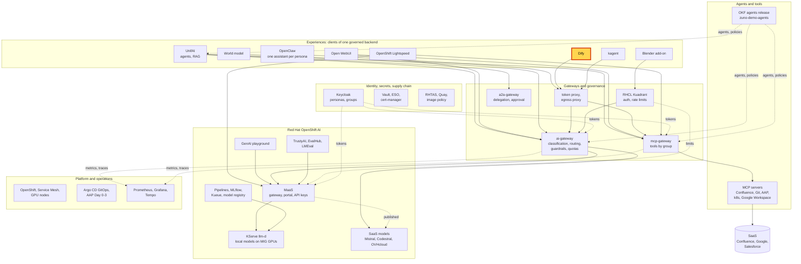
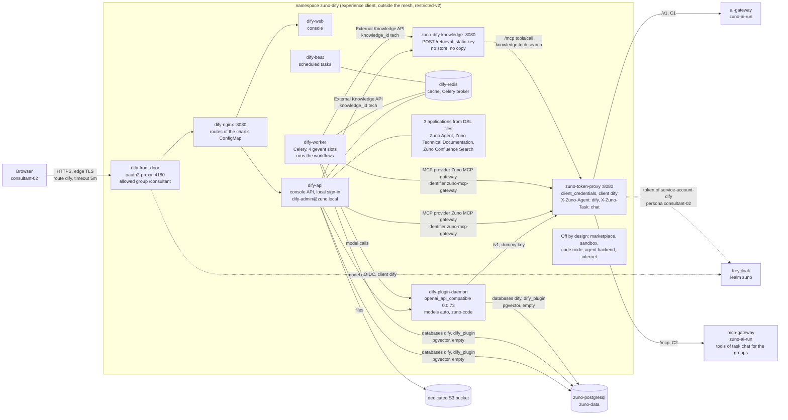

# Scenario: Dify - a no-code canvas on the governed backend

> **Status:** Not rehearsed in this format. Prerequisites checked read-only on demo333 on 2026-11-12: Applications
> `zuno-dify-d1`, `zuno-dify-knowledge-d1` and `zuno-token-proxy-dify-d1` Synced and Healthy; in `zuno-dify` the
> Deployments `dify-api`, `-worker`, `-beat`, `-web`, `-plugin-daemon`, `-nginx`, `-front-door`, `zuno-token-proxy` and
> `zuno-dify-knowledge` 1/1 (Dify 1.17.0 pinned by digest) and `dify-redis-master` 1/1; route
> `dify.apps.demo333.startx.fr`; five ExternalSecrets synced; EgressFirewall applied; the token proxy runs as Keycloak
> client `dify` with `X-Zuno-Agent: dify` and task `chat`; `dify` is in the ai-gateway's experience and persona-claim
> clients. Around 22:00Z master ip-10-18-36-37 was cordoned, Grafana was down and the local models were restarting. At
> 22:51Z the master was schedulable again, Grafana was 1/1, the four local models were Ready, and the Dify pods had been
> recreated about 80 minutes earlier (`dify-api` with 3 restarts, `dify-web` with 1). The three applications were not
> checked: that needs a sign-in.
> **Show-ready ([ADR-0606](../../../adr/0606-admit-new-experiences-with-a-definition-of-done-and-a-wip-limit.md)):**
> yes, golden-path probe `dify`.
> **Personas:** see [Personas](#personas).
> **Used in workshops:** [One governed backend, many experiences](../../five-experiences.md).

## Introduction

Dify is an open-source canvas on which a business user draws an LLM application: an agent, a chat flow or a workflow,
built from model, knowledge, tool and logic boxes. In Zuno it is an experience client of the one governed backend (see
[Appendix A](#appendix-a---hld)). It holds no model key, no document store and no tool credential. Its Community
Edition has no single sign-on and cannot pass a user token. Every call therefore leaves Dify through a **token proxy**
that signs it as one persona, **consultant-02**. Models come from the ai-gateway, tools from the mcp-gateway, and
knowledge from a small adapter over the same mcp-gateway (see [Appendix B](#appendix-b---lld)). Three example
applications are imported at every install.

**The message:** "Business users can draw their own AI apps. The models, tools, documents and budget behind them stay
the platform's."

**Decisions:**
- [ADR-0587](../../../adr/0587-admit-additional-user-experiences-over-the-one-governed-backend.md): experiences are
  presentation layers over the one governed backend.
- [ADR-0599](../../../adr/0599-serve-a-no-code-workflow-canvas-with-dify-as-an-experience-client.md): Dify in one
  workspace behind a Keycloak front door; no datasets, marketplace, code sandbox or internet egress; External
  Knowledge through an adapter; the three example applications.
- [ADR-0601](../../../adr/0601-inject-client-credentials-tokens-for-experience-clients-without-oidc-passthrough.md):
  the token proxy adds a client-credentials token of the persona to every model and tool call.
- [ADR-0593](../../../adr/0593-key-the-per-user-quota-and-telemetry-by-persona-across-experiences.md): quota and
  telemetry are keyed by persona, so every Dify user counts as consultant-02.
- [ADR-0594](../../../adr/0594-give-the-three-experiences-the-same-mcp-tools-behind-signed-classification-markers.md):
  the same tools as the agents, filtered by group; a turn that used a tool stays on local models.

## Personas

The personas are fictional role accounts of the Keycloak realm `zuno`
([ADR-0349](../../../adr/0349-restructure-demo-personas-cluster-access-groups-and-new-agents.md)). They share one
password, kept in Vault at `keycloak/demo-personas`. The [catalogue](../../README.md#personas) lists all of them.

| Persona | Profile | What it can do here | Role in this demo |
|---|---|---|---|
| **consultant-02** | Consultant and architect, front office. Group `consultant` with six Confluence subgroups (build OpenShift and OpenShift AI, the four architecture spaces), `agent_tekos`, `agent_arkos`, `aap_ops`. | Passes Dify's front door, which admits the group `consultant` only. Dify's service account carries exactly these groups, so the applications get the tools of Dify's task `chat` that these groups allow: Confluence search and page read, technical-docs search, Drive, Gmail, diagrams. | Signs in through the front door in both versions and runs the three applications. |
| **ai-ops-01** | AI platform operator, back office. Group `ocp-ai-ops` (admin on the Zuno namespaces, `zuno-monitoring` included). | Opens Grafana. Cannot enter Dify: it is not in `consultant`. | Shows the dashboard in the 15-minute version. |
| **paas-ops-01** | Platform operator, back office. Group `ocp-paas-ops` (cluster-admin). | Runs the golden-path probe and reads the objects of `zuno-dify`. | The presenter's `oc` terminal: the probe before the session and the terminal step of the 15-minute version. |

Other identities:
- `dify-admin@zuno.local`, Dify's single local administrator. Its password is in Vault `zuno/dify/admin`. Everyone
  the front door admits works in Dify as this account, in one workspace (a licence condition of Dify).
- `service-account-dify`, the service account of the Keycloak client `dify`: the groups of consultant-02 and a fixed
  `persona` claim `consultant-02`. The token proxy signs every model and tool call with its token.
- The golden-path probes `dify` and `guardrails` call through the same token proxy, so they also count as
  consultant-02.

## Before you start

- [ ] A browser profile for **consultant-02**. Open `https://dify.apps.demo333.startx.fr` and sign in twice:
  - Keycloak first, as **consultant-02** (the front door);
  - then Dify's own form, as `dify-admin@zuno.local`, password from Vault `zuno/dify/admin`, typed off screen. There
    is no per-person Dify account, by design.
- [ ] **Studio** lists the three applications: **Zuno Agent**, **Zuno Technical Documentation** and **Zuno Confluence
  Search**.
- [ ] Run each application once before the audience arrives. It wakes the model and catches the Workflow stall (D1)
  off stage. Time the Agent turn: it took 82 s on 2026-11-06, before the experience clients moved to gpt-oss-20b first
  (2026-11-07), and it was not timed since.
- [ ] Do not open the server card under **Integrations**, **MCP**: Dify 1.17.0 answers 500 there (upstream defect).
  The applications are not affected.
- [ ] Golden-path probe `dify` passed within the last hour (`ONLY=dify,tools make demo golden-path`), see
  [golden-path.md](../../golden-path.md). `dify` proves the model path through the token proxy; `tools` proves that
  the Confluence MCP server answers. Neither runs the applications.
- [ ] 15-minute version:
  - a terminal logged in with `oc` as **paas-ops-01**;
  - Grafana in another profile, signed in as **ai-ops-01**, dashboard **Zuno Platform / Five experiences**, last 1
    hour, `client` = `dify`.

## 5-minute version

Profile **consultant-02**, signed in to Dify.

| Time | Do | Say | You should see |
|---|---|---|---|
| 0:00 | Show **Studio** | "A no-code canvas: a business user draws an AI app from boxes. Three examples are imported at every install." | Three applications: **Zuno Agent** (Agent), **Zuno Technical Documentation** (Chatflow), **Zuno Confluence Search** (Workflow). |
| 0:45 | Open **Zuno Agent** and ask in its chat pane: `Find our onboarding pages in Confluence` | "The agent searches Confluence through the platform's tool gateway. Dify holds no Confluence key and no model key." | A call to the tool `confluence.page.search`, then the onboarding pages with their titles, for example MNGD2-AP001 Onboarding Chef de projet métier (six pages on 2026-11-05). |
| 2:30 | Open **Zuno Confluence Search**, click **Run**, enter the topic `onboarding` | "The same search, drawn as a fixed workflow: a tool box, then a summary box. No code." | Start, `confluence.page.search`, Summarise and End succeeded, in about 3 s. The output `summary` lists one page per line with its space. |
| 3:45 | Say who Dify acts as | "Dify has no single sign-on. I passed the company sign-in at the door, but behind Dify every call is made as one persona, consultant-02: its tools, its documents, its budget." | |
| 4:15 | Close | "Business users can draw their own AI apps. The models, tools, documents and budget behind them stay the platform's." | |

## 15-minute version

Run the 5-minute version, then:

| Time | Do | Say | You should see |
|---|---|---|---|
| 5:00 | Open **Zuno Technical Documentation** in the canvas | "Drawn, not coded: a start box, a knowledge box, the model, the answer." | Four boxes: Start, Zuno technical documentation (knowledge retrieval), LLM, Answer. |
| 6:00 | In its chat preview, ask: `Quels sont les workshops de onboarding disponibles ?` | "The knowledge box holds no copy of our documents. It asks the platform at each question, with the persona's rights." | A list of onboarding workshops, with the sources under the answer and their classification (Confluence C2, public documentation C1). |
| 7:30 | **Knowledge**: open the external knowledge base **Zuno technical documentation** and its API **Zuno knowledge adapter** | "Dify's own datasets are not used: no upload, no embedding, no vector store of ours. The base is an adapter that makes one documentation search on the mcp-gateway per question." | An external knowledge base bound to the API **Zuno knowledge adapter**, endpoint `http://zuno-dify-knowledge:8080`. |
| 8:45 | Terminal: `oc get deploy zuno-token-proxy -n zuno-dify -o jsonpath='{.spec.template.spec.containers[0].env}'` | "Every call leaves Dify through this proxy. It drops Dify's dummy key, takes a token for the Keycloak client `dify` and stamps who is calling and for which task." | `CLIENT_ID` `dify`; `AI_HEADERS` with `X-Zuno-Agent: dify`, `X-Zuno-Task: chat`, `X-Zuno-Data-Classification: C1`; `MCP_HEADERS` the same with `C2`. |
| 10:00 | Grafana, row **Same backend, five experiences** | "The gateway counts Dify like any other client." | A `dify` series in **Model calls by experience (over range)** and **Tokens by experience (over range)**. |
| 11:00 | Row **Same tools, governed: cluster reads (ADR-0600)**, panel **All governed tool calls by tool and outcome (over range)** | "Same tools, same entitlement and one audit as UnifAI or Open WebUI. The cluster tools are not offered to Dify: its task does not allow them." | `confluence.page.search` and `knowledge.tech.search` with the outcome `allowed`. |
| 12:00 | Row **One budget across the experiences** | "Dify spends consultant-02's budget: the same budget as consultant-02 in UnifAI or Open WebUI." | Tokens of the consultant groups, with client `dify` next to the other clients. |
| 13:00 | Say the limit, and what is off | "The platform cannot tell two Dify users apart: the front door logs who signed in, the gateways see consultant-02. Dify also cannot run code or reach the internet: the code sandbox, the marketplace and outbound traffic are off." | |
| 14:15 | Close | Repeat the message. | |

## If something goes wrong

| Symptom | Fallback | Say |
|---|---|---|
| A Workflow run shows no progress after a few seconds | The known stall of Dify 1.17.0 ([WP-208](../../../roadmap/work-packages/wp-208-five-experiences-demonstration.md) D1): about one run in four, 190 s to 8 minutes before the first tool call. Stop the run and start it again; the next run takes about 3 s. Or show **Zuno Agent** instead ([runbook of 2026-11-09](../../demo-day-2026-11-09.md)). | "This stall is inside Dify, before the request reaches the platform. Running it again is the workaround." |
| 503 or "no eligible provider" in an answer | No local model is ready (ADR-0591). A turn that used a company tool may only use local models. | "The gateway refuses rather than sending company data to a SaaS model." |
| 403 after the Keycloak sign-in | The browser holds a Keycloak session of a persona outside `consultant`. Use the consultant-02 profile or a private window. | |
| Dify's form refuses `dify-admin@zuno.local` | Read the password again from Vault `zuno/dify/admin`, off screen. | |
| The Chatflow ignores the question or answers "I'm ready to help" | The application predates the fix of WP-208 D2 (2026-11-06). Show **Zuno Agent**; re-import the application after the session. | |
| An application is missing from Studio | Show the other two. After the session, `make d2 install dify` imports a missing example again (once per name). | |
| No `dify` series in Grafana | Widen the time range to 3 hours. Export and scrape take about a minute. | |
| Every model and tool call fails at once | The token proxy holds no valid Keycloak token (Keycloak or the client secret is broken) and answers 503 ([ADR-0601](../../../adr/0601-inject-client-credentials-tokens-for-experience-clients-without-oidc-passthrough.md) decision 4). Stop the Dify part. | "Without a valid identity, nothing leaves Dify." |

## Limits

- **One persona for every Dify user.** Quota, telemetry and audit see consultant-02; only the front door knows who
  signed in (ADR-0601 decision 5).
- **One workspace, one local account.** Dify Community has no SSO, and more than one workspace needs written
  permission from Dify (licence).
- **Dify's own knowledge features are unused.** No dataset, upload or embedding model. pgvector is configured only
  because the console requires a vector store; it holds nothing.
- **Off by design:** the marketplace and plugin installation from the internet, provider plugins other than the
  OpenAI-compatible one (pinned by sha256), the code sandbox and the code node, the agent backend (needed by Dify's
  newer `agent` type; the example uses the legacy Agent type), web search and HTTP to the internet. The EgressFirewall
  allows only Keycloak and Dify's S3 bucket.
- **No cluster tools in Dify.** The `k8s.*` tools are not in Dify's task `chat`, and the policy grants them to
  `ocp-ai-ops` only. See the [kagent scenario](kagent.md).
- **The token proxy does not check its callers on demo333.** Its inbound key (ADR-0602 clause 10) is off: any pod of
  `zuno-dify` may call it, as the NetworkPolicy allows.
- **The Workflow stall (D1)** is a closed known limit: its cause is inside Dify and was not named.
- **Guardrails are not shown here.** The golden-path probe `guardrails` sends its DAN prompt through Dify's token
  proxy, so a `dify` series with outcome `detected` may appear on the dashboard. The [guardrails scenario](../governance/guardrails.md)
  shows it.

## Appendix A - HLD

Where Dify sits in Zuno. The highlighted box is the subject of this page. Plain arrows carry requests, dotted arrows
carry identity, policy or telemetry.

## Appendix B - LLD

Dify's internals and the calls it makes. Drawn from `gitops/charts/dify/` (values and templates),
`gitops/charts/zuno-token-proxy/`, `gitops/charts/zuno-dify-knowledge/`, `ansible/roles/dify/defaults/main.yml`,
`ansible/roles/dify/files/configure.py` and `ansible/roles/dify/files/apps/`.

