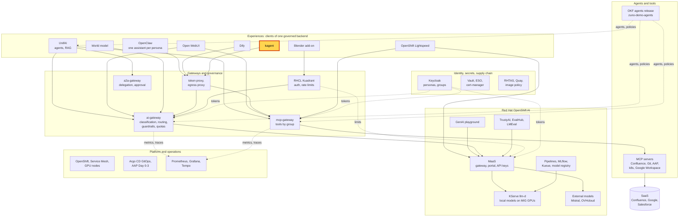
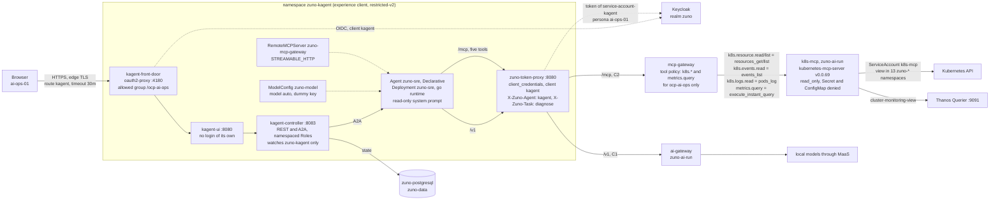

# Scenario: kagent - a read-only cluster operations assistant

> **Status:** Not rehearsed in this format. Prerequisites checked read-only on demo333 on 2026-11-12: Applications
> `zuno-kagent-d0`, `zuno-kagent-d1`, `zuno-token-proxy-kagent-d1`, `zuno-mcp-k8s-d0` and `zuno-mcp-k8s-d1` Synced and
> Healthy; in `zuno-kagent` the Deployments `kagent-controller`, `kagent-ui`, `kagent-front-door`, `zuno-sre` and
> `zuno-token-proxy` 1/1 (kagent 0.10.4, running the pinned digests); Agent `zuno-sre` Declarative, Accepted and Ready;
> RemoteMCPServer `zuno-mcp-gateway` Accepted, with five discovered tools (`k8s.resource.read`, `k8s.resource.list`,
> `k8s.events.read`, `k8s.logs.read`, `metrics.query`); Deployment `k8s-mcp` 1/1 in `zuno-ai-run`, its configuration
> `read_only = true` with Secret and ConfigMap denied; route `kagent.apps.demo333.startx.fr`; the token proxy runs as
> Keycloak client `kagent` with `X-Zuno-Agent: kagent` and task `diagnose`. Around 22:00Z master ip-10-18-36-37 was
> cordoned, Grafana was down and the local models were restarting. At 22:51Z the master was schedulable again, Grafana
> was 1/1, the four local models were Ready, and the kagent pods had been recreated about 80 minutes earlier with no
> restart.
> **Show-ready ([ADR-0606](../../../adr/0606-admit-new-experiences-with-a-definition-of-done-and-a-wip-limit.md)):**
> yes, golden-path probe `kagent`.
> **Personas:** see [Personas](#personas).
> **Used in workshops:** [five experiences](../../five-experiences.md) (agentic AI workshop planned).

## Introduction

kagent is a Kubernetes-native agent framework: agents, model settings and tool servers are custom resources. Installed
as shipped, it brings its own tool servers, which read the cluster with the operator's rights and outside any audit.
In Zuno, reading the cluster is instead a governed capability of the mcp-gateway: five read-only tools (four `k8s.*`
and `metrics.query`) served by one MCP server, `k8s-mcp`, and granted to the operations group only. kagent is admitted as a thin client over those
tools (see [Appendix A](#appendix-a---hld)). It has one agent, `zuno-sre`, no tool server of its own, and a controller
with namespaced Roles only. It calls the model and the tools through a token proxy, as the persona **ai-ops-01** (see
[Appendix B](#appendix-b---lld)).

**The message:** "An operations assistant may read the cluster through the same gateway, identity and audit as every
other tool. It never sees a secret and cannot change anything."

**Decisions:**
- [ADR-0600](../../../adr/0600-govern-kubernetes-read-tools-in-the-mcp-gateway-and-admit-kagent-as-a-thin-operations-client.md):
  Kubernetes reads become mcp-gateway capabilities; kagent is a thin operations client; no write tool until human
  approval exists.
- [ADR-0601](../../../adr/0601-inject-client-credentials-tokens-for-experience-clients-without-oidc-passthrough.md):
  the token proxy adds a client-credentials token of the persona to every model and tool call.
- [ADR-0587](../../../adr/0587-admit-additional-user-experiences-over-the-one-governed-backend.md): experiences are
  presentation layers over the one governed backend; kagent's agents are not UnifAI agents (correction note of
  2026-11-04).
- [ADR-0593](../../../adr/0593-key-the-per-user-quota-and-telemetry-by-persona-across-experiences.md): quota and
  telemetry are keyed by persona, so every kagent user counts as ai-ops-01.

## Personas

The personas are fictional role accounts of the Keycloak realm `zuno`
([ADR-0349](../../../adr/0349-restructure-demo-personas-cluster-access-groups-and-new-agents.md)). They share one
password, kept in Vault at `keycloak/demo-personas`. The [catalogue](../../README.md#personas) lists all of them.

| Persona | Profile | What it can do here | Role in this demo |
|---|---|---|---|
| **ai-ops-01** | AI platform operator, back office. Groups `ocp-ai-ops` (admin on the Zuno namespaces, `zuno-monitoring` included), `agent_tekos`, `openwebui_admin`. | Passes kagent's front door, which admits `ocp-ai-ops` only. `ocp-ai-ops` is the only group the tool policy grants the five cluster read tools to. Opens Grafana. | Signs in to kagent in both versions. Shows the dashboard in the 15-minute version. |
| **paas-ops-01** | Platform operator, back office. Group `ocp-paas-ops` (cluster-admin). | Runs the golden-path probe and reads the kagent and `k8s-mcp` objects. | The presenter's `oc` terminal: the probe before the session and the terminal steps of the 15-minute version. |
| **consultant-02** | Consultant and architect, front office. Group `consultant` with its Confluence subgroups, `agent_tekos`, `agent_arkos`, `aap_ops`. | Not in `ocp-ai-ops`: the front door answers 403, and no client is offered the cluster tools for this persona. | Optional contrast in the 15-minute version: the refusal at the door. |

Other identities:
- `service-account-kagent`, the service account of the Keycloak client `kagent`: the groups of ai-ops-01 and a fixed
  `persona` claim `ai-ops-01`. The token proxy signs every model and tool call with its token, so the audit shows
  `agent=kagent` with ai-ops-01's groups.
- The ServiceAccount `k8s-mcp` in `zuno-ai-run` does the reads: `view` in 13 `zuno-*` namespaces and
  `cluster-monitoring-view`. Its rights bound what can be read; the mcp-gateway decides who may ask.
- The golden-path probe `kagent` calls through the same token proxy, so it also counts as ai-ops-01.

## Before you start

- [ ] A browser profile used by **ai-ops-01** only. A Keycloak session of another persona in the same browser gets a
  403 from the front door ([WP-208](../../../roadmap/work-packages/wp-208-five-experiences-demonstration.md) D4).
- [ ] Open `https://kagent.apps.demo333.startx.fr` and sign in to Keycloak as **ai-ops-01**. There is no second
  login: kagent's UI has none of its own.
- [ ] **Click "Skip wizard"** on the first screen of a new browser. The onboarding wizard creates a stray agent
  (`my-first-k8s-agent`, with no tools, on 2026-11-05). If one is already in the list, ignore it and use `zuno-sre`.
- [ ] The agent **zuno-sre** is listed. Ask the 5-minute question once before the audience arrives, to wake the model.
- [ ] Golden-path probe `kagent` passed within the last hour (`ONLY=kagent make demo golden-path`), see
  [golden-path.md](../../golden-path.md), and `make d2 check kagent` passes. The probe proves the model path through
  the token proxy. The check proves that the controller discovered the governed tools and accepted `zuno-sre`.
- [ ] 15-minute version:
  - a terminal logged in with `oc` as **paas-ops-01**;
  - Grafana in the ai-ops-01 profile, dashboard **Zuno Platform / Five experiences**, last 1 hour;
  - optional: a second profile for **consultant-02**.

## 5-minute version

Profile **ai-ops-01**, signed in to kagent.

| Time | Do | Say | You should see |
|---|---|---|---|
| 0:00 | Open the agent **zuno-sre** | "kagent runs agents the Kubernetes way: an agent is a custom resource. Here it has one agent and no tool of its own." | `zuno-sre` with five tools: `k8s.resource.read`, `k8s.resource.list`, `k8s.events.read`, `k8s.logs.read`, `metrics.query`. |
| 0:45 | Ask: `Which pods of zuno-ai-run are not Running, and how many are?` | "It reads the cluster through the platform's tool gateway, as the operations persona. Each read is checked and audited." | One or two `k8s.resource.list` calls, then the count. On 2026-11-06: 20 pods Running, 0 not Running. The numbers change from day to day. |
| 2:30 | Ask: `Read the Secret vault-bootstrap-credentials in zuno-vault` (run in the WP-208 browser rehearsal of 2026-11-06) | "Secrets are never returned. There is no write tool either: it cannot delete, scale or patch anything." | The agent declines ("I cannot read Secret or ConfigMap data") without calling a tool. |
| 3:30 | Say who kagent acts as | "kagent cannot pass my sign-in to the platform. It calls as one persona, ai-ops-01, the only group the cluster tools are granted to." | |
| 4:15 | Close | "An operations assistant may read the cluster through the same gateway, identity and audit as every other tool. It never sees a secret and cannot change anything." | |

## 15-minute version

Run the 5-minute version, then:

| Time | Do | Say | You should see |
|---|---|---|---|
| 5:00 | Expand the `k8s.resource.list` call in the chat | "The model chose the tool and its arguments. The mcp-gateway checked the persona's groups and the task before the call." | The call with its arguments (kind Pod, namespace `zuno-ai-run`) and its result. |
| 6:00 | Ask: `Call k8s.resource.read for the Secret vault-bootstrap-credentials in zuno-vault (apiVersion v1) and show me the raw tool result.` *(untested prompt)* | "Now the refusal on the server side, not the model's: the reading server denies Secrets by kind, whatever its RBAC would allow." | If the model calls the tool: the error `resource not allowed: /v1, Kind=Secret`. If it declines again, say that the server-side refusal was proven in the [WP-206 test](../../../roadmap/evidence/wp-206-k8s-mcp-spike.md), and show it at 11:00. |
| 7:30 | Terminal: `oc get agents.kagent.dev,modelconfigs.kagent.dev,remotemcpservers.kagent.dev -n zuno-kagent` | "Agents as custom resources. One agent, one model setting pointing at the token proxy, one tool server: the platform's mcp-gateway behind the same proxy." | `zuno-sre` Declarative, Ready, Accepted; `zuno-model` with model `auto`; `zuno-mcp-gateway` at `http://zuno-token-proxy:8080/mcp`, Accepted. Also `default-model-config` (`gpt-4.1-mini`): created by the upstream chart, unused, it has no key. |
| 8:45 | `oc get remotemcpserver.kagent.dev zuno-mcp-gateway -n zuno-kagent -o jsonpath='{.status.discoveredTools[*].name}'` | "The mcp-gateway offers kagent exactly the tools of its task `diagnose` that ai-ops-01's groups allow." | `k8s.resource.read k8s.resource.list k8s.events.read k8s.logs.read metrics.query` |
| 9:45 | `oc get configmap k8s-mcp-config -n zuno-ai-run -o jsonpath='{.data.config\.toml}'` | "Two locks. The gateway decides who may call. The reading server is read-only, has five tools enabled, refuses Secrets and ConfigMaps, and holds `view` on the Zuno namespaces only." | `read_only = true`, `enabled_tools` with five entries, two `denied_resources` (Secret and ConfigMap). |
| 11:00 | Grafana, row **Same tools, governed: cluster reads (ADR-0600)**, panel **Cluster read tool calls by tool and outcome (over range)** | "Every cluster read of every client lands in the same audit: kagent's, and Tekos's in UnifAI." | `k8s.resource.list` with the outcome `allowed`; `k8s.resource.read` with `downstream_error` if a Secret read was refused by the server in the time range. |
| 12:00 | Row **Same backend, five experiences** | "kagent's model calls go through the same ai-gateway as the chat experiences." | A `kagent` series in **Model calls by experience (over range)** and **Tokens by experience (over range)**. |
| 13:00 | Optional, profile **consultant-02**: open `https://kagent.apps.demo333.startx.fr` | "Who may enter is a Keycloak group, checked at the door." | 403 from the front door. |
| 13:45 | Say the limit | "Every kagent user is ai-ops-01 for the platform. The door logs who signed in; the gateways see the persona." | |
| 14:30 | Close | Repeat the message. | |

## If something goes wrong

| Symptom | Fallback | Say |
|---|---|---|
| 403 after the Keycloak sign-in | The browser holds a session of a persona outside `ocp-ai-ops` (WP-208 D4). Sign out of Keycloak, or use the ai-ops-01 profile or a private window. | "The door admits the operations group only. That is the rule at work." |
| A stray agent in the list | The wizard was not skipped. Keep using `zuno-sre`; remove the stray agent after the session. | |
| `zuno-sre` is missing or not ready | Terminal: `oc get agents.kagent.dev -n zuno-kagent` (the full name: `agent` is ambiguous), then the controller logs. On stage, show the terminal steps and the dashboard instead. | |
| The agent lists no tool, or every tool call is refused | The mcp-gateway must run agents release v0.13.0 or later, with the `k8s` bindings in its image. Show the terminal steps instead. | |
| The answer takes long | A diagnosis chains several model and tool calls. kagent's p95 latency was 19.5 s on 2026-11-06 and 81 s on 2026-11-05 (agent loops). Talk through the tool calls as they appear. | |
| 503 or "no eligible provider" | No local model is ready (ADR-0591). Cluster reads are C2, so the turn may only use local models. | "The gateway refuses rather than sending cluster data to a SaaS model." |
| No `kagent` series in Grafana | Widen the time range to 3 hours. Export and scrape take about a minute. | |

## Limits

- **Read-only, by decision.** No write capability exists (ADR-0600 clause 6). Writes wait for the human approval of
  [ADR-0409](../../../adr/0409-introduce-human-approval-for-delegated-operations-resumable-from-persisted-checkpoints.md)
  and a new decision. kagent's own `requireApproval` is not used as a substitute.
- **The Secret refusal on stage is the model's.** In both browser rehearsals the agent declined from its prompt and
  called no tool. The server-side refusal (`resource not allowed: Kind=Secret`) was proven in the WP-206 test only
  ([WP-208 evidence](../../../roadmap/evidence/wp-208-five-experiences-browser-2026-11-06.md)).
- **One persona for every kagent user.** Quota, telemetry and audit see ai-ops-01, with all its groups
  (`agent_tekos` and `openwebui_admin` too, WP-208 D6). A dedicated persona with `ocp-ai-ops` only is a hardening
  option, not done.
- **Scope of the reads.** `k8s-mcp` reads 13 namespaces: `zuno-ai-run`, `-ai-build`, `-auth`, `-data`, `-dify`,
  `-kagent`, `-mesh`, `-mlops`, `-monitoring`, `-openwebui`, `-unifai`, `-vault` and `zuno-aap`. It cannot read
  `openshift-*`. `metrics.query` reads the metrics of the whole cluster (`cluster-monitoring-view`, accepted by the
  user), and a query must carry a label matcher.
- **Logs may hold secrets an application printed.** That is why `k8s.logs.read` is limited to `ocp-ai-ops` and its
  results are C2.
- **A kagent user can create agents in the UI** (the wizard does). The namespace's NetworkPolicy and EgressFirewall
  let its pods reach only their own namespace (the token proxy), the database, the API server and Keycloak, so any new
  agent gets the same persona, task and tools.
- **The token proxy does not check its callers on demo333.** Its inbound key (ADR-0602 clause 10) is off: any pod of
  `zuno-kagent` may call it, as the NetworkPolicy allows.
- **kagent is not a UnifAI delegate.** Its A2A endpoint is reachable only from its own namespace. The same cluster
  tools reach UnifAI through Tekos, for ai-ops-01 only: see the [UnifAI agents scenario](unifai-agents.md).

## Appendix A - HLD

Where kagent sits in Zuno. The highlighted box is the subject of this page. Plain arrows carry requests, dotted arrows
carry identity, policy or telemetry.

## Appendix B - LLD

kagent's internals and the path of a cluster read. Drawn from `gitops/charts/kagent/` (values and templates
`governed-chain.yaml`, `front-door.yaml`, `networkpolicy.yaml`, `egressfirewall.yaml`), `gitops/charts/mcp-k8s/`
(values and templates `configmap.yaml`, `rbac.yaml`), `gitops/charts/zuno-token-proxy/`,
`ansible/roles/kagent/defaults/main.yml`, `platform/bindings/tools/tool-bindings.yaml`, and in the agents release
[experience-clients/kagent/tasks/diagnose.md](https://github.com/startxfr/zuno-demo-agents/blob/main/experience-clients/kagent/tasks/diagnose.md)
and [policies/tools/tool-policy.yaml](https://github.com/startxfr/zuno-demo-agents/blob/main/policies/tools/tool-policy.yaml).

