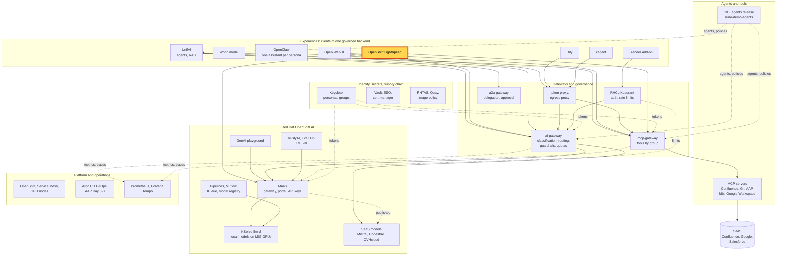
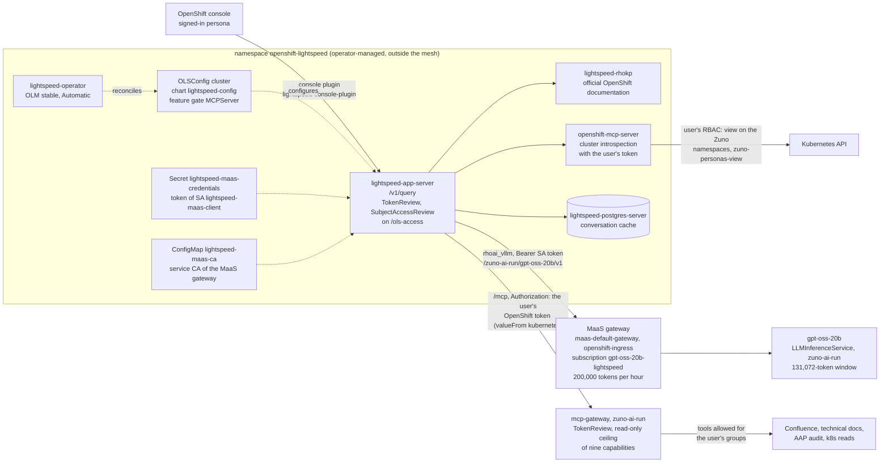

# Scenario: OpenShift Lightspeed - the console assistant served by MaaS

> **Status:** Not rehearsed in this format. Prerequisites checked read-only on demo333 on 2026-11-12 (22:50 to 22:55
> UTC): Applications `zuno-lightspeed-d0`/`-d1` and `zuno-lightspeed-config-d0`/`-d1` Synced and Healthy, operator
> `lightspeed-operator.v2.0.1` Succeeded (channel `stable`, Automatic), `OLSConfig` provider `rhoai_vllm` on
> `https://maas-default-gateway-istio.openshift-ingress.svc/zuno-ai-run/gpt-oss-20b/v1`, `gpt-oss-20b` Ready,
> MaaSSubscription `gpt-oss-20b-lightspeed` Active (200,000 tokens per hour), MCP server `zuno-mcp` with the feature
> gate `MCPServer`, ClusterRoleBinding `zuno-lightspeed-query-access` for `consultant` and `sales`, RoleBindings
> `zuno-personas-view` on the Zuno namespaces, conditions `ConsolePluginReady`, `MCPServerReady` and `RHOKPReady` True.
> Down at the time of the check: `ApiReady` was False since 21:27 UTC (the app server's readiness answered 503, 19
> ReplicaSets in 80 minutes, the operator manager restarted 10 times). From about 23:00 UTC the Kubernetes API itself
> timed out and answered 401 for about three minutes; at 23:03 UTC it answered again and `ApiReady` was still False.
> The probe passed at 10:38 UTC the same day. Run it before any session.
> **Show-ready ([ADR-0606](../../../adr/0606-admit-new-experiences-with-a-definition-of-done-and-a-wip-limit.md)):**
> yes, golden-path probe `lightspeed`.
> **Personas:** see [Personas](#personas).
> **Used in workshops:** none yet. It was shown in the console during [the 2026-11-09 demonstration](../../demo-day-2026-11-09.md)
> (moment 1).

## Introduction

OpenShift Lightspeed is Red Hat's assistant inside the OpenShift web console. It answers from the official
documentation of the cluster's OpenShift version, and it reads the live cluster with the signed-in user's own rights.
In Zuno it is a **consumer** of the platform, not an experience client of the ai-gateway (see
[Appendix A](#appendix-a---hld)). Its only model is gpt-oss-20b, called directly through MaaS under its own
subscription. Its company tools come from the mcp-gateway, called with the console user's own OpenShift token (see
[Appendix B](#appendix-b---lld)).

**The message:** "The console's own assistant runs on our model, on our GPUs, within a budget, and it sees only what
the person asking may see."

**Decisions:**
- [ADR-0524](../../../adr/0524-integrate-openshift-lightspeed-with-the-zuno-ai-platform.md): Lightspeed is a consumer
  of Zuno: inference through MaaS (provider `rhoai_vllm`), official documentation untouched, Zuno tools through the
  mcp-gateway's `/mcp` front door, read-only in three places, per-user identity, cluster introspection on.
- [ADR-0521](../../../adr/0521-route-local-model-traffic-through-maas.md): local-model traffic goes through MaaS.
- [ADR-0201](../../../adr/0201-complete-the-openshift-ai-maas-governance-plane-integration.md): MaaS is the model
  access plane, with subscriptions and token limits per consumer.

## Personas

The personas are fictional role accounts of the Keycloak realm `zuno`
([ADR-0349](../../../adr/0349-restructure-demo-personas-cluster-access-groups-and-new-agents.md)). They share one
password, kept in Vault at `keycloak/demo-personas`. The [catalogue](../../README.md#personas) lists all of them.

| Persona | Profile | What it can do here | Role in this demo |
|---|---|---|---|
| **consultant-02** | Consultant and architect, front office. OpenShift groups, synced from Keycloak at sign-in: `consultant` and its six Confluence subgroups, `agent_tekos`, `agent_arkos`, `aap_ops`. | Opens the chat (`consultant` is bound to the query role). `view` on the Zuno namespaces, nothing elsewhere. Five Zuno tools: Confluence search and page read, technical-docs search, AAP platform audit, AAP cluster audit. | Asks the questions of both versions. |
| **sale-01** | Salesperson, front office. Group `sales`. | Opens the chat. `view` on the Zuno namespaces. No Zuno tool: `sales` is in none of the front door's tool policies. | The contrast of the 15-minute version. On 2026-11-12 it had never signed in to OpenShift on demo333 (no user, no `sales` group). |
| **paas-ops-01** | Platform operator, back office. Group `ocp-paas-ops` (cluster-admin). | Reads the `OLSConfig`, the MaaS subscription and the bindings. Its token runs the probe. | The presenter's `oc` terminal in the 15-minute version. On 2026-11-12 it had never signed in to OpenShift on demo333 either; `kube:admin` with a token works too. |

Other identities:
- The ServiceAccount `lightspeed-maas-client` (`openshift-lightspeed`) makes every Lightspeed model call. It is the
  only subject of the subscription `gpt-oss-20b-lightspeed`. The console user's identity never reaches MaaS.
- Named only: **ai-ops-01**, **ai-dev-01** and **paas-dev-01** have no cluster-level binding to the query role, so
  the chat should answer "Not authorized" for them (read from the RBAC, not tested).

## Before you start

- [ ] The Lightspeed API is up:
  `oc get olsconfig cluster -o jsonpath='{range .status.conditions[*]}{.type}={.status}{"\n"}{end}'`.
  `ApiReady` and `ConsolePluginReady` must be `True`. `AgenticConsolePluginReady` and `AlertsAdapterReady` are `False`
  with `UnsupportedOCPVersion`: expected, those features are not shown here.
- [ ] `oc get llminferenceservice gpt-oss-20b -n zuno-ai-run` is Ready. Lightspeed has no other model.
- [ ] Golden-path probe `lightspeed` passed within the last hour (`ONLY=lightspeed make demo golden-path`), see
  [golden-path.md](../../golden-path.md). It needs an `oc` session with a token (`oc whoami -t`); with a certificate
  login it prints `MANUAL`, and you ask its question in the console instead.
- [ ] Profile 1: open `https://console-openshift-console.apps.demo333.startx.fr` and log in with **openshift** (the
  Keycloak provider), not `startx-htpasswd_auth`, as **consultant-02**. Open the Lightspeed chat icon at the bottom
  right and clear the previous conversation.
- [ ] 15-minute version: profile 2 signed in the same way as **sale-01**. Its first sign-in creates its OpenShift user
  and the `sales` group, which opens the chat to it. Do it before the session, not on stage.
- [ ] Budget: 200,000 tokens per hour on one subscription, for every console user and the probe together. Ask at
  most two or three rehearsal questions in the hour before the session.
- [ ] Known warning: "Lightspeed stopped the operation because a tool result failed the safety inspection". About 3
  documentation questions in 10 end like this on this model (measured on 2026-10-25). Ask again in other words.
- [ ] 15-minute version: a terminal logged in as **paas-ops-01** or `kube:admin`, large font.

## 5-minute version

Profile 1, **consultant-02**.

| Time | Do | Say | You should see |
|---|---|---|---|
| 0:00 | Open the Lightspeed panel | "This is the assistant built into the OpenShift console, a Red Hat product. Here it runs on our own model." | The Lightspeed panel and its prompt box. |
| 0:45 | Ask: `In one sentence, what is a Pod in OpenShift?` | "The answer comes from gpt-oss-20b on our GPUs, through the same MaaS gateway as our developers' keys, and from the official documentation of this OpenShift version." | A one-sentence answer, usually within a minute (219 and 242 characters in the probe runs of 2026-11-12). |
| 2:00 | Ask: `Which pods are running in the zuno-ai-run namespace?` *(untested prompt)* | "Now it reads the live cluster with my own rights. As a consultant I may read the Zuno namespaces." | A list of pods of `zuno-ai-run` (the gateways, the model pods). |
| 3:15 | Ask: `List the pods in the openshift-etcd namespace.` *(untested prompt)* | "Outside what I may see, it gets nothing: it uses my rights, not its own." | An answer saying the user has no permission to list pods there. |
| 4:15 | Close | "The console's own assistant runs on our model, on our GPUs, within a budget, and it sees only what the person asking may see." | |

## 15-minute version

Run the 5-minute version, then:

| Time | Do | Say | You should see |
|---|---|---|---|
| 5:00 | Ask: `Search Confluence for our onboarding pages.` *(untested prompt)* | "Company knowledge comes through the same mcp-gateway as in every other experience. Lightspeed passes my OpenShift token; the gateway checks it with the Kubernetes API and applies my groups." | A call to `confluence.page.search`, then onboarding pages of the space SXSI. |
| 6:30 | Profile 2, **sale-01**, same question *(untested prompt)* | "Same console, same assistant, another person. A salesperson has no Confluence tool, so the assistant cannot reach Confluence for them." | No Confluence call. An answer saying it cannot search Confluence. |
| 8:00 | Terminal: `oc get olsconfig cluster -o jsonpath='{.spec.llm.providers[0].type} {.spec.llm.providers[0].url}{"\n"}{.spec.mcpServers[0].url}{"\n"}'` | "One provider, of type `rhoai_vllm`, pointed at the MaaS gateway, not at the ai-gateway. One extra MCP server: Zuno's mcp-gateway." | `rhoai_vllm https://maas-default-gateway-istio.openshift-ingress.svc/zuno-ai-run/gpt-oss-20b/v1`, then `http://mcp-gateway.zuno-ai-run.svc.cluster.local:8080/mcp`. |
| 9:15 | `oc get maassubscription gpt-oss-20b-lightspeed -n models-as-a-service -o yaml` | "Lightspeed is a MaaS tenant like a developer: one service account, one model, 200,000 tokens an hour for all console users. Each call also carries about 15,000 tokens of tool definitions, so that is a handful of questions an hour." | `owner.users`: `system:serviceaccount:openshift-lightspeed:lightspeed-maas-client`; `limit: 200000`, `window: 1h`; phase `Active`. |
| 10:45 | `oc get clusterrolebinding zuno-lightspeed-query-access -o wide`, then `oc get rolebinding zuno-personas-view -n zuno-ai-run -o wide` | "Two bindings decide who may ask and what the cluster reads can see. The chat is open to consultants and sales, and they may view the Zuno namespaces only." | Role `lightspeed-operator-query-access` for groups `consultant` and `sales`; role `view` for the same groups. |
| 12:00 | Open [`gitops/charts/mcp-gateway/values.yaml`](../../../../gitops/charts/mcp-gateway/values.yaml), block `lightspeed.frontdoorCapabilities` | "The mcp-gateway's front door has a read-only ceiling, whoever calls. The groups then filter it: a consultant gets five tools, a salesperson none." | Nine capabilities: Confluence search and read, technical-docs search, two AAP audits, four `k8s.*` reads. |
| 13:15 | Explain the split with the ai-gateway | "Lightspeed does not go through the ai-gateway, by decision: it is a Red Hat product on a Red Hat model gateway. So it has no data classification, no Zuno guardrails and no per-person budget. Its only model is local, so nothing leaves the cluster. It is also why it is not on the Five experiences dashboard." | |
| 14:30 | Close | Repeat the message. | |

## If something goes wrong

| Symptom | Fallback | Say |
|---|---|---|
| "Lightspeed stopped the operation because a tool result failed the safety inspection" | Ask again in other words, or move on. Lightspeed's checker of tool results calls our model with a fixed 128-token limit and refuses the category `unknown` ([evidence](../../../roadmap/evidence/lightspeed-tool-result-inspection-2026-10-25.md)). | "Lightspeed checks every tool result for prompt injection, and its checker is too strict with our model. It is a known vendor defect." |
| "Not authorized" in the panel | The persona's OpenShift group does not exist yet. Sign the persona in once, then reload. Only `consultant`, `sales` and cluster administrators may ask. | |
| No answer, an error or an endless spinner | Check `ApiReady` in the `OLSConfig` (it was False on 2026-11-12 from 21:27 UTC). Do not debug on stage: show the 15-minute configuration steps instead. | "The console assistant is down; the platform behind it is not." |
| An answer about a quota, or HTTP 429 | The 200,000 tokens of the hour are spent, by the audience, the rehearsal or the probe. Show the subscription step instead. | "That is the budget at work: Lightspeed is a governed MaaS tenant." |
| "You don't have permission" for a Zuno namespace | `zuno-personas-view` exists only in the namespaces labelled `zuno.io/managed`. Ask about `zuno-ai-run`. | "It reads with my rights: what I cannot see, it cannot see." |
| No Confluence call for **consultant-02** | Name Confluence in the question. If it still lists no tool, check `MCPServerReady` and the mcp-gateway pod. | |
| Lightspeed asks to approve a tool call | Tools not annotated as read-only ask first (`tool_annotations`, 600 s). Approve a read. Refuse `aap.cluster.audit` unless you mean it: it starts an AAP job. | |
| The probe prints `MANUAL` | The `oc` session uses a certificate. Ask the probe's question in the console. | |

## Limits

- **Not through the ai-gateway.** No data classification, no ai-gateway guardrails, no per-person budget and no
  `zuno_model_*` metrics. Every console user shares one subscription. No Zuno dashboard shows Lightspeed's model calls.
- **One model.** The `OLSConfig` names gpt-oss-20b only: when it is not Ready, Lightspeed cannot answer. A rollback to
  an older configuration with a 32,768-token window failed with 413 "Prompt is too long" on 2026-11-12
  ([WP-249 evidence](../../../roadmap/evidence/wp-249-lightspeed-rollback-2026-11-12.md)).
- **A small budget.** 200,000 tokens per hour allowed 6 to 10 documentation questions per hour on 2026-10-25, checker
  included. The tool set has grown since: one call carried 14,585 tokens of tool definitions on 2026-11-12.
- **About 3 documentation questions in 10 fail** on the tool-result checker. The user accepted this on 2026-11-01 and
  kept the checker on; it is a Lightspeed defect, to be reported upstream.
- **Chat access by group.** Only `consultant`, `sales` and cluster administrators may ask. The AI and platform
  personas below cluster-admin have no binding.
- **Read-only by ceiling, with one exception.** `aap.cluster.audit` launches the read-only AAP job template and returns
  at once; it is not a pure read.
- **Not shown:** the agentic console plugin and the alerts adapter (`UnsupportedOCPVersion` on this OpenShift
  version), and the conversation history, kept in Lightspeed's own PostgreSQL and not backed up.
- **The operator follows OLM.** It is on `stable` with automatic approval (2.0.1 on 2026-11-12; ADR-0524 was written
  on 1.1.2). Its rollback is a forward fix only; the `OLSConfig` rolls back by `git revert` ([rollback](../../rollback.md)).
- **Prompts.** Only the probe's question is tested. The other prompts on this page are not.

## Appendix A - HLD

Where OpenShift Lightspeed sits in Zuno. The highlighted box is the subject of this page. Plain arrows carry requests,
dotted arrows carry identity, policy or telemetry.

## Appendix B - LLD

Lightspeed's operand and the three paths it calls. Drawn from `gitops/charts/lightspeed-config/` (`values.yaml`,
`templates/olsconfig.yaml`, `clusterrolebinding-query-access.yaml`, `credentials-maas.yaml`, `configmap-maas-ca.yaml`),
`gitops/charts/models/values.yaml` (subscription `gpt-oss-20b-lightspeed`), `gitops/charts/mcp-gateway/values.yaml`
(`lightspeed.frontdoorCapabilities`), `gitops/charts/openshift-rbac-groups/` (`personaView`), and the live objects
listed in the status banner.

