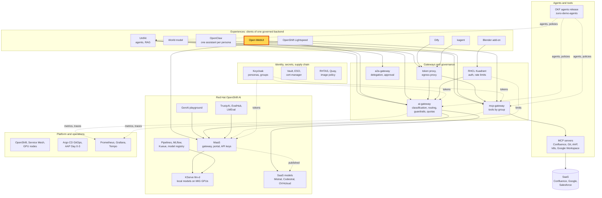
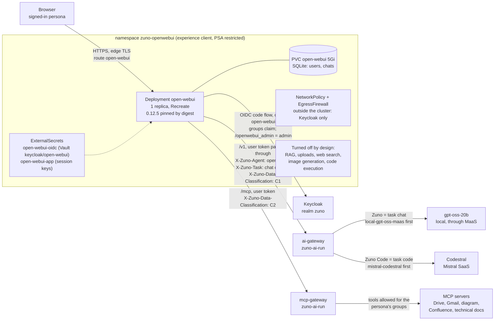

# Scenario: Open WebUI - a familiar chat on governed models and tools

> **Status:** Not rehearsed in this format. Prerequisites checked read-only on demo333 on 2026-11-12:
> Application `zuno-open-webui-d1` Synced and Healthy, Deployment `open-webui` 1/1 (image 0.12.5 pinned by digest),
> route `open-webui.apps.demo333.startx.fr`, both ExternalSecrets synced, `open-webui` listed in the ai-gateway's
> experience clients.
> **Show-ready ([ADR-0606](../../../adr/0606-admit-new-experiences-with-a-definition-of-done-and-a-wip-limit.md)):**
> yes, golden-path probes `open-webui` and `zuno-code`.
> **Personas:** see [Personas](#personas).
> **Used in workshops:** [One backend, three experiences](../../three-experiences.md), [One governed backend,
> many experiences](../../five-experiences.md).

## Introduction

Open WebUI is the general-purpose chat of Zuno: the screen any employee already knows. In Zuno it is only a
**presentation layer** over the governed backend (see [Appendix A](#appendix-a---hld)). It holds no model key, no
policy, no RAG and no tool credential. Every answer comes from the ai-gateway and every tool from the mcp-gateway,
called with the signed-in user's own Keycloak token (see [Appendix B](#appendix-b---lld)). The platform therefore
decides which model answers, which tools the user may call and what the turn costs. The same decisions apply in the
six other experiences.

**The message:** "Bring any chat UI you like: identity, models, tools and budget stay governed by the platform."

**Decisions:**
- [ADR-0587](../../../adr/0587-admit-additional-user-experiences-over-the-one-governed-backend.md): experiences are
  presentation layers over the one governed backend.
- [ADR-0588](../../../adr/0588-serve-a-general-purpose-chat-experience-with-open-webui.md): Open WebUI, user's own
  token, no RAG, uploads or web search.
- [ADR-0594](../../../adr/0594-give-the-three-experiences-the-same-mcp-tools-behind-signed-classification-markers.md):
  the same tools as the agents, filtered by group; a turn that used a tool stays local.
- [ADR-0596](../../../adr/0596-let-experience-clients-pick-a-declared-code-model-routed-to-codestral-first.md):
  "Zuno Code" is routed to Codestral first.

## Personas

The personas are fictional role accounts of the Keycloak realm `zuno`
([ADR-0349](../../../adr/0349-restructure-demo-personas-cluster-access-groups-and-new-agents.md)). They share one
password, kept in Vault at `keycloak/demo-personas`. The [catalogue](../../README.md#personas) lists all of them.

| Persona | Profile | What it can do here | Role in this demo |
|---|---|---|---|
| **sale-01** | Salesperson, front office. Groups `sales`, `agent_comage`, `agent_finage`. | Open WebUI user. Three tools: Drive search, Gmail read, diagram generation. | The everyday employee of the 5-minute version: signs in, chats, switches to Zuno Code, opens a tool list made for a salesperson. |
| **consultant-02** | Consultant and architect, front office. Group `consultant` with its Confluence subgroups (build OpenShift and OpenShift AI, the four architecture spaces), `agent_tekos`, `agent_arkos`. | Open WebUI user. Six tools: the three of **sale-01** plus Confluence search, Confluence page read and technical-docs search. | The contrast of the 15-minute version: same screen, a wider tool set, and an answer built from Confluence with the consultant's own rights. |
| **ai-ops-01** | AI platform operator, back office. Group `ocp-ai-ops` (admin on the Zuno namespaces), `openwebui_admin`. | Open WebUI administrator. Admin on `zuno-monitoring`, which opens Grafana. | Shows the dashboards in the 15-minute version: which model served each turn, the tool calls, the shared budget. |

Other identities:
- the presenter's `oc` session (**paas-ops-01**, cluster-admin) for the optional `oc get` step;
- `eval-consultant-01`, an evaluation copy of consultant-01, used only by the golden-path probes, never on stage.

## Before you start

- [ ] Two browser profiles, so two personas stay signed in side by side:
  - profile 1: **sale-01**;
  - profile 2: **consultant-02** (15-minute version only).
- [ ] Open `https://open-webui.apps.demo333.startx.fr` in both profiles and sign in with **Continue with Keycloak**.
  There is no local login form, by design.
- [ ] Start a **new chat** after signing in. Chats created before 2026-11-03 keep their tool switch off
  ([WP-193 evidence](../../../roadmap/evidence/wp-193-open-webui-user-experience.md)).
- [ ] Warm the model: send one question in profile 1 before the audience arrives. "Zuno" is served by gpt-oss-20b and
  answers in about 2 s when warm.
- [ ] 15-minute version: Grafana in a third tab, signed in as **ai-ops-01**. Grafana sits behind the OpenShift
  sign-in and admits accounts with RBAC on `zuno-monitoring`. Open the dashboard **Zuno Platform / Five experiences**,
  time range last 1 hour, `client` = `open-webui`.
- [ ] Golden-path probes `open-webui` and `zuno-code` passed within the last hour
  (`ONLY=open-webui,zuno-code make demo golden-path`), see [golden-path.md](../../golden-path.md).
- [ ] The UI language follows the browser. Set the browser to English or French before the session, not on stage.

## 5-minute version

Profile 1, **sale-01**.

| Time | Do | Say | You should see |
|---|---|---|---|
| 0:00 | Show the home page | "A chat everyone knows. I signed in with my company account, there is no password stored here." | The model picker shows **Zuno**. The info banner **Zuno picks the model** and four suggestion cards are visible. |
| 0:45 | Ask: `In one short sentence, say what you can help me with.` | "I did not choose a model: Zuno did, and it chose one that runs on our own GPUs." | An answer in a few seconds. |
| 1:45 | Switch the model picker to **Zuno Code** and ask: `write Python code that checks the format of an email address` | "Code questions go to a code model, Mistral Codestral. The platform makes that choice, not the UI, and falls back to a local model if Codestral is down." | A Python function with a regular expression. |
| 3:00 | Click the tools button under the prompt (**Zuno tools**) | "My tools come from my job. As a salesperson I get Drive, Gmail and diagrams. A consultant gets Confluence and the technical documentation." | Three tools for **sale-01**: Drive search, Gmail read, diagram generation. |
| 4:15 | Close | "Any chat UI can plug in. Who you are, which model answers, which tools you can use and what it costs stay decided by the platform." | |

## 15-minute version

Run the 5-minute version, then:

| Time | Do | Say | You should see |
|---|---|---|---|
| 5:00 | Profile 2, **consultant-02**, new chat. Open the tools button | "Same UI, another person: the tool list is computed from Keycloak groups and the agent policy, not configured in the UI." | Six tools: the three of **sale-01** plus Confluence search, Confluence page read and technical-docs search. |
| 6:00 | Click the suggestion card **Find our onboarding pages in Confluence** (prompt `Find our onboarding pages in Confluence.`) | "The model calls Confluence with my own identity. The mcp-gateway checks my groups before the call." | A list of onboarding pages from Confluence, with the tool call shown in the chat. |
| 7:30 | Grafana, row **Same models, same routing**, panel **Which provider served each experience (over range)** | "Each answer leaves a trace: the code question went to Codestral, the others stayed on local models. A turn that used a company tool is always kept local." | For `open-webui`: `mistral-codestral` for the Zuno Code turn and a local provider (`local-...`) for the other turns. |
| 9:30 | Row **Same tools, governed: cluster reads (ADR-0600)**, panel **All governed tool calls by tool and outcome (over range)** | "Every tool call of every experience goes through the one mcp-gateway: same tools, same entitlement, one audit. This table is the same for UnifAI, Dify or OpenClaw." | The Confluence search of **consultant-02** with the outcome `allowed`. |
| 10:30 | Row **One budget across the experiences** | "Tokens are counted per persona, not per application. Spending them in Open WebUI uses the same budget as UnifAI." | Token series for the two personas. |
| 11:30 | Show [`gitops/charts/open-webui/values.yaml`](../../../../gitops/charts/open-webui/values.yaml): the `ai-gateway` connection, `auth_type: system_oauth`, the `X-Zuno-*` headers, the features turned off | "Open WebUI passes my token through and declares who it is: agent `open-webui`, task `chat` or `code`. RAG, uploads, web search and image generation are off: the platform owns those." | One connection to the ai-gateway and one to the mcp-gateway, both without a key. |
| 13:00 | Optional, presenter terminal: `oc get deploy,pvc,egressfirewall -n zuno-openwebui` | "One pod and one volume for chat history. Its firewall allows nothing outside the cluster except Keycloak." | `open-webui` 1/1, PVC 5Gi, one EgressFirewall. |
| 14:00 | Close | Repeat the message. | |

## If something goes wrong

| Symptom | Fallback | Say |
|---|---|---|
| A "Zuno" answer is slow (the model is cold or a fallback model answers) | Ask again, or use **Zuno Code**. Do not wait on stage. | "The first call wakes the model up; the platform keeps a fallback ready." |
| 503 "no eligible provider is available" | Show it. Every candidate the turn's classification allows is down; a tool turn may only use local models. | "The gateway refuses rather than sending restricted data to a SaaS model: that is the sovereignty rule at work." |
| A red cross on a Gmail or Drive tool call (`delegated_credential_missing`) | Carry on. | "Gmail and Drive need a delegated Google token, and no Google Workspace tenant is connected to this demo. The gateway refuses the call: that is the delegation rule." |
| No tools in a chat | Start a new chat. Old chats keep their tool switch off. | |
| No series on the Grafana dashboard | Widen the time range to 3 hours. Export and scrape take about a minute. | |
| The Keycloak sign-in page does not return | Check that `keycloak.apps.demo333.startx.fr` answers. Open WebUI reaches Keycloak through the external load balancer, not the in-cluster router ([WP-181](../../../roadmap/work-packages/wp-181-install-open-webui-on-demo333.md)). | |

## Limits

- **No RAG, uploads, web search, image generation or code execution** in Open WebUI. They are turned off by
  ADR-0588; documents are searched through the platform's tools instead.
- **Classification markers never verify in Open WebUI.** It rewrites tool results, so every tool turn counts as an
  unmarked C2 turn and stays on local models. Accepted on 2026-11-03
  ([WP-191 evidence](../../../roadmap/evidence/wp-191-same-mcp-tools-live-proof.md)).
- **Guardrails run in observe mode.** They detect and record; they do not block. See the [guardrails scenario](../governance/guardrails.md).
- **One replica with SQLite on a 5Gi volume.** Fine for a demo; not a production sizing.
- In **Zuno Code**, a turn that used a tool result becomes local, and the chat title is also generated by Codestral
  ([WP-194 evidence](../../../roadmap/evidence/wp-194-zuno-code-live-proof.md)).

## Appendix A - HLD

Where Open WebUI sits in Zuno. The highlighted box is the subject of this page. Plain arrows carry requests, dotted
arrows carry identity, policy or telemetry.

## Appendix B - LLD

Open WebUI's internals and the calls it makes. Drawn from `gitops/charts/open-webui/` (values and templates),
`gitops/charts/ai-gateway/values.yaml` and `gitops/charts/ai-gateway/files/model-routing.generated.yaml`.

