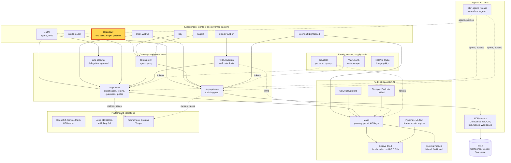
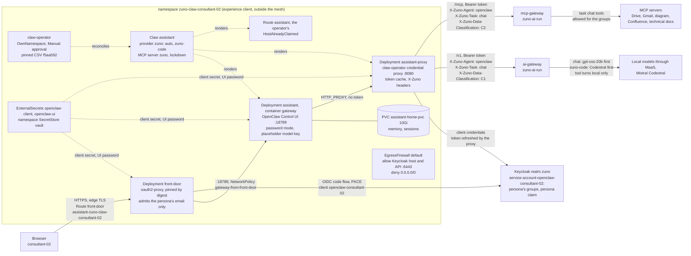

# Scenario: OpenClaw - one personal assistant per persona

> **Status:** Not rehearsed in this format. Prerequisites checked read-only on demo333 on 2026-11-12 (22:50 UTC):
> Applications `zuno-openclaw-d0`/`-d1` Synced and Healthy. In both persona namespaces: CSV
> `claw-operator.v0.0.227-commit-f5aa592` Succeeded, `Claw` `assistant` Ready on the pinned OpenClaw digest,
> Deployments `assistant`, `assistant-proxy` and `front-door` 1/1, Route `front-door` admitted and the operator's Route
> `HostAlreadyClaimed`, EgressFirewall rules applied, ExternalSecrets `openclaw-client` and `openclaw-ui` synced. The
> ai-gateway lists `openclaw-*` in its experience, persona-claim and fail-closed clients. The four local models were
> Ready, Grafana 1/1 and master ip-10-18-36-37 schedulable again. One thing was not healthy: both claw-operator managers
> were restarting (13 restarts in 80 minutes in `zuno-claw-consultant-02`, 3 in 13 minutes in `zuno-claw-sale-01`, exit
> code 1), while the assistants kept running. Run the probe before any session.
> **Show-ready ([ADR-0606](../../../adr/0606-admit-new-experiences-with-a-definition-of-done-and-a-wip-limit.md)):**
> yes, golden-path probe `openclaw`.
> **Personas:** see [Personas](#personas).
> **Used in workshops:** [three experiences](../../three-experiences.md), [five experiences](../../five-experiences.md).

## Introduction

OpenClaw is an open-source personal assistant: a long-lived agent with its own chat, sessions and memory. Its own
guidance is one instance per user. Zuno gives each demo persona its own assistant, deployed by Red Hat's claw-operator
in its own namespace (see [Appendix A](#appendix-a---hld)). The assistant holds no model key and cannot reach the
internet. A proxy next to it fetches a short-lived token for the persona's Keycloak client and adds it to every call to
the ai-gateway and the mcp-gateway. The persona signs in twice: Keycloak at an oauth2-proxy front door, then OpenClaw's
own password (see [Appendix B](#appendix-b---lld)).

**The message:** "Everyone can have their own AI assistant. It holds no key, it cannot reach the internet, and the
platform decides which models and tools it may use."

**Decisions:**
- [ADR-0587](../../../adr/0587-admit-additional-user-experiences-over-the-one-governed-backend.md): experiences are
  presentation layers over the one governed backend.
- [ADR-0589](../../../adr/0589-serve-per-persona-openclaw-assistants-via-claw-operator-behind-a-token-injecting-egress-proxy.md):
  one assistant per persona by claw-operator, a service account per assistant with the persona's groups, a token
  injected by the egress proxy, ClawHub and community skills off.
- [ADR-0590](../../../adr/0590-front-openclaw-with-oauth2-proxy-and-an-egress-firewall-one-claw-operator-per-persona-namespace.md):
  one namespace and one operator per persona, an oauth2-proxy front door that claims the host first, an EgressFirewall.
- [ADR-0594](../../../adr/0594-give-the-three-experiences-the-same-mcp-tools-behind-signed-classification-markers.md):
  the same tools as the other experiences, filtered by group; a turn that used a company tool stays on local models.
- [ADR-0593](../../../adr/0593-key-the-per-user-quota-and-telemetry-by-persona-across-experiences.md): the budget and
  the `user` label are the persona's, shared with its other experiences.

## Personas

The personas are fictional role accounts of the Keycloak realm `zuno`
([ADR-0349](../../../adr/0349-restructure-demo-personas-cluster-access-groups-and-new-agents.md)). They share one
password, kept in Vault at `keycloak/demo-personas`. The [catalogue](../../README.md#personas) lists all of them.

| Persona | Profile | What it can do here | Role in this demo |
|---|---|---|---|
| **consultant-02** | Consultant and architect, front office. Group `consultant` with six Confluence subgroups (build OpenShift and OpenShift AI, the four architecture spaces), `agent_tekos`, `agent_arkos`, `aap_ops`. | Owns the assistant in `zuno-claw-consultant-02`. Six tools: Drive search, Gmail read, diagram generation, Confluence search, Confluence page read, technical-docs search. Models `zuno` and `zuno-code`. | The owner of the 5-minute version: signs in twice and asks its assistant for the onboarding pages in Confluence. Asks a code question in the 15-minute version. |
| **sale-01** | Salesperson, front office. Groups `sales`, `agent_comage`, `agent_finage`. | Owns the assistant in `zuno-claw-sale-01`. Three tools: Drive search, Gmail read, diagram generation. No Confluence. | The contrast of the 15-minute version: same software, fewer tools, and refused at consultant-02's front door. |
| **ai-ops-01** | AI platform operator, back office. Group `ocp-ai-ops` (admin on the Zuno namespaces, `zuno-monitoring` included). | Opens Grafana, which sits behind the OpenShift sign-in. | Shows the dashboard of the 15-minute version. |

Other identities:
- `service-account-openclaw-consultant-02` and `service-account-openclaw-sale-01`: the service-account users of the
  Keycloak clients `openclaw-consultant-02` and `openclaw-sale-01`. Each carries exactly its persona's groups and a
  hardcoded `persona` claim. Every model and tool call of an assistant is made with this identity, never with the
  person's own token. The same client also runs the front door's browser sign-in.
- The presenter's `oc` terminal (**paas-ops-01**, cluster-admin, or `kube:admin`) for the `oc` step and the probe.
  On 2026-11-12 paas-ops-01 had never signed in to OpenShift on demo333: sign it in once before using it.

## Before you start

- [ ] Two browser profiles, so two personas stay signed in side by side. The front door admits one email per
  assistant: a profile whose Keycloak session belongs to another persona gets a 403.
  - profile 1: **consultant-02**;
  - profile 2: **sale-01** (15-minute version only).
- [ ] Read each assistant's UI password before the session, off screen:
  `oc extract secret/openclaw-ui -n zuno-claw-consultant-02 --to=-`, and the same with `-n zuno-claw-sale-01`.
  The persona password is in Vault at `keycloak/demo-personas`.
- [ ] Profile 1: open `https://assistant-zuno-claw-consultant-02.apps.demo333.startx.fr`, sign in with Keycloak as
  **consultant-02**, enter the UI password in the Control UI and click **Connect**. Do the same in profile 2 with
  `https://assistant-zuno-claw-sale-01.apps.demo333.startx.fr` and **sale-01**.
- [ ] Look at the last session of each assistant. The assistant keeps its own memory on a 10Gi volume: on 2026-11-06
  consultant-02's assistant signed as "Bob" and called the user "mon lord", from an earlier session.
- [ ] Warm the model: one short question in a **New session**. The `chat` task prefers gpt-oss-20b; the probe got an
  answer in 7.5 s for both personas on 2026-11-07.
- [ ] `oc get claw -A`: both `assistant` Claws `Ready`.
- [ ] Golden-path probe `openclaw` passed within the last hour (`ONLY=openclaw make demo golden-path`, from a terminal
  allowed to `oc exec` in the persona namespaces), see [golden-path.md](../../golden-path.md). `ONLY=openclaw make demo
  browser` also checks sale-01's front door and Control UI.
- [ ] 15-minute version: Grafana in a third tab, signed in as **ai-ops-01**. Dashboard **Zuno Platform / Five
  experiences**, time range last 1 hour, `client` = `openclaw-consultant-02` and `openclaw-sale-01`.
- [ ] The Control UI language follows the browser. The captures of 2026-11-06 are in French.

## 5-minute version

Profile 1, **consultant-02**, already signed in.

| Time | Do | Say | You should see |
|---|---|---|---|
| 0:00 | Show the Control UI and the address bar | "This is my personal assistant. Each person gets one, in its own namespace. I signed in twice: my company account at the front door, then the assistant's own password." | The address `assistant-zuno-claw-consultant-02.apps.demo333.startx.fr`, **New session** and the session list on the left, the model selector `zuno` under the message box. |
| 0:45 | **New session**, then ask: `Cherche dans Confluence les pages d'onboarding` | "My assistant searches our Confluence with my rights. It holds no key: a proxy next to it gets a short-lived token for my assistant and adds it to every call." | A tool line **Zuno Confluence-page-search** with `onboarding`, then a table of six onboarding pages (MNGD2-AP001 to O0R12-WSCPJ) in the space SXSI. |
| 2:30 | Point at the tool line | "The tool comes from the platform's mcp-gateway, filtered by my groups. The result is internal data, so the platform answered this turn with a model on our own GPUs." | |
| 3:30 | Say the contrast | "A salesperson's assistant runs the same software and gets no Confluence tool at all: Drive, Gmail and diagrams only." | |
| 4:15 | Close | "Everyone can have their own AI assistant. It holds no key, it cannot reach the internet, and the platform decides which models and tools it may use." | |

## 15-minute version

Run the 5-minute version, then:

| Time | Do | Say | You should see |
|---|---|---|---|
| 5:00 | Profile 2, **sale-01**'s assistant, **New session**, same prompt: `Cherche dans Confluence les pages d'onboarding` (tested with consultant-02 only) | "Same software, another person. The tool list is computed from Keycloak groups by the gateway, not configured in the assistant." | No Confluence tool call. The assistant says it cannot search Confluence, or answers from OpenClaw's own documents (seen on 2026-11-06 with a vaguer question). |
| 6:15 | Still in profile 2, open `https://assistant-zuno-claw-consultant-02.apps.demo333.startx.fr` | "Each front door admits one email. A salesperson cannot open a consultant's assistant." | A 403 page from the front door (oauth2-proxy). |
| 7:00 | Profile 1, **New session**, switch the model selector to `zuno-code`, ask: `peux tu me faire du code python pour verifier une adresse email` | "A code question with no company data in it may go to Mistral Codestral. The platform makes that choice, not the assistant." | A Python function with a regular expression, in a few seconds (2.2 s on Codestral on 2026-11-05). |
| 8:30 | Grafana, row **Same models, same routing**, panel **Which provider served each experience (over range)** | "Each assistant is its own client of the same gateway. The code question went to Codestral; the Confluence turn stayed local." | For `openclaw-consultant-02`: `mistral-codestral` and a local provider (`local-...`). |
| 9:45 | Row **Same tools, governed: cluster reads (ADR-0600)**, panel **All governed tool calls by tool and outcome (over range)** | "The Confluence search went through the one mcp-gateway, like the tools of every other experience: one audit." | `confluence.page.search` with the outcome `allowed`. The panel has no client column. |
| 10:45 | Presenter terminal: `oc get claw,deploy,route,egressfirewall -n zuno-claw-consultant-02` | "One namespace and one operator per person. The operator's own Route is rejected, so the front door is the only way in. The firewall lets only Keycloak and the API server out." | `Claw` `assistant` Ready; Deployments `assistant`, `assistant-proxy`, `claw-operator-controller-manager`, `front-door`; Route `assistant` `HostAlreadyClaimed` and Route `front-door` on the assistant's host; EgressFirewall `default` with its rules applied. |
| 12:00 | Open [`gitops/charts/openclaw/templates/claw.yaml`](../../../../gitops/charts/openclaw/templates/claw.yaml): the two `oauth2` credentials | "The pod has a placeholder key. The proxy exchanges the Keycloak client `openclaw-consultant-02` for a short-lived token and adds the `X-Zuno` headers. That client's service account carries consultant-02's groups and a signed persona claim: tools follow the groups, and the budget is consultant-02's in every experience." | Credentials `zuno-ai` and `zuno-mcp`, `X-Zuno-Agent: openclaw`, `X-Zuno-Task: chat`, `C1` on the model connection and `C2` on the tool connection. |
| 13:30 | Say the limits | "The calls are made by the assistant's service account, not by the person. The operator is alpha and pinned by digest. ClawHub cannot be switched off in OpenClaw: the firewall is what blocks it." | |
| 14:30 | Close | Repeat the message. | |

## If something goes wrong

| Symptom | Fallback | Say |
|---|---|---|
| A 403 page at the front door for the right assistant | The browser profile's Keycloak session belongs to another persona. Use the right profile or a private window. | "The front door admits one person per assistant." |
| The Control UI shows "Could not connect" | Wrong UI password, or the gateway pod restarted. Read the password again off screen (`oc extract secret/openclaw-ui -n <namespace> --to=-`), reload, **Connect**. | |
| The answer is about OpenClaw itself, not Confluence | The question did not name Confluence. Ask the verbatim prompt, which does ([WP-208 evidence](../../../roadmap/evidence/wp-208-five-experiences-browser-2026-11-06.md), D5). | |
| 503 "no eligible provider is available" | No local model is ready. A turn with a Confluence result may only use local models. Check `oc get llminferenceservice -n zuno-ai-run`. | "The gateway refuses rather than sending internal data to a SaaS model." |
| A slow answer | A local model is cold or busy. Start a new session and ask again; do not wait on stage. | |
| The assistant ran code with its built-in `exec` tool | Carry on. The result of `exec` is unmarked, so the rest of the turn is served by local models ([WP-194 evidence](../../../roadmap/evidence/wp-194-zuno-code-live-proof.md), T4). | "Anything that came from a tool keeps the turn on our own GPUs." |
| A red cross on a Gmail call (`delegated_credential_missing`) | Carry on. | "Gmail needs a delegated Google token, and no Google Workspace tenant is connected to this demo." |
| `oc get claw -A` is not Ready, or the UI is down | Run `ONLY=openclaw make demo golden-path`: it calls the model from inside each assistant's pod through its proxy. Show its `PASS` line and the 15-minute configuration steps instead. | |
| The claw-operator manager restarts (seen on 2026-11-12) | Ignore it on stage. The assistant, its proxy and its front door keep running; the operator only reconciles them. | |
| No series in Grafana, or 0 tokens for OpenClaw in the budget row | Widen the time range. Export and scrape take about a minute. The 0-token rows were seen on 2026-11-06 and not explained. | |

## Limits

- **The identity is the assistant's, not the person's.** Every call is made with the service account of
  `openclaw-<persona>`. The budget and the `user` label are the persona's (ADR-0593), but the caller is the assistant.
  Calling with the person's own token is a no-go for now
  ([WP-190 spike](../../../roadmap/evidence/wp-190-openclaw-user-token-spike.md)): the assistant also works in the
  background, when there is no browser session.
- **Two personas only.** consultant-02 and sale-01 have an assistant; any other persona would need a namespace, a
  Keycloak client and Vault paths.
- **Two sign-ins.** OpenClaw has no OIDC, and the operator forbids its trusted-proxy mode. Its device check is off and
  it has no sign-in rate limit; the front door compensates.
- **claw-operator is alpha.** It is published from a catalog rebuilt on every upstream commit, on a `staging` channel,
  without releases or signatures. It is pinned by digest, and its manager, proxy and OpenClaw images are checked by
  running image ID. OpenClaw follows the operator: 2026.10.9 refused the operator's configuration and was rolled back on
  2026-11-03 ([WP-249](../../../roadmap/work-packages/wp-249-test-one-rollback-per-experience.md)).
- **ClawHub has no off switch** and the operator's proxy allows TCP 443 to any address. The EgressFirewall is the
  control that keeps the assistant off the internet ([WP-182 evidence](../../../roadmap/evidence/wp-182-openclaw-spike.md)).
- **No messaging channel, no browser control, no community skills.** They are off by ADR-0589 and the `lockdown`
  values.
- **Memory is persistent and can be poisoned.** A prompt injection can misuse the tools the persona is entitled to. The
  personas are demo accounts with demo data.
- **Classification markers verify in OpenClaw**, unlike Open WebUI. A turn whose tool results are all C1 can still be
  served by a SaaS model ([WP-191 evidence](../../../roadmap/evidence/wp-191-same-mcp-tools-live-proof.md)).
- **Guardrails run in observe mode.** They detect and record; they do not block.

## Appendix A - HLD

Where OpenClaw sits in Zuno. The highlighted box is the subject of this page. Plain arrows carry requests, dotted
arrows carry identity, policy or telemetry.

## Appendix B - LLD

One persona's namespace; the other persona has the same objects in its own. Drawn from `gitops/charts/openclaw/`
(`values.yaml`, `templates/operator.yaml`, `claw.yaml`, `front-door.yaml`, `externalsecrets.yaml`,
`secretstores.yaml`), `gitops/charts/keycloak/files/realm-zuno.json` (clients `openclaw-<persona>`), the operator's
proxy as described in the [WP-182 evidence](../../../roadmap/evidence/wp-182-openclaw-spike.md), and the live objects
listed in the status banner.

