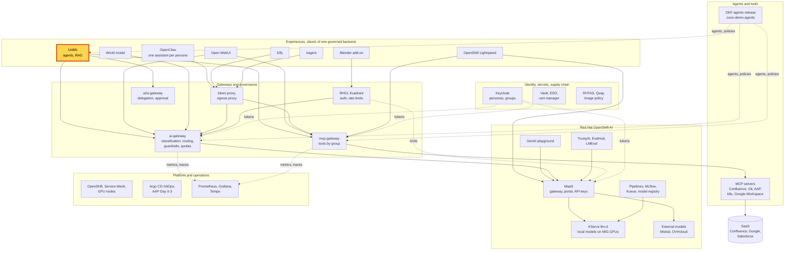
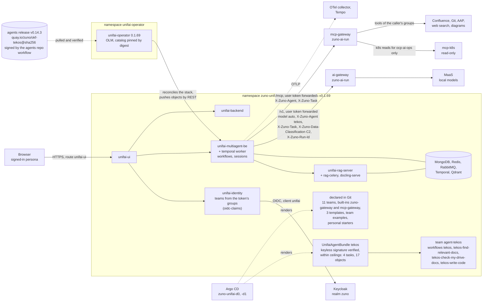

# Scenario: UnifAI - governed agents in team and personal workspaces

> **Status:** Not rehearsed in this format. Prerequisites checked read-only on demo333 on 2026-11-12 at 22:50 UTC:
> Applications `zuno-unifai-d0`/`-d1` Synced and Healthy, UnifaiStack `unifai` Ready (images v0.1.69, operator CSV
> `unifai-operator.v0.1.69` Succeeded), the 14 stack pods Running, the 11 UnifaiTeams Ready (`agent-tekos` included),
> UnifaiAgentBundle `tekos` Ready and verified (4 tasks, 17 objects), the 45 UnifaiWorkflows Ready (`tekos` and the
> personal starters included), the four local models Ready, `ai-gateway` and `mcp-gateway` 1/1. An earlier check, at
> about 22:00 UTC, found the master `ip-10-18-36-37` cordoned, Grafana down and the local models restarting. At
> 22:50 UTC the master was schedulable again and Grafana was 1/1. The UnifAI multiagent, worker and UI pods had
> restarted at 22:47 UTC on the same image digests. The last recorded `unifai-tekos` pass was at 17:07 UTC that day
> ([WP-249 evidence](../../../roadmap/evidence/wp-249-unifai-rollback-2026-11-12.md)).
> **Show-ready ([ADR-0606](../../../adr/0606-admit-new-experiences-with-a-definition-of-done-and-a-wip-limit.md)):**
> yes, golden-path probe `unifai-tekos`. The probe proves a Tekos turn only. The cluster-tools contrast at 3:00 has no
> probe: rehearse it the same day.
> **Personas:** see [Personas](#personas).
> **Used in workshops:** [three experiences](../../three-experiences.md) (step 2),
> [five experiences](../../five-experiences.md) (step 8).

## Introduction

UnifAI is the agent platform of Zuno ([ADR-0561](../../../adr/0561-adopt-unifai-as-the-agent-platform.md)). It
gives each person a **Personal** workspace and **Team** workspaces with workflows, chats, a catalog and a document
library (see [Appendix A](#appendix-a---hld)). UnifAI does not decide anything on its own:
- the agents (prompts, tasks, tools, data level) come from a **signed release** of the `zuno-demo-agents` repository;
- every model call goes to the ai-gateway and every tool call to the mcp-gateway, with the **signed-in user's own
  Keycloak token**;
- the team workspaces a person sees are computed from the Keycloak groups in that token.

The operator, the custom resources and the call path are in [Appendix B](#appendix-b---lld).

**The message:** "Agents are published from a signed release, and what an agent may do follows the person who asks.
UnifAI holds no model key and no tool credential."

**Decisions:**
- [ADR-0561](../../../adr/0561-adopt-unifai-as-the-agent-platform.md): UnifAI is the agent platform. The agent
  definition, the model path, the tool authorization and the identity stay Zuno's.
- [ADR-0563](../../../adr/0563-forward-caller-identity-and-zuno-context-headers-from-unifai.md): UnifAI forwards the
  user's token and the agent, task and run headers.
- [ADR-0578](../../../adr/0578-sign-okf-artifacts-keyless-with-github-oidc-and-verify-them-offline-by-identity.md)
  and [ADR-0580](../../../adr/0580-consume-the-corp-okf-bundle-by-a-single-digest-pin-promoted-by-pull-request.md):
  agents are signed keyless by the agents repository's release workflow, and the platform pins one release by digest.
- [ADR-0574](../../../adr/0574-deploy-unifai-through-argocd-from-a-pinned-olm-catalog.md) and
  [ADR-0586](../../../adr/0586-verify-the-unifai-runtime-images-by-digest-signature-and-attestations-before-deploying-them.md):
  Argo CD deploys the stack from a pinned operator catalog; the images are checked by digest and signature.
- [ADR-0597](../../../adr/0597-declare-unifai-built-in-resources-through-the-operator.md): the shared gateway LLM and
  MCP provider are public built-ins.
- [ADR-0598](../../../adr/0598-give-every-persona-default-unifai-team-workspaces-and-a-shared-catalog.md): one team
  workspace per business group, a catalog without secrets, starters for three personas.
- [ADR-0600](../../../adr/0600-govern-kubernetes-read-tools-in-the-mcp-gateway-and-admit-kagent-as-a-thin-operations-client.md):
  cluster read tools are governed by the mcp-gateway and granted to `ocp-ai-ops` only.

## Personas

The personas are fictional role accounts of the Keycloak realm `zuno`
([ADR-0349](../../../adr/0349-restructure-demo-personas-cluster-access-groups-and-new-agents.md)). They share one
password, kept in Vault at `keycloak/demo-personas`. The [catalogue](../../README.md#personas) lists all of them.

| Persona | Profile | What it can do here | Role in this demo |
|---|---|---|---|
| **consultant-02** | Consultant and architect, front office. Groups `consultant` (with its Confluence subgroups), `agent_tekos`, `agent_arkos`, `aap_ops`. | Team workspaces `agent-tekos`, `agent-arkos` and `consultant`. By the release's authorization matrix, Tekos offers it the consultant tools (Confluence search, web search, Git reads, diagrams, the AAP audits) and no `k8s.*` tool. No personal starter. | Main persona of the 5-minute version: sees its workspaces, asks Tekos, gets a generic answer to a cluster question. Shows the `consultant` team examples in the 15-minute version. |
| **ai-ops-01** | AI platform operator, back office. Groups `ocp-ai-ops` (admin on the Zuno namespaces), `agent_tekos`, `openwebui_admin`. | Team workspaces `agent-tekos` and `ops`. Tekos also offers it the five cluster reads (`k8s.resource.read`, `k8s.resource.list`, `k8s.events.read`, `k8s.logs.read`, `metrics.query`). Personal starters `ai-ops-01-my-assistant` and `ai-ops-01-my-documents`. Opens Grafana. It is also the UnifAI administrator (`adminUsers`) and the owner of the built-ins. | The contrast of the 5-minute version: same agent, same question, an answer from the live cluster. Shows the starters, the catalog, the built-ins and Grafana in the 15-minute version. |
| **consultant-01**, **sale-01** | Consultant (front office) and salesperson (front office). | The two other personas with personal starters. sale-01 has no `agent_tekos`, so it does not see `agent-tekos`. | Named only. The [UnifAI live RAG](../../unifai-live-rag.md) scenario signs them in. |

Other identities:
- the presenter's `oc` session (**paas-ops-01**, cluster-admin) for the 15-minute terminal steps;
- `eval-consultant-01`, an evaluation copy of consultant-01, used by the `unifai-tekos` probe only, never on stage;
- the unifai-operator writes the platform's objects (built-ins, teams, templates, team examples) as **ai-ops-01**, the
  first entry of `stack.rag.sharedPublishers`. The personal starters are owned by each persona.

## Before you start

- [ ] Two browser profiles, so two personas stay signed in side by side. A shared browser session signs in the wrong
  account (the kagent 403 of [WP-208](../../../roadmap/work-packages/wp-208-five-experiences-demonstration.md), D4):
  - profile 1: **consultant-02**;
  - profile 2: **ai-ops-01**.
- [ ] Open `https://unifai-ui-zuno-unifai.apps.demo333.startx.fr` in both profiles and sign in through Keycloak
  (realm `zuno`, client `unifai`). Check the name at the top right of each profile.
- [ ] In each profile, start your own session: **Team**, workspace `agent-tekos`, **Collaboration Hub**, **+**, workflow
  `tekos`. Sessions of a team workspace are shared by its members: never reuse a session the other persona opened.
- [ ] Warm the model: send the probe prompt once in each profile before the audience arrives.
- [ ] `oc get llminferenceservice -n zuno-ai-run`: at least one local model `Ready=True`.
- [ ] Golden-path probe `unifai-tekos` passed within the last hour (`ONLY=unifai-tekos make demo golden-path`), see
  [golden-path.md](../../golden-path.md).
- [ ] Rehearse the cluster question as **ai-ops-01** the same day. Its answer depends on the live state of
  `zuno-ai-run`: when every pod is Running, Tekos says so, which is still an answer from the cluster.
- [ ] 15-minute version:
  - [ ] a terminal at the repository root, logged in with `oc` as **paas-ops-01**, large font;
  - [ ] Grafana as **ai-ops-01** (OpenShift sign-in, RBAC on `zuno-monitoring`), dashboards
    **Zuno Platform / Five experiences** (last 1 hour, `client` = `unifai`) and **Zuno Platform / Agents, tools & RAG**;
  - [ ] Tekos's sheet open at
    [agents/tekos/agent.okf.md](https://github.com/startxfr/zuno-demo-agents/blob/main/agents/tekos/agent.okf.md),
    scrolled to **Authorization matrix**.

## 5-minute version

| Time | Do | Say | You should see |
|---|---|---|---|
| 0:00 | Profile 1, **consultant-02**. Show the **Personal** / **Team** switch, then open the workspace selector under **Team** | "I signed in with my company account. The workspaces I see come from my Keycloak groups: one per agent I am entitled to, one for my business team. Nobody created them by hand." | `agent-arkos`, `agent-tekos` and `consultant`. |
| 0:45 | `agent-tekos`, **Collaboration Hub**, your session on workflow `tekos`. Ask: `In one short sentence, say what you can help me with.` | "Tekos is our technical agent. Its prompt, tasks, tools and data level come from a signed release, not from this screen." | A one-sentence answer. The **Live workflow** panel shows **User Question Node**, **Tekos Answer Technical Question** (with the `knowledge-tekos` retriever) and **Final Answer Node**. |
| 1:45 | Same session. Ask: `Why would a pod in the zuno-ai-run namespace fail to start? Check the current state of the namespace and give me what you find.` | "Now I ask about our cluster. I am a consultant." | A generic list of common causes (probe failures, image pull errors and so on), no pod name from the cluster. "1 tool used" is the documentation retriever, not a cluster read ([screenshot](../../../assets/img/unifai-tekos-k8s-consultant-02-generic-answer.png)). |
| 3:00 | Profile 2, **ai-ops-01**. `agent-tekos`, **Collaboration Hub**, its own session on `tekos`. Ask the same question | "Same agent, same question, another person. ai-ops-01 operates the AI platform, so the platform offers Tekos the cluster read tools for this person only." | An answer that names real pods and events of `zuno-ai-run`, read with `k8s.events.read`. On 2026-11-06 it was a startup probe failure of an `a2a-gateway` pod ([question](../../../assets/img/unifai-tekos-k8s-ai-ops-01-question.png), [answer](../../../assets/img/unifai-tekos-k8s-ai-ops-01-answer.png)). |
| 4:15 | Close | "Agents come from a signed release, and what they may do follows who asks. UnifAI never held a model key or a tool credential: the platform decided." | |

## 15-minute version

Run the 5-minute version, then:

| Time | Do | Say | You should see |
|---|---|---|---|
| 5:00 | Profile 2, **ai-ops-01**: **Personal**, **Agentic AI Workflows** | "Three personas get starters in their personal workspace: a plain assistant, and a RAG on their own documents. They are declared in Git and recreated if someone deletes them." | `ai-ops-01-my-assistant` and `ai-ops-01-my-documents`. |
| 6:00 | **Agentic AI Templates**, then **Agentic Inventory**, tab **Built-in** | "The catalog has three templates and none asks for an API key. They all use the platform's gateway LLM and MCP tools, which every user sees as built-ins and only an administrator can change." | Templates **Zuno Chat**, **Zuno Tools Agent**, **Zuno Draft and Review**. Built-ins `zuno-gateway` (LLM) and `mcp-gateway` (MCP provider). |
| 7:00 | Profile 1, **consultant-02**: **Team**, workspace `consultant`, **Agentic AI Workflows**, then **Scheduled Workflows**. Show the list only; do not build or run a workflow on stage | "Each business team gets example workflows on the same gateway: linear, branches, RAG, orchestrated. A team member starts from them instead of an empty page." | `consultant-linear`, `consultant-branches`, `consultant-rag`, `consultant-orchestrated`; the schedule `consultant-weekday-brief`, suspended. |
| 8:00 | Terminal: `oc get unifaiagentbundles -n zuno-unifai` | "Agents arrive as signed bundles of one agents release. The operator checks each signature before it creates anything in UnifAI." | Eight bundles, `VERIFIED` true for all. `arkos`, `comage` and `tekos` Ready; the five placeholders Pending (not served). |
| 9:00 | `oc get unifaiagentbundle tekos -n zuno-unifai -o jsonpath='{range .status.conditions[*]}{.type}: {.message}{"\n"}{end}'` | "Signed keyless by the release workflow of the agents repository, then checked against the ceilings the platform allows." | `Verified: ... signed by https://github.com/startxfr/zuno-demo-agents/.github/workflows/publish.yml@refs/tags/v0.14.0`, then `WithinCeilings`, then `Emitted: 4 tasks, 17 objects emitted`. The platform pins release v0.14.3 in [`platform/okf/agents.lock`](../../../../platform/okf/agents.lock); the Tekos artifact in it was signed at v0.14.0. |
| 10:00 | Tekos's sheet on GitHub, **Authorization matrix**, the `k8s.*` rows | "The release states which group gets which tool for which task. The cluster reads are granted to `ocp-ai-ops` only: that is why consultant-02 got a generic answer." | `k8s.resource.read`, `k8s.resource.list`, `k8s.events.read`, `k8s.logs.read` and `metrics.query` with business role `ocp-ai-ops` only. |
| 11:00 | `oc get unifaillm tekos-answer-technical-question -n zuno-unifai -o jsonpath='{.spec.config}'` | "Tekos calls the ai-gateway with the user's own token and says which agent, task and data level it is. The gateway picks the model. The tool provider is built the same way, towards the mcp-gateway." | `base_url` `http://ai-gateway.zuno-ai-run.svc:8080/v1`, `model_name` `auto`, `forward_user_token` true, headers `X-Zuno-Agent: tekos`, `X-Zuno-Task: answer-technical-question`, `X-Zuno-Data-Classification: C2`. |
| 12:00 | Grafana **Five experiences**, row **Same tools, governed: cluster reads (ADR-0600)**, panel **Cluster read tool calls by tool and outcome (over range)** | "Every tool call of every experience is audited in one place. The read of ai-ops-01 is here. consultant-02 has no line: the tool was never offered, so there was nothing to refuse." | `k8s.events.read` (or another `k8s.*` tool) with outcome `allowed`. |
| 13:00 | Row **Same models, same routing**, panel **Which provider served each experience (over range)** | "UnifAI is one client of the gateway like the other experiences: same models, same routing rules." | A row for `unifai` with a local provider (`local-...`) when the local models are Ready. |
| 14:00 | Close | Repeat the message. Name what comes next: one agent delegating to another with a human approval, the scenario "A2A delegation with approval" (planned). | |

## If something goes wrong

| Symptom | Fallback | Say |
|---|---|---|
| `agent-tekos` is missing from the workspace selector | Check the name at the top right. A shared browser session signs in another account. Sign out and sign in with the right profile. | "The workspaces follow the account's groups: wrong account, other workspaces." |
| consultant-02's session already holds ai-ops-01's cluster answer | It is a shared team session. Start a new one with **+**. | "A team session is shared with the team. The tools are not: they are checked for each call, with the caller's token." |
| ai-ops-01 gets a generic answer with no cluster read | Ask again in the same session. If it stays generic, check that the gateways run the agents release pinned in `platform/okf/agents.lock` (`make d2 check agents`) and show the 2026-11-06 screenshots. | "The platform decides which tools are offered; the model decides whether to call one. This time it did not." |
| A card **Rate limit reached - quota_exceeded** | Switch to the other profile, or show the probe result. | "The token budget is per person, across every experience: this is the quota at work." |
| 503 "no eligible provider is available", or a very long wait | The local models are down or restarting (`oc get llminferenceservice -n zuno-ai-run`). Show the 15-minute terminal steps instead. | "No model this turn may use is ready, so the gateway refuses at once instead of waiting or widening the choice." |
| The page shows no answer, or the **Live workflow** panel never completes | The multiagent pods may have restarted (they did at 22:47 UTC on 2026-11-12). Reload the page; check `oc get pods -n zuno-unifai`. | |
| No series in Grafana | Widen the time range to 3 hours. The export and the scrape take about a minute. | |

## Limits

- **No delegation here.** Arkos asking Tekos, with a human approval, is the scenario "A2A delegation with approval"
  (planned).
- **Tekos is reached only through the team workspace `agent-tekos`.** The personal chat list has no agent selector
  ([WP-208](../../../roadmap/work-packages/wp-208-five-experiences-demonstration.md), D10).
- **Team sessions are shared** with every member of the team, answers included. On the WP-208 screenshots, one
  `agent-tekos` session lists both ai-ops-01 and consultant-02 as participants.
- **Personal starters exist for three personas only**: consultant-01, sale-01 and ai-ops-01
  ([`ansible/clusters/demo333.yml`](../../../../ansible/clusters/demo333.yml), `personalStarters`). consultant-02 has none.
- **"Configure & Generate" on a template was not checked in the browser.** The WP-198 live record leaves that check
  open. Do not generate a workflow on stage before you have rehearsed it.
- **The starters and the team examples call the shared `zuno-gateway` LLM without a classification header.** Their turns
  are routed at C1, even when a retriever returned Confluence (C2) passages: the UnifAI session is not raised by a
  retrieved chunk ([ADR-0565](../../../adr/0565-derive-data-classification-from-okf-and-only-allow-raising-it.md),
  updates of 2026-11-03 and 2026-11-07). Tekos's own LLMs declare C2.
- **Five of the eight agent bundles are placeholders** and are not served: advantage, cognos, finage, naveo and
  soursage.
- **Guardrails run in observe mode.** They record; they do not block.
- **One UnifAI instance per cluster** (ADR-0598 point 6). There is no sandbox stack to fall back to.

## Appendix A - HLD

Where UnifAI sits in Zuno. The highlighted box is the subject of this page. Plain arrows carry requests, dotted
arrows carry identity, policy or telemetry.

## Appendix B - LLD

UnifAI's internals and the path of a Tekos turn. Drawn from `gitops/charts/unifai/` (`values.yaml`,
`templates/unifaistack.yaml`, `templates/objects.yaml`, `templates/_helpers.tpl`), the UnifAI block of
`ansible/clusters/demo333.yml`, `platform/okf/stack-config.generated.yaml`, and the live objects listed in the status
banner.

