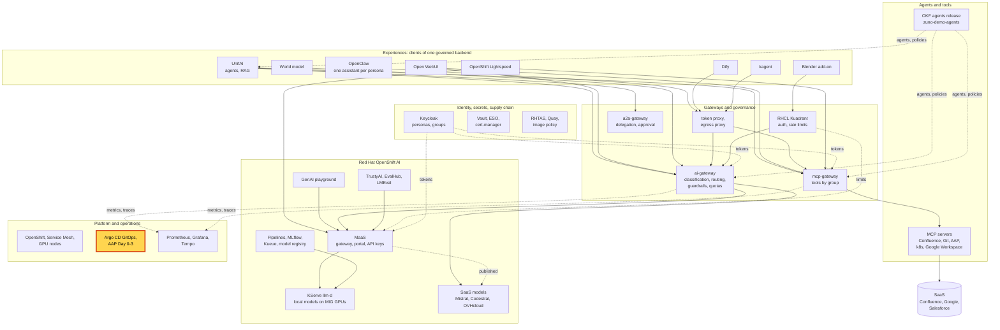
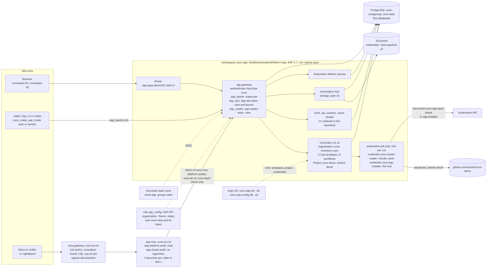

# Scenario: Ansible Automation Platform - audited operations

> **Status:** Not rehearsed in this format. Prerequisites checked read-only on demo333 on 2026-11-13 (00:10 to 00:45
> UTC): Applications `zuno-aap-d0`/`-d1`, `zuno-aap-config-d0`/`-d1` and `zuno-mcp-aap-d0`/`-d1` Synced and Healthy;
> `AnsibleAutomationPlatform` `aap` at version 2.7.20261019, `Running` and `Successful`, controller 4.8.13, operator CSV
> `aap-operator.v2.7.0-0.1794269743`; Route `aap.apps.demo333.startx.fr`; 17 `JobTemplate` and 8 `WorkflowTemplate`
> resources in `zuno-aap`; the `AnsibleProject` `zuno-demo` on branch `devel`; Hub `storage_type: s3`; 10
> ExternalSecrets; no ServiceMonitor or PodMonitor. Every AAP pod was Running. They had been recreated between 21:27 and
> 22:37 UTC on 2026-11-12, during a node incident, and the seven AAP operator managers had restarted 15 to 24 times
> since. No `automation-job` pod was running. Deployment `aap-mcp` 1/1 in `zuno-ai-run`, with a launch limit of 2 per
> 900 s and the link base `https://aap.apps.demo333.startx.fr`. The OpenShift group `aap_ops` holds consultant-02 and
> paas-dev-01; **paas-ops-01** had not signed in to OpenShift. The AAP API was not queried: the job history, the Teams,
> the authenticator maps and the content of EDA were not checked.
> **Show-ready ([ADR-0606](../../../adr/0606-admit-new-experiences-with-a-definition-of-done-and-a-wip-limit.md)):** no
> golden-path probe. Rehearse it before showing it to an audience. (The `delegation-approval` probe rejects its approval,
> so it never launches an AAP job.)
> **Personas:** see [Personas](#personas).
> **Used in workshops:** [Trusted platform and operations](../../workshops/trusted-platform-ops.md).

## Introduction

Ansible Automation Platform (AAP) 2.7 is where Zuno's operations can run as recorded jobs. The Day 0 check and the Day
1 to Day 3 `make` verbs exist as job templates, except `uninstall`, `reinstall`, the Day 2 `reconcile` and `admit`. The
templates are declared in Git by the `aap-config` chart and
run playbooks from the same repository and branch that Argo CD deploys. Each run is a job with its launcher, its time,
its commit and its full output. Three Keycloak groups decide who may see or launch what. Agents reach AAP through one
MCP server, `aap-mcp`, with two tools: read the platform's state and its audit history, and launch one read-only
cluster audit. AAP and its configuration are Day 0 components. In the platform map, AAP is part of the box "Argo CD
GitOps, AAP Day 0-3" (see [Appendix A](#appendix-a---hld)). Its pods, identities and paths are in
[Appendix B](#appendix-b---lld).

| Job template | Runs | Credential | On stage |
|---|---|---|---|
| `zuno-day0-check` | `day0_check.yml` | `zuno-cluster-reader` | yes: the one template agents may launch |
| `zuno-day1-check`, `zuno-day2-check`, `zuno-day3-check`, `zuno-day3-test` | the read-only checks of `make` | `zuno-cluster-reader` | yes |
| `zuno-day1-build`, `zuno-day2-build` | in-cluster image builds (a build rolls the pods that run `:latest`) | `zuno-aap-installer` | never |
| `zuno-day1-install`, `zuno-day1-reconcile`, `zuno-day2-install` | installs and remediations | `zuno-aap-installer` | never |
| `zuno-day3-stresstest`, `zuno-day3-backup`, `zuno-day3-restore`, `zuno-day3-run`, `zuno-day3-release` | operations on the running platform | `zuno-aap-installer` | never |
| `zuno-day3-scenario-failover-node-inject`, `zuno-day3-scenario-failover-node-restore` | the GPU node failover drill, run as a workflow with an approval node between them | `zuno-aap-installer` | never |

The 8 workflow templates chain one job template over several components in dependency order:
`zuno-day1-install-workflow`, `zuno-day1-check-workflow`, `zuno-day1-reconcile-workflow`, `zuno-day1-build-workflow`,
`zuno-day2-install-workflow`, `zuno-day2-check-workflow`, `zuno-day2-build-workflow` and
`zuno-day3-scenario-failover-node-workflow`.

**The message:** "Our operations run as jobs defined in Git, and each job is recorded with who launched it. People get
the rights of their group. An agent may read that history and launch one read-only audit, nothing more."

**Decisions:**
- [ADR-0354](../../../adr/0354-add-ansible-automation-platform-as-a-day-1-component.md): AAP as a platform component:
  Gateway, Controller, Hub and EDA together, one replica each, Keycloak sign-in.
- [ADR-0421](../../../adr/0421-reshape-day-0-day-1-boundaries-around-always-on-infra.md): AAP and its configuration
  move to Day 0, with PostgreSQL and Keycloak.
- [ADR-0418](../../../adr/0418-execute-day-0-and-day-1-operations-as-aap-job-templates.md): every Day 1 to Day 3
  playbook is a job template; two credential tiers; launch rights from Keycloak groups (WP-103); `make` routes through
  AAP according to `zuno_make_aap_mode`.
- [ADR-0355](../../../adr/0355-expose-aap-audits-to-agents-through-an-mcp-aap-server.md): AAP audits reach agents
  through `aap-mcp`, as the least-privilege AAP user `zuno-mcp`: `is_platform_auditor` for the reads, and execute on
  `zuno-day0-check` alone.
- [ADR-0603](../../../adr/0603-close-the-medium-severity-security-gaps-found-in-the-2026-11-06-review.md) M15: at most
  2 audit launches per caller in 900 s.
- [ADR-0409](../../../adr/0409-introduce-human-approval-for-delegated-operations-resumable-from-persisted-checkpoints.md):
  a launch requested through a delegation waits for the person's approval.

## Personas

The personas are fictional role accounts of the Keycloak realm `zuno`
([ADR-0349](../../../adr/0349-restructure-demo-personas-cluster-access-groups-and-new-agents.md)). They share one
password, kept in Vault at `keycloak/demo-personas`. The [catalogue](../../README.md#personas) lists all of them.

| Persona | Profile | What it can do here | Role in this demo |
|---|---|---|---|
| **consultant-03** | Consultant (run), front office. Groups `consultant` with Confluence run OpenShift and Keycloak, `agent_tekos`, `aap_reader`. | AAP Team `aap-reader-team`: views the job templates, the workflow templates and the project `zuno-demo`. Launches nothing: every template showed `start: false` for this persona in the WP-103 test. | Signs in to AAP in the 5-minute version. |
| **consultant-02** | Consultant and architect, front office. Groups `consultant` with its Confluence subgroups, `agent_tekos`, `agent_arkos`, `aap_ops`. | AAP Team `aap-ops-team`: views and launches every job template and workflow template, approves a workflow's approval node, views and syncs the project. The person of the [delegation scenario](../governance/a2a-delegation-approval.md). | Launches `zuno-day0-check` in the 15-minute version. |
| **paas-ops-01** | Platform operator, back office. Groups `ocp-paas-ops` (cluster-admin), `agent_tekos`, `aap_admin`, `openwebui_admin`. | AAP superuser through `aap_admin`. Reads every object of `zuno-aap` and `zuno-ai-run`. | The presenter's `oc` terminal in the 15-minute version. Does not sign in to AAP on stage. |
| **consultant-01** | Consultant and architect, front office. Groups `consultant` with six Confluence subgroups, four `agent_*` groups, `aap_admin`. | AAP superuser. | Named only: a business persona with superuser rights in AAP. |
| **paas-dev-01** | Platform developer, back office. Groups `ocp-paas-dev` (cluster-reader), `agent_tekos`, `aap_ops`. | Same AAP rights as consultant-02. | Named only: the persona the ops tier was tested with (WP-103). |

| Keycloak group | Members | In AAP |
|---|---|---|
| `aap_admin` | consultant-01, paas-ops-01 | superuser, through an authenticator map (no Team) |
| `aap_ops` | consultant-02, paas-dev-01; also the service accounts `service-account-dify` and `service-account-openclaw-consultant-02`, which copy consultant-02's groups and never sign in to AAP | Team `aap-ops-team`: view and execute on all 17 job templates and 8 workflow templates, approve on the workflows, view and sync on the project |
| `aap_reader` | consultant-03 | Team `aap-reader-team`: view only |
| none | everyone else | can sign in, sees nothing |

Other identities:
- `zuno-mcp`, the AAP user of `aap-mcp`. It is not a superuser: `is_platform_auditor` gives it read access to the job
  templates, projects, inventories and the organization; the role `zuno-day0-check-executor` lets it launch
  `zuno-day0-check` and nothing else (403 on any other template, ADR-0355). Its token is in Vault at `aap/mcp-token`.
  AAP shows the agents' jobs as launched by `zuno-mcp`.
- The ServiceAccounts jobs run as: `aap-day0-check` (credential `zuno-cluster-reader`, ClusterRole `cluster-reader`)
  for checks and tests, and `aap-installer` (credential `zuno-aap-installer`, ClusterRole `zuno-aap-installer`, limited
  to the repository's operator kinds and Applications, no RBAC write) for everything else.
- The local AAP `admin` account (Vault `aap/admin`): used by the `aap_config` role's API calls and as a break-glass
  sign-in. Never on stage.

## Before you start

- [ ] Two browser profiles, one for **consultant-03** and one for **consultant-02** (password in Vault,
  `keycloak/demo-personas`). Open `https://aap.apps.demo333.startx.fr` and sign in through Keycloak (authenticator
  `Keycloak zuno`). Neither sign-in is recorded on demo333: WP-103 tested consultant-03 and paas-dev-01 on 2026-08-30,
  before demo333's first install. Rehearse both, and check the menu names below in AAP 2.7.
- [ ] **paas-ops-01** has signed in once to the OpenShift console (on 2026-11-13 it had not), then a terminal logged in
  with `oc` as **paas-ops-01**.
- [ ] Prove the execution path the same day ([freeze protocol](../../freeze-protocol.md)): as consultant-02, launch
  `zuno-day0-check`, see an `automation-job-*` pod start in `zuno-aap`, and let the job end. Green AAP resources hid a
  dead dispatcher for a week (2026-11-02) and a two-day stop after a cluster restart (2026-09-14). The job takes several
  minutes (about six in the delegation scenario).
- [ ] **Templates**, `zuno-day0-check`: no Survey. A required Survey question typed by hand in AAP on 2026-09-29 made
  every agent launch fail with `'env' value missing` until 2026-11-06 ([WP-174](../../../roadmap/work-packages/wp-174-tekos-to-arkos-delegation-on-demo333.md)).
- [ ] **Jobs** lists at least one `zuno-day0-check` run launched by `zuno-mcp`. If none exists, rehearse the
  [delegation scenario](../governance/a2a-delegation-approval.md) with **Approve** at least 15 minutes before the
  session (2 launches per caller in 900 s).
- [ ] Known on screen, not a failure: the report of `zuno-day0-check` always says `vault is NOT installed`. The
  read-only identity cannot exec into the Vault pod for `vault status` (ADR-0354, accepted limitation).

## 5-minute version

Profile **consultant-03**.

| Time | Do | Say | You should see |
|---|---|---|---|
| 0:00 | Open `https://aap.apps.demo333.startx.fr`, sign in with Keycloak | "This is where our platform operations run and are recorded. I sign in with my company account. My Keycloak group decides what I can see and do." | The AAP home page, user consultant-03. Not rehearsed on demo333. |
| 0:45 | **Automation Execution**, **Templates** | "Every operation of the platform is here as a template: the checks, the installs, the backups, the GPU failover drill. They are declared in Git, not clicked together." | 17 job templates, `zuno-day0-check` to `zuno-day3-test`, and 8 workflow templates ending in `-workflow`. No launch action: consultant-03 is in `aap_reader`. |
| 2:00 | **Jobs**, filter on `zuno-day0-check`, open the latest run | "Each run is a record: what ran, from which commit, who launched it, and the full output. This one was launched by an agent, at a person's request, through the platform's own account." | A `zuno-day0-check` job, launched by `zuno-mcp`, with its status and output. Whether a reader sees jobs it did not launch was not tested: if the list is empty, switch to the consultant-02 profile. |
| 3:15 | **Projects**, `zuno-demo` | "The automation comes from the same repository and the same branch as the cluster itself. Nobody runs a script from a laptop that the platform cannot see." | Source `https://github.com/startxfr/zuno-demo.git`, branch `devel`, a recent revision. |
| 4:15 | Close | "Our operations run as jobs defined in Git, and each job is recorded with who launched it. People get the rights of their group. An agent may read that history and launch one read-only audit, nothing more." | |

## 15-minute version

Run the 5-minute version, then:

| Time | Do | Say | You should see |
|---|---|---|---|
| 5:00 | Terminal **paas-ops-01**: `oc get jobtemplates.tower.ansible.com,workflowtemplates.tower.ansible.com -n zuno-aap` | "The templates are Kubernetes resources. A chart renders them and Argo CD keeps them, like every other part of the platform." | 17 `jobtemplate.tower.ansible.com/zuno-...` and 8 `workflowtemplate.tower.ansible.com/...-workflow`. |
| 6:00 | `oc get ansibleprojects.tower.ansible.com zuno-demo -n zuno-aap -o jsonpath='{.spec.repo} {.spec.branch}{"\n"}'` | "The role writes the cluster's branch into the project, so AAP runs exactly what Argo CD deploys." | `https://github.com/startxfr/zuno-demo.git devel` |
| 6:45 | Profile **consultant-02**: **Templates**, `zuno-day0-check`, **Launch**. Terminal: `oc get pods -n zuno-aap -w` | "consultant-02 is in the ops group, so it may launch. A check runs with a read-only cluster identity. Each job is a fresh pod that disappears when it ends; the record stays." | The job page streams its output; an `automation-job-<id>-...` pod appears in the terminal. A read-only template: it adds a job record and a temporary pod, nothing else. Never launch an install, reconcile, build, release, restore or stresstest template on stage. |
| 8:00 | Show the group table of [Personas](#personas) | "Three Keycloak groups: admin, ops, reader. The boundary is the group, not the template: the ops group may launch every template, installs included." | |
| 9:00 | `oc get deploy aap-mcp -n zuno-ai-run -o jsonpath='{range .spec.template.spec.containers[0].env[*]}{.name}={.value}{"\n"}{end}' \| grep -e AAP_CLUSTER_AUDIT -e AAP_CONTROLLER_UI_URL` | "Agents reach AAP through one MCP server with two tools. One reads the platform's state and the recent runs. The other launches one job, the Day 0 check, and takes no argument, so nothing can point it at another template. Twice per person in fifteen minutes." | `AAP_CLUSTER_AUDIT_RATE_LIMIT=2`, `AAP_CLUSTER_AUDIT_RATE_WINDOW_SECONDS=900`, `AAP_CONTROLLER_UI_URL=https://aap.apps.demo333.startx.fr`. |
| 10:15 | The agents release's [tool policy](https://github.com/startxfr/zuno-demo-agents/blob/main/policies/tools/tool-policy.yaml), entries `aap.platform.audit` and `aap.cluster.audit` | "Who may ask is a business group: consultants, the board, and the AI operators through Lightspeed. Only Tekos declares the launch. In AAP the job runs as `zuno-mcp`, an auditor allowed to launch that single template." | `access: read` and `access: write`, `min_classification: C2`, `allowed_groups` `consultant`, `board`, `cdp`, `ocp-ai-ops`. |
| 11:15 | Name the [delegation scenario](../governance/a2a-delegation-approval.md) | "When another agent asks Tekos for that audit, the person who started the chain must approve before anything runs." | |
| 12:00 | `oc get ansibleautomationplatform aap -n zuno-aap -o jsonpath='{.spec.hub.storage_type}{"\n"}'`, then `oc get pods -n zuno-aap \| grep -e hub -e eda` | "The same platform holds Automation Hub, with its content in S3, and Event-Driven Ansible, which can react to a webhook. EDA runs, but this repository declares no rulebook for it yet." | `s3`, then the pods `aap-hub-api`, `-content`, `-redis`, `-web`, `-worker` and `aap-eda-activation-worker`, `-api`, `-default-worker`, `-event-stream`, all Running. |
| 13:00 | Profile **consultant-02**: back to the job | "The check has finished. The pod is gone, the record stays." | The job finished, with `vault is NOT installed` in its report (expected). If it still runs, leave it. |
| 14:00 | Close | Repeat the message. | |

## If something goes wrong

| Symptom | Fallback | Say |
|---|---|---|
| The Keycloak sign-in fails, or comes back to the AAP login page | Run the terminal steps of the 15-minute version. Never sign in with the local `admin` on stage. | "Single sign-on is down for AAP; the automation and its records are not." |
| consultant-03 sees no template | Its Team mapping is missing (the `aap_config` role sets it through the AAP API). Continue as consultant-02. | |
| The launched job stays `Pending`, or no `automation-job` pod appears within two minutes | The dispatcher is not running jobs. Show the last successful run instead. After the session, the owner checks the controller's instances and the project. | "A green status is not a proof; a job that runs is. That is why we launch one before every session." |
| The job fails with `The OpenShift GitOps operator or ArgoCD is not healthy` | The Argo CD part of the Day 0 check fails when the GitOps operator restarted in the last 15 minutes (25 restarts on 2026-11-13). Show the rest of the report. | "The check reports a real event: an operator restarted a few minutes ago." |
| The launch answers 400 `'env' value missing` | A Survey was added to the template by hand. Do not fix it on stage. | "The template was changed by hand, outside Git. Such a change is a finding." |
| An agent answers `cluster_audit is rate limited: 2 launch(es) per 900s per caller (ADR-0603 M15)` | Show the last run in **Jobs**. | "Two audits per person in fifteen minutes." |
| `forbidden` in the terminal | The terminal is not **paas-ops-01**. Skip the terminal steps. | |

## Limits

- **Not every operation goes through AAP.** Day 0 verbs, `uninstall` and `reinstall` never do (ADR-0418 clause 6).
  With `zuno_make_aap_mode: local`, the setting of the demo333 operator workstation on 2026-11-13, `make` runs Ansible
  from the terminal and AAP records nothing.
- **AAP sees `zuno-mcp`, not the person,** for a job an agent launches. The person is in the mcp-gateway audit and the
  trace (`zuno.user_sub`), see the [delegation scenario](../governance/a2a-delegation-approval.md).
- **The ops group launches everything,** installs and restores included. The templates marked "gated" no longer differ
  for `aap_ops` and `aap_reader` (WP-103). Only the failover workflow has an approval step.
- **The agent launch is decided by business groups.** The tool policy grants `aap.cluster.audit` to `consultant`,
  `board`, `cdp` and `ocp-ai-ops`, whatever the AAP group: consultant-03, read-only in AAP, is in `consultant`. Tekos
  declares the tool in its own task, and the approval of ADR-0409 covers only delegated calls. A direct launch by
  consultant-03 through Tekos was not tested.
- **The AAP configuration outside the custom resources is not GitOps.** The organization, the Teams, the authenticator
  maps, the tokens and the `zuno-mcp` user are created through the AAP API by the `aap_config` role. A change made by
  hand in AAP is not repaired, and `make d3 check drift` does not read AAP: the hand-made Survey broke the agent audit
  for 38 days ([WP-174](../../../roadmap/work-packages/wp-174-tekos-to-arkos-delegation-on-demo333.md)).
- **The `tower.ansible.com` resources can report `Successful` while creating nothing:** the resource operator ignores
  the API errors: a dead token once left them green while the `zuno` inventory was missing
  (`ansible/roles/aap_config/tasks/install.yml`). Judge AAP by a job that runs.
- **EDA has no content from this repository:** no rulebook, activation or event stream is declared. The webhook segment
  of the [AAP HLD walkthrough](../../../architecture/aap-hld.md) used a sample project set up by hand on demo222.
  Whether demo333's EDA holds anything was not checked.
- **Reinstalling AAP is destructive.** The Gateway's and EDA's encryption keys belong to their custom resources and are
  regenerated, so `make d0 uninstall aap` drops the `aap` and `aap-eda` databases
  ([WP-077](../../../roadmap/work-packages/wp-077-aap-postgres-uninstall-cleanup.md)). Users, tokens, Teams and EDA
  content go with them, and `make d0 install aap-config` must run again. Rehearsal only, never during a freeze, with the
  platform owner's go. The external mode, which keeps the key, is not started
  ([WP-215](../../../roadmap/work-packages/wp-215-aap-internal-external-mode.md)).
- **A database password rotation needs a manual step:** the AAP operators keep their own copies of the connection
  Secrets ([operations](../../../platform/operations.md)).
- **One replica of each component** (ADR-0354), and no ServiceMonitor in `zuno-aap`: AAP's metrics are not in
  Prometheus.
- **The [AAP HLD](../../../architecture/aap-hld.md) describes demo222:** Day 1, branch `main` and 18 job templates. On
  demo333 AAP is Day 0, the project follows `devel`, and the chart declares 17 job templates.

## Appendix A - HLD

Where AAP sits in Zuno: it is part of the highlighted box "Argo CD GitOps, AAP Day 0-3". Plain arrows carry requests,
dotted arrows carry identity, policy or telemetry.

## Appendix B - LLD

AAP's components, the three ways in (a person, `make`, an agent) and the identities each path uses. Drawn from
`gitops/charts/aap/values.yaml` and `templates/aap.yaml`, `gitops/charts/aap-config/values.yaml` and its templates,
`gitops/apps/aap-config/application-d1.yaml`, `ansible/roles/aap_config/defaults/main.yml`,
`ansible/roles/aap_config/tasks/install.yml` and `wire_launch_rbac.yml`, the `AAP_ROUTING_SHELL_FUNCS` of the
`Makefile`, `components/mcp-servers/aap/server.py`, `gitops/charts/mcp-aap/values.yaml`,
`gitops/charts/keycloak/files/realm-zuno.json`, the agents release's
[policies/tools/tool-policy.yaml](https://github.com/startxfr/zuno-demo-agents/blob/main/policies/tools/tool-policy.yaml),
and the live objects listed in the status banner.

