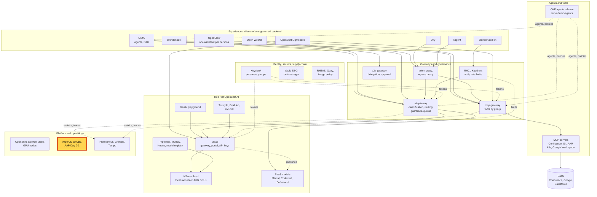
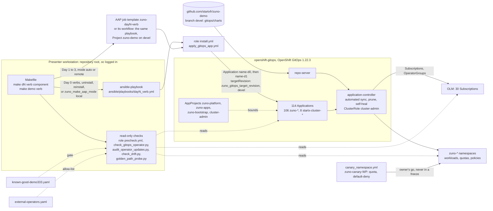

# Scenario: GitOps and Day 0-3 - the install and operations contract

> **Status:** Not rehearsed in this format. Prerequisites checked read-only on demo333 on 2026-11-13 (00:10 to 00:45
> UTC): 114 Argo CD Applications in `openshift-gitops`, all tracking `devel`: 106 `zuno-*` from `startxfr/zuno-demo`
> and 8 `startx-cluster-*` from `startxfr/helm-repository`. 111 were Synced and Healthy. `startx-cluster-auth` and
> `startx-cluster-infra-config` were OutOfSync and Healthy (no self-heal; the same pair was OutOfSync on 2026-11-04).
> `zuno-postgresql-d1` was Synced and Progressing, with 2 of 3 PostgreSQL instances Ready. AppProjects: `zuno-platform`
> (62 Applications), `zuno-apps` (44), `cluster-admin` (8), `zuno-bootstrap` (none). The synced commit of
> `zuno-ai-gateway-d1` moved from `0a713411` to `24da7de3` during the check: a push reached the cluster. OpenShift
> GitOps 1.22.3 (`Manual`, `AtLatestKnown`); the Argo CD pods had not restarted since 2026-11-12 21:27 UTC, but the
> operator's `manager` container had restarted 25 times in 162 minutes (failed probes, last exit at 23:47 UTC). 30
> Subscriptions; two of them are named by no repository file and are missing from
> `platform/olm/known-good-demo333.yaml`: `elasticsearch-eck-operator-certified` (created again on 2026-11-12 at 14:17
> UTC, after the owner's uninstall of 2026-11-11) and `kubevirt-hyperconverged` (created on 2026-11-12 at 14:40 UTC).
> `zuno_drift_strict: true` on demo333. No canary namespace. **paas-ops-01** had not signed in to OpenShift (no
> `ocp-paas-ops` group). No `make` target was run for this page.
> **Show-ready ([ADR-0606](../../../adr/0606-admit-new-experiences-with-a-definition-of-done-and-a-wip-limit.md)):** no
> golden-path probe. Rehearse it before showing it to an audience.
> **Personas:** see [Personas](#personas).
> **Used in workshops:** [Trusted platform and operations](../../workshops/trusted-platform-ops.md).

## Introduction

Zuno is installed and operated through one entry point: `make`, then a day, a verb and a component. Ansible runs the
verb. For each component, a role applies two Argo CD Applications: `<component>-d0` for the operator and the
cluster-scoped objects, then `<component>-d1` for the service. From then on Argo CD keeps the cluster equal to the Git
branch the Applications follow. On demo333 that branch is `devel`, so a push is a deployment. Read-only checks report
what is installed, what runs without a declaration in the repository, which operators left their known-good version,
and whether each demonstration moment really answers. Where this sits in the platform: see
[Appendix A](#appendix-a---hld). How a verb reaches the cluster: see [Appendix B](#appendix-b---lld).

| Day | What it holds | Verbs | Components (Makefile lists) |
|---|---|---|---|
| 0 | Cluster prerequisites and the always-on infrastructure | `check` `install` `uninstall` `reconcile` `all` `reinstall` | `admin-context` `argocd` `namespaces` `openshift-rbac-groups` `vault` `external-secrets` `cert-manager` `machines` `postgresql` `keycloak` `aap` `aap-config` `world-model-gpu` |
| 1 | The AI platform operator stack | the Day 0 verbs and `build` | 23 components from `smtp` to `rhtas-config` (mesh, Kiali, Grafana, Tempo, Kueue, OpenShift AI, Lightspeed, RHTAS, ...); build only: `ai-gateway` `supply-chain-signer` `aap-execution-environment` |
| 2 | AI infrastructure and content | the Day 1 verbs; `reconcile` takes `models` only | 16 components: `namespaces` `llm` `models` `quay-registry` `mcp` `agents` `mlops` `trustyai-config` `mlflow` `lightspeed-config` `unifai` `open-webui` `openclaw` `dify` `kagent` `world-model`; check only: `supply-chain`; build: `mcp` `mlops` `trustyai-eval` `token-proxy` `dify-knowledge` `world-model` |
| 3 | Operations on an installed platform | `test` `stresstest` `backup` `restore` `check` `admit` `run` `release` `scenario-failover-node` | test: `agents` `platform`; backup and restore: `postgresql` `unifai` `quay-registry`; check only: `lightspeed` `lightspeed-config` `trustyai-config` `mlflow` `operators` `drift`; run: `mlops`; release: `supply-chain`; admit: `agents` |
| demo | Presenter tooling | `check` `all-check` `golden-path` `browser` `reset` `step-1` to `step-5` | none |

Which verbs are safe on stage:

| Read-only, allowed during a freeze | Changes the cluster: rehearsal only, never during a freeze, with the platform owner's go |
|---|---|
| Every `check` (Day 2 `agents` runs the ADR-0053 acceptance gate); `make d3 test`; `make d3 admit agents` (no cluster; `UPDATE_LOCK=1` rewrites the lock file); `make demo check`, `make demo golden-path` (creates test sessions and deletes them), `make demo browser`, `make demo step-1` to `step-5` (they only print) | `install`, `uninstall`, `reinstall`, `all`, `reconcile`, `build` (an in-cluster build rolls the pods that run `:latest`); `make d3 stresstest`, `make d3 restore`, `make d3 run`, `make d3 release`, `make d3 scenario-failover-node`; `make demo reset` (uncordons a node, creates UnifAI team workspaces). `make d3 backup` writes a backup to S3; the freeze protocol does not freeze it |

**The message:** "The platform is the repository. One command installs or checks any piece of it, Argo CD keeps the
cluster equal to Git, and before any live session we prove each moment with a real answer."

**Decisions:**
- [ADR-0003](../../../adr/0003-use-ansible-and-make-as-the-deployment-entry-point.md) and
  [ADR-0030](../../../adr/0030-use-a-command-dispatch-makefile-interface.md): Ansible behind `make`, one dispatch
  shape.
- [ADR-0060](../../../adr/0060-restructure-day-0-day-1-day-2-day-3-deployment-sequencing.md): four days;
  [ADR-0421](../../../adr/0421-reshape-day-0-day-1-boundaries-around-always-on-infra.md) moved PostgreSQL, Keycloak and
  AAP to Day 0.
- [ADR-0311](../../../adr/0311-stop-applying-the-root-app-of-apps-from-ansible.md) and
  [ADR-0312](../../../adr/0312-route-operator-installs-through-argocd-applications.md): no app-of-apps; each role
  applies its own Applications, operators included.
- [ADR-0418](../../../adr/0418-execute-day-0-and-day-1-operations-as-aap-job-templates.md): Day 1 to Day 3 verbs can
  run as AAP job templates (see the [AAP scenario](aap-audited-operations.md)).
- [ADR-0602](../../../adr/0602-harden-the-platform-trust-boundaries-before-a-customer-runs-it.md) clause 5: the
  AppProjects `zuno-platform`, `zuno-apps` and `zuno-bootstrap`.
- [ADR-0605](../../../adr/0605-gate-every-live-demo-on-a-golden-path-check-and-a-freeze-window.md): the golden path
  and the freeze window.
- [ADR-0607](../../../adr/0607-pin-gate-and-schedule-pre-ga-dependencies.md): pre-GA pins and the known-good gate
  (`make d3 check operators`).
- [ADR-0608](../../../adr/0608-keep-the-repository-the-only-source-of-cluster-state.md): the repository is the only
  source of cluster state (`make d3 check drift`).
- [ADR-0609](../../../adr/0609-rehearse-on-canary-namespaces-of-demo333.md): rehearsals in canary namespaces.

## Personas

The personas are fictional role accounts of the Keycloak realm `zuno`
([ADR-0349](../../../adr/0349-restructure-demo-personas-cluster-access-groups-and-new-agents.md)). They share one
password, kept in Vault at `keycloak/demo-personas`. The [catalogue](../../README.md#personas) lists all of them.

| Persona | Profile | What it can do here | Role in this demo |
|---|---|---|---|
| **paas-ops-01** | Platform operator, back office. Groups `ocp-paas-ops` (cluster-admin), `agent_tekos`, `aap_admin`, `openwebui_admin`. | Runs every `make` check and reads every Application, AppProject and Subscription. In Argo CD, `ocp-paas-ops` maps to `role:admin` (sign-in through OpenShift). | The presenter's `oc` terminal in both versions; the Argo CD UI, optional, in the 15-minute version. |
| **paas-dev-01** | Platform developer, back office. Groups `ocp-paas-dev` (cluster-reader), `agent_tekos`, `aap_ops`. | In Argo CD, `ocp-paas-dev` maps to `role:zuno-paas-dev`: get and sync on the Applications of `zuno-platform` and `zuno-apps`, no edit. | Named only: a developer may resync an Application, never change what it deploys. |

Other identities:
- The Argo CD application controller, ServiceAccount `openshift-gitops-argocd-application-controller`, bound to
  `cluster-admin` (ClusterRoleBinding `zuno-argocd-application-controller-admin`).
- When `zuno_make_aap_mode` is `auto` or `remote`, Day 1 to Day 3 verbs run in AAP as the ServiceAccount
  `aap-day0-check` (checks and tests) or `aap-installer` (writes). On the operator workstation of demo333 the mode was
  `local` on 2026-11-13, so `make` runs Ansible from the terminal.
- The golden-path probes sign in as `eval-consultant-01`. Some spend the budget of consultant-02, ai-ops-01 or sale-01
  ([golden-path.md](../../golden-path.md)).

## Before you start

- [ ] **paas-ops-01** has signed in once to the OpenShift console: on 2026-11-13 its group `ocp-paas-ops` did not exist.
  Then log a terminal in with `oc` as **paas-ops-01**, at the root of the checkout that holds `ansible/confidential.yml`,
  large font.
- [ ] `make d0 check argocd` passes the same day. It fails when the GitOps operator's pod restarted in the last 15
  minutes: on 2026-11-13 its manager had restarted 25 times in under three hours. Argo CD itself was not affected.
- [ ] Run `make d3 check operators` and `make d3 check drift` the day before. On 2026-11-13 both would have reported
  `elasticsearch-eck-operator-certified` and `kubevirt-hyperconverged`, installed on 2026-11-12 outside the repository
  (expected from the code and the live Subscriptions; not run for this page). Decide with the platform owner: show the
  findings as the checks at work, or have the two operators declared or removed first. Removing them is a cluster
  change, outside any freeze.
- [ ] No golden-path probe covers this scenario. Keep the output of the morning's `make demo golden-path` run open
  (about 15 minutes; never run it while the audience watches), see [golden-path.md](../../golden-path.md).
- [ ] Optional, 15-minute version: the Argo CD UI
  `https://openshift-gitops-server-openshift-gitops.apps.demo333.startx.fr`, **Log in via OpenShift** as
  **paas-ops-01**. Not rehearsed. Look only: never press Sync, Hard Refresh or Delete.
- [ ] Open [freeze-protocol.md](../../freeze-protocol.md) and
  [docs/platform/canary-rehearsal.md](../../../platform/canary-rehearsal.md) in a browser tab.
- [ ] Known on screen, not a failure: the three Applications that are not Synced and Healthy (see the status banner).

## 5-minute version

Terminal **paas-ops-01**, at the repository root.

| Time | Do | Say | You should see |
|---|---|---|---|
| 0:00 | `make help` | "One entry point for the whole platform: make, a day, a verb, a component. Day 0 is the cluster's foundation, Day 1 the platform operators, Day 2 the AI services and their content, Day 3 the operations on a running platform." | The usage lines (`make day0\|d0 check [component]` ...), then the component lists of each day at the bottom. |
| 1:00 | `oc get applications.argoproj.io -n openshift-gitops -o jsonpath='{range .items[*]}{.spec.source.targetRevision}{" "}{.status.sync.status}{" "}{.status.health.status}{"\n"}{end}' \| sort \| uniq -c` | "Each component is two Argo CD Applications: its operator, then its service. All of them follow one Git branch. Argo CD keeps the cluster equal to that branch and undoes any change made by hand." | On 2026-11-13: `111 devel Synced Healthy`, `2 devel OutOfSync Healthy`, `1 devel Synced Progressing`. |
| 2:00 | `oc get applications.argoproj.io -n openshift-gitops \| awk 'NR==1 \|\| $2!="Synced" \|\| $3!="Healthy"'` | "Each exception has a name. Two come from the cluster's provisioning, outside this repository, without self-heal: they differ on the OAuth and monitoring settings our roles change. The third is a database replica catching up." | `startx-cluster-auth` and `startx-cluster-infra-config` OutOfSync Healthy; `zuno-postgresql-d1` Synced Progressing. Your list may differ: read it before the session. |
| 3:00 | `make d0 check argocd` | "And every component has a read-only check. This one asks: is Argo CD installed, are its projects in place, is its operator healthy." | The Ansible run, then a state report with `argocd is installed` and no `is not healthy` message. Duration not measured. |
| 4:15 | Close | "The platform is the repository. One command installs or checks any piece of it, Argo CD keeps the cluster equal to Git, and before any live session we prove each moment with a real answer." | |

## 15-minute version

Run the 5-minute version, then:

| Time | Do | Say | You should see |
|---|---|---|---|
| 5:00 | `oc get application.argoproj.io zuno-ai-gateway-d1 -n openshift-gitops -o jsonpath='{.spec.source.repoURL}{" "}{.spec.source.path}{" "}{.spec.source.targetRevision}{"\n"}{.spec.syncPolicy.automated}{"\n"}{.status.sync.revision}{"\n"}'` | "One Application: our repository, one chart, the branch `devel`, automatic sync with prune and self-heal. The last line is the commit the cluster runs. On demo333 a push to `devel` is a deployment." | `https://github.com/startxfr/zuno-demo.git gitops/charts/ai-gateway devel`, `{"prune":true,"selfHeal":true}`, a commit id. |
| 6:00 | Open [`gitops/apps/ai-gateway/application-d1.yaml`](../../../../gitops/apps/ai-gateway/application-d1.yaml) | "The file in Git says `main`. The role writes the cluster's branch when it applies the Application. Argo CD reads the charts from Git, but the Applications themselves are written by the roles: a chart change deploys on push, a change to this file waits for the component's `install`." | `targetRevision: main` in the file; `devel` live. |
| 7:00 | `oc get applications.argoproj.io -n openshift-gitops -o jsonpath='{range .items[*]}{.spec.project}{"\n"}{end}' \| sort \| uniq -c` | "Projects bound what an Application may declare. `zuno-platform` may install operators and a fixed list of cluster-wide kinds. `zuno-apps` holds only namespaced objects in Zuno's namespaces." | `8 cluster-admin`, `44 zuno-apps`, `62 zuno-platform` (2026-11-13). |
| 8:00 | Optional: Argo CD UI as **paas-ops-01**, filter on `zuno-ai-gateway`, open `zuno-ai-gateway-d1` | "Every object the chart renders, its sync state and its health, in one tree." | The resource tree: Deployment, Service, ConfigMaps, all Synced. Look only. |
| 9:00 | `make d3 check operators` | "Pre-GA operators move fast. A file records the known-good version of every operator. The gate fails when a pre-GA operator differs from it, or when an operator is not in it at all." | The update audit, then `known-good gate against .../known-good-demo333.yaml:` and `PASS every operator matches the known-good set`, or `FAIL` lines. On 2026-11-13 expect `FAIL elasticsearch-eck-operator-certified [openshift-operators] ... is installed but not in the known-good set`, the same for `kubevirt-hyperconverged [openshift-cnv]`, and an `INFO` line for the AAP operator (a GA patch). |
| 10:30 | `make d3 check drift` | "Second question: what runs that the repository does not explain? An undeclared operator, a hand-applied object, an image built from a commit that was never pushed, a forgotten rehearsal namespace. On demo333 any finding fails the check." | Five sections, `subscriptions`, `storage`, `by-hand`, `images`, `canaries`, each `clean` or `N finding(s)`, then `RESULT: clean` or `RESULT: N finding(s)`. On 2026-11-13 expect at least the two Subscriptions above. |
| 11:45 | Show the morning's `make demo golden-path` output | "Green status is not proof. Before a live session we send one real request through each demonstration moment, and a moment that fails switches to its fallback. It runs the day before, at the start of the freeze, and twice on the morning." | One line per moment and `RESULT: PASS` (14 of 14 on 2026-11-08). |
| 12:45 | [Freeze protocol](../../freeze-protocol.md), section "During the freeze" | "From the baseline run to the end of the demonstration nobody pushes to the deployment branch and nobody runs a command that writes. One break-glass change needs the owner's go, then the whole golden path again." | The frozen commands and namespaces. |
| 13:30 | `oc get ns -l zuno.io/canary=true` | "Changes are rehearsed in labelled canary namespaces with a quota and a default-deny network policy. Operators, Vault, the mesh and Argo CD cannot be rehearsed there, and we say so. A canary left behind is a drift finding." | `No resources found` on 2026-11-13. |
| 14:15 | `make demo` | "The presenter's own tools: a preflight, the golden path, the browser checks. Only `reset` changes anything." | The list of `make demo` verbs. |
| 14:45 | Close | Repeat the message. | |

## If something goes wrong

| Symptom | Fallback | Say |
|---|---|---|
| `make` stops with `No kubeconfig found` | `oc login` first, then run it again. | |
| `forbidden` or `Unauthorized` in the terminal | The terminal is not **paas-ops-01**, or its OpenShift group was never created. Show the 5-minute steps from the slides or the screenshots of the rehearsal. | |
| More Applications than the three of 2026-11-13 are OutOfSync, Degraded or Missing | Show the list as it is. In the Argo CD UI, open the Application and point at the object that differs. Do not sync. | "Argo CD tells us exactly which object differs from Git. Repairing it is a change, and we do not change the platform in front of you." |
| `make d0 check argocd` fails: `Pod openshift-gitops-operator-controller-manager-... (manager) was terminated (Error) ...s ago` | `oc get pods -n openshift-gitops`: the Argo CD pods run. The finding is about the operator that installs Argo CD. | "The check also watches the installer of Argo CD, and it is right: the operator restarted a few minutes ago. Argo CD itself is running." |
| `make d3 check operators` or `make d3 check drift` fails with findings | Read the findings aloud. | "Two operators were installed on 2026-11-12 outside the repository. The checks name them; the owner decides whether to declare or remove them." |
| A check prints `AAP not reachable - falling back to local execution` | Nothing to do: `zuno_make_aap_mode` is `auto` and the check ran locally. | |
| `make d3 check drift` prints `drift check skipped` | It ran in AAP (no `oc`, no git checkout there). Run it from the workstation with `zuno_make_aap_mode: local`. | |
| The morning's golden path has a red moment | That moment switches to its fallback in the demo-day runbook. Do not open a fix ([ADR-0605](../../../adr/0605-gate-every-live-demo-on-a-golden-path-check-and-a-freeze-window.md) clause 2). | "A failing probe is why we run it: the moment has a written fallback." |

## Limits

- **No golden-path probe for this scenario.** The checks above are its proof. `make d0 check argocd` was green on
  2026-11-04 ([WP-195](../../../roadmap/work-packages/wp-195-update-every-operator-on-demo333-through-the-repository.md));
  the gate passed and the drift check was clean on 2026-11-07 (ADR-0607, ADR-0608). None was run for this page.
- **A push to `devel` is a deployment on demo333.** The manifests say `main`; the roles write
  `zuno_gitops_target_revision` (`devel`). `main` carries the tags ([RELEASING.md](../../../../RELEASING.md)).
- **The Applications are not synced from Git** (ADR-0311). `gitops/apps/*/application-*.yaml` is applied by the roles
  (`ansible/tasks/apply_gitops_app.yml`), which also replace the Helm values of some Applications. A values change in
  those files reaches the cluster only with the component's `install`.
- **The Argo CD controller keeps its `cluster-admin` binding** (ADR-0602 clause 5, still open). The AppProjects bound
  what an Application may declare, not what the controller may do.
- **The 8 `startx-cluster-*` Applications are not this repository's.** They come from the cluster provisioning, live in
  the `cluster-admin` project, have no self-heal, and two of them have been OutOfSync since at least 2026-11-04.
- **What the drift check does not see.** It reads Subscriptions, storage classes, labelled or unowned security objects in
  `zuno-*` namespaces, first-party image commits and canary namespaces. It does not read AAP objects, the Keycloak
  realm, or Helm values patched into a live Application. It runs only from a workstation.
- **The known-good gate fails on pre-GA versions and unknown operators only.** A GA patch is `INFO`. OLM never
  downgrades: an operator release is undone by a restore or a forward fix (ADR-0607).
- **Day 0 verbs, `uninstall` and `reinstall` never go through AAP**, whatever `zuno_make_aap_mode` says (ADR-0418
  clause 6). With `local`, AAP records none of the runs.
- **`make demo step-1` to `step-4` print the September 2026 webinar script.** Steps 1 to 4 open
  `https://arkos.<domain>`, `https://tekos.<domain>` and `https://comage.<domain>`; no such route existed on demo333 on
  2026-11-13 (the agent frontends were retired with
  [WP-156](../../../roadmap/work-packages/wp-156-retire-zuno-agent-and-rag-code.md)). Use the scenario pages instead.
- **Canary namespaces cannot hold** cluster-scoped operators and CRDs, Vault, mesh-wide settings, Argo CD and its
  AppProjects, or GPU node pools (ADR-0609 clause 3). Those changes are scheduled, backed up and followed by a
  golden-path run.
- **Argo CD is not paused during a freeze** (ADR-0605, rejected alternative): self-heal keeps repairing drift. The
  freeze is a no-push rule.
- A `recovery` check component was added on `devel` on 2026-11-13 (`24da7de3`), after the base of this page. It is not
  described here.

## Appendix A - HLD

Where GitOps and the Day 0-3 operations sit in Zuno. The highlighted box is the subject of this page. Plain arrows
carry requests, dotted arrows carry identity, policy or telemetry.

## Appendix B - LLD

How a `make` verb reaches the cluster, and what the read-only checks read. Drawn from the `Makefile` (the `DAY*` and
`DEMO_VERBS` lists, `AAP_ROUTING_SHELL_FUNCS`, the `DAY0` to `DAY3` recipes), `ansible/playbooks/day0_check.yml`,
`ansible/playbooks/day3_check.yml`, `ansible/tasks/apply_gitops_app.yml`, `ansible/roles/argocd/tasks/precheck.yml`
(`platform/gitops/check_gitops_operator.py`), `ansible/roles/operators/tasks/precheck.yml`
(`platform/olm/audit_operator_updates.py`, `platform/olm/known-good-demo333.yaml`),
`ansible/roles/drift/tasks/precheck.yml` (`platform/drift/check_drift.py`,
`platform/drift/external-operators.yaml`), `ansible/playbooks/demo_golden_path.yml`, `ansible/tasks/canary_namespace.yml`,
`gitops/apps/README.md`, and the live objects listed in the status banner.

