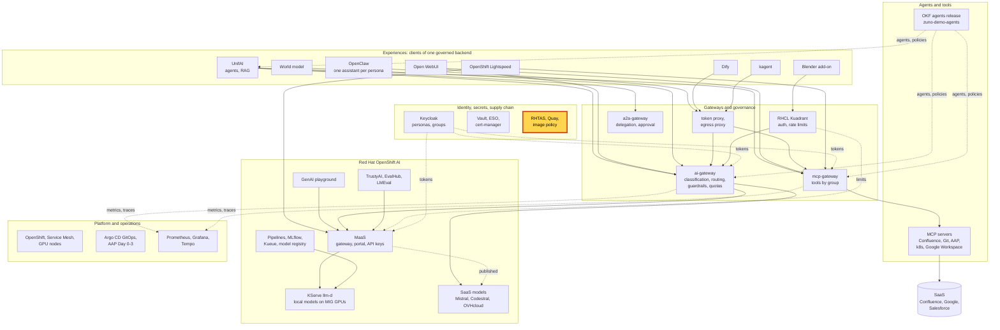
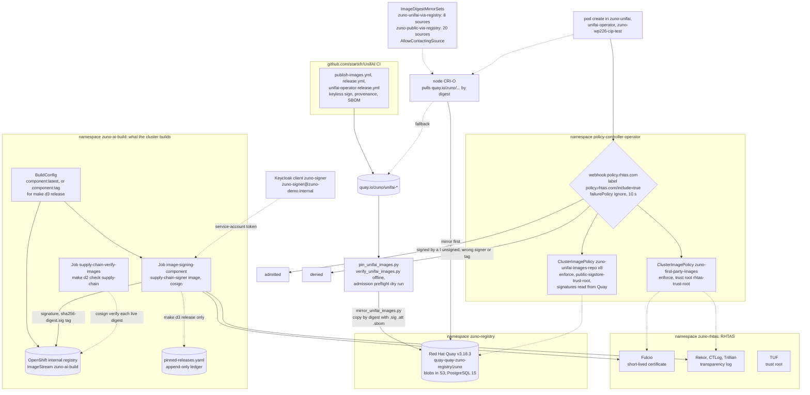

# Scenario: Supply chain - signed images, admission policy and the internal Quay

> **Status:** Not rehearsed in this format. Prerequisites checked read-only on demo333 on 2026-11-13: `Securesign`
> `zuno-securesign` `Ready` in `zuno-rhtas` (`rhtas-operator.v1.5.1`), routes `fulcio-server`, `rekor-server`, `tuf` and
> `console-ui` on `*-zuno-rhtas.apps.demo333.startx.fr`, nine RHTAS pods Running; `policy-controller-operator.v1.1.2`,
> Deployment `zuno-policy-controller-webhook` 1/1, webhook `policy.rhtas.com` with `failurePolicy: Ignore` and a 10 s
> timeout, `no-match-policy: warn`; nine `clusterimagepolicies.policy.sigstore.dev`, all in `enforce`:
> `zuno-first-party-images` (images `image-registry.openshift-image-registry.svc:5000/zuno-ai-build/**`, identity
> `zuno-signer@zuno-demo.internal`) and eight `zuno-unifai-images-<repository>` that read the signatures from
> `quay-quay-zuno-registry.apps.demo333.startx.fr/zuno/<repository>`; a bare `oc get clusterimagepolicy` lists only
> OpenShift's own `openshift` object; namespaces labelled `policy.rhtas.com/include=true`: `unifai-operator`,
> `zuno-unifai`, `zuno-wp226-cip-test`; `QuayRegistry` `quay` `v3.18.3` available in `zuno-registry`, its application
> pod with 20 restarts; `ImageDigestMirrorSet`s `zuno-unifai-via-registry` (8 sources) and `zuno-public-via-registry`
> (20 sources), all `AllowContactingSource`; the UnifAI pods of `zuno-unifai` on `quay.io/zuno/unifai-*@sha256:...`;
> Job `supply-chain-verify-images` in `zuno-ai-build` `Complete` 16 hours earlier; the release ledger holds 12
> releases, the last `v0.15.0` (2026-11-11, 13 pins, `signed: true`); both machine config pools `Updated`, 7 nodes
> Ready. **paas-ops-01** had still not signed in to OpenShift (no `User` object): the checks ran as `kube:admin`.
> **Show-ready ([ADR-0606](../../../adr/0606-admit-new-experiences-with-a-definition-of-done-and-a-wip-limit.md)):** no
> golden-path probe. Rehearse it before showing it to an audience.
> **Personas:** see [Personas](#personas).
> **Used in workshops:** [Trusted platform and operations](../../workshops/trusted-platform-ops.md).

## Introduction

Zuno signs what it runs and checks the signature before it runs it. Red Hat Trusted Artifact Signer (RHTAS) runs in
the cluster: Fulcio gives a short-lived certificate to a service identity from Keycloak, Rekor records each signature,
and TUF publishes the trust root. Every image built in the cluster is signed right after its build. The UnifAI images
are built and signed by the CI of the UnifAI fork on GitHub. The Sigstore policy controller checks these signatures when
a pod is created in a namespace that opted in, and refuses an image that fails. An internal Red Hat Quay holds the
UnifAI images and their signatures, the agents release and a list of public images, so most pod starts no longer
depend on a public registry. Where the supply chain sits: see [Appendix A](#appendix-a---hld). The signing,
admission and mirror paths: see [Appendix B](#appendix-b---lld).

**The message:** "What runs here is signed, and the signer is named. In the namespaces that opted in, the cluster
refuses an image whose signature does not match, and it reads images and signatures from our own registry."

**Decisions:**
- [ADR-0535](../../../adr/0535-adopt-rhtas-as-the-artifact-trust-and-supply-chain-service.md): RHTAS signs the
  images built in the cluster, keyless, with the `zuno-signer` Keycloak identity.
- [ADR-0603](../../../adr/0603-close-the-medium-severity-security-gaps-found-in-the-2026-11-06-review.md) (M16, M17):
  the image policy moves to `enforce` after a clean `warn` run; release digests can be rendered into the charts.
- [ADR-0586](../../../adr/0586-verify-the-unifai-runtime-images-by-digest-signature-and-attestations-before-deploying-them.md):
  UnifAI images are pinned by digest and verified (signature, provenance, SBOM) before they are deployed, then checked
  again at admission ([WP-178](../../../roadmap/work-packages/wp-178-admit-only-signed-unifai-images-at-the-cluster.md)).
- [ADR-0549](../../../adr/0549-close-the-secnumcloud-supply-chain-gap-with-an-in-cluster-release-ledger.md): a named
  release rebuilds, signs and records every component in an append-only ledger.
- [ADR-0612](../../../adr/0612-serve-every-zuno-image-from-an-internal-red-hat-quay-backed-by-an-s3-bucket.md): one
  internal Red Hat Quay, backed by an S3 bucket, serves the zuno images.
- [ADR-0611](../../../adr/0611-mirror-the-admitted-okf-release-into-the-internal-registry.md): measured on 2026-11-09,
  the OpenShift internal registry cannot hold the signatures of OCI artifacts.
- [ADR-0115](../../../adr/0115-use-immutable-and-verifiable-software-supply-chain-artifacts.md) (Deferred): the
  original goal of immutable, verifiable artifacts published by CI.

## Personas

The personas are fictional role accounts of the Keycloak realm `zuno`
([ADR-0349](../../../adr/0349-restructure-demo-personas-cluster-access-groups-and-new-agents.md)). They share one
password, kept in Vault at `keycloak/demo-personas`. The [catalogue](../../README.md#personas) lists all of them.

| Persona | Profile | What it can do here | Role in this demo |
|---|---|---|---|
| **paas-ops-01** | Platform operator, back office. Groups `ocp-paas-ops` (cluster-admin), `agent_tekos`, `aap_admin`, `openwebui_admin`. | Reads the RHTAS, policy, Quay and mirror objects and the Jobs of `zuno-ai-build`. Could also run `make d2 check supply-chain` and the break-glass label; both change the cluster, so only with the owner's go and never on stage. | The presenter's `oc` terminal in both versions. |

Other identities:
- **`zuno-signer`**, a Keycloak service-account client. Fulcio turns its token into a certificate for
  `zuno-signer@zuno-demo.internal`. Its secret is in Vault at `keycloak/zuno-signer-client`, copied to the Secret
  `zuno-signer-client-secret` in `zuno-ai-build` for the signing Jobs.
- **The UnifAI fork's GitHub workflows**, the signers of the UnifAI images: `publish-images.yml` on a release tag, and
  on `devel` because demo333 accepts development builds; `unifai-operator-release.yml`; `release.yml`. They are listed
  once, in [`platform/supply-chain/image-identities.yaml`](../../../../platform/supply-chain/image-identities.yaml).
- **The Quay robots**: `zuno+pull` (read only) and `zuno+push`, in Vault at `zuno/registry/quay-robots`. The Quay
  administrator record is at `zuno/registry/quay-admin`. Not used on stage.
- **The presenter's `oc` session**: **paas-ops-01**, which must have signed in to OpenShift once.

## Before you start

- [ ] **paas-ops-01** has signed in once to the OpenShift console (on 2026-11-13 it had not). Then log a terminal in with
  `oc` as **paas-ops-01**, at the repository root, large font.
- [ ] `oc get mcp`: both pools `UPDATED True`, `UPDATING False`. No `ImageDigestMirrorSet` change may be planned that
  day: removing a source drains every node (see [Limits](#limits)).
- [ ] `oc get securesign -n zuno-rhtas` shows `Ready`, and `oc get quayregistry -n zuno-registry` shows
  `AVAILABLE True`.
- [ ] `make d2 check supply-chain` writes a ConfigMap and a Job in `zuno-ai-build`. Run it before the session only with
  the owner's go (rehearsal only). On stage, show the last Job instead.
- [ ] 15-minute version: open [WP-178](../../../roadmap/work-packages/wp-178-admit-only-signed-unifai-images-at-the-cluster.md)
  at step 4 of its Steps, and [`platform/supply-chain/pinned-releases.yaml`](../../../../platform/supply-chain/pinned-releases.yaml)
  at its last entry.
- [ ] Known on screen, not a failure: `oc get clusterimagepolicy` alone lists only `openshift`, OpenShift's own
  resource of the same name. Always type `clusterimagepolicies.policy.sigstore.dev`.
- [ ] Known on screen, not a failure: `zuno-first-party-images` is in `enforce`, but no opted-in namespace runs a
  first-party image yet. Say so if asked.

## 5-minute version

| Time | Do | Say | You should see |
|---|---|---|---|
| 0:00 | `oc get securesign -n zuno-rhtas` | "Red Hat Trusted Artifact Signer runs inside the cluster: a certificate authority, Fulcio; a transparency log, Rekor; and TUF, which publishes the trust root. Every image we build is signed here right after the build, by a service identity. No private key is stored anywhere." | `zuno-securesign` `Ready`, with the Rekor, Fulcio and TUF URLs on `*-zuno-rhtas.apps.demo333.startx.fr`. |
| 1:15 | `oc get clusterimagepolicies.policy.sigstore.dev -o custom-columns=NAME:.metadata.name,MODE:.spec.mode` | "The cluster checks signatures when a pod is created. One policy for what we build, one per UnifAI image. All in enforce: an image whose signature does not match is refused." | Nine policies, all `enforce`: `zuno-first-party-images` and eight `zuno-unifai-images-...`. |
| 2:30 | `oc get ns -l policy.rhtas.com/include=true` | "A namespace opts in. Today: UnifAI, its operator, and a test namespace." | `unifai-operator`, `zuno-unifai`, `zuno-wp226-cip-test`. |
| 3:15 | `oc get imagedigestmirrorset zuno-unifai-via-registry -o jsonpath='{range .spec.imageDigestMirrors[*]}{.source} -> {.mirrors[0]}{"\n"}{end}'` | "The pods still name quay.io, by digest. The nodes fetch the images from our own Red Hat Quay, and the policy reads their signatures there too. Same digest, so the same signature." | `quay.io/zuno/unifai-backend -> quay-quay-zuno-registry.apps.demo333.startx.fr/zuno/unifai-backend`, and seven more. |
| 4:15 | Close | "What runs here is signed, and the signer is named. In the namespaces that opted in, the cluster refuses an image whose signature does not match, and it reads images and signatures from our own registry." | |

## 15-minute version

Run the 5-minute version, then:

| Time | Do | Say | You should see |
|---|---|---|---|
| 5:00 | `oc get clusterimagepolicies.policy.sigstore.dev zuno-first-party-images -o jsonpath='{.spec.images[0].glob}{"\n"}{.spec.authorities[0].keyless.identities[0].subject}{"\n"}'` | "What we build: any image of the build namespace, signed by the `zuno-signer` identity, through our own Fulcio." | `image-registry.openshift-image-registry.svc:5000/zuno-ai-build/**` and `zuno-signer@zuno-demo.internal`. |
| 6:00 | `oc get clusterimagepolicies.policy.sigstore.dev zuno-unifai-images-unifai-ui -o jsonpath='{.spec.authorities[0].keyless.identities[*].subjectRegExp}{"\n"}{.spec.authorities[0].source[0].oci}{"\n"}'` | "UnifAI is built and signed by its own CI on GitHub. We trust named workflows, not a key: release tags, and the `devel` branch because this cluster runs it. The signature is read from our Quay." | Regular expressions on `github.com/startxfr/UnifAI/.github/workflows/` (`publish-images.yml`, `unifai-operator-release.yml`, `release.yml`), then `quay-quay-zuno-registry.apps.demo333.startx.fr/zuno/unifai-ui`. |
| 7:15 | `oc get pods -n zuno-unifai -o jsonpath='{range .items[*]}{.spec.containers[*].image}{"\n"}{end}' \| grep unifai-` | "Every UnifAI image is pinned by digest. In an opted-in namespace the webhook also refuses a tag." | `quay.io/zuno/unifai-backend@sha256:...`, `unifai-identity`, `unifai-multiagent`, `unifai-rag`, `unifai-ui`. |
| 8:15 | Show [WP-178](../../../roadmap/work-packages/wp-178-admit-only-signed-unifai-images-at-the-cluster.md), step 4 | "Before we switched to enforce, on 2026-10-25, we sent unsigned digests and a tag through the real webhook as dry runs. They were refused; a CI-signed digest was admitted. Before each new pin, the pin script asks the webhook the same question." | `admission webhook "policy.rhtas.com" denied the request ... no signatures found`. |
| 9:15 | `oc get quayregistry -n zuno-registry`, then `oc get imagedigestmirrorset` | "One Red Hat Quay, its blobs in an S3 bucket. It holds the agents release with its signatures, the UnifAI images and 20 public image repositories we depend on. Why not OpenShift's own registry? It has no OCI referrers API, so a signature copied there cannot be found: we measured it." | `quay` `v3.18.3` `AVAILABLE True`; `zuno-public-via-registry` and `zuno-unifai-via-registry`. |
| 10:30 | `oc get job supply-chain-verify-images -n zuno-ai-build` | "Admission is the second guard. The first one is a check, `make d2 check supply-chain`: a Job verifies the live digest of every image we build against Fulcio and Rekor, and checks the release ledger. Its last run passed." | `Complete` `1/1`, with its age. |
| 11:30 | `grep -c 'release_tag' platform/supply-chain/pinned-releases.yaml`, then `grep -A8 'release_tag: v0.15.0' platform/supply-chain/pinned-releases.yaml` | "A named release rebuilds every component from its tag, signs it and writes its digest in an append-only ledger. The ledger is the evidence; it changes nothing that runs." | `12`; then `release_tag: v0.15.0`, `pinned_at: '2026-11-11T16:25:00Z'`, a digest and `signed: true`. |
| 12:45 | `oc get validatingwebhookconfiguration policy.rhtas.com -o jsonpath='{.webhooks[0].failurePolicy} {.webhooks[0].timeoutSeconds}{"\n"}'` | "One honest limit: if the webhook is down or slower than ten seconds, the pod is admitted without a check. The verification before each deployment and the drift check are the main guard." | `Ignore 10`. |
| 13:45 | Point to the [signed agent release](./okf-signed-agent-release.md) | "Agents follow the same rule with a different signer: the agents repository's release workflow." | |
| 14:15 | Close | Repeat the message. | |

## If something goes wrong

| Symptom | Fallback | Say |
|---|---|---|
| `oc get clusterimagepolicy` lists only `openshift` | Use the full name `clusterimagepolicies.policy.sigstore.dev`. | "OpenShift has its own resource with the same name." |
| A policy shows `warn` | Show it as it is. The mode is one value in Git (`zuno_unifai_admission_mode` in `ansible/clusters/demo333.yml`, `policyOperand.clusterImagePolicy.mode` in the rhtas-config chart). | "Today it reports instead of refusing. The switch is one line, reviewed like code." |
| `zuno-unifai` or `unifai-operator` is missing from the opted-in list | The break-glass was used: it removes the label of a namespace ([operations.md](../../../platform/operations.md#a-legitimate-pod-is-refused-break-glass)). Do not relabel on stage. | "Someone used the emergency exit. Putting it back is the owner's call." |
| An event says `admission webhook "policy.rhtas.com" denied the request` | Show the event. Follow the break-glass procedure after the session, with the owner's go. | "The cluster did its job. Now a human decides." |
| `quay` is not `AVAILABLE`, or pods wait on images | Nodes fall back to `quay.io` for the mirrored images (`AllowContactingSource`); the gateways' agents release does not. Skip to the RHTAS and policy steps. | |
| `oc get mcp` shows `UPDATING True`, or nodes are `SchedulingDisabled` | A mirror or machine configuration change is rolling. Do not demo the platform. After a drain, `make d3 check recovery` (on `devel` since 2026-11-13, untested) checks each layer. | |
| The Job `supply-chain-verify-images` is missing or `Failed` | Show the ledger step instead. | "The check did not run today. The ledger shows what was signed." |
| `oc` answers `Forbidden` | **paas-ops-01** has not signed in to OpenShift, so its group does not exist yet. Sign it in before the session. | |

## Limits

- **Admission fails open.** The webhook has `failurePolicy: Ignore`, one replica and a 10 s timeout. If it is down or
  slow, pods are admitted unchecked. zuno's verifier before a pin and the drift check do not depend on it.
- **Only opted-in namespaces are checked.** `zuno-ai-run`, where the gateways run, is not opted in. The webhook refuses
  tag references there, and the first-party charts still deploy `:latest`
  ([ADR-0059](../../../adr/0059-auto-redeploy-on-in-cluster-build-via-image-triggers.md)). A namespace opts in only
  once its charts render digests (ADR-0603 M16). So the first-party policy in `enforce` refuses nothing that runs today.
- **Admission checks the signer only.** Provenance and SBOM are checked by `verify_unifai_images.py` before a pin, not
  at admission. A signature logged only in the Ed25519 Rekor v2 log verifies with cosign but not at admission.
- **The OpenShift internal registry cannot hold OCI referrers.** No Referrers API, and the tag fallback is refused with
  a 500 ([WP-246](../../../roadmap/work-packages/wp-246-mirror-the-okf-release-into-the-internal-registry.md),
  2026-11-09). That is why the agents release and the UnifAI signatures live in Quay. The first-party images and their
  cosign signatures stay in the internal registry: moving them to Quay (WP-248 family b) is not done.
- **Removing an `ImageDigestMirrorSet` source drains every node.** On 2026-11-12, removing one source made the Machine
  Config Operator cordon and drain all nodes: about 50 minutes for the four workers, a master blocked by the
  single-replica PodDisruptionBudgets, Quay down for more than an hour, gateways in `Init:Error`, and MaaS answering 503
  until the Kuadrant operator recovered
  ([WP-248](../../../roadmap/work-packages/wp-248-replace-the-okf-mirror-with-an-internal-quay-for-every-zuno-image.md#incident-of-the-zot-removal-removing-an-idms-source-drains-the-nodes-2026-11-12)).
  Adding a source reloads the nodes without a drain. Change mirrors only in an announced window of at least two hours,
  never before a session.
- **Quay is one replica.** Its application pod had 20 restarts on 2026-11-13 (its liveness probe kills a slow start). An
  outage blocks a pod start that needs an image not yet on its node.
- **Clair has no vulnerability data.** Its `rhel-vex` download stalls behind the namespace egress firewall, and the
  owner chose to leave it without data (WP-248). Quay's empty security column does not mean "no vulnerabilities".
- **The release ledger is evidence, not a deployment.** `make d3 release TAG=<tag>` rebuilds and signs every component
  in the cluster ([RELEASING.md](../../../../RELEASING.md), path 3): rehearsal only, with the owner's go, never in a
  freeze. Rendering the digests into the charts is a separate decision.
- **CI keyless signing of the GitHub-built images was written and never run** (ADR-0603 M17); ADR-0115 stays Deferred.
- **The RHTAS console** (`console-ui` route) exists on demo333 but was not opened for this page: what it shows and how
  it signs in are not documented.

## Appendix A - HLD

Where the supply chain sits in Zuno. The highlighted box is the subject of this page. Plain arrows carry requests,
dotted arrows carry identity, policy or telemetry.

## Appendix B - LLD

The three paths: signing what the cluster builds, verifying and mirroring the UnifAI images, and admission. Drawn from
`gitops/charts/rhtas/templates/securesign.yaml`, `gitops/charts/rhtas-config/templates/` (`clusterimagepolicy.yaml`,
`clusterimagepolicy-unifai.yaml`, `policycontroller.yaml`, `trustroot.yaml`, `trustroot-public.yaml`) and its
`values.yaml`, `ansible/tasks/run_image_signing_job.yml`, `ansible/tasks/verify_image_signatures.yml`,
`ansible/roles/supply_chain/tasks/check.yml`, `platform/supply-chain/` (`tag_local_release.py`,
`check_release_ledger.py`, `verify_unifai_images.py`, `mirror_unifai_images.py`, `admission_preflight.py`,
`image-identities.yaml`), `gitops/charts/quay-registry/templates/`, `ansible/clusters/demo333.yml` and the live objects
of the status banner.

