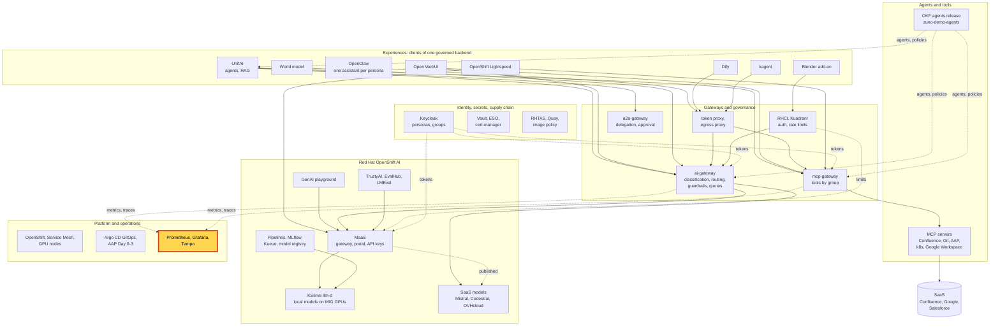
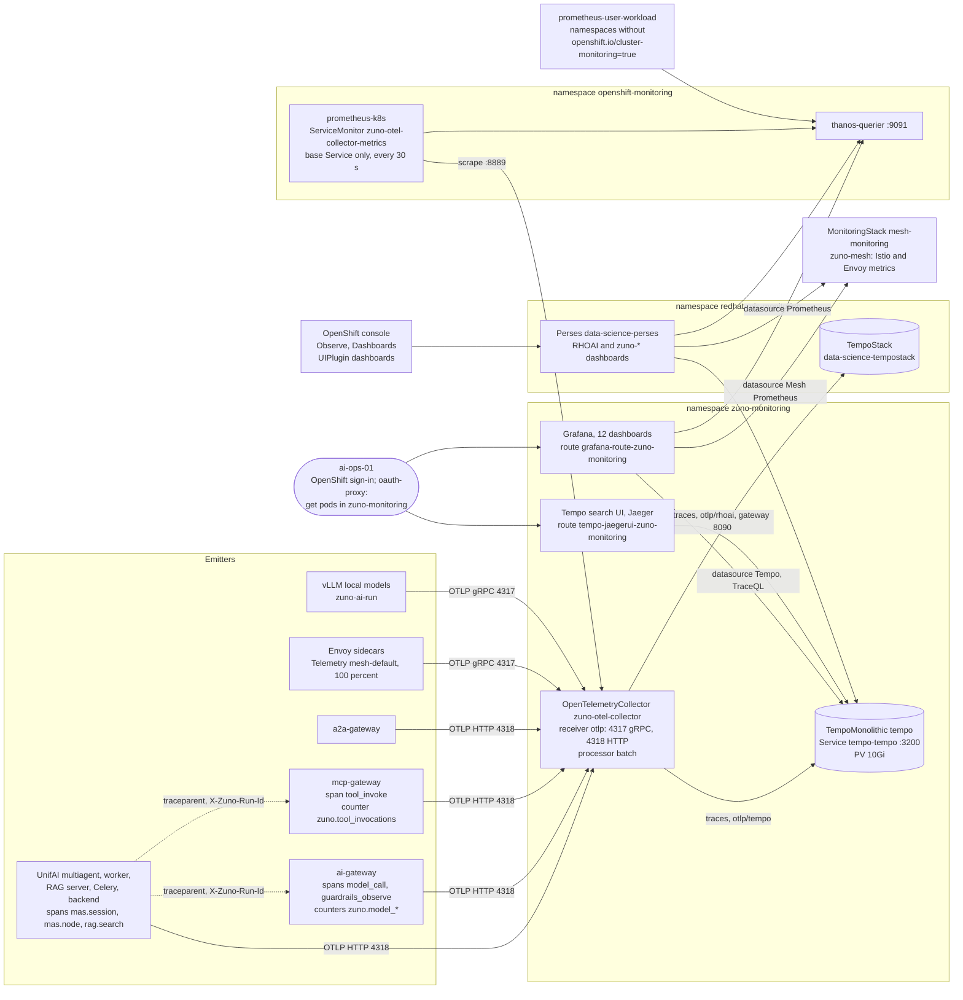

# Scenario: Observability - one turn traced, every call counted

> **Status:** Not rehearsed in this format. Prerequisites checked read-only on demo333 on 2026-11-13: Applications
> `zuno-observability-d0`/`-d1`, `zuno-tempo-d0`/`-d1`, `zuno-grafana-d0`/`-d1` and `zuno-perses-d1` Synced and
> Healthy; OpenTelemetryCollector `zuno-otel-collector` 1/1 (0.158.0), traces exported to `debug`, `otlp/tempo` and
> `otlp/rhoai`, metrics to `debug` and `prometheus`; ServiceMonitor `zuno-otel-collector-metrics` selecting the base
> Service only; namespace `zuno-monitoring` labelled `openshift.io/cluster-monitoring=true`; TempoMonolithic `tempo`
> Ready (Tempo 2.10.8, 10Gi volume) with its Jaeger UI route; Grafana 1/1 with 12 GrafanaDashboards and the
> datasources `prometheus`, `mesh-prometheus` and `tempo`; 19 PersesDashboards in `redhat-ods-monitoring`, the 11
> `zuno-*` ones Available and RHOAI's `data-science-tempo-traces` Degraded; UIPlugin `dashboards` Available;
> `ai-gateway`, `mcp-gateway` and `a2a-gateway` 1/1; UnifaiStack `unifai` exporting to the collector; the four local
> models Ready; OpenShift group `ocp-ai-ops` holding ai-ops-01, and no group `ocp-paas-ops` yet. The collector, Tempo,
> Grafana and Prometheus pods had restarted about 2 h 40 min before the check.
> **Show-ready ([ADR-0606](../../../adr/0606-admit-new-experiences-with-a-definition-of-done-and-a-wip-limit.md)):**
> yes, golden-path probe `trace`, run together with `unifai-tekos`, which gives it its run id. The probe proves that
> the trace exists. The Tempo search, the dashboards and Perses have no probe: rehearse them the same day.
> **Personas:** see [Personas](#personas).
> **Used in workshops:** [Trusted platform and operations](../../workshops/trusted-platform-ops.md).

## Introduction

Every Zuno service sends its traces and metrics over OTLP to one OpenTelemetry collector in `zuno-monitoring` (see
[Appendix A](#appendix-a---hld)). Traces are stored in Tempo, with a copy in OpenShift AI's own Tempo. Metrics are
scraped by the cluster's platform Prometheus and read by Grafana through Thanos. The gateways stamp each span with
the caller's persona, the experience, the agent, task, data level, model, an estimated cost, and the run id of the
UnifAI turn, so one query finds a whole turn. The pipeline, the three Prometheus instances and the twelve dashboards
are in [Appendix B](#appendix-b---lld).

**The message:** "Every model and tool call leaves a count and a trace: who asked, from which experience, which agent
and model, and what it cost."

**Decisions:**
- [ADR-0029](../../../adr/0029-instrument-model-usage-costs-and-distributed-traces.md): measure tokens, cost, latency
  and decisions by user, agent, task, model and provider with OpenTelemetry.
- [ADR-0543](../../../adr/0543-propagate-a-per-run-id-across-every-service-span.md): one run id on every service span;
  the per-run dashboard is TraceQL only; Tempo's Jaeger UI is exposed behind an oauth-proxy.
- [ADR-0566](../../../adr/0566-instrument-unifai-with-opentelemetry.md): UnifAI emits OpenTelemetry and passes
  `traceparent` to the gateways, which extract it.
- [ADR-0523](../../../adr/0523-dual-export-traces-into-the-rhoai-monitoring-stack.md): a copy of every trace goes to
  OpenShift AI's Tempo.
- [ADR-0413](../../../adr/0413-consolidate-grafana-dashboards-into-six-platform-views.md): Grafana dashboards are
  platform views with filters, declared in Git (six then, twelve today).
- [ADR-0552](../../../adr/0552-reuse-rhoais-perses-instance-instead-of-running-an-independent-one.md): Zuno's
  dashboards are duplicated onto OpenShift AI's Perses instance, never onto a second one.
- [ADR-0603](../../../adr/0603-close-the-medium-severity-security-gaps-found-in-the-2026-11-06-review.md) (M15): no
  metric carries a person; the persona is on the trace only.

## Personas

The personas are fictional role accounts of the Keycloak realm `zuno`
([ADR-0349](../../../adr/0349-restructure-demo-personas-cluster-access-groups-and-new-agents.md)). They share one
password, kept in Vault at `keycloak/demo-personas`. The [catalogue](../../README.md#personas) lists all of them.

| Persona | Profile | What it can do here | Role in this demo |
|---|---|---|---|
| **consultant-02** | Consultant and architect, front office. Groups `consultant` (with its Confluence subgroups), `agent_tekos`, `agent_arkos`, `aap_ops`: ten Keycloak groups in all. | Team workspace `agent-tekos` in UnifAI. Tekos calls the gateways with consultant-02's own token, so its spans carry `zuno.persona=consultant-02` and `zuno.client=unifai`. | Browser profile 1, 5-minute version: asks Tekos one question. That turn is the run traced in both versions. |
| **ai-ops-01** | AI platform operator, back office. Groups `ocp-ai-ops` (admin on the Zuno namespaces, `zuno-monitoring` included, RoleBinding `zuno-ocp-ai-ops-admin`), `agent_tekos`, `openwebui_admin`. | Passes the oauth-proxy rule of Grafana and of the Tempo search UI (`get pods` in `zuno-monitoring`). Grafana creates its user at the first sign-in. | Browser profile 2, both versions: finds the trace, then opens the Run Trace and Usage & cost dashboards. |
| **paas-ops-01** | Platform operator, back office. Group `ocp-paas-ops` (cluster-admin). | Reads every object of the pipeline. Runs the golden-path probe, which reads a Secret and opens a port-forward to `tempo-tempo`. Queries Prometheus in the OpenShift console (**Observe**, **Metrics**) and opens the Perses dashboards. | The presenter's `oc` terminal and OpenShift console in the 15-minute version. Must have signed in to OpenShift once: on 2026-11-13 the group `ocp-paas-ops` did not exist on demo333. |
| `eval-consultant-01` | Evaluation copy of consultant-01. Never signed in on stage. | The `unifai-tekos` probe asks Tekos as this persona. Its UnifAI session id is the run id the `trace` probe looks for. | Named only: the identity behind the probe result. |

Other identities:
- `grafana-prometheus-reader` (ServiceAccount, `zuno-monitoring`, ClusterRole `cluster-monitoring-view`): Grafana's
  Prometheus datasource reads `thanos-querier` with its token. `zuno-perses-prometheus-reader` does the same for
  Perses in `redhat-ods-monitoring`.
- `zuno-otel-collector-collector` (the collector's ServiceAccount) writes the trace copy to OpenShift AI's Tempo,
  through ClusterRole `zuno-rhoai-tempo-traces-write`.
- `grafana-oauth-proxy` and the Tempo operator's oauth-proxy check each viewer's OpenShift rights; neither holds a
  Keycloak client of its own.

## Before you start

- [ ] Two browser profiles, signed in through Keycloak (Vault `keycloak/demo-personas`):
  - profile 1, **consultant-02**: UnifAI `https://unifai-ui-zuno-unifai.apps.demo333.startx.fr`, **Team**, workspace
    `agent-tekos`, **Collaboration Hub**, your own session on workflow `tekos` (see the
    [UnifAI agents scenario](../experiences/unifai-agents.md#before-you-start));
  - profile 2, **ai-ops-01**: the Tempo search UI `https://tempo-jaegerui-zuno-monitoring.apps.demo333.startx.fr` and
    Grafana `https://grafana-route-zuno-monitoring.apps.demo333.startx.fr`, both through the OpenShift sign-in.
- [ ] Run `ONLY=unifai-tekos,trace make demo golden-path` within the hour before the session. Both lines must print
  `PASS`. The `trace` moment alone always fails: it reads the run id that `unifai-tekos` produces. See
  [golden-path.md](../../golden-path.md).
- [ ] Warm-up: ask Tekos once as consultant-02 before the audience arrives. The local model is then warm and the
  service list of the Tempo search UI is filled.
- [ ] `oc get llminferenceservice -n zuno-ai-run`: at least one local model `Ready=True`.
- [ ] 15-minute version:
  - [ ] a terminal at the repository root, logged in with `oc` as **paas-ops-01** (sign it in to OpenShift once
    first), large font;
  - [ ] the OpenShift console `https://console-openshift-console.apps.demo333.startx.fr` as **paas-ops-01**;
  - [ ] in profile 2, Grafana dashboards **Zuno Platform / Run Trace (per-run drill-down)** (last 1 hour) and
    **Zuno Platform / Usage & cost** (last 24 hours) open in two tabs.
- [ ] Known on screen, not a failure: the OpenShift AI dashboard **RHOAI Distributed Tracing** in Perses is Degraded
  on demo333 (a vendor dashboard error). Do not open it.

## 5-minute version

| Time | Do | Say | You should see |
|---|---|---|---|
| 0:00 | Introduce the claim | "Every call our agents and applications make goes through the platform. Each one is counted and traced: who asked, from which application, which agent, which model, and what it cost." | |
| 0:45 | Profile 1, **consultant-02**, your session on `tekos`. Ask: `In one short sentence, say what you can help me with.` | "A consultant asks our technical agent a question, as any user would." | A one-sentence answer within a few seconds. |
| 1:45 | Profile 2, **ai-ops-01**, Tempo search UI: service `ai-gateway`, operation `model_call`, tags `zuno.persona=consultant-02`, lookback last 15 minutes, **Find Traces**. Open the newest trace | "Now I am the platform operator, in another account. I find that turn by who asked, not by reading the conversation." | One or more traces from the last minutes. The trace holds UnifAI's spans and the ai-gateway's `model_call` spans. *(search not rehearsed)* |
| 3:00 | Click a `model_call` span and show its tags | "The person, the application, the agent and its task, the data level, the model, the time and an estimated cost. The gateway's span carries no question text." | `zuno.persona=consultant-02`, `zuno.client=unifai`, `zuno.agent=tekos`, `zuno.task=answer-technical-question`, `zuno.classification=C2`, `zuno.model_kind=local`, `zuno.provider`, `zuno.model`, `zuno.latency_ms`, `zuno.estimated_cost_usd`, `zuno.outcome=success`, `zuno.run_id`. |
| 4:15 | Close | "Every model and tool call leaves a count and a trace: who asked, from which experience, which agent and model, and what it cost." | |

## 15-minute version

Run the 5-minute version, then:

| Time | Do | Say | You should see |
|---|---|---|---|
| 5:00 | Copy the value of `zuno.run_id` from the span. Grafana, **Run Trace (per-run drill-down)**: `agent` = `tekos`, paste the value into `run_id` | "The run id is the UnifAI session. UnifAI stamps it as `mas.run.id`, the gateways as `zuno.run_id`. One TraceQL query on both finds the whole turn." | Row **Overview**: **Traffic sanity for $agent (is this dashboard/pipeline alive?)**, shown for `tekos`, above zero, and **Span timeline**, one point per span, by service. Its query: `{(span.zuno.run_id="$run_id" \|\| span.mas.run.id="$run_id")}`. *(not rehearsed)* |
| 6:30 | Expand the rows **Traces by service** and **Model calls & cost** | "The workflow, its nodes, the document search and each model call, side by side. A local model is priced by GPU second, a SaaS model by token." | **UnifAI session (multiagent)**, **UnifAI graph nodes (multiagent)**, **RAG trace (UnifAI rag.search)**, **Model calls (all - provider/model/duration)**, **Total cost - local**. **MCP trace (mcp-gateway)** stays empty if Tekos called no tool. A trace ID opens **Open trace in Jaeger**. |
| 8:00 | **Usage & cost**, last 24 hours. Expand the row **By experience client**: **Estimated cost (by client, over range)**, then **Tokens consumed (by client/kind, over range)** | "The trace is one turn. The counters add up every turn, per experience. No counter carries a person: the person is on the trace only." | One series per client used in the range, for example `unifai`, `open-webui`, `openclaw-consultant-02`, `dify`, `kagent`. The same series feed the dashboard **Five experiences**. |
| 9:15 | Expand the row **By group & agent**, panel **Tokens consumed (by group/kind, over range)** | "A first counting trap. A group panel counts each call once per Keycloak group of the caller: consultant-02 holds ten groups, so one call appears on ten rows. Add these rows by group, never across groups. Until 3 November the main counters did the same, and a delegating turn read 839,000 tokens instead of about 65,000." | One row per Keycloak group and token kind (`prompt`, `completion`). |
| 10:15 | Terminal: `oc get opentelemetrycollector zuno-otel-collector -n zuno-monitoring -o jsonpath='{.spec.config.service.pipelines}'` | "One collector receives everything over OTLP: the gateways, UnifAI, the mesh sidecars and the model servers. Traces go to our Tempo and to OpenShift AI's. Metrics are exposed for Prometheus." | `traces` with exporters `debug`, `otlp/tempo`, `otlp/rhoai`; `metrics` with exporters `debug`, `prometheus`. |
| 11:15 | `oc get ns zuno-monitoring -o jsonpath='{.metadata.labels.openshift\.io/cluster-monitoring}'`, then `oc get grafanadashboard -n zuno-monitoring` | "This label puts the namespace under cluster monitoring. The platform Prometheus, `prometheus-k8s`, scrapes the collector; the user-workload Prometheus skips such namespaces. The twelve dashboards are declared in Git and synced by Argo CD." | `true`, then twelve dashboards: `agents-tools-rag`, `ai-models`, `data`, `gitops`, `infra-data`, `mesh-gateway`, `overview`, `run-trace`, `three-experiences`, `trustyai`, `usage-cost`, `world-model`. |
| 12:15 | OpenShift console as **paas-ops-01**, **Observe**, **Metrics**: `count by (job) (zuno_model_calls_total)` | "A second trap. In September the collector was scraped through two Services and every counter doubled. Rates looked right, because the factor cancels in a ratio; only the volumes were wrong. This query must return one row." | One row, `job="zuno-otel-collector-collector"`. *(untested)* |
| 13:15 | Console, **Observe**, **Dashboards** | "OpenShift AI brings its own dashboards for models and llm-d, on its own Perses instance. Zuno adds copies of its dashboards there, next to them. The demo dashboards stay in Grafana." | RHOAI's **LLM Traffic**, **LLM Utilization**, **LLM Performance**, **Models**, **Usage**, and the Zuno copies such as **Zuno overview**. *(navigation untested)* |
| 14:15 | Close | Repeat the message. | |

## If something goes wrong

| Symptom | Fallback | Say |
|---|---|---|
| The Tempo search finds no trace | Click **Find Traces** again after 30 seconds, then widen to the last hour. Drop the tag and search with `zuno.client=unifai` only. | "Spans are exported in batches; it takes up to a minute." |
| The Tempo search UI or Grafana refuses the account | Check the name in the profile. The oauth-proxy lets in only accounts allowed to `get pods` in `zuno-monitoring`. Sign in again as **ai-ops-01**. | "The traces are behind the cluster's own access rules." |
| The `trace` probe prints `no run id: the unifai-tekos moment did not run or failed` | Run `ONLY=unifai-tekos,trace make demo golden-path`: the `unifai-tekos` moment must run first, and pass. | |
| The `trace` probe prints `no trace with the run id in Tempo within the wait` | `oc get pods -n zuno-monitoring`: the collector and `tempo-tempo-0` must be Running. Skip the scenario if they are not. | |
| Grafana does not load (on 2026-11-12 it was down while its master node was cordoned) | Skip the dashboard steps. The span tags of the 5-minute version carry the message. | |
| The Run Trace panels are empty | Check **Traffic sanity**: zero means the pipeline or the `agent` value is wrong. Otherwise widen the time range to cover the run, and check that the whole run id was pasted. | "Prometheus cannot filter on a run id, so this dashboard reads only traces." |
| The Usage & cost panels are empty | Widen to 7 days. If still empty, nobody used the experiences in the range. | |
| The count query returns two rows | Stop and say so: the double scrape is back. | "This is the trap we just described, caught by its own check." |
| No Perses dashboard under **Observe**, **Dashboards** | Show `oc get persesdashboard -n redhat-ods-monitoring` instead. | "OpenShift AI ships these dashboards; Zuno's own view is Grafana." |
| A 503 or a very long wait in UnifAI | The local models are not ready. Search Tempo for an earlier turn (`zuno.client=unifai`, last 24 hours). | "No model ready, no answer, and the refusal is traced too." |

## Limits

- **The probe proves that a trace exists, not what it holds.** `trace` passes when Tempo returns a trace with spans
  for the run id. It does not check for the ai-gateway's `model_call` span: its list of "gateway spans" only names
  spans that contain `gateway` or start with `POST`, `chat`, `llm` or `gen_ai`, and it never fails on it.
- **Costs are estimates** (`components/ai-gateway/app/telemetry.py`). A local call is priced by its duration and the
  GPU slice share of the node prices in ADR-0351. A SaaS call is priced per 1,000 tokens only for `openai`, `gemini`,
  `anthropic` and `mistral`: `mistral-codestral` and `ovhcloud-gpt-oss-120b` have no price row and show a cost of 0.
- **No metric per person.** Since WP-225 lot B the counters carry no `user` label. The persona is on the span
  (`zuno.persona`, `zuno.user_sub`, `zuno.groups`) and in the quota ledger.
- **Group panels count one point per group.** Sum them by group only. A time range that crosses 2026-11-03 still mixes
  the old per-group series of the main counters.
- **Ratio panels hide counting errors.** A uniform factor cancels in a ratio; check volumes with the count query.
- **Who can read the traces.** Grafana and the Tempo search UI admit anyone who may `get pods` in `zuno-monitoring`:
  `ocp-ai-ops` (admin), `ocp-ai-dev` (edit) and, through RoleBinding `zuno-personas-view` (view, ADR-0524), the
  `consultant` and `sales` groups. Spans carry other personas' names and groups. Not tested with a consultant.
- **No Grafana Explore on stage.** Grafana creates proxy users with its default role, Viewer, which usually cannot open
  Explore (not verified). This page uses the Tempo search UI and the dashboards instead.
- **A gateway span joins the UnifAI trace only with a `traceparent`.** Without one it is a trace of its own, joined
  by `zuno.run_id` only. The Run Trace dashboard queries both run attributes for that reason.
- **Tempo is a demo-scale TempoMonolithic**: one tenant, a 10Gi volume, no authentication on the in-cluster ingest
  and query ports. Its retention was not checked.
- **Perses in the console is not rehearsed.** The console plugin is registered, but ADR-0552's live check of
  2026-11-06 did not open the page. RHOAI's own **RHOAI Distributed Tracing** dashboard is Degraded on demo333:
  `reference "#/spec/config/panels/traces" is pointing to the void`.
- **The demo dashboard is played elsewhere.** The **Five experiences** tour belongs to the
  [five experiences workshop](../../five-experiences.md#same-rules-one-dashboard).

## Appendix A - HLD

Where observability sits in Zuno. The highlighted box is the subject of this page. Plain arrows carry requests,
dotted arrows carry identity, policy or telemetry.

## Appendix B - LLD

How a span and a counter travel from a service to a screen. Drawn from
`gitops/charts/observability/templates/opentelemetrycollector.yaml`, `servicemonitor-otel-collector.yaml` and
`rbac-rhoai-traces.yaml`; `gitops/charts/tempo/templates/tempomonolithic.yaml`;
`gitops/charts/grafana/templates/grafana.yaml`, `datasource-*.yaml` and `dashboard-*.yaml`;
`gitops/charts/perses/templates/globaldatasource-*.yaml` and `uiplugin-dashboards.yaml`;
`gitops/charts/mesh-monitoring/templates/monitoringstack.yaml`; `gitops/charts/service-mesh/templates/istio.yaml`
and `telemetry.yaml`; the `openTelemetry` value of `gitops/charts/unifai/values.yaml`; the `tracing` value of
`gitops/charts/models/values.yaml`; and the `telemetry.py` modules of `components/ai-gateway`,
`components/mcp-gateway` and `components/a2a-gateway`.

Where the data lives:
- **Traces**: Tempo `tempo-tempo` in `zuno-monitoring`, and a copy in RHOAI's TempoStack. The probe searches with
  TraceQL `{ span.mas.run.id = "<run id>" }` (`evaluations/common/unifai_target.py`, `tempo_run_trace`).
- **The `zuno_*` series**: in `prometheus-k8s`, the platform Prometheus. `zuno-monitoring`, like almost every Zuno
  namespace, carries `openshift.io/cluster-monitoring=true`, which the user-workload Prometheus excludes. User
  workload monitoring is on (`enableUserWorkload: true`) and serves the unlabelled namespaces, for example
  `zuno-claw-consultant-02` and `zuno-claw-sale-01`. Grafana reads both through `thanos-querier`.
- **Mesh metrics**: a third Prometheus, the `mesh-monitoring` MonitoringStack in `zuno-mesh` (datasource **Mesh
  Prometheus**).
- **Counters of a model call** (ai-gateway): `zuno_model_calls_total`, `zuno_model_tokens_total`,
  `zuno_model_cost_usd_total` and the `zuno_model_call_duration_ms` histogram take one point per call, with labels
  `provider`, `model`, `outcome`, `agent`, `client`. `zuno_model_calls_by_group_total` and
  `zuno_model_tokens_by_group_total` take one point per Keycloak group of the caller (`cc000ec3`).

The twelve Grafana dashboards, folder **Zuno Platform**:

| File | Title | Shows |
|---|---|---|
| `dashboard-overview.yaml` | Zuno overview | SLO and error budget, deployment health, **Telemetry pipeline up (OTel collector)**, usage KPIs |
| `dashboard-ai-models.yaml` | AI models & serving | Gateway model traffic, semantic cache, vLLM serving, GPU (DCGM), slow and failed `model_call` traces |
| `dashboard-agents-tools-rag.yaml` | Agents, tools & RAG | Model calls per agent, MCP tool outcomes and denials, RAG searches, slow and failed traces |
| `dashboard-usage-cost.yaml` | Usage & cost | Calls, tokens and estimated cost by client, group, agent, provider and model |
| `dashboard-run-trace.yaml` | Run Trace (per-run drill-down) | One run by its run id, TraceQL only, links to the Jaeger UI |
| `dashboard-three-experiences.yaml` | Five experiences | The experiences on one backend: calls, tokens, cost, providers, guardrails, budget, tools |
| `dashboard-trustyai.yaml` | TrustyAI evaluation & guardrails | Evaluation scores and guardrails detections |
| `dashboard-mesh-gateway.yaml` | Mesh & gateway | Istio and Envoy traffic, Authorino and Limitador (Mesh Prometheus) |
| `dashboard-world-model.yaml` | World model | The world-model demo; empty while it is off |
| `dashboard-data.yaml` | Data | PostgreSQL, MariaDB and Redis exporters |
| `dashboard-gitops.yaml` | GitOps | Argo CD sync and health |
| `dashboard-infra-data.yaml` | Infrastructure | Nodes, pods and deployments |
