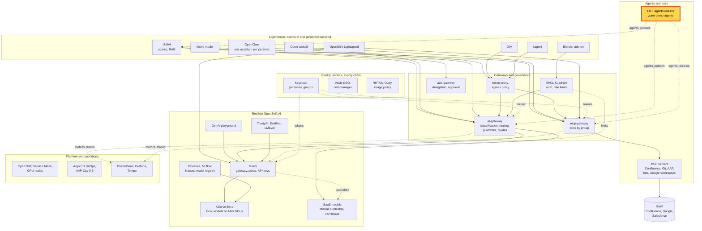
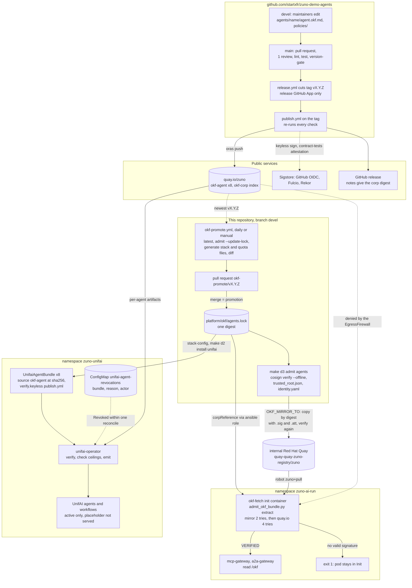

# Scenario: OKF agents release - agents signed in their own repository, admitted by digest

> **Status:** Not rehearsed in this format. Prerequisites checked read-only on demo333 on 2026-11-13:
> [`platform/okf/agents.lock`](../../../../platform/okf/agents.lock) pins release v0.14.3,
> `quay.io/zuno/okf-corp@sha256:2918e463...`, and `admit_okf_bundle.py latest` names the same release as the newest on
> `quay.io`; `make d3 admit agents`, run from the workstation (no cluster access), printed 13 warnings about knowledge
> domains that no UnifAI RAG source serves, then `RESULT: PASS - v0.14.3 (quay.io/zuno/okf-corp@sha256:2918e463...) is
> verified and servable.` in about 35 s; Deployments `mcp-gateway` and `a2a-gateway` in `zuno-ai-run` 2/2 Running, and
> the `okf-fetch` init container of each printed `VERIFIED
> quay-quay-zuno-registry.apps.demo333.startx.fr/zuno/okf-corp@sha256:2918e463...: release 0.14.3 (release), 8
> agent(s): advantage 0.2.1, arkos 0.2.2, cognos 0.2.1, comage 0.2.1, finage 0.2.2, naveo 0.1.1, soursage 0.1.0, tekos
> 0.5.0`; `OKF_MIRROR_PREFIX=quay-quay-zuno-registry.apps.demo333.startx.fr/zuno` on `okf-fetch`; the `zuno-ai-run`
> EgressFirewall allows that host, has no `quay.io` rule and ends with `Deny 0.0.0.0/0`; eight `UnifaiAgentBundle`s in
> `zuno-unifai`, all `Verified=True` (`SignatureValid`), `arkos`, `comage` and `tekos` `Ready`, the five others
> `Pending` (`PlaceholderNotServed`); ConfigMap `unifai-agent-revocations` key `revoked` is `[]`; `unifai-operator.v0.1.69`;
> `QuayRegistry` `quay` available, its application pod with 20 restarts. **paas-ops-01** had still not signed in to
> OpenShift (no `User` object): the checks ran as `kube:admin`.
> **Show-ready ([ADR-0606](../../../adr/0606-admit-new-experiences-with-a-definition-of-done-and-a-wip-limit.md)):** no
> golden-path probe. Rehearse it before showing it to an audience.
> **Personas:** see [Personas](#personas).
> **Used in workshops:** [Trusted platform and operations](../../workshops/trusted-platform-ops.md),
> [Agentic AI](../../workshops/agentic-ai.md).

## Introduction

The agents of Zuno are not written in this repository. Their sheets (purpose, tasks, tools, data classification) and
the company policies live in their own repository, `startxfr/zuno-demo-agents`, kept by its maintainers. A release tag
there publishes one OCI artifact per agent and one index artifact, `okf-corp`, all signed keyless by the release
workflow. The platform runs exactly one release, pinned by digest in one file and moved by pull request. Every component
that reads it verifies the signature first, offline, and refuses to start if it fails. Where the release sits in the
platform: see [Appendix A](#appendix-a---hld). The chain from the tag to a running pod: see
[Appendix B](#appendix-b---lld).

**The message:** "Agents run only from a signed release, owned by the business, chosen by digest and reviewed like code.
If the signature does not verify, the component does not start."

**Decisions:**
- [ADR-0576](../../../adr/0576-extract-agent-definitions-and-corp-policies-into-the-zuno-demo-agents-repository.md):
  agent definitions and corp policies live in `zuno-demo-agents`.
- [ADR-0577](../../../adr/0577-publish-okf-as-per-agent-artifacts-plus-a-corp-index-artifact.md): one artifact per
  agent, plus a corp artifact that indexes them.
- [ADR-0578](../../../adr/0578-sign-okf-artifacts-keyless-with-github-oidc-and-verify-them-offline-by-identity.md):
  signed keyless with GitHub OIDC by `publish.yml` on a `v*` tag; verified offline by that identity against a trust
  root committed here.
- [ADR-0580](../../../adr/0580-consume-the-corp-okf-bundle-by-a-single-digest-pin-promoted-by-pull-request.md): one
  digest in `platform/okf/agents.lock`, moved by a promotion pull request.
- [ADR-0564](../../../adr/0564-deliver-okf-bundles-to-unifai-operator-as-signed-oci-artifacts.md): UnifAI's operator
  receives each agent as a signed OCI artifact and verifies it before it creates anything.
- [ADR-0611](../../../adr/0611-mirror-the-admitted-okf-release-into-the-internal-registry.md) and
  [ADR-0612](../../../adr/0612-serve-every-zuno-image-from-an-internal-red-hat-quay-backed-by-an-s3-bucket.md): the
  admitted release is copied to the internal Red Hat Quay and read from there; the verification does not change.
- [ADR-0584](../../../adr/0584-define-agent-lifecycle-states-roles-and-incident-revocation.md): lifecycle states
  (`placeholder`, `active`, `deprecated`, `retired`) and incident revocation within one hour.

## Personas

The personas are fictional role accounts of the Keycloak realm `zuno`
([ADR-0349](../../../adr/0349-restructure-demo-personas-cluster-access-groups-and-new-agents.md)). They share one
password, kept in Vault at `keycloak/demo-personas`. The [catalogue](../../README.md#personas) lists all of them.

| Persona | Profile | What it can do here | Role in this demo |
|---|---|---|---|
| **paas-ops-01** | Platform operator, back office. Groups `ocp-paas-ops` (cluster-admin), `agent_tekos`, `aap_admin`, `openwebui_admin`. | Reads the gateway Deployments and their `okf-fetch` logs in `zuno-ai-run`, the `UnifaiAgentBundle`s and the revocation ConfigMap in `zuno-unifai`. Changes nothing. | The presenter's `oc` terminal in both versions. |
| **ai-ops-01** | AI platform operator, back office. Group `ocp-ai-ops` (admin on the Zuno namespaces). | `spec.owner` of every `UnifaiAgentBundle`: the UnifAI user that owns the agents the operator creates. | Named only. Not signed in. |
| **consultant-02** | Consultant and architect, front office. Groups `consultant`, `agent_tekos`, `agent_arkos`. | Uses Arkos and Tekos in UnifAI: the agents of this release. | Named only: the user whose agents come from this release. Not signed in. |

Other identities:
- **The agents repository maintainers.** A role, not a persona. They merge `devel` into `main` in `zuno-demo-agents`
  (one review, green checks). A release GitHub App then cuts the `v*` tag, and `publish.yml` signs. Nobody holds a
  signing key.
- **The signing identity**: `https://github.com/startxfr/zuno-demo-agents/.github/workflows/publish.yml@refs/tags/v...`,
  issued by `https://token.actions.githubusercontent.com`. It is written once, in
  [`platform/okf/sigstore/identity.yaml`](../../../../platform/okf/sigstore/identity.yaml).
- **The `okf-promote` workflow** of this repository opens the promotion pull request. A maintainer of this repository
  merges it.
- **The Quay robots**: `zuno+pull` (read only) is the `okf-fetch` pull credential, from Vault `zuno/registry/quay-pull`;
  `zuno+push` fills the mirror, from Vault `zuno/registry/quay-robots`.
- **The presenter's `oc` session**: **paas-ops-01**, which must have signed in to OpenShift once.

## Before you start

- [ ] **paas-ops-01** has signed in once to the OpenShift console (on 2026-11-13 it had not). Then log a terminal in with
  `oc` as **paas-ops-01**, at the repository root, large font.
- [ ] In that terminal, `echo "$OKF_MIRROR_TO"` prints an empty line. With that variable set, `make d3 admit agents`
  also writes to the internal Quay.
- [ ] Re-read the lock: `tail -2 platform/okf/agents.lock`. The digest and the release number of this page were read on
  2026-11-13; use what the file says on the day.
- [ ] Check the gateways: `oc get pods -n zuno-ai-run | grep -e mcp-gateway -e a2a-gateway` shows both `2/2 Running`.
- [ ] Check the internal Quay: `oc get quayregistry -n zuno-registry` shows `AVAILABLE True`. If a gateway pod restarts
  while Quay is down, it stays in `Init`.
- [ ] A browser tab on [agents/arkos/agent.okf.md](https://github.com/startxfr/zuno-demo-agents/blob/main/agents/arkos/agent.okf.md),
  and one on the agents [releases](https://github.com/startxfr/zuno-demo-agents/releases).
- [ ] 15-minute version: `cosign` v2 and `oras` on the presenter's `PATH`, and `quay.io` reachable from the
  workstation. Run `make d3 admit agents` once before the session (about 35 s).
- [ ] Known on screen, not a failure: `make d3 admit agents` prints 13 lines starting with `!`. They are knowledge
  domains (`knowledge.project`, `knowledge.adv`, `knowledge.sales`) that no UnifAI RAG source serves yet. They are
  warnings; the result is `PASS`.
- [ ] Known on screen, not a failure: five of the eight `UnifaiAgentBundle`s are `Pending`. Those agents are
  `placeholder` in the release, so they are verified and not served.
- [ ] No golden-path probe covers this page. `ONLY=unifai-tekos make demo golden-path` proves that Tekos, from this
  release, answers in UnifAI ([golden-path.md](../../golden-path.md)).

## 5-minute version

| Time | Do | Say | You should see |
|---|---|---|---|
| 0:00 | Open [agents/arkos/agent.okf.md](https://github.com/startxfr/zuno-demo-agents/blob/main/agents/arkos/agent.okf.md) | "Agents are declared by their owners in their own repository: purpose, tasks, tools, data classification. The platform team does not write them." | The OKF sheet of Arkos, with its tasks, its tools and `preferred_classification: C3`. |
| 1:15 | `tail -2 platform/okf/agents.lock` | "The platform runs exactly one agents release, pinned by its digest. Changing it is a pull request, reviewed like code." | `# release v0.14.3` and `quay.io/zuno/okf-corp@sha256:2918e463...` |
| 2:15 | `oc logs deploy/mcp-gateway -c okf-fetch -n zuno-ai-run \| grep VERIFIED` | "Before the tool gateway starts, a small container downloads that release and checks its signature: it must come from the release workflow of the agents repository, on a release tag. If it does not verify, the gateway does not start." | `VERIFIED quay-quay-zuno-registry.apps.demo333.startx.fr/zuno/okf-corp@sha256:2918e463...: release 0.14.3 (release), 8 agent(s): advantage 0.2.1, arkos 0.2.2, ...` |
| 3:30 | Point at the start of the reference | "It reads the release from our own registry, not from the internet. Same digest, same signature check." | The reference starts with `quay-quay-zuno-registry.apps.demo333.startx.fr`, not `quay.io`. |
| 4:15 | Close | "Agents run only from a signed release, owned by the business, chosen by digest and reviewed like code. If the signature does not verify, the component does not start." | |

## 15-minute version

Run the 5-minute version, then:

| Time | Do | Say | You should see |
|---|---|---|---|
| 5:00 | `oc get deploy mcp-gateway -n zuno-ai-run -o jsonpath='{range .spec.template.spec.initContainers[?(@.name=="okf-fetch")].env[*]}{.name}={.value}{"\n"}{end}'` | "Two sources: our registry first, then the original one. The digest is the same in both, and the signature covers the digest. The registry is only transport: it cannot change what the pod accepts." | `OKF_REFERENCE=quay.io/zuno/okf-corp@sha256:2918e463...`, `OKF_MIRROR_PREFIX=quay-quay-zuno-registry.apps.demo333.startx.fr/zuno`, `OKF_MIRROR_REFERENCE=...`, `DOCKER_CONFIG=/quay-pull`. |
| 6:00 | `make d3 admit agents` | "The same check runs on my laptop, offline, against the Sigstore trust root committed in this repository. It checks the signature of every artifact, the attestation that the agents repository's tests passed, and whether this platform can serve what the release asks for: models, tools, knowledge." | 13 `!` warnings, then `RESULT: PASS - v0.14.3 (quay.io/zuno/okf-corp@sha256:2918e463...) is verified and servable.` |
| 7:30 | Open [`platform/okf/sigstore/identity.yaml`](../../../../platform/okf/sigstore/identity.yaml) | "We trust an identity, not a key: this workflow of this repository, on a release tag, as GitHub vouches for it. A development build is signed by another workflow, so it is refused as a release." | `issuer: https://token.actions.githubusercontent.com`, `release_subject_regexp: '^https://github\.com/startxfr/zuno-demo-agents/\.github/workflows/publish\.yml@refs/tags/v'`. |
| 8:30 | `git log --format='%h %ad %s' --date=short -4 -- platform/okf/agents.lock`, then `git log --oneline -3 --grep 'okf-promote/'` | "Every agents release that ran here is one commit on this file. Each morning a workflow looks for a newer release, verifies it, and opens a pull request that says what changes. Merging it is the promotion." | `2c6b3a75 2026-11-07 feat(okf): promote agents release v0.14.3 ...`, `a09fa373 2026-11-06 okf: promote zuno-demo-agents v0.14.2`, ...; then `Merge pull request #37 from startxfr/okf-promote/v0.14.2` and two more. |
| 10:00 | `oc get unifaiagentbundle -n zuno-unifai` | "UnifAI's operator gets each agent as its own artifact and verifies it again, by the same identity, before it creates anything. An agent marked `placeholder` in the release is verified, not served." | 8 bundles, `VERIFIED` `true` for all; `arkos`, `comage`, `tekos` `Ready`; the five others `Pending`. |
| 11:00 | `oc get unifaiagentbundle arkos -n zuno-unifai -o jsonpath='{.spec.source.oci.reference}{"\n"}{.spec.verify.keyless.subjectRegExp}{"\n"}'` | "One agent, one digest, one expected signer." | `quay.io/zuno/okf-arkos@sha256:c9cfa572...` and the `publish.yml@refs/tags/v` expression. |
| 12:00 | `oc get configmap unifai-agent-revocations -n zuno-unifai -o jsonpath='{.data.revoked}{"\n"}'`, then open the [revocation runbook](../../../platform/agent-revocation-runbook.md) | "If an agent misbehaves, we do not wait for a release. One entry in this list, with the agent, the reason and who approved, and the operator withdraws it at its next reconcile, with an audit event. We rehearsed it on 2026-11-11 on Comage: about five minutes end to end. The proper fix then goes through a new release." | `[]`: nothing is revoked. |
| 13:30 | One sentence on the states | "An agent is `placeholder`, `active`, `deprecated` or `retired`. The state is in the agent's sheet, so it changes only through a release." | |
| 14:15 | Close | Repeat the message. | |

## If something goes wrong

| Symptom | Fallback | Say |
|---|---|---|
| A gateway pod is `Init:Error` or `Init:CrashLoopBackOff` | Show it: `oc get pods -n zuno-ai-run \| grep -e mcp-gateway -e a2a-gateway`. Check Quay: `oc get quayregistry -n zuno-registry`. Do not restart anything on stage. | "This is the rule at work: no verified release, no gateway. Here our registry is down, and this namespace may not reach the internet." |
| The `okf-fetch` log has no `VERIFIED` line, or also says `falling back to the source registry` | Use `a2a-gateway` instead: `oc logs deploy/a2a-gateway -c okf-fetch -n zuno-ai-run \| grep VERIFIED`. | |
| The `VERIFIED` line names `quay.io/zuno/okf-corp` | Say what it means: the mirror did not answer and the pod read the original registry, which `zuno-ai-run` should not reach since 2026-11-12. Report it after the session. | "Same digest, same check, but not the path we intended." |
| The lock names a newer release than the log | A promotion was merged and the gateways have not been rolled yet: they move at the next `make d2 install mcp`. Show both lines. | "The pin moves first; the pods follow at the next roll." |
| `make d3 admit agents` says `cosign not found on PATH` or `oras not found on PATH`, or hangs | Stop it (Ctrl-C). Show the gateways' `VERIFIED` lines: they are the same check. | |
| `make d3 admit agents` prints `RESULT: FAIL` | Stop the step and say so. This is a real defect; do not improvise. | "The check caught it before you did: this is what it is for." |
| `oc` answers `Forbidden` | **paas-ops-01** has not signed in to OpenShift, so its group does not exist yet. Sign it in before the session. | |

## Limits

- **The scenario shows verification, not a release.** Cutting an agents release is the agents repository maintainers'
  work (merge to `main`, then the release bot and `publish.yml`). Promoting it is a pull request here. Neither is run on
  stage. These commands change the lock or the registry; they are rehearsal only, with the owner's go:
  `make d3 admit agents RELEASE=vX.Y.Z UPDATE_LOCK=1`, and
  `OKF_MIRROR_TO=quay-quay-zuno-registry.apps.demo333.startx.fr/zuno OKF_MIRROR_QUAY=1 make d3 admit agents`.
- **The internal Quay is on the gateways' start path.** `zuno-ai-run` denies `quay.io` since 2026-11-12, so the
  `quay.io` fallback of `okf-fetch` cannot work there. On 2026-11-12 a node drain kept Quay down for more than an hour,
  and restarting gateways stayed in `Init:Error` until it was back
  ([WP-248](../../../roadmap/work-packages/wp-248-replace-the-okf-mirror-with-an-internal-quay-for-every-zuno-image.md#incident-of-the-zot-removal-removing-an-idms-source-drains-the-nodes-2026-11-12)).
  The Quay application pod had 20 restarts on 2026-11-13: its liveness probe kills a slow start.
- **UnifAI's operator still reads the agent artifacts from `quay.io`.** The bundle references name
  `quay.io/zuno/okf-<agent>`. Only the two gateways read the internal Quay.
- **Not every consumer reads the release at start.** The ai-gateway and mlops images bake it at build time, verified the
  same way; a promotion reaches them only after a rebuild. The routing, floors and quota files are generated from the
  release at promotion and committed.
- **What is verified is who signed and what was tested,** not the quality of the content. Schema, policy and contract
  tests run in the agents repository's CI; admission checks their attestation.
- **The trust root is a committed file.** `platform/okf/sigstore/trusted_root.json` is refreshed through Sigstore TUF and
  reviewed like any pin. A stale root would refuse new releases.
- **A compromised signing identity** is not a revocation entry: the trust policy changes, then a release signed by the
  new identity is promoted (see the [runbook](../../../platform/agent-revocation-runbook.md#a-compromised-signing-identity)).
- **Revocation was rehearsed once**, on operator 0.1.68. The fix that keeps the agent's team (operator 0.1.69, pinned on
  2026-11-12) was not re-run live.
- **No golden-path probe** checks the release chain. The `unifai-tekos` probe only proves that one agent of the release
  answers.

## Appendix A - HLD

Where the agents release sits in Zuno. The highlighted box is the subject of this page. Plain arrows carry requests,
dotted arrows carry identity, policy or telemetry.

## Appendix B - LLD

From a release tag in the agents repository to a verified release in a pod. Drawn from the agents repository's
[RELEASING.md](https://github.com/startxfr/zuno-demo-agents/blob/main/RELEASING.md) and
[`.github/workflows/publish.yml`](https://github.com/startxfr/zuno-demo-agents/blob/main/.github/workflows/publish.yml),
and in this repository from `.github/workflows/okf-promote.yml`, `platform/supply-chain/admit_okf_bundle.py` (`verify`,
`extract`, `mirror`, `prune`, `admit`), `platform/okf/sigstore/identity.yaml`, the `admit` verb of the `Makefile`,
`gitops/charts/mcp-gateway/templates/deployment.yaml` (init container `okf-fetch`), `ansible/clusters/demo333.yml`
(`zuno_okf_registry_mirror`), [the revocation runbook](../../../platform/agent-revocation-runbook.md), and the live
`UnifaiAgentBundle` objects of `zuno-unifai`.

