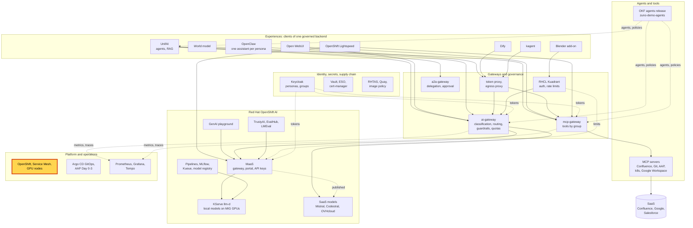
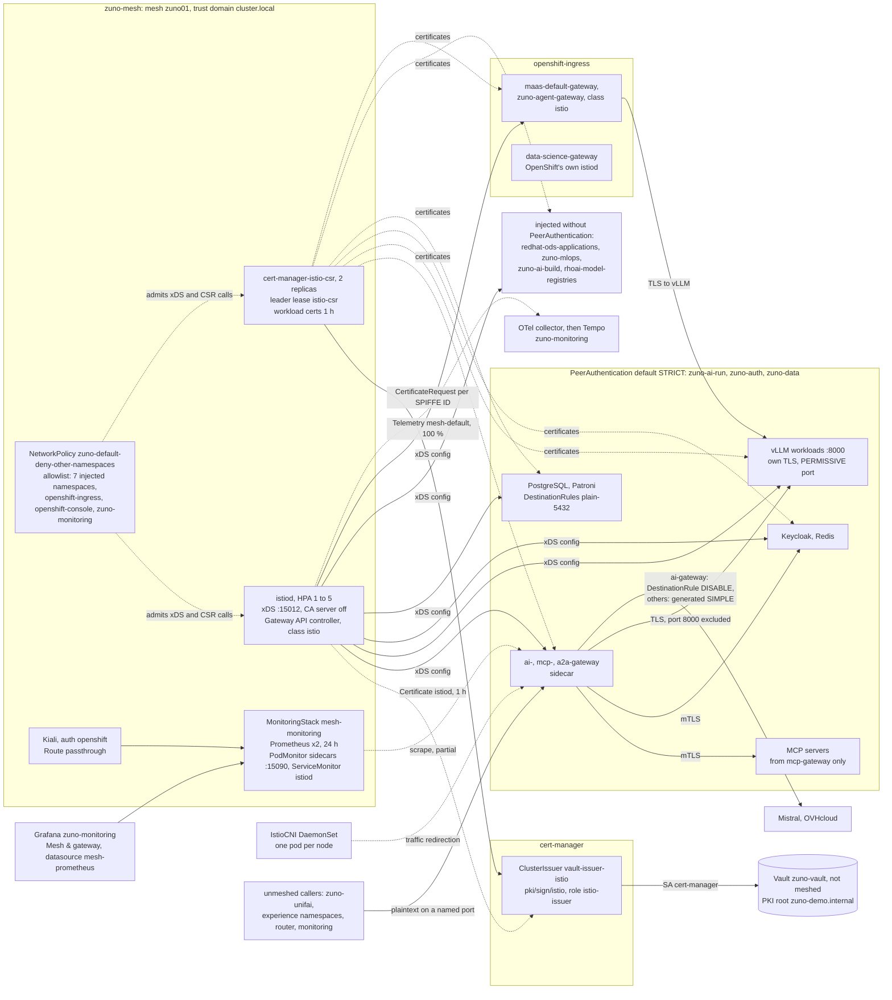

# Scenario: Service mesh - mutual TLS, workload identity and the Kiali graph

> **Status:** Not rehearsed in this format. Prerequisites checked read-only on demo333 on 2026-11-13 (00:10 to 00:30
> UTC): Applications `zuno-service-mesh-d0`/`-d1`, `zuno-kiali-d0`/`-d1`, `zuno-mesh-monitoring-d0`/`-d1`,
> `zuno-grafana-d0`/`-d1` and `zuno-namespaces-d0`/`-d1` Synced and Healthy. Operator `servicemeshoperator3.v3.5.0`;
> `Istio` `default` Healthy (Istio 1.30.3, one revision); `IstioCNI` Healthy on all 7 nodes; `istiod` 1/1 (HPA 1 to 5);
> `cert-manager-istio-csr` 2/2, both pods still signing (`CertificateIssued` events) but restarting: 20 and 10 restarts
> (exit 1) since the master cordon of 2026-11-12, the last at 00:24Z, while the `etcd` ClusterOperator had changed
> state at about 23:38Z. Certificate `istiod` Ready, one hour, from ClusterIssuer `vault-issuer-istio` (Ready). 71
> running pods carry a sidecar: `redhat-ods-applications` 32, `zuno-ai-run` 20, `zuno-data` 6, `zuno-mlops` 5,
> `openshift-ingress` 4, `zuno-auth` 3, `rhoai-model-registries` 1. PeerAuthentication `default` `STRICT` in
> `zuno-ai-run`, `zuno-auth` and `zuno-data`, with 12 workload exceptions; no AuthorizationPolicy. Seven namespaces
> labelled `istio-injection=enabled`, all in the `zuno-mesh` allowlist (10 entries). Kiali CR `kiali` (operator
> v2.33.1) reconciled, `auth.strategy: openshift`, Route `kiali-zuno-mesh.apps.demo333.startx.fr` (passthrough);
> MonitoringStack `mesh-monitoring` (Prometheus 2/2); GrafanaDashboard `mesh-gateway` synchronized. Gateways
> `maas-default-gateway` and `zuno-agent-gateway` (class `istio`) Programmed; the MaaS gateway pod takes its
> configuration from `istiod.zuno-mesh.svc:15012`. **ai-ops-01** exists as an OpenShift user; **paas-ops-01** does
> not. Kiali and Grafana were not opened.
> **Show-ready ([ADR-0606](../../../adr/0606-admit-new-experiences-with-a-definition-of-done-and-a-wip-limit.md)):** no
> golden-path probe. Rehearse it before showing it to an audience.
> **Personas:** see [Personas](#personas).
> **Used in workshops:** [Trusted platform and operations](../../workshops/trusted-platform-ops.md).

## Introduction

Zuno runs Red Hat OpenShift Service Mesh 3 (the Sail operator, Istio 1.30.3) with one control plane in `zuno-mesh`
(see [Appendix A](#appendix-a---hld)). A sidecar next to each meshed pod encrypts its traffic and presents a workload
identity: a certificate for the pod's ServiceAccount, valid one hour. istiod's own CA is off. The certificates come
from Vault's PKI, through `cert-manager-istio-csr` and the ClusterIssuer `vault-issuer-istio`. The three namespaces
that hold the platform's data, identities and AI runtime refuse plaintext. Kiali and a Grafana dashboard read the
mesh's own Prometheus. How the parts connect is in [Appendix B](#appendix-b---lld).

| Part | On demo333 |
|---|---|
| Control plane | `Istio` `default` and `IstioCNI` in `zuno-mesh`; istiod with `ENABLE_CA_SERVER: "false"` |
| Certificate authority | `cert-manager-istio-csr` (2 replicas, one leader) asks Vault, through cert-manager, to sign each workload certificate: SPIFFE ID `spiffe://cluster.local/ns/<namespace>/sa/<serviceaccount>`, one hour |
| Meshed workloads | 7 namespaces labelled for injection, plus the gateway pods of `openshift-ingress`: 71 pods on 2026-11-13 |
| Mutual TLS enforced | `PeerAuthentication` `STRICT` in `zuno-ai-run`, `zuno-auth`, `zuno-data`; 12 PERMISSIVE ports, each naming its caller |
| Observability | Kiali, the mesh Prometheus (`MonitoringStack` `mesh-monitoring`, 24 h), the Grafana dashboard **Mesh & gateway**, traces to Tempo |
| Gateways | `maas-default-gateway` and `zuno-agent-gateway` (Kubernetes Gateway API, class `istio`), programmed by the same istiod |

**The message:** "Inside Zuno, the services that hold data, identities and models accept only mutual TLS, and each
proves who it is with a one-hour certificate from our own PKI."

**Decisions:**
- [ADR-0602](../../../adr/0602-harden-the-platform-trust-boundaries-before-a-customer-runs-it.md) clause 4:
  `STRICT` on `zuno-data`, `zuno-auth` and `zuno-ai-run` only, not mesh-wide; every exception is one workload's port
  with a `zuno.io/permissive-reason`; `platform/security/check_mesh_mtls.py` enforces both. No fine-grained
  AuthorizationPolicy (decision of 2026-11-06).
- [ADR-0037](../../../adr/0037-protect-mcp-servers-with-network-and-workload-identity-boundaries.md): MCP servers
  accept traffic only from the MCP gateway, enforced by NetworkPolicy and workload identity.
- [ADR-0603](../../../adr/0603-close-the-medium-severity-security-gaps-found-in-the-2026-11-06-review.md): M2
  (databases in the mesh with `DISABLE` rules) and M7 (one PKI root, one ServiceAccount for all Vault issuers) are
  open, planned by
  [ADR-0613](../../../adr/0613-close-the-three-remaining-live-hardening-items-of-adr-0603-in-mid-december.md).
- [ADR-0201](../../../adr/0201-complete-the-openshift-ai-maas-governance-plane-integration.md): the MaaS gateway and
  its governance plane.
- [ADR-0413](../../../adr/0413-consolidate-grafana-dashboards-into-six-platform-views.md): the mesh and API-gateway
  dashboards merged into **Mesh & gateway**.

## Personas

The personas are fictional role accounts of the Keycloak realm `zuno`
([ADR-0349](../../../adr/0349-restructure-demo-personas-cluster-access-groups-and-new-agents.md)). They share one
password, kept in Vault at `keycloak/demo-personas`. The [catalogue](../../README.md#personas) lists all of them.

| Persona | Profile | What it can do here | Role in this demo |
|---|---|---|---|
| **ai-ops-01** | AI platform operator, back office. Group `ocp-ai-ops` (admin on 23 Zuno namespaces, `zuno-mesh`, `zuno-ai-run`, `zuno-auth`, `zuno-data` and `zuno-monitoring` included; not `openshift-ingress`), `agent_tekos`, `openwebui_admin`. | Signs in to Kiali with OpenShift; Kiali checks the user's own rights per namespace, so it shows the Zuno namespaces and not the gateways of `openshift-ingress`. Passes Grafana's gate (`get pods` in `zuno-monitoring`). | Opens Kiali (3:15, 5:00) and Grafana (6:30). |
| **paas-ops-01** | Platform operator, back office. Group `ocp-paas-ops` (cluster-admin), `agent_tekos`, `aap_admin`, `openwebui_admin`. | Reads every mesh object in every namespace. In Kiali it would also see `openshift-ingress`. | The presenter's `oc` terminal in both versions. |

Other identities, none of which signs in on stage:
- Each meshed pod is a workload identity, `spiffe://cluster.local/ns/<namespace>/sa/<serviceaccount>`, for example
  `.../ns/openshift-ingress/sa/maas-default-gateway-istio` for the MaaS gateway.
- The ServiceAccount `cert-manager-istio-csr` creates the CertificateRequests. cert-manager signs them by logging in to
  Vault as its own ServiceAccount `cert-manager`, role `istio-issuer`.
- Kiali queries the cluster with the signed-in user's token. It has no RBAC of its own to maintain.

## Before you start

- [ ] **paas-ops-01** has signed in once to the OpenShift console: on 2026-11-13 it had no OpenShift user. Then log a
  terminal in with `oc` as **paas-ops-01**, large font, at the repository root.
- [ ] `oc get istio,istiocni,deploy -n zuno-mesh`: `Healthy` twice, every Deployment ready.
- [ ] `oc get pods -n zuno-mesh`: read the `RESTARTS` of `cert-manager-istio-csr`. On 2026-11-13 they were 20 and 10
  and still growing. If they grow in the hour before the session, see
  [If something goes wrong](#if-something-goes-wrong).
- [ ] Browser profile **ai-ops-01**: Kiali `https://kiali-zuno-mesh.apps.demo333.startx.fr`, **Log In With
  OpenShift**, then the identity provider `openshift` (Keycloak), not `startx-htpasswd_auth`. The Kiali sign-in as
  ai-ops-01 was not tried on 2026-11-13: do it the day before.
- [ ] Same profile: Grafana `https://grafana-route-zuno-monitoring.apps.demo333.startx.fr`, dashboard **Zuno Platform /
  Mesh & gateway**, last 1 hour, row **Mesh traffic & control plane** open.
- [ ] Create traffic in the hour before: `make demo golden-path` calls the gateways and the models
  ([golden-path.md](../../golden-path.md)).
- [ ] Known, not a failure: every sidecar logs a repeating SDS error about a missing `service-ca.crt`. It is benign
  and never wired to a real certificate
  ([ADR-0411](../../../adr/0411-trust-the-vault-pki-root-for-the-tekos-frontend-oidc-client.md) follow-ups,
  [WP-124](../../../roadmap/work-packages/wp-124-ai-gateway-external-saas-mesh-egress.md)). This page shows no logs.

## 5-minute version

| Time | Do | Say | You should see |
|---|---|---|---|
| 0:00 | Terminal: `oc get istio,istiocni,deploy -n zuno-mesh` | "Zuno runs Red Hat OpenShift Service Mesh 3: one Istio control plane. Each meshed pod gets a sidecar that encrypts its traffic and proves who it is. The certificates do not come from Istio: they come from our Vault." | `istio.sailoperator.io/default` `Healthy` `v1.30.3`; `istiocni.sailoperator.io/default` `Healthy`; `cert-manager-istio-csr` 2/2, `istiod` 1/1, `kiali` 1/1, `ossmconsole` 1/1. |
| 1:00 | `oc get peerauthentication -A` | "Three namespaces refuse plaintext: the databases, Keycloak, and the AI runtime with its gateways and models. A caller without a mesh certificate is turned away. Each exception opens one port of one workload, and must say who needs it." | `default` `STRICT` in `zuno-ai-run`, `zuno-auth` and `zuno-data`. Twelve exceptions without a mode, such as `ai-gateway-from-unmeshed-clients`, `keycloak-http-from-router`, `postgres-instance-exporter-and-patroni`: they keep `STRICT` except on their port. |
| 2:15 | `oc get certificaterequests -n zuno-mesh --sort-by=.metadata.creationTimestamp -o custom-columns='IDENTITY:.metadata.annotations.istio\.cert-manager\.io/identities,ISSUER:.spec.issuerRef.name,DURATION:.spec.duration' \| grep spiffe \| tail -5` | "Each service proves who it is with a certificate for its own ServiceAccount, valid one hour and signed by Vault. There is no password between services, and a stolen certificate is useless within the hour." | Five lines `spiffe://cluster.local/ns/<namespace>/sa/<serviceaccount>`, `vault-issuer-istio`, `1h0m0s`. The list shows the requests still kept in `zuno-mesh`, not one per pod. |
| 3:15 | Profile **ai-ops-01**: Kiali, **Overview** | "Kiali, the mesh console, reads the same configuration and the mesh's own metrics. It shows ai-ops-01 only the namespaces ai-ops-01 may read." | Not checked on 2026-11-13. Expected: one card per Zuno namespace, with an mTLS indicator on `zuno-ai-run`, `zuno-auth` and `zuno-data`. If the page does not match, stay on the terminal. |
| 4:15 | Close | "Inside Zuno, the services that hold data, identities and models accept only mutual TLS, and each proves who it is with a one-hour certificate from our own PKI." | |

## 15-minute version

Run the 5-minute version, then:

| Time | Do | Say | You should see |
|---|---|---|---|
| 5:00 | Kiali, **Traffic Graph**, namespaces `zuno-ai-run`, `zuno-auth`, `zuno-data`, last 1 hour, **Display**: **Security** | "The graph is drawn from what the sidecars report. A padlock on an edge means the calls on it used mutual TLS." | Not rehearsed. Expected: edges such as ai-gateway to the models and to Keycloak, with padlocks. On 2026-11-06 the mesh Prometheus scraped only 3 of about 30 sidecars ([WP-224 evidence](../../../roadmap/evidence/wp-224-live-rehearsal-2026-11-07.md), section 2), so expect few edges. |
| 6:30 | Grafana, **Mesh & gateway**, row **Mesh traffic & control plane**: panels **mTLS coverage (rate, by connection security policy)**, **Mesh requests (rate, by destination service/response code)**, **Mesh control plane health (istiod)** | "Grafana reads the same mesh Prometheus. The first panel splits requests by the security of the connection: mutual TLS or none." | Not rehearsed. Expected: a `mutual_tls` series and possibly `none` on the first panel. Same coverage caveat as 5:00. |
| 7:45 | `oc get ns -l istio-injection=enabled -o name`, then `oc get networkpolicy zuno-default-deny-other-namespaces -n zuno-mesh -o jsonpath='{range .spec.ingress[*].from[*]}{.namespaceSelector.matchLabels.kubernetes\.io/metadata\.name}{" "}{end}{"\n"}'` | "Injection is not membership. The label gives a namespace its sidecars. The sidecars can only fetch their certificate and configuration if `zuno-mesh` lets that namespace in. Forget the second list and the new pods hang at start, with an error that points at the wrong namespace. It happened several times; each entry in the list names its incident." | Seven namespaces: `redhat-ods-applications`, `rhoai-model-registries`, `zuno-ai-build`, `zuno-ai-run`, `zuno-auth`, `zuno-data`, `zuno-mlops`. Then the allowlist (after two empty entries, the router and host-network groups): those seven, plus `openshift-console`, `zuno-monitoring`, `openshift-ingress`. |
| 9:00 | `oc get certificate istiod -n zuno-mesh -o jsonpath='{.spec.issuerRef.name}{"  notAfter "}{.status.notAfter}{"  renewal "}{.status.renewalTime}{"\n"}'`, then `oc get clusterissuer vault-issuer-istio` | "istiod has no CA of its own here. Its serving certificate and every workload certificate come from Vault through cert-manager. If issuance stops, running pods keep their certificate until it expires, but no new meshed pod can start. During the Vault migration of 7 November, that lasted about 25 minutes." | `vault-issuer-istio`, `notAfter` within the hour, renewal 30 minutes earlier. `vault-issuer-istio` `READY True`. The [Vault and PKI scenario](./vault-pki.md) shows the issuer side. |
| 10:00 | `oc get gateway -n openshift-ingress -o custom-columns='NAME:.metadata.name,CLASS:.spec.gatewayClassName,PROGRAMMED:.status.conditions[?(@.type=="Programmed")].status'`, then `oc get pod -n openshift-ingress -l gateway.networking.k8s.io/gateway-name=maas-default-gateway -o jsonpath='{range .items[0].spec.containers[0].env[?(@.name=="PROXY_CONFIG")]}{.value}{"\n"}{end}'` | "The MaaS gateway, the door to our models, is an Istio gateway declared with the Kubernetes Gateway API. The same control plane programs it, and its identity comes from the same CA." | `maas-default-gateway` and `zuno-agent-gateway`, class `istio`, `True`; `data-science-gateway` on OpenShift's own class. Then `{"discoveryAddress":"istiod.zuno-mesh.svc:15012","meshId":"zuno01"}`. The [MaaS scenario](../rhoai/maas-portal-api-keys.md) uses this gateway. |
| 11:15 | `oc get peerauthentication vllm-workloads-own-tls -n zuno-ai-run -o jsonpath='{.metadata.annotations.zuno\.io/permissive-reason}{"\n"}'` | "An exception has to say who needs it. vLLM serves its own TLS, and its callers send that TLS rather than Istio's. A check in the build fails any exception without a reason, and any PeerAuthentication outside the three namespaces." | One sentence that names the callers of port 8000: the MaaS gateway, the ai-gateway, OpenShift Lightspeed and the OpenShift and RHOAI monitoring scrapes, which "send TLS, never Istio mTLS". |
| 12:15 | `oc get destinationrule -n zuno-ai-run -o custom-columns='NAME:.metadata.name,HOST:.spec.host,TLS:.spec.trafficPolicy.tls.mode,ONLY_FOR:.spec.workloadSelector.matchLabels' \| grep -E 'NAME\|mistral\|ovhcloud'` | "A mesh can also break things quietly. OpenShift AI generates a rule telling every sidecar to wrap TLS around calls to Mistral and OVHcloud. The ai-gateway already speaks TLS, so its calls were wrapped twice. Until 3 September they all failed, and every request fell back to a local model with no alert. Our rule turns the wrapping off for the ai-gateway only." | `mistral-large` and `gpt-oss-120b-ovhcloud`: `SIMPLE`, no selector (generated). `mistral-large-plaintext` and `gpt-oss-120b-ovhcloud-plaintext`: `DISABLE`, only for `app.kubernetes.io/name:ai-gateway`. See [external models](../rhoai/external-models.md). |
| 13:30 | Say only | "Two lessons from running it. A TCP connect from a meshed pod always succeeds, because the sidecar answers locally: only a real TLS or HTTP request proves a firewall rule. And the mesh depends on the API server. When etcd is slow, for example on a master short of disk, the CA's leader loses its lease and restarts, and new pods wait for their certificate. Running pods keep working while their current certificate lasts." | |
| 14:15 | Close | Repeat the message. | |

## If something goes wrong

| Symptom | Fallback | Say |
|---|---|---|
| `cert-manager-istio-csr` restarts keep growing, or a new meshed pod stays in `Init` | Do not restart anything on stage. Read `oc get lease istio-csr -n zuno-mesh -o jsonpath='{.spec.holderIdentity}{"  renewed "}{.spec.renewTime}{"\n"}'` (a renewal within seconds means a leader is signing), then `oc get nodes` for `DiskPressure` and `oc get clusteroperator etcd`. After the session, the owner looks at the API server and etcd latency first, not at the mesh. | "Running pods keep their certificate for up to an hour. Only new pods wait." |
| The pods of one namespace hang at start with `dial tcp ...:443: i/o timeout` (istio-csr) or `...:15012: i/o timeout` (istiod) | The namespace is labelled for injection but missing from the `zuno-mesh` allowlist. Show 7:45. The fix is one line in `gitops/charts/namespaces/values.yaml`, after the session. | "The label gave it sidecars; the allowlist did not let them in." |
| The Kiali graph is empty or shows few edges | Widen to 3 hours. Then show the PeerAuthentications (1:00) instead: the policy is the proof, the graph is an illustration. | "The graph only shows what our mesh Prometheus scrapes, and today that is a small part of the sidecars." |
| Kiali does not sign in, or shows no namespace | Check the profile and the provider (`openshift`). Otherwise stay on the terminal. | |
| Grafana mesh panels show "No data" | Same cause as an empty graph. **Mesh control plane health (istiod)** is scraped inside `zuno-mesh`; show it if it has data. | |
| A direct HTTPS call to Mistral or OVHcloud from a pod other than the ai-gateway gets "connection reset" | That is the generated `SIMPLE` rule (12:15), not an outage. Test through the ai-gateway. | |
| `forbidden` on cluster-scoped objects or `-A` | The terminal is not **paas-ops-01**. As **ai-ops-01**, run the steps in `zuno-mesh` and `zuno-ai-run` (`oc get deploy -n zuno-mesh`, `oc get peerauthentication -n zuno-ai-run`, 2:15, 7:45 second command, 9:00 first command, 11:15, 12:15). Skip 10:00. | |

## Limits

- **Mutual TLS is enforced in three namespaces only.** `redhat-ods-applications` and the other injected namespaces
  have no PeerAuthentication: they are vendor-managed or carry no secret data (ADR-0602 clause 4). The unmeshed
  namespaces (`zuno-unifai`, the experiences, the router, monitoring) reach meshed pods on the 12 named PERMISSIVE
  ports. `zuno-vault` is deliberately not meshed: its PKI signs the mesh's certificates.
- **Identity is presented, not checked per call.** There is no AuthorizationPolicy: no service checks the caller's
  SPIFFE ID. NetworkPolicy decides who may connect (decision of 2026-11-06).
- **The databases are in the mesh without Istio TLS on 5432.** The `zuno-postgresql-*-plain-5432` DestinationRules
  turn mesh TLS off for PostgreSQL; database-native `verify-full` is planned
  ([WP-253](../../../roadmap/work-packages/wp-253-verify-full-database-transport-for-every-client.md), ADR-0603 M2).
- **The graph and the mesh panels see few sidecars.** The mesh Prometheus scrapes the sidecars on their metrics port,
  and the NetworkPolicies of `zuno-ai-run`, `zuno-auth` and `zuno-data` do not admit `zuno-mesh`. Measured on
  2026-11-06: 3 of about 30 sidecars. On 2026-11-13 no NetworkPolicy of those namespaces named `zuno-mesh`; the
  Prometheus targets were not read.
- **One PKI root, no intermediate.** The mesh and the application certificates chain to the same 10-year root in
  Vault, and one ServiceAccount signs for every Vault issuer (ADR-0603 M7,
  [WP-254](../../../roadmap/work-packages/wp-254-intermediate-ca-and-separate-istio-service-account.md)).
- **The mesh CA depends on the API server.** istio-csr keeps its leader lease through the API server
  (`leaderElectionNamespace: zuno-mesh`). When the API server or etcd is slow, for example a master short of disk or a
  slow etcd member, the leader loses the lease and restarts. The `istio-csr` lease had changed holder 171 times by
  2026-11-13, and both pods restarted 30 times in the three hours after the 2026-11-12 cordon; their logs were not
  read. istiod runs one replica (HPA up to 5); on 2026-11-08 a canary load made it restart within two minutes
  ([demo day](../../demo-day-2026-11-09.md)).
- **Kiali shows what the signed-in user may read.** ai-ops-01 does not see `openshift-ingress`, so the MaaS gateway
  is missing from its graph.
- **`data-science-gateway` is not in this mesh.** It belongs to OpenShift's own Gateway API controller
  (`istiod-openshift-gateway` in `openshift-ingress`).
- **Traces are sampled at 100 %** (`Telemetry` `mesh-default`), right for a demo's volume, not for production; see
  [Observability and traces](./observability-trace.md).

## Appendix A - HLD

Where the service mesh sits in Zuno. The highlighted box is the subject of this page. Plain arrows carry requests,
dotted arrows carry identity, policy or telemetry.

## Appendix B - LLD

The control plane, the certificate path, where mutual TLS is enforced, and where the telemetry goes. Drawn from
`gitops/charts/service-mesh/` (`values.yaml`, `templates/istio.yaml`, `istiocni.yaml`, `clusterissuer-istio.yaml`,
`telemetry.yaml`), `gitops/charts/namespaces/` (the `zuno-mesh` entry of `values.yaml`,
`templates/peerauthentication-namespace.yaml`), `gitops/charts/kiali/templates/kiali.yaml`,
`gitops/charts/mesh-monitoring/templates/` (`monitoringstack.yaml`, `podmonitor-istio-proxy.yaml`,
`servicemonitor-istiod.yaml`), `gitops/charts/grafana/templates/dashboard-mesh-gateway.yaml`,
`gitops/charts/models/templates/destinationrule-external-model-plaintext.yaml`, `platform/security/check_mesh_mtls.py`,
the [WP-224 evidence](../../../roadmap/evidence/wp-224-live-rehearsal-2026-11-07.md), and the live objects listed in
the status banner.

