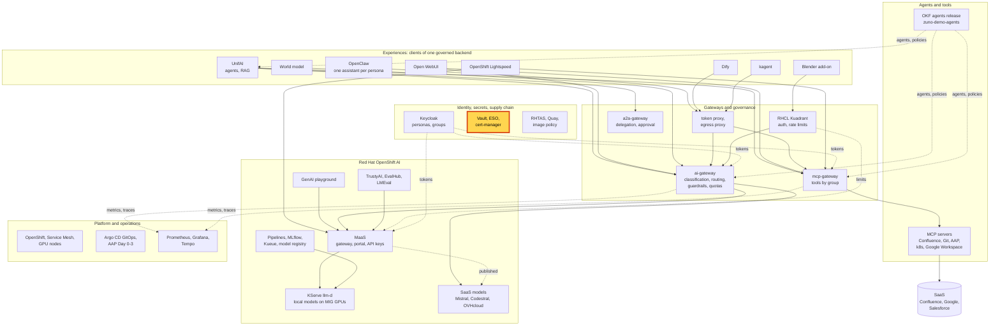
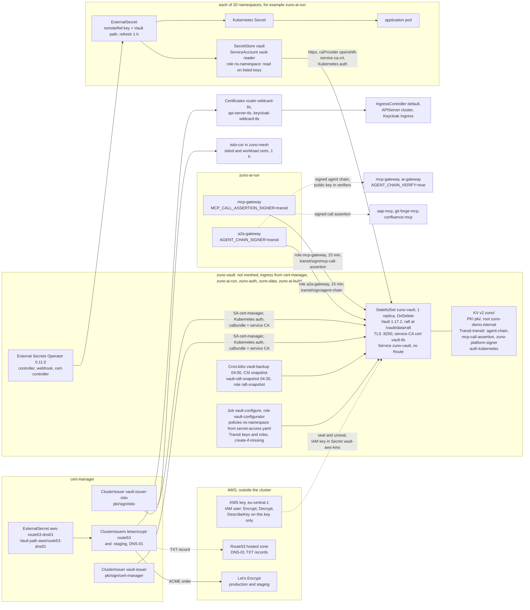

# Scenario: Vault and PKI - secrets and certificates without static credentials

> **Status:** Not rehearsed in this format. Prerequisites checked read-only on demo333 on 2026-11-13 (about 00:20 UTC):
> Applications `zuno-vault-d0`/`-d1`, `zuno-external-secrets-d0`/`-d1` and `zuno-cert-manager-d0`/`-d1` Synced and
> Healthy. Pod `zuno-vault-0` 1/1 Running, Vault 1.17.2, labels `vault-sealed=false`, `vault-active=true`,
> `vault-initialized=true`. The pod was recreated at 21:27:55Z on 2026-11-12, during the master cordon, and came back
> unsealed with no human step: four readiness-probe timeouts between 21:35Z and 22:38Z, Ready since 22:38Z. Its rendered
> configuration has `storage "raft"`, `seal "awskms"` (region eu-central-1) and a TLS listener. No Route in
> `zuno-vault`. CronJobs `vault-backup` and `vault-raft-snapshot` last ran 20 h and 19 h earlier (Complete); seven
> daily VolumeSnapshots plus `vault-pre-kms-raft-20261107092607`. 97 ExternalSecrets in 19 namespaces, all
> `SecretSynced`: 95 on a namespace `SecretStore` `vault`, 2 generator-only. 20 SecretStores `vault`, all Valid and
> Ready; no ClusterSecretStore. ClusterIssuers `letsencrypt-route53`, `letsencrypt-route53-staging`, `vault-issuer`
> and `vault-issuer-istio` Ready. Certificates `router-wildcard-tls`, `api-server-tls` and `keycloak-wildcard-tls`
> (Let's Encrypt) Ready until 2027-02-04; `istiod` (one hour, `vault-issuer-istio`) Ready. The `a2a-gateway` runs
> `AGENT_CHAIN_SIGNER=transit` (key `agent-chain`) and the `mcp-gateway` `MCP_CALL_ASSERTION_SIGNER=transit` (key
> `mcp-call-assertion`); the Secrets `a2a-gateway-agent-chain` and `mcp-gateway-call-assertion` do not exist.
> **paas-ops-01** had not signed in to OpenShift (no user `paas-ops-01`).
> **Show-ready ([ADR-0606](../../../adr/0606-admit-new-experiences-with-a-definition-of-done-and-a-wip-limit.md)):** no
> golden-path probe. Rehearse it before showing it to an audience.
> **Personas:** see [Personas](#personas).
> **Used in workshops:** [Trusted platform and operations](../../workshops/trusted-platform-ops.md).

## Introduction

Every credential of Zuno lives in one HashiCorp Vault, in the namespace `zuno-vault` (see
[Appendix A](#appendix-a---hld)). No manifest in Git carries a credential. The External Secrets Operator copies into
each namespace only the keys that namespace may read. cert-manager issues the certificates: Let's Encrypt for what a
browser sees, Vault's own PKI for the service mesh. Since 2026-11-07, Vault seals with an AWS KMS key the cluster does
not hold, keeps its data in Raft and serves TLS. Vault Transit signs for two gateways without giving them the key. How
the parts connect is in [Appendix B](#appendix-b---lld).

| Part | What it does on demo333 |
|---|---|
| Vault `zuno-vault` | Raft storage, AWS KMS auto-unseal, TLS listener with an OpenShift service-CA certificate. Engines: KV `zuno/`, PKI `pki/`, Transit `transit/`, Kubernetes auth |
| External Secrets Operator | 97 ExternalSecrets, 20 SecretStores `vault` (one per namespace), refreshed every hour |
| cert-manager | Let's Encrypt (DNS-01 on Route53) for the router, the API server and Keycloak; Vault PKI for istiod and every mesh workload |
| Vault Transit | Signs the agent chain of the a2a-gateway (key `agent-chain`) and the tool-call assertion of the mcp-gateway (key `mcp-call-assertion`) |

**The message:** "Vault holds every credential and gives each namespace only its own. It unseals itself with a key the
cluster does not hold, and its signing keys never leave it."

**Decisions:**
- [ADR-0024](../../../adr/0024-use-vault-for-application-secrets.md): credentials stay out of Git; workloads read them
  through the External Secrets Operator. Its text still names one `ClusterSecretStore` and an unseal Secret; ADR-0602
  replaced both.
- [ADR-0602](../../../adr/0602-harden-the-platform-trust-boundaries-before-a-customer-runs-it.md):
  - clause 1: AWS KMS auto-unseal, Raft, TLS, the root token revoked after bootstrap, the UI Route off;
  - clause 2: one `SecretStore` per namespace, each reading only the keys listed in `platform/vault/secret-access.yaml`;
  - clauses 3 and 12: the `demo` and `hardened` security profiles.
- [ADR-0603](../../../adr/0603-close-the-medium-severity-security-gaps-found-in-the-2026-11-06-review.md): M7 (the PKI
  root, open, [ADR-0613](../../../adr/0613-close-the-three-remaining-live-hardening-items-of-adr-0603-in-mid-december.md)),
  M8 (the Vault UI Route, closed), M9 (credentials out of command strings, closed), M14 (Transit signing, closed).
- [ADR-0211](../../../adr/0211-publicly-trusted-wildcard-tls-via-lets-encrypt-and-route53.md): Let's Encrypt
  wildcard and API certificates through Route53 DNS-01, staging first.
- [ADR-0316](../../../adr/0316-keycloak-route-tls-via-cert-manager.md): Keycloak's Route gets its certificate from
  cert-manager.
- [ADR-0345](../../../adr/0345-make-self-generated-vault-credentials-idempotent.md): seeding writes only the Vault
  paths that are missing; a re-run never rotates a value.
- [ADR-0420](../../../adr/0420-sign-supply-chain-artifacts-in-cluster-with-vault-transit.md): the in-cluster Transit
  signing pattern (superseded for images by RHTAS, reused by
  [WP-247](../../../roadmap/work-packages/wp-247-sign-gateway-assertions-with-vault-transit.md) for the gateways).
- [ADR-0112](../../../adr/0112-implement-production-grade-backup-and-recovery.md): daily backups, RPO 24 h.
- [ADR-0352](../../../adr/0352-run-day-0-platform-services-in-internal-or-external-mode.md): the External Secrets
  Operator and cert-manager can also run in external mode (rehearsed on 2026-11-07, internal on demo333).

## Personas

The personas are fictional role accounts of the Keycloak realm `zuno`
([ADR-0349](../../../adr/0349-restructure-demo-personas-cluster-access-groups-and-new-agents.md)). They share one
password, kept in Vault at `keycloak/demo-personas`. The [catalogue](../../README.md#personas) lists all of them.

| Persona | Profile | What it can do here | Role in this demo |
|---|---|---|---|
| **paas-ops-01** | Platform operator, back office. Groups `ocp-paas-ops` (cluster-admin), `agent_tekos`, `aap_admin`, `openwebui_admin`. | Lists ExternalSecrets, SecretStores, ClusterIssuers and Certificates in every namespace; reads the Vault ConfigMaps. It could read Secrets: this page never does. | The presenter's `oc` terminal in both versions. |
| **ai-ops-01** | AI platform operator, back office. Group `ocp-ai-ops` (admin on 23 Zuno namespaces, `zuno-vault`, `zuno-ai-run` and `zuno-mesh` included), `agent_tekos`, `openwebui_admin`. | Reads the objects of `zuno-vault` and `zuno-ai-run`. May create an ExternalSecret in `zuno-ai-run`: the store of that namespace limits it to 18 Vault keys. Cannot list across namespaces. | Fallback terminal for the namespaced steps. Named in the 15-minute version (6:00). |
| **ai-dev-01** | AI developer, back office. Groups `ocp-ai-dev` (edit on the Zuno namespaces), `agent_tekos`. | Same ExternalSecret right in `zuno-ai-run`. | Named only: the 2026-11-06 finding that made per-namespace stores necessary. |

Other identities, none of which signs in on stage:
- In each of the 20 namespaces, the ServiceAccount `vault-reader`. Its store logs in to Vault with the Kubernetes auth
  role `ns-<namespace>`. No pod runs as it.
- The ServiceAccount `cert-manager` logs in to Vault for both Vault ClusterIssuers (roles `cert-manager-issuer` and
  `istio-issuer`).
- The ServiceAccounts `a2a-gateway` and `mcp-gateway` in `zuno-ai-run` log in to the Transit roles of the same names
  (15-minute tokens, sign and read the public key only).
- The Job `vault-configure` logs in as `vault-configurator`, which has no KV access. Ansible seeds as
  `ansible-seeder` with one-hour tokens. The raft-snapshot CronJob uses `raft-snapshot`.
- A dedicated AWS IAM user may only encrypt, decrypt and describe with the KMS key. Its static AWS key is the one
  credential Vault cannot hold for itself: it sits in the Secret `vault-aws-kms`, created by Ansible.
- The recovery keys (3 shares, threshold 2) are held by the operator outside the cluster. The initial root token was
  revoked on 2026-11-07.

## Before you start

- [ ] **paas-ops-01** has signed in once to the OpenShift console: on 2026-11-13 it had no OpenShift user. Then log a
  terminal in with `oc` as **paas-ops-01**, large font, at the repository root.
- [ ] `oc get pods -n zuno-vault -L vault-sealed,vault-active,vault-version`: `zuno-vault-0` 1/1 Running,
  `VAULT-SEALED false`, `VAULT-ACTIVE true`.
- [ ] Optional: `make d0 check vault` *(untested)*. Its precheck reads `vault status` inside the pod and reports Vault
  installed only when it is initialized and unsealed. It is read-only. Do not run it on stage.
- [ ] `oc get externalsecrets -A --no-headers | awk '{print $(NF-1)}' | sort | uniq -c` prints only `SecretSynced`.
- [ ] Open the "What changed" table of the [migration runbook](../../../platform/vault-kms-raft-migration.md#what-changed).
- [ ] There is no Vault URL to open: the UI Route is off by design.
- [ ] Known on screen, not a failure:
  - the SecretStores show `CAPABILITIES ReadWrite`: that is the operator's view of the provider. The Vault policy
    behind each store grants `read` only (6:00);
  - two ExternalSecrets show no store and a refresh of `0` (`zuno-tool-marker-key`, `genai-pgvector-credentials`):
    they generate a value once and read nothing from Vault.
- [ ] This page shows no `vault` command. Never run one that reads a value in front of an audience.

## 5-minute version

| Time | Do | Say | You should see |
|---|---|---|---|
| 0:00 | Terminal: `oc get pods -n zuno-vault -L vault-sealed,vault-active,vault-version` | "Every credential of the platform lives in one Vault. It seals with an AWS key that the cluster does not hold. When its pod restarts, it unseals itself: nobody types a key, and no unseal key is stored in the cluster." | `zuno-vault-0` 1/1 Running, `VAULT-SEALED false`, `VAULT-ACTIVE true`, `1.17.2`. Next to it the three `external-secrets` pods. On 2026-11-13 the pod was about 3 hours old: it had restarted during a master cordon and unsealed itself. |
| 1:00 | `oc get externalsecrets -A --no-headers \| awk '{print $(NF-1)}' \| sort \| uniq -c`, then `oc get externalsecrets -n zuno-ai-run` | "No application gets a credential from Git. Each ExternalSecret names a Vault path. The operator copies the value into the namespace and refreshes it every hour." | `97 SecretSynced` (on 2026-11-13). In `zuno-ai-run`, 24 lines, all `READY True`: provider keys (`llm-provider-mistral`...), the S3 credentials of each model, `quay-pull`, with `STORE vault` and `REFRESH 1h`; one generator line without a store. |
| 2:15 | `oc get secretstores -A`, then `oc get clustersecretstores` | "Each namespace has its own store, and the store logs in to Vault as that namespace. Its policy lists the exact keys the namespace may read. Before 7 November, one shared store could read everything." | 20 stores named `vault`, `Valid`, `READY True`. Then `No resources found`. |
| 3:15 | `oc get certificates -A -o custom-columns='NAMESPACE:.metadata.namespace,NAME:.metadata.name,ISSUER:.spec.issuerRef.name,READY:.status.conditions[?(@.type=="Ready")].status,EXPIRES:.status.notAfter' \| grep -E 'NAMESPACE\|letsencrypt\|vault-issuer'` | "Certificates are issued and renewed, never copied. The routes, Keycloak and the API server carry a Let's Encrypt wildcard, proven through DNS. The service mesh gets its certificates from Vault's own PKI, one hour at a time." | `api-server-tls`, `router-wildcard-tls`, `keycloak-wildcard-tls` on `letsencrypt-route53`, `True`, expiring 2027-02-04 (on 2026-11-13). `istiod` on `vault-issuer-istio`, `True`, expiring within the hour. |
| 4:15 | Close | "Vault holds every credential and gives each namespace only its own. It unseals itself with a key the cluster does not hold, and its signing keys never leave it." | |

## 15-minute version

Run the 5-minute version, then:

| Time | Do | Say | You should see |
|---|---|---|---|
| 5:00 | `oc get cm zuno-vault-config -n zuno-vault -o jsonpath='{.data.extraconfig-from-values\.hcl}' \| grep -E '^(storage\|seal\|listener)'`, then `oc get route -n zuno-vault` | "Three lines carry the design: Raft storage, the AWS KMS seal, a TLS listener. The KMS key is used by an IAM user that may only encrypt and decrypt with that one key. The web UI is off: every client is inside the cluster." | `listener "tcp" {`, `storage "raft" {`, `seal "awskms" {`. Then `No resources found in zuno-vault namespace.` Do not print the whole ConfigMap: it shows the KMS key identifier. |
| 6:00 | `oc get cm vault-configure-secret-access -n zuno-vault -o jsonpath='{.data.ns-zuno-ai-run\.hcl}' \| grep '^path'` | "This is the Vault policy of the `zuno-ai-run` store: 18 paths, read only. It is generated from one table in Git, and a check fails the build if an ExternalSecret asks for a key the table does not list. ai-ops-01 and ai-dev-01 may create ExternalSecrets here, so this list is all they could ever pull." | 18 lines, from `path "zuno/data/aap/mcp-token" {` to `path "zuno/data/smtp/technical" {`. Paths only, no values. |
| 7:15 | `oc get externalsecret llm-provider-mistral -n zuno-ai-run -o jsonpath='{.spec.secretStoreRef.kind}/{.spec.secretStoreRef.name}{"  "}{.spec.data[*].remoteRef.key}{"  "}{.status.refreshTime}{"\n"}'` | "One example: the ai-gateway's Mistral key. The manifest in Git names a path. The value is fetched by the operator and refreshed every hour." | `SecretStore/vault  providers/mistral  <a time within the last hour>`. |
| 8:15 | `oc get deploy a2a-gateway mcp-gateway -n zuno-ai-run -o jsonpath='{range .items[*]}{.metadata.name}{"\n"}{range .spec.template.spec.containers[0].env[*]}{"  "}{.name}={.value}{"\n"}{end}{end}' \| grep -E 'gateway$\|SIGNER\|VAULT_(AUTH_ROLE\|TRANSIT_KEY\|ADDR)'` | "Two private keys used to sit in Secrets: one signs the agent chain of a delegation, one signs every tool call. Now Vault Transit signs. The gateway sends the bytes, Vault returns a signature, and the key never leaves Vault. If Vault does not answer, nothing is signed another way: the tool call is refused, the delegation goes without a chain." | `a2a-gateway`: `AGENT_CHAIN_SIGNER=transit`, `VAULT_ADDR=https://zuno-vault.zuno-vault.svc:8200`, `VAULT_AUTH_ROLE=a2a-gateway`, `VAULT_TRANSIT_KEY=agent-chain`. `mcp-gateway`: `MCP_CALL_ASSERTION_SIGNER=transit`, role `mcp-gateway`, key `mcp-call-assertion`. |
| 9:30 | `oc get cm vault-configure-script -n zuno-vault -o jsonpath='{.data.configure\.sh}' \| grep -A4 'auth/kubernetes/role/a2a-gateway'` | "Only the a2a-gateway's ServiceAccount, in `zuno-ai-run`, may use that role, for 15 minutes at a time, and the policy allows signing and nothing else. The verifiers hold only the public key." | `bound_service_account_names=a2a-gateway`, `bound_service_account_namespaces=zuno-ai-run`, `policies=agent-chain-signer`, `ttl=15m`. The [delegation scenario](../governance/a2a-delegation-approval.md) shows the signed chain at work. |
| 10:30 | `oc get clusterissuers`, then `oc get certificate istiod -n zuno-mesh -o jsonpath='{.spec.issuerRef.name}{"  notAfter "}{.status.notAfter}{"  renewal "}{.status.renewalTime}{"\n"}'` | "Two kinds of issuer. Let's Encrypt for what browsers see, through a DNS challenge on Route53: no inbound port is opened. Vault's PKI for what only the cluster sees. istiod's certificate lives one hour and is renewed every 30 minutes." | Four ClusterIssuers `True`: the two Let's Encrypt ones "The ACME account was registered with the ACME server", `vault-issuer` and `vault-issuer-istio` "Vault verified". `istiod` on `vault-issuer-istio`, `notAfter` within the hour, renewal 30 minutes earlier. On 2026-11-13 no Certificate used `vault-issuer`: Keycloak serves the Let's Encrypt wildcard. |
| 11:30 | `oc get ingresscontroller default -n openshift-ingress-operator -o jsonpath='{.spec.defaultCertificate}{"\n"}'`, then `oc get apiserver cluster -o jsonpath='{.spec.servingCerts.namedCertificates}{"\n"}'` | "The router and the API server only consume the Secret that cert-manager keeps renewed. That is why `oc login` and every route work without a custom CA." | `{"name":"router-wildcard-tls"}`, then `api.demo333.startx.fr` served by `api-server-tls`. |
| 12:30 | `oc get cronjobs -n zuno-vault`, then `oc get volumesnapshot -n zuno-vault` | "Two backups every night: a Raft snapshot and a disk snapshot. Both are encrypted by the seal, so both are useless without the KMS key. That key is never deleted." | `vault-backup` `0 4 * * *` and `vault-raft-snapshot` `30 4 * * *`. Seven `vault-data-<date>` snapshots `true`, plus `vault-pre-kms-raft-20261107092607`, the rollback point of the migration (on 2026-11-13). |
| 13:30 | Say only | "demo333 runs the `demo` profile: infrastructure passwords derive from one shared value so a rehearsal restarts fast. The `hardened` profile gives each infrastructure credential its own random value in Vault and refuses the shortcut. KMS, Raft, TLS and the per-namespace stores do not depend on the profile: they are on here already." | |
| 14:15 | Close | Repeat the message. | |

## If something goes wrong

| Symptom | Fallback | Say |
|---|---|---|
| `zuno-vault-0` shows `VAULT-SEALED true`, or is not Ready for minutes | Do not try to unseal on stage: with the KMS seal, no key typed by a person can unseal it. Show the [runbook](../../../platform/vault-kms-raft-migration.md#what-changed). After the session the owner checks that AWS KMS is reachable and the IAM key in `vault-aws-kms` is valid. | "Applications keep the Secrets they already have. What waits is the next refresh, new certificates and every signature." |
| Some ExternalSecrets show `SecretSyncedError` | `oc describe externalsecret <name> -n <namespace>` (read-only) and read the last event. After a Vault outage, the owner re-syncs the Applications and the ExternalSecrets, with a go ([runbook](../../../platform/vault-kms-raft-migration.md#after-the-migration), item 4). | "The value in the namespace is the last good one. The operator retries." |
| A count differs from this page (97, 20, 18) | Say the number you see. It moves when a component is installed or removed. | |
| A Certificate is not Ready | `oc describe certificate <name> -n <namespace>`. The current certificate keeps serving until its `notAfter`. | "Renewal starts 30 days before expiry, so a failed attempt has time to be fixed." |
| `forbidden` on `-A`, cluster issuers, the router or the API server | The terminal is not **paas-ops-01**, or its group was never created. Run 0:00, 6:00 to 9:30 and 12:30 as **ai-ops-01** (admin in `zuno-vault` and `zuno-ai-run`). Skip 1:00 (first command), 2:15, 3:15, 10:30 (first command) and 11:30. | |
| Someone asks to see a secret value | Refuse and show the path instead (6:00). | "A path is not a credential. The value stays in Vault." |

## Limits

- **No `vault` command is shown.** The seal state comes from the labels Vault writes on its own pod. `vault status`
  runs only inside `make d0 check vault`, before the session.
- **One Vault replica.** Raft runs with one node; the configuration is ready for three (`retry_join`), and no
  PodDisruptionBudget exists at one replica. A pod restart or a node loss stops Vault until it is rescheduled. Since
  WP-247, a Vault outage refuses every tool call (the assertion cannot be signed) and sends delegations without a
  signed chain; neither falls back to a local key. That path was proven by unit tests, not by stopping Vault live.
- **Vault depends on AWS KMS.** Without a reachable KMS and a valid IAM key, Vault does not start. That IAM key is a
  static AWS credential in the Secret `vault-aws-kms`: the second human-supplied credential that ADR-0602 accepts.
- **A synced Secret is an ordinary Kubernetes Secret.** The store limits which keys can reach a namespace, not who may
  read the Secret once it is there. Who may create an ExternalSecret is unchanged
  ([WP-223](../../../roadmap/work-packages/wp-223-secrets-and-identity-hardening-vault-eso-passwords-keycloak.md),
  "Not done here").
- **Three retired values are still in Vault**: `zuno/mcp/gateway-workload-token`, `zuno/mcp/gateway-call-assertion`
  and `zuno/a2a/agent-chain`. No namespace store can read them. Deleting them waits for the owner's go
  ([WP-250](../../../roadmap/work-packages/wp-250-retire-the-shared-mcp-workload-token.md)).
- **Not every caller sends a signed chain.** UnifAI and the evaluations stay outside `agentChain.requireFor` until the
  UnifAI fork signs its own calls
  ([WP-251](../../../roadmap/work-packages/wp-251-agent-chain-required-for-experience-clients.md)).
- **The internal PKI has no intermediate.** The root `zuno-demo.internal` lives in Vault for 10 years, and the three
  cert-manager Vault roles share one ServiceAccount, so it can also sign mesh identities (ADR-0603 M7). An
  intermediate is planned for mid-December
  ([WP-254](../../../roadmap/work-packages/wp-254-intermediate-ca-and-separate-istio-service-account.md)).
- **A Raft snapshot restore has not been drilled.** The 2026-08-18 drill restored the old `file` storage
  ([backup and recovery](../../../platform/backup-recovery.md)).
- **The service CA rotates about once a year.** The Vault ClusterIssuers (two on demo333) carry its bundle as a value.
  After a rotation, `make d0 install cert-manager` and `make d1 install service-mesh` must run again, and
  `make d1 install mariadb` only on a cluster that runs MariaDB, or issuance stops
  ([runbook](../../../platform/vault-kms-raft-migration.md#what-changed)).
- **demo333 runs the `demo` profile.** One switch for the `hardened` profile
  ([WP-227](../../../roadmap/work-packages/wp-227-hardened-deployment-profile.md)) is not started.

## Appendix A - HLD

Where Vault, the External Secrets Operator and cert-manager sit in Zuno. The highlighted box is the subject of this
page. Plain arrows carry requests, dotted arrows carry identity, policy or telemetry.

## Appendix B - LLD

How a credential, a certificate and a signature reach a workload. Drawn from `gitops/charts/vault/values.yaml` and
its templates (`cronjob-backup.yaml`, `cronjob-raft-snapshot.yaml`, `route.yaml`),
`gitops/charts/external-secrets/templates/` (`secretstores.yaml`, `operatorconfig.yaml`),
`platform/vault/secret-access.yaml`, `ansible/roles/vault/kustomize/configure/configure.sh`,
`gitops/charts/cert-manager/templates/` (`clusterissuer.yaml`, `acme-clusterissuers.yaml`, `acme-certificates.yaml`,
`acme-cluster-patches.yaml`, `acme-externalsecret.yaml`), `gitops/charts/service-mesh/templates/clusterissuer-istio.yaml`,
the `zuno-vault` entry of `gitops/charts/namespaces/values.yaml`, `docs/platform/vault-kms-raft-migration.md`,
[WP-247](../../../roadmap/work-packages/wp-247-sign-gateway-assertions-with-vault-transit.md), and the live objects
listed in the status banner.

