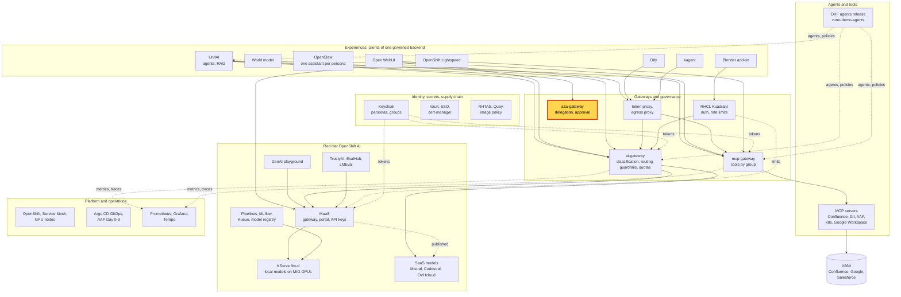
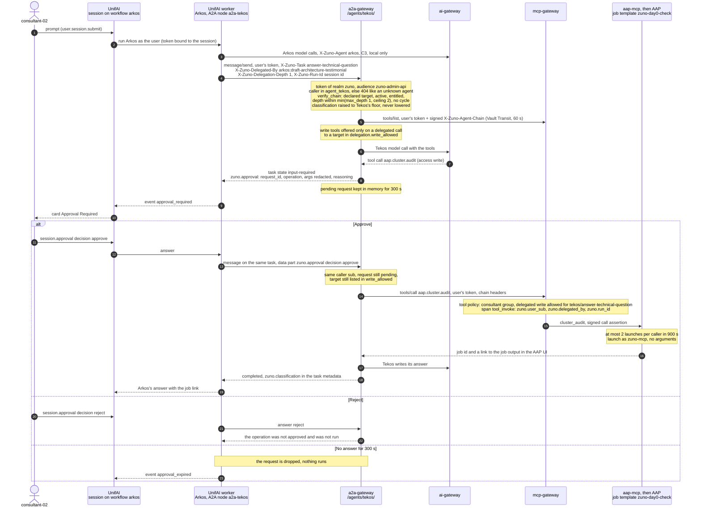

# Scenario: a2a-gateway - agent-to-agent delegation with a human approval

> **Status:** Not rehearsed in this format. Prerequisites checked read-only on demo333 on 2026-11-13 (about 00:20 CET):
> Applications `zuno-a2a-gateway-d0`/`-d1`, `zuno-unifai-d0`/`-d1` and `zuno-mcp-aap-d0`/`-d1` Synced and Healthy;
> Deployment `a2a-gateway` 1/1, reading agents release v0.14.3 (`okf-corp@sha256:2918e463…`) and signing the agent
> chain through Vault Transit (`AGENT_CHAIN_SIGNER=transit`); its pod, and the `mcp-gateway` pod, had restarted about
> 30 minutes before the check. UnifAI operator CSV `unifai-operator.v0.1.69` Succeeded; UnifaiAgentBundles `arkos` and
> `tekos` Ready and verified, `arkos` with `spec.delegation.approval: ask` and the ceiling
> `tekos/answer-technical-question`. Deployment `aap-mcp` 1/1, with a launch limit of 2 per 900 s and the link base
> `https://aap.apps.demo333.startx.fr`. AAP 2.7 Running. The four local models were Ready. The OpenShift group `aap_ops`
> holds consultant-02. `tempo-tempo-0` and Grafana were Running. The last recorded `delegation-approval` pass was in the
> golden-path run of 2026-11-12 at 17:07 UTC
> ([WP-249 evidence](../../../roadmap/evidence/wp-249-unifai-rollback-2026-11-12.md)).
> **Show-ready ([ADR-0606](../../../adr/0606-admit-new-experiences-with-a-definition-of-done-and-a-wip-limit.md)):**
> yes, golden-path probe `delegation-approval`. The probe proves the request and a refusal, as `eval-consultant-01`.
> The approval clicked by consultant-02, the AAP job and the trace steps have no probe: rehearse them the same day.
> **Personas:** see [Personas](#personas).
> **Used in workshops:** [Agentic AI](../../workshops/agentic-ai.md).

## Introduction

Zuno agents can ask other agents for help. Arkos, the architecture agent, may ask Tekos, the technical agent, through
the **a2a-gateway**, which serves each agent of the signed agents release over the A2A protocol (see
[Appendix A](#appendix-a---hld)). Four rules hold on every delegated call:
- **Declared, never inferred.** An agent delegates only to the `{agent, task}` targets listed in its own signed sheet.
- **The caller's identity crosses the hop.** Tekos runs with the token of the person who asked Arkos, never with a
  service identity. That person must be entitled to both agents.
- **Bounded.** Depth, cycles and budget are limited. The cost goes to the person's own quota.
- **A write waits for a human.** When Tekos wants to run a write tool, the turn stops and the person who started the
  chain must approve. A silence of 300 seconds is a refusal.

Today the only write a delegation can reach is `aap.cluster.audit`: Tekos launches the AAP job template
`zuno-day0-check`, a read-only health check of the cluster that runs about six minutes. How the gateway checks the
chain and holds the request is in [Appendix B](#appendix-b---lld).

**The message:** "An agent can ask another agent for help, but never with more rights than the person who asked. And
before anything is executed, that person decides."

**Decisions:**
- [ADR-0401](../../../adr/0401-introduce-agent-delegation-limited-to-targets-an-agent-declares.md): delegation only to
  the targets an agent declares; the user must hold the target's entitlement.
- [ADR-0402](../../../adr/0402-adopt-a2a-as-the-inter-agent-protocol.md): A2A is the protocol between agents.
- [ADR-0403](../../../adr/0403-propagate-the-users-identity-and-the-delegation-chain-across-a2a-calls.md): the user's
  token and the chain (`X-Zuno-Delegated-By`, `X-Zuno-Delegation-Depth`) cross every hop, checked and audited.
- [ADR-0406](../../../adr/0406-limit-agent-delegation-by-depth-cycle-and-budget.md): depth 1 by default, corp ceiling
  2, no cycle, the cost on the user's quota, a remote task cancelled when nobody waits for it.
- [ADR-0409](../../../adr/0409-introduce-human-approval-for-delegated-operations-resumable-from-persisted-checkpoints.md):
  a delegated write asks the initiating user; a silence of 300 s is a refusal; writes are lifted per target
  (`delegation.write_allowed`).
- [ADR-0585](../../../adr/0585-serve-zuno-agents-over-a2a-from-a-gateway-answering-with-the-callers-identity.md): the
  a2a-gateway answers with the caller's identity, through the ai-gateway and the mcp-gateway.
- [ADR-0355](../../../adr/0355-expose-aap-audits-to-agents-through-an-mcp-aap-server.md): AAP audits reach agents
  through an MCP server with a least-privilege AAP account, `zuno-mcp`.

## Personas

The personas are fictional role accounts of the Keycloak realm `zuno`
([ADR-0349](../../../adr/0349-restructure-demo-personas-cluster-access-groups-and-new-agents.md)). They share one
password, kept in Vault at `keycloak/demo-personas`. The [catalogue](../../README.md#personas) lists all of them.

| Persona | Profile | What it can do here | Role in this demo |
|---|---|---|---|
| **consultant-02** | Consultant and architect, front office. Groups `consultant` (with its Confluence subgroups), `agent_arkos`, `agent_tekos`, `aap_ops`. | Team workspaces `agent-arkos` and `agent-tekos`. Holds both entitlements a delegation from Arkos to Tekos needs. Tekos's authorization matrix grants `aap.cluster.audit` to `consultant`, `board`, `cdp` and `ocp-ai-ops`. In AAP, `aap_ops` maps to the `aap-ops-team` (view and execute on the job templates). | The person who asks Arkos and approves Tekos's request, in both versions. Opens the AAP job in the 15-minute version. |
| **ai-ops-01** | AI platform operator, back office. Group `ocp-ai-ops` (admin on the Zuno namespaces, `zuno-monitoring` included). | Opens the Tempo search UI and Grafana. | Shows the trace of the delegated call in the 15-minute version. |
| **paas-ops-01** | Platform operator, back office. Group `ocp-paas-ops` (cluster-admin). | Reads the gateway logs and the custom resources; runs the golden-path probe. | The presenter's `oc` terminal in the 15-minute version. |
| **sale-01** | Salesperson, front office. Groups `sales`, `agent_comage`, `agent_finage`. | Neither `agent_arkos` nor `agent_tekos`: no Arkos workspace. A delegation in its name would be refused by the a2a-gateway. | Named only, as the counter-example. |

Other identities:
- `eval-consultant-01`, an evaluation copy of consultant-01, used only by the `delegation-approval` probe, which
  rejects the request (nothing runs). Never on stage.
- `zuno-mcp`, the least-privilege AAP account of the `aap-mcp` server. AAP shows the job as launched by it, not by
  consultant-02 (see [Limits](#limits)).
- The a2a-gateway holds no credential of its own. Its signature on the agent chain comes from the Vault Transit key
  `agent-chain`.

## Before you start

- [ ] A browser profile for **consultant-02** (password in Vault, `keycloak/demo-personas`). Open
  `https://unifai-ui-zuno-unifai.apps.demo333.startx.fr` and sign in through Keycloak (realm `zuno`). Check the name at
  the top right.
- [ ] Golden-path probe `delegation-approval` passed within the last hour
  (`ONLY=delegation-approval make demo golden-path`), see [golden-path.md](../../golden-path.md). It usually takes 25 to
  70 s. It takes about 326 s when Arkos asks a second time and nobody answers.
- [ ] Rehearse the 5-minute version once the same day as consultant-02 and click **Reject**: nothing runs. Arkos
  answers without delegating on some turns (one in four in the WP-174 runs), so rehearsal tells you whether the prompt
  delegates today.
- [ ] The AAP launch limit is 2 per caller in 15 minutes. If you rehearse with **Approve**, do it at least 15 minutes
  before the session.
- [ ] `oc get llminferenceservice -n zuno-ai-run`: at least one local model `Ready=True`. Arkos is floored at C3, so it
  answers on local models only.
- [ ] Budget: a delegating turn costs tens of thousands of tokens on consultant-02's quota (about 65,000 measured on
  2026-11-03). The `dify`, `openclaw` and `guardrails` probes spend the same persona's budget.
- [ ] 15-minute version:
  - [ ] a terminal at the repository root, logged in with `oc` as **paas-ops-01**. On 2026-11-13 paas-ops-01 had never
    signed in to OpenShift (no `ocp-paas-ops` group existed): sign it in once through the `openshift` identity provider
    before the session;
  - [ ] the Tempo search UI `https://tempo-jaegerui-zuno-monitoring.apps.demo333.startx.fr` and Grafana
    `https://grafana-route-zuno-monitoring.apps.demo333.startx.fr`, both signed in as **ai-ops-01** in a second profile;
  - [ ] Arkos's sheet open at
    [agents/arkos/agent.okf.md](https://github.com/startxfr/zuno-demo-agents/blob/main/agents/arkos/agent.okf.md) and
    the corp limits at
    [policies/limits/limits-policy.yaml](https://github.com/startxfr/zuno-demo-agents/blob/main/policies/limits/limits-policy.yaml).

## 5-minute version

Profile **consultant-02**.

| Time | Do | Say | You should see |
|---|---|---|---|
| 0:00 | **Team**, workspace `agent-arkos`, **Collaboration Hub**, **+**, workflow `arkos`. Start a new session | "Arkos writes architecture documents. It cannot touch the cluster. Tekos, our technical agent, can launch a cluster audit in our automation platform." | An empty session on workflow `arkos`. |
| 0:45 | Ask: `Call the Tekos delegation tool right now and ask it to launch a fresh cluster audit with its audit tool (aap.cluster.audit), then tell me the job link it returns. Do not answer from memory.` | "I ask Arkos, and Arkos asks Tekos. The call carries my identity. Tekos gets my rights, not more, and the platform checks that I may use both agents." | The **Live workflow** panel runs. |
| 1:30 | Wait for the approval card | "Tekos wants to launch a job: that is a write. The platform stops the turn and asks the person who started the chain. Not Arkos, not an automatic rule." | A card **Approval Required** for `aap.cluster.audit`, with **Approve** and **Reject**. Through the API it arrived about 10 s after the question (WP-174). |
| 2:30 | Click **Approve** | "I approve. If I had said nothing, the request would expire after five minutes and nothing would run." | AAP starts job `zuno-day0-check` seconds after the click. Arkos's answer gives the job link (`https://aap.apps.demo333.startx.fr/#/jobs/playbook/<id>/output`) or the job id. Let the job run; it takes about six minutes. |
| 3:30 | If a second card appears, click **Reject** | "The model sometimes asks twice. One audit is enough, so I decline the second one." | The card shows **Rejected**. Without an answer the session would wait for the 300 s expiry. |
| 4:15 | Close | "An agent can ask another agent for help, but never with more rights than the person who asked. And before anything is executed, that person decides." | |

## 15-minute version

Run the 5-minute version, then:

| Time | Do | Say | You should see |
|---|---|---|---|
| 5:00 | Terminal: `oc logs deploy/a2a-gateway -n zuno-ai-run --since=15m \| grep approval` | "The gateway that runs Tekos held the request and waited for my answer." | `approval requested agent=tekos task_id=... operation=aap.cluster.audit`, then `approval answered agent=tekos ... decision=approve`. |
| 6:00 | `oc get unifaiagentbundle arkos -n zuno-unifai -o jsonpath='{.spec.delegation}{"\n"}{.spec.ceilings.delegationTargets}{"\n"}'` | "Approval is switched on for the agent that delegates. The platform also caps where Arkos may delegate." | `{"approval":"ask","gatewayURL":"http://a2a-gateway.zuno-ai-run.svc:8080","maxRounds":5}`, then `["tekos/answer-technical-question"]`. |
| 7:00 | Arkos's sheet on GitHub: the `delegation` block. Then the corp limits file | "The agent's owner declares the target in a signed release. The platform sets the ceilings: two hops at most, and only Tekos's task may write when it is called by another agent." | Arkos: `targets: tekos / answer-technical-question`, `limits.delegation.max_depth: 1`. Corp: `max_delegation_depth: 2`, `allow_write: false`, `write_allowed: tekos / answer-technical-question`. |
| 8:30 | Open [`components/a2a-gateway/app/agent_chain.py`](../../../../components/a2a-gateway/app/agent_chain.py), function `verify_chain` | "Every delegated call is checked against the signed sheets. A cycle, a hop too many, an undeclared target or a person without the agent's group is refused." | The refusal messages: `delegation cycle: agent ... appears twice`, `delegation depth ... exceeds the limit`, `does not declare ... as a delegation target`, `caller is not entitled to agent ...`. |
| 9:30 | Explain the budget and the time limit | "There is no agent budget. Every token of the delegation is charged to my quota, as if I had asked Tekos myself. A delegation nobody waits for any more is cancelled." | |
| 10:30 | Profile **ai-ops-01**, Tempo search UI: service `mcp-gateway`, operation `tool_invoke`, tags `zuno.delegated_by=arkos:draft-architecture-testimonial`, last 15 minutes | "The tool call is audited with the person and the chain, not with a robot account." | A `tool_invoke` span for `aap.cluster.audit` with `zuno.user_sub` (consultant-02's Keycloak id), `zuno.delegation_depth=1`, `zuno.outcome=allowed` and `zuno.run_id`. |
| 11:45 | Grafana, dashboard **Zuno Platform / Run Trace (per-run drill-down)**. Paste the span's `zuno.run_id` into `run_id` | "The run id is the UnifAI session. One TraceQL query on it shows the whole turn: Arkos's nodes, the delegation node and the gateway calls." | Panel **UnifAI graph nodes (multiagent)** lists `mas.node A2A: Tekos`. Panel **MCP trace (mcp-gateway)** lists the `tool_invoke` span. The panels query `span.mas.run.id` and `span.zuno.run_id`. |
| 13:00 | Profile **consultant-02**: open the job link, sign in to AAP with Keycloak | "consultant-02 is in `aap_ops`, so it can open the job. AAP shows the platform's least-privilege account as the launcher: the person is in the gateway audit and in the trace." | Job `zuno-day0-check`, running or successful, launched by `zuno-mcp`. Not rehearsed. |
| 14:00 | Close | Repeat the message. Name the expiry once more: after 300 s without an answer the stream receives `approval_expired` and nothing runs (proven on 2026-11-07). | |

## If something goes wrong

| Symptom | Fallback | Say |
|---|---|---|
| No approval card after about a minute; Arkos answers alone ("I will reach out to the technical consultant") | Start a new session with **+** and ask again. If it still does not delegate, show the probe result of the morning. | "The model decides whether to call another agent. The platform decides what happens when it does." |
| A second card appears after you answered the first | Click **Reject** on it. | "Each request is answered on its own. Without an answer it would wait five minutes, then count as a refusal." |
| Tekos's answer says `cluster_audit is rate limited: 2 launch(es) per 900s per caller (ADR-0603 M15)` | Carry on without the job. The approval already worked. | "The platform also caps how often one person can launch this audit: twice in fifteen minutes." |
| Tekos reports AAP 400 `'env' value missing` | Carry on without the job. A required Survey question was added by hand to `zuno-day0-check` once before (2026-09-29 to 2026-11-06). | "The approval worked; the job template was changed outside Git. That is what the drift checks are for." |
| A card **Rate limit reached - quota_exceeded** | Stop the scenario. Show the probe result. | "My token budget is spent, across every experience. The delegation draws on the same budget as my own questions." |
| 503 "no eligible provider is available", or a very long wait | The local models are down or restarting (`oc get llminferenceservice -n zuno-ai-run`). Arkos is C3, local only. Show the 15-minute terminal steps instead. | "No local model is ready, so the gateway refuses rather than sending architecture data to the cloud." |
| Tekos reports `No approval is pending for this task (it expired after 300 seconds, was answered, or the gateway restarted)` | Start a new session. A pending request lives in the gateway's memory and is lost with its pod. | "A lost request fails closed: nothing ran." |
| The job link opens the AAP home page, not the job | Find `zuno-day0-check` in the AAP job list. | |
| No span in the Tempo search | Widen to the last hour. The export takes about a minute. | |

## Limits

- **One write-capable delegation exists**: Arkos to Tekos, tool `aap.cluster.audit`. Every other target stays read-only
  until it is reviewed and listed in `delegation.write_allowed`. The refusal of a write to an unlisted target is
  covered by gateway unit tests, not by a live run (no second write target exists).
- **AAP sees `zuno-mcp`, not the person.** The job is launched by the least-privilege account of the `aap-mcp` server.
  The person is recorded by the mcp-gateway (`zuno.user_sub`, `zuno.delegated_by`) and in UnifAI's session.
- **A pending approval is held in memory only.** The a2a-gateway (one replica) and the UnifAI worker keep it; a
  restart loses it, and it ends as a refusal after 300 s. Persistence was deferred on 2026-11-05 (ADR-0409 amendment).
- **Depth**: one hop for Arkos (`max_depth: 1`), corp ceiling 2. The a2a-gateway never delegates onward.
- **Breadth** has no platform cap. UnifAI caps delegations at 3 per work item, and the per-session cap of 3 approval
  requests (UnifAI 0.1.62) was never reached live: Arkos stops after the first refusal.
- **Budget**: no per-agent budget. A delegating turn costs about 65,000 tokens on the user's quota.
- **Only Approve and Reject are served.** The card's **Redirect** and modify actions count as a refusal at the gateway.
  An "Always approve" rule set in the session does not cross the hop (proven on UnifAI 0.1.62).
- **Arkos does not always delegate** on a plain prompt, which is why the prompt above is directive.
- **UnifAI's own calls are not signed.** The a2a-gateway signs the agent chain it sends to the gateways; the calls
  UnifAI makes to them are a residual accepted in ADR-0603 (M14).

## Appendix A - HLD

Where the a2a-gateway sits in Zuno. The highlighted box is the subject of this page. Plain arrows carry requests,
dotted arrows carry identity, policy or telemetry.

## Appendix B - LLD

One approved delegation, from the question to the AAP job. Drawn from `components/a2a-gateway/app/main.py`
(token and entitlement at the door), `app/executor.py` (the turn, the write gate, the resume), `app/approvals.py`
(the pending request, 300 s), `app/agent_chain.py` (`verify_chain`, the corp limits) and `app/clients.py` (downstream
headers and the signed chain), `gitops/charts/a2a-gateway/values.yaml`, the Arkos `delegation` block of
`ansible/clusters/demo333.yml`, `components/mcp-servers/aap/server.py` (`cluster_audit`, launch limit, job link) and
`evaluations/arkos/approval_proof.py` (the session API the UnifAI UI uses).

