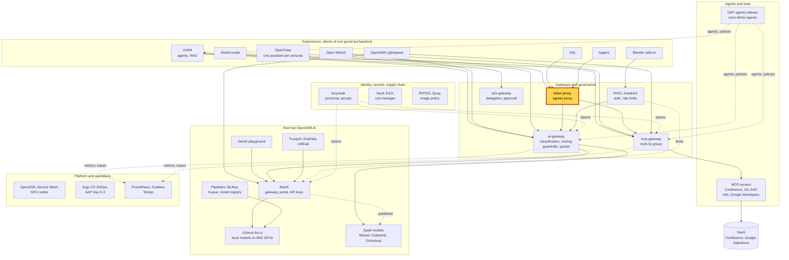
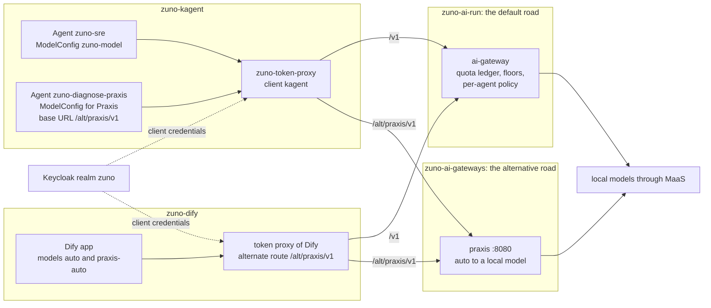

# Scenario: Agents on an alternative gateway - one setting, no code change

Last reviewed: 2026-11-20

## Introduction

An agent is a set of instructions and tools on top of a model. Where the model comes from is a setting. This scenario
moves two agents to an alternative gateway, Praxis AI, by changing that setting only: a kagent agent gets a model
configuration that points to the alternative road, and a Dify app picks a second model in its model list. The
instructions, the tools and the code stay the same. Both clients reach the alternative gateway through the token proxy,
which holds the client credentials. See [Appendix A](#appendix-a---hld) for where it sits and
[Appendix B](#appendix-b---lld) for the road of the two agents.

The scenario also shows the price. On the alternative road the gateway sees the proxy's identity, not the user's, and
the Zuno controls of the default road do not apply. Only C1 content is shown.

**The message:** "An agent changes gateway with one setting and no code. What it gains is a choice of road. What it
loses, we can name."

## Personas

The personas are fictional role accounts of the Keycloak realm `zuno`. They share one
password, kept in Vault at `keycloak/demo-personas`. The [catalogue](../../README.md#personas) lists all of them.

| Persona | Profile | What it can do here | Role in this demo |
|---|---|---|---|
| **ai-ops-01** | AI platform operator, back office. Groups `ocp-ai-ops`, `agent_tekos`, `openwebui_admin`. | Passes the kagent front door (`ocp-ai-ops` only). Opens Grafana and its Tempo explorer. | Signs in to kagent and to Grafana. |
| **consultant-02** | Consultant and architect, front office. Group `consultant`. | Dify acts as this persona: every Dify call goes through the token proxy with its client credential. | Signs in to Dify and switches the app's model. |
| **paas-ops-01** | Platform operator, back office. Group `ocp-paas-ops` (cluster-admin). | Reads the agents, the model settings and the token proxy's configuration. | The presenter's `oc` terminal. |

Other identities:
- `service-account-kagent` and the service account of the Dify client: the token proxy signs the calls with them. On the
  alternative road, the alternative gateway sees these identities, not the user's.

## Presenter lifecycle

`make demo use agents-alt-gateway 5|15` selects this page.
Each section below is printed after its action's Ansible file (`ansible/demos/agents-alt-gateway/<action>.yml`) has run,
and says what is left to the presenter.

### Status

Nothing to do. The file reads the Deployment `praxis` in `zuno-ai-gateways`, the token proxy of kagent and the Agents
`zuno-sre` and `zuno-diagnose-praxis`. Read the Dify side by hand: its model list. If one is missing or not Ready, stop and tell the platform owner: this
demo installs nothing.

### Check

Nothing to do when it passes. This page has no golden-path probe yet: rehearse it the same day. Read by hand that the
two Agents are `Accepted`. If something fails, see [If something goes wrong](#if-something-goes-wrong).

### Install

Nothing to do. The alternative gateway and the alternate routes are part of the shared platform: the file only verifies
them.

### Start

The file prepares nothing on the cluster. What only a person does:

- [ ] A browser profile for **ai-ops-01**, signed in to kagent. A session of another persona gets a 403 from the
  kagent front door.
- [ ] A second browser profile for **consultant-02**, signed in to Dify, on the app that the page uses. Note the model
  the app uses before the session: it is put back at the end.
- [ ] A terminal logged in with `oc` as **paas-ops-01**.
- [ ] 15-minute version: Grafana in the ai-ops-01 profile, the Tempo explorer.
- [ ] Type only the prompts of this page. They contain no data of the company.

### Stop

Switch the Dify app back to the model it used at the start. Dify keeps the draft of an app and may move its edited date
when it is used: that is Dify's behaviour, not a step of this page. Close the browser profiles and the terminal.

### Uninstall

Nothing to do.

## 5-minute version

Terminal as **paas-ops-01**, then the browser profiles.

| Time | Do | Say | You should see |
|---|---|---|---|
| 0:00 | Terminal: `oc get agents.kagent.dev -n zuno-kagent` | "Two agents with the same instructions. They differ in one thing: the model setting they point to." | `zuno-sre` and `zuno-diagnose-praxis`, both Accepted and Ready. |
| 0:45 | Terminal: `oc get agents.kagent.dev zuno-sre zuno-diagnose-praxis -n zuno-kagent -o jsonpath='{range .items[*]}{.metadata.name}{" "}{.spec.declarative.modelConfig}{"\n"}{end}'` | "One field. The first uses the default model setting. The second uses the setting for the alternative gateway. No code." | Two lines: each agent and its model setting. The field path is to confirm at the first rehearsal. |
| 1:30 | kagent, profile **ai-ops-01**: open **zuno-diagnose-praxis** and ask: `What does it mean when a pod is in CrashLoopBackOff? Answer in two sentences and call no tool.` | "The agent runs through the token proxy, as the operations persona, and the proxy sends it to the alternative gateway." | A short answer, no tool call. |
| 2:30 | Dify, profile **consultant-02**: open the app and its model list | "Dify is the second client. Its model list has one more entry: the alternative gateway's `auto`." | The list shows `auto` and `praxis-auto` (the name is to confirm at the first rehearsal). |
| 3:15 | Pick `praxis-auto` and ask in Debug & Preview: `What does it mean when a pod is in CrashLoopBackOff? Answer in two sentences.` | "One click in the model list. The question and the app do not change." | A short answer. |
| 4:15 | Say what changed and what did not | "The gateway changed. The sign-in, the instructions and the tools did not. The alternative gateway sees the proxy's identity, not mine, and it does not apply the Zuno quotas or floors." | |
| 4:45 | Close | "An agent changes gateway with one setting and no code." | |

## 15-minute version

Run the 5-minute version, then:

| Time | Do | Say | You should see |
|---|---|---|---|
| 5:00 | Terminal: `oc set env deploy/zuno-token-proxy -n zuno-kagent --list` and read the line of the alternate gateways. Show names only. | "The token proxy has a list of alternate upstreams: a name and an address. The route `/alt/praxis/v1` is built from it." | An environment line with the name `praxis` and the address of the service in `zuno-ai-gateways`. Check that the line holds no header value before showing it. *(untested)* |
| 6:15 | Terminal: `oc get agents.kagent.dev,modelconfigs.kagent.dev -n zuno-kagent` | "A model setting is a custom resource. The new one has the proxy's alternate route as its base URL." | A second model setting, with the route `/alt/praxis/v1` as base URL. |
| 7:30 | Grafana, Tempo explorer: the trace of the kagent question on the Praxis service | "The alternative gateway recorded the call." | Service `praxis`: spans `routing.select`, `token_rate_limit` and `llm_request`, and `selected.provider` naming the local model (`qwen3.6-27b-instruct` on 2026-11-20). |
| 9:00 | Look at who the trace says made the call | "Not the user. The proxy's identity. The default road has the persona in every span; here the persona is only in the proxy." | No subject is recorded: the spans carry only the client address (the sidecar, `127.0.0.6`) and the client's user agent (`OpenAI/Go` for kagent). Say so: the alternative road does not know who asked. |
| 10:15 | Dashboard **Five experiences**, row **Same backend, five experiences**, last 1 hour | "The default road counts the calls by experience and by persona. The alternative road does not feed that count." | The `kagent` and `dify` series do not count the two questions of this demo. |
| 11:15 | Dify: switch the app back to `auto` and ask the same question | "Back to the default road, as easily." | A short answer. In Grafana, a Dify point after a minute. |
| 12:15 | Say how the list is managed | "The list of alternative gateways is empty by default. An entry adds a route and a model. Removing it puts the agents back on the default road." | |
| 13:15 | Say what the C1 rule means | "I only sent a public question. A tool result of a cluster read is C2. On the default road the gateway keeps it on local models. On the alternative road nothing does, so the agent here uses no tool." | |
| 14:30 | Close | Repeat the message. | |

## If something goes wrong

| Symptom | Fallback | Say |
|---|---|---|
| `zuno-diagnose-praxis` is missing or not Ready | Terminal: `oc get agents.kagent.dev -n zuno-kagent`, then the controller logs. Show `zuno-sre` and the trace of an earlier take. | "The alternative agent is optional." |
| The model list of Dify has no `praxis-auto` | The configure step of Dify was not run for the alternative gateway. Show the default model and the kagent half only. | |
| 502 or a timeout from the proxy | The alternate route or the alternative gateway is down. Terminal: `oc get pods -n zuno-ai-gateways`. Continue on the default road. | "The alternative gateway is alpha. We show it knowing that." |
| 403 from the kagent front door | The browser holds a session of a persona outside `ocp-ai-ops`. Use the ai-ops-01 profile. | "The door admits the operations group only." |
| The environment line of the proxy shows a header value | Do not show it. Say what the list holds, by name. | |
| No Praxis trace in Tempo | Widen the time range to 1 hour. Export takes about a minute. If there is still none, say that the trace was not verified. | |

## Limits

- **Not rehearsed.** Nothing on this page was played. The model-setting field, the model names, the span names and the
  checkpoints are expectations taken from the design.
- **Only C1 content is shown.** The alternative gateway has no classification floor. The kagent agent uses no tool on
  this page, because a tool result of a cluster read is C2.
- **The alternative gateway does not enforce:**
  - the persona quota ledger: a call on that road is not counted in the persona's budget;
  - the classification floors and the signed tool-result markers;
  - the per-agent routing policy;
  - the Zuno cost metrics.
- **The gateway sees the proxy's identity.** The token proxy holds the client credential. The user's token is not
  forwarded, so the alternative gateway cannot tell two users of the same client apart.
- **The Dify switch is a write to the app.** Dify saves the draft of the app when its model changes, and may move its
  edited date. Put the model back at the end.
- **The agent keeps its tools.** The tools stay behind the mcp-gateway, which is the same on both roads. Only the model
  call changes road.
- **MaaS budgets of Praxis.** Praxis's ServiceAccount shares the `<model>-platform` subscription with the ai-gateway (the platform tier), not the owner of a `<model>-praxis` one
  ([ADR-0619](../../../adr/0619-run-praxis-ai-as-an-alternative-ai-gateway-next-to-the-default-zuno-ai-gateway.md) note of 2026-11-20): the two identities have separate counters of the same size. A Praxis
  429 from MaaS falls back to the direct KServe step by design, so a client on that road never sees a MaaS 429.
- **Praxis is alpha.** Its configuration can change between releases.

## Appendix A - HLD

## Appendix B - LLD

The road of the two agents. Drawn from `gitops/charts/kagent/templates/alt-gateways.yaml` (the second model setting
`zuno-model-praxis` and the Agent), the `altGateways` list of `gitops/charts/zuno-token-proxy`, `gitops/charts/praxis`
and the alternative-gateway lists of `ansible/inventories/demo333/cluster.yml`. The page was not played: check the names against
the live objects.

## References

The decisions this page rests on:

- [ADR-0619](../../../adr/0619-run-praxis-ai-as-an-alternative-ai-gateway-next-to-the-default-zuno-ai-gateway.md): the
  alternative gateways, the identity limit of a gateway fronted by the token proxy, what the alternative road loses.
- [ADR-0601](../../../adr/0601-inject-client-credentials-tokens-for-experience-clients-without-oidc-passthrough.md): the
  token proxy adds a client-credentials token to every call of an experience client.
- [ADR-0600](../../../adr/0600-govern-kubernetes-read-tools-in-the-mcp-gateway-and-admit-kagent-as-a-thin-operations-client.md):
  kagent as a thin operations client over governed tools.
- [ADR-0349](../../../adr/0349-restructure-demo-personas-cluster-access-groups-and-new-agents.md): the demo personas,
  their groups and their shared password.
- [ADR-0616](../../../adr/0616-prepare-and-play-every-catalogue-demo-through-one-make-demo-lifecycle.md): the `make demo`
  lifecycle that the Presenter lifecycle section follows.

Evidence: the work packages of the two clients:
[kagent](../../../roadmap/work-packages/wp-297-give-kagent-the-alternative-gateways-through-the-token-proxy.md) and
[Dify](../../../roadmap/work-packages/wp-300-give-dify-the-alternative-gateways.md). Both are Done since 2026-11-19; the page itself was not played.

## Page status

> **Status:** Rehearsed on 2026-11-20, 5-minute version: `make demo rehearse` passes, and the chat steps were played
> through the clients' own APIs with the page's personas (see
> [WP-304](../../../roadmap/work-packages/wp-304-write-the-multi-gateway-claude-code-and-agents-scenarios.md)).
> For the Dify steps (2:30, 3:15), the road behind `praxis-auto` was replayed from Dify's token proxy; Dify's own model
> list was not opened (it needs Dify's administrator sign-in): check it at the rehearsal.
