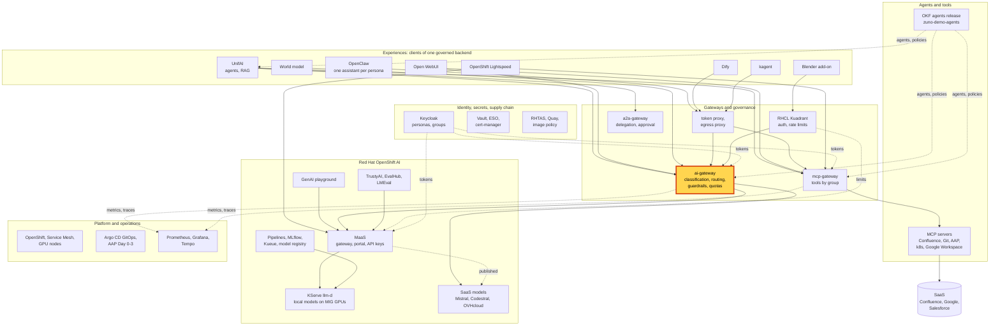
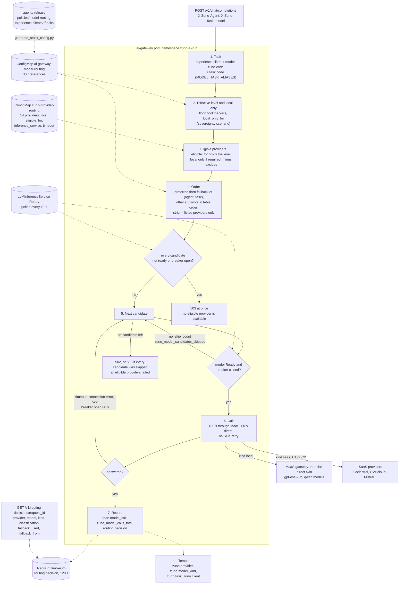

# Scenario: ai-gateway - model routing and fallback

> **Status:** Not rehearsed in this format. Prerequisites checked read-only on demo333 on 2026-11-13: Applications
> `zuno-ai-gateway-d0`/`-d1`, `zuno-llm-d1` and `zuno-open-webui-d1` Synced and Healthy; Deployment `ai-gateway` 1/1;
> gateway environment `MODEL_TASK_ALIASES=zuno-code=code:Zuno Code`, `MODEL_READINESS_ENABLED=true`,
> `CIRCUIT_BREAKER_ENABLED=true`, `CIRCUIT_OPEN_SECONDS=60`,
> `MARKER_FAIL_CLOSED_CLIENTS=open-webui,openclaw-*,dify,kagent`; ConfigMap `ai-gateway-model-routing` (30
> preferences, `open-webui`/`code`: `prefer: [mistral-codestral]`, not strict) and ConfigMap `zuno-provider-routing`
> (14 providers) identical to the repository files; ExternalSecret `llm-provider-mistral-codestral` `SecretSynced` (the
> key itself was not tested);
> the four `LLMInferenceService` Ready; Deployment `open-webui` 1/1; Grafana 1/1 and `tempo-tempo-0` Running.
> **paas-ops-01** had still not signed in to OpenShift.
> **Show-ready ([ADR-0606](../../../adr/0606-admit-new-experiences-with-a-definition-of-done-and-a-wip-limit.md)):**
> yes, golden-path probe `zuno-code`.
> **Personas:** see [Personas](#personas).
> **Used in workshops:** [sovereign and governed AI](../../workshops/sovereign-governed-ai.md),
> [five experiences](../../five-experiences.md) (row **Same models, same routing**).

## Introduction

The ai-gateway is the only router between the experiences and the models (see [Appendix A](#appendix-a---hld)). For
each call it builds an ordered list of providers, then tries them in that order. The order is declared per agent or
experience and per task, as a **preferred** list and a **fallback** list, in the signed agents release. The gateway
never reads the question. The task decides: in Open WebUI, OpenClaw and Dify, the model **Zuno Code** selects the task
`code`, whose list puts Mistral Codestral first and the local models after it.

Two rules sit above the order. The data classification removes the providers that may not see the data; that story is
in the [sovereignty scenario](./ai-gateway-sovereignty.md). Availability removes the models that cannot answer now: a
local model whose controller reports it not ready is skipped, and a provider that has just failed is skipped for 60
seconds. When nothing is left, the gateway answers 503 at once. How the list is built and walked is in
[Appendix B](#appendix-b---lld).

**The message:** "The platform picks the model for each task, falls back when a model is down, and never waits on a
model that is not there."

**Decisions:**
- [ADR-0419](../../../adr/0419-split-model-preference-into-preferred-fallback-with-prompt-slot-overrides.md): a
  preference is a `preferred` list and a `fallback` list; it only reorders the eligible providers.
- [ADR-0417](../../../adr/0417-consume-codestral-via-mistral-api.md): Codestral for code tasks; `strict` keeps a task
  on its listed providers only.
- [ADR-0581](../../../adr/0581-derive-stack-configuration-from-the-admitted-corp-bundle.md): the routing table is
  generated from the admitted agents release.
- [ADR-0596](../../../adr/0596-let-experience-clients-pick-a-declared-code-model-routed-to-codestral-first.md): "Zuno
  Code" maps to the task `code`, Codestral first, the local models as fallback.
- [ADR-0591](../../../adr/0591-route-only-to-ready-local-models-and-fail-fast-on-stalled-candidates.md): only ready
  local models are tried, a circuit breaker skips a provider that just failed, and an empty list is a 503 at once.
- [ADR-0550](../../../adr/0550-demonstrate-sovereign-ai-through-classification-specialization-and-resilience.md):
  `local_only_for` per task, and the routing decision published per request.

## Personas

The personas are fictional role accounts of the Keycloak realm `zuno`
([ADR-0349](../../../adr/0349-restructure-demo-personas-cluster-access-groups-and-new-agents.md)). They share one
password, kept in Vault at `keycloak/demo-personas`. The [catalogue](../../README.md#personas) lists all of them.

| Persona | Profile | What it can do here | Role in this demo |
|---|---|---|---|
| **sale-01** | Salesperson, front office. Groups `sales`, `agent_comage`, `agent_finage`. | Open WebUI user. Sees two models, **Zuno** and **Zuno Code**. Its calls are routed under the client `open-webui`, task `chat` or `code`. | The everyday employee of the 5-minute version: asks a code question with **Zuno Code**. |
| **ai-ops-01** | AI platform operator, back office. Group `ocp-ai-ops` (admin on the Zuno namespaces, `zuno-monitoring` included). | Opens Grafana and the Tempo search UI, both behind the OpenShift sign-in. | Shows which provider served each call (5-minute version), the skipped candidates and the trace (15-minute version). |
| **paas-ops-01** | Platform operator, back office. Group `ocp-paas-ops` (cluster-admin). | Runs the golden-path probe and reads the routing ConfigMaps and the model status. | The presenter's `oc` terminal in the 15-minute version. |

Other identities:
- `eval-consultant-01`, an evaluation copy of consultant-01: the probe `zuno-code` signs in to Open WebUI with it,
  never on stage;
- consultant-01 and consultant-02 are named only: they ran the recorded Codestral fallback drill of 2026-11-05.

## Before you start

- [ ] **paas-ops-01** has signed in once to the OpenShift console: on 2026-11-13 it had not, so its group
  `ocp-paas-ops` did not exist yet. Then log a terminal in with `oc` as **paas-ops-01**, at the repository root.
- [ ] Golden-path probe `zuno-code` passed within the last hour (`ONLY=zuno-code make demo golden-path`), see
  [golden-path.md](../../golden-path.md). It asks "Write a one-line Python function that adds two numbers." with the
  `zuno-code` model through Open WebUI.
- [ ] Browser profile 1: `https://open-webui.apps.demo333.startx.fr`, **Continue with Keycloak** as **sale-01**. Start
  a new chat with the model **Zuno** and ask one question before the audience arrives. It wakes the local model and
  gives the dashboard a local series to compare with.
- [ ] Browser profile 2: Grafana `https://grafana-route-zuno-monitoring.apps.demo333.startx.fr`, signed in as
  **ai-ops-01**. Dashboard **Zuno Platform / Five experiences**, last 1 hour, `client` = `open-webui`.
- [ ] Check the local models: `oc get llminferenceservice -n zuno-ai-run`. Four `READY True` on 2026-11-13.
- [ ] 15-minute version: the Tempo search UI `https://tempo-jaegerui-zuno-monitoring.apps.demo333.startx.fr`, signed
  in as **ai-ops-01**, and the
  [WP-194 evidence](../../../roadmap/evidence/wp-194-zuno-code-live-proof.md) open at section T5.
- [ ] Known on screen, not a failure: Open WebUI generates the chat title with the model you picked, so one **Zuno
  Code** question makes two Codestral calls.

## 5-minute version

| Time | Do | Say | You should see |
|---|---|---|---|
| 0:00 | Profile 1, **sale-01**: open the model picker | "Two models only. I do not pick a provider: I pick a kind of work. The platform owns the list of models behind each one." | **Zuno** and **Zuno Code**. |
| 0:45 | New chat, **Zuno Code**, ask: `write Python code that checks the format of an email address` | "A code question goes to a code model, Mistral Codestral. If Codestral is down, a model running on our GPUs answers instead." | A Python function with a regular expression, in a few seconds. |
| 2:00 | Profile 2, Grafana, row **Same models, same routing**, panel **Which provider served each experience (over range)** | "Here is the proof. The code question went to Codestral. My first question went to a model on our own GPUs. Same chat, same user: the task chose." | For `open-webui`: `mistral-codestral` with outcome `success`, and `local-gpt-oss-maas` for the warm-up question. |
| 3:15 | Say what happens when a model is down | "If a local model stops, its controller says so and the gateway skips it in milliseconds. Before this rule, the same situation cost each experience up to fifteen minutes." | |
| 4:15 | Close | "The platform picks the model for each task, falls back when a model is down, and never waits on a model that is not there." | |

## 15-minute version

Run the 5-minute version, then:

| Time | Do | Say | You should see |
|---|---|---|---|
| 5:00 | Terminal: `oc get configmap ai-gateway-model-routing -n zuno-ai-run -o yaml` | "One entry per agent or experience and per task. The order only reorders what the classification allows; it can never add a provider." | `open-webui`/`chat`: `local-gpt-oss-maas`, `local-gpt-oss`. `open-webui`/`code`: `mistral-codestral`, not strict. `arkos`/`write-code`: Codestral with `strict: true`. `tekos`/`find-relevant-docs`: a `preferred` and a `fallback` list. |
| 6:30 | Open the agents release: [experience-clients/open-webui/tasks/code.md](https://github.com/startxfr/zuno-demo-agents/blob/main/experience-clients/open-webui/tasks/code.md), then [policies/model-routing/model-routing-policy.yaml](https://github.com/startxfr/zuno-demo-agents/blob/main/policies/model-routing/model-routing-policy.yaml) | "The owner of a task declares roles, here `code`. The corporate policy holds the ordered lists. The platform generates the table from the signed release; nobody edits it by hand." | `zuno.models.preferred: [code]` in the task. `preferred:`, `fallback:` and `local_only_for:` entries in the policy. |
| 8:00 | Point at the `local_only_for: [C1, C2, C3]` lines | "Tekos answers from Confluence and the technical documentation. For those tasks, no external model at any level: if no local model answers, the task fails instead of sending the context out." | `local_only_for` on Tekos `answer-technical-question` and `find-relevant-docs`, Arkos `draft-architecture-testimonial` and `workshop-presentation`, Naveo. |
| 9:00 | Open [`platform/ai-gateway/provider-routing.yaml`](../../../../platform/ai-gateway/provider-routing.yaml) | "Fourteen providers. Each local model has two entries: through MaaS first, then direct. Each declares its role, the levels it may serve, its timeout, and the model object whose readiness the gateway watches." | Roles `default`, `quality`, `reasoning`, `specialized`, `code`, `reasoning-external`, `general-external`. `inference_service:` on the 8 local entries; `timeout_seconds` 180 through MaaS, 60 direct. |
| 10:30 | Terminal: `oc get llminferenceservice -n zuno-ai-run`, then `oc set env deploy/ai-gateway -n zuno-ai-run --list \| grep -e MODEL_READINESS -e CIRCUIT_` | "The gateway reads the `Ready` condition every 10 seconds. A model that is not ready is skipped. A provider that failed by timeout, connection error or 5xx is skipped for 60 seconds, then one call tests it again." | Four models `READY True`. `MODEL_READINESS_ENABLED` `true`, `CIRCUIT_BREAKER_ENABLED` `true`, `CIRCUIT_OPEN_SECONDS` `60`. |
| 11:30 | Grafana, panel **Candidates skipped for availability (over range)** | "On 2026-11-02 the GPU nodes were down. Every MaaS candidate waited its full 180 seconds, and an Open WebUI chat reached a SaaS model after about ten minutes. Now the skip costs nothing and is counted." | Skips by client, provider and reason (`not_ready`, `circuit_open`) if a model was down in the range. An empty panel means nothing was skipped. |
| 12:15 | Tempo search UI: service `ai-gateway`, operation `model_call`, tags `zuno.task=code zuno.client=open-webui`, last 15 minutes | "Each call is traced with the provider and whether it ran on our GPUs or outside." | The span of the 5-minute question: `zuno.provider=mistral-codestral`, `zuno.model_kind=saas`, `zuno.classification=C1`, `zuno.model=codestral-latest`. |
| 13:00 | Show the WP-194 evidence, table T5 | "We broke Codestral on purpose on 2026-11-05. The user got a normal answer from the local model, in the same trace, about one second after the failure. The routing decision of such a call names `local-maas`, with `fallback_used: true` and `fallback_from: mistral-codestral`. UnifAI reads it from `GET /v1/routing-decisions/{request_id}`." | Two traces: `mistral-codestral` error `Invalid model` in under a second, then `local-maas` ok in 40 to 66 s. |
| 14:15 | Close | Repeat the message. | |

## If something goes wrong

| Symptom | Fallback | Say |
|---|---|---|
| The **Zuno Code** answer takes 40 seconds or more | Carry on. Codestral failed and a local model answered. Show the provider panel: `mistral-codestral` with outcome `error`, then a local provider. | "This is the fallback at work: Codestral failed, our own model answered the same question." |
| 503 "no eligible provider is available for classification ...: ... not ready" | Show it. Every provider the call could use is down or skipped. | "The gateway answers at once instead of waiting minutes on models that are not there." |
| The probe prints `FAIL zuno-code no zuno-code model in Open WebUI` | The model list of Open WebUI lost **Zuno Code**. Show **Zuno** only and play the configuration steps of the 15-minute version. | |
| The panel shows no `open-webui` series | Widen the time range to 3 hours. Export and scrape take about a minute. | |
| **Candidates skipped for availability (over range)** is empty | Say that nothing was down in the range, and quote the measurement of 2026-11-02 instead. | "An empty panel is the good case." |
| No span in the Tempo search | Widen to the last hour, or drop the `zuno.client` tag. | |
| Grafana does not load | Skip the panels. Show the ConfigMap and the WP-194 evidence. | |

## Limits

- **The gateway never reads the question.** "Zuno Code" is the user's choice. A code question asked to **Zuno** stays
  on the local models; a chat question asked to **Zuno Code** goes to Codestral.
- **A tool turn stays local.** In an experience client, a turn that carries a tool result is C2 and local-only
  (ADR-0594). "Zuno Code" reaches Codestral only for a tool-free C1 conversation. See the
  [sovereignty scenario](./ai-gateway-sovereignty.md).
- **Readiness covers the local models only.** A SaaS outage is found by its first failure: one call pays the timeout,
  then the breaker skips the provider for 60 seconds. The breaker is in memory and per replica.
- **A slow but ready model is still waited for.** 180 s through MaaS, 60 s direct (user decision 2026-10-31, a cold
  model compiles its kernels on the first requests).
- **The routing decision lives 120 seconds** in Redis and names the serving provider and the first candidate. It does
  not list the skipped candidates: those are only on the counter `zuno_model_candidates_skipped`.
- **`strict` fails visibly.** Arkos `write-code` lists Codestral only, and Arkos is floored at C3, where Codestral is
  not eligible. That call probably fails (not verified). Do not ask Arkos for code on stage.
- **The skip of a down model is told, not shown.** Showing it live needs a model taken down. It was proven on demo333
  on 2026-11-03 (WP-188): models skipped while not ready, served again without a gateway restart.

## Appendix A - HLD

Where the ai-gateway sits in Zuno. The highlighted box is the subject of this page. Plain arrows carry requests,
dotted arrows carry identity, policy or telemetry.

## Appendix B - LLD

How the ai-gateway builds and walks the candidate list. Drawn from `components/ai-gateway/app/main.py`
(`chat_completions`, `_invoke_with_fallback`, `_availability_skip`, `_nothing_available`), `app/model_tasks.py`,
`app/model_routing_policy.py`, `app/routing.py` (`RoutingTable.candidates_for`, `_apply_preference`),
`app/model_readiness.py`, `app/circuit_breaker.py`, `app/routing_decisions.py` and `app/telemetry.py`, with
`platform/ai-gateway/provider-routing.yaml`, `gitops/charts/ai-gateway/files/model-routing.generated.yaml` and
`platform/okf/generate_stack_config.py`.

