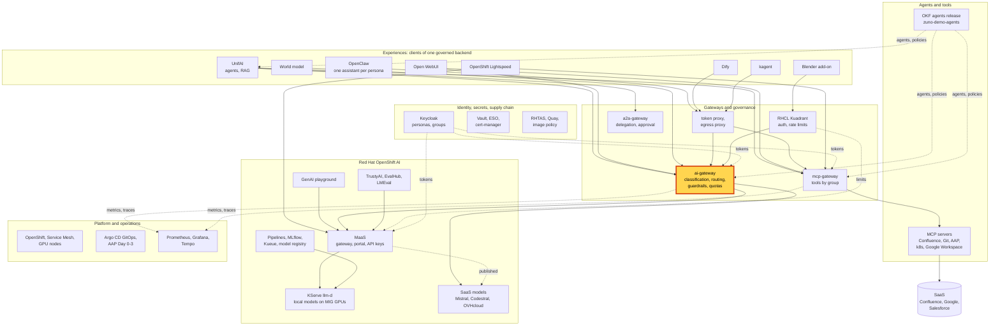
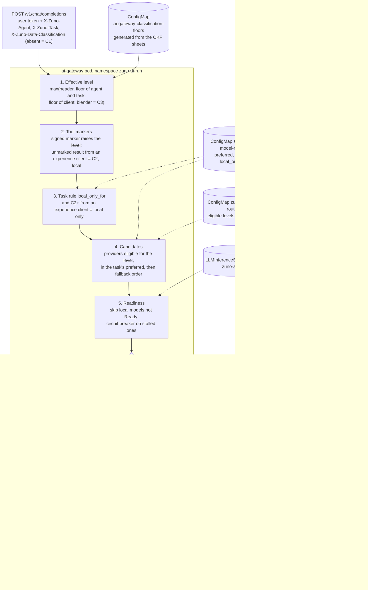

# Scenario: ai-gateway - data classification keeps sovereign data on local models

> **Status:** Not rehearsed in this format. Prerequisites checked read-only on demo333 on 2026-11-12:
> Applications `zuno-ai-gateway-d0`/`-d1` Synced and Healthy, Deployment `ai-gateway` 1/1, ConfigMap
> `ai-gateway-classification-floors` (Arkos C3 on its 4 tasks, Cognos C3, Comage C2, Tekos C1), gateway environment
> `CLASSIFICATION_DEFAULT_WHEN_ABSENT=C1`, `MODEL_READINESS_ENABLED=true`, `CIRCUIT_BREAKER_ENABLED=true`, Tempo
> running. At the time of the check the local models were restarting (one of four Ready) and Grafana was down: run the
> probe before any session.
> **Show-ready ([ADR-0606](../../../adr/0606-admit-new-experiences-with-a-definition-of-done-and-a-wip-limit.md)):**
> yes, golden-path probe `sovereignty` (the 15-minute version also uses `trace`).
> **Personas:** see [Personas](#personas).
> **Used in workshops:** [five experiences](../../five-experiences.md) (sovereign and agentic workshops planned).

## Introduction

Every model call in Zuno goes through the ai-gateway, the platform's single policy router (see
[Appendix A](#appendix-a---hld)). Before it picks a model, the gateway computes the request's **data classification**:

| Level | Meaning | Where it may be answered |
|---|---|---|
| C1 | Public or low-risk | any provider, SaaS included |
| C2 | Business-sensitive | approved SaaS or local models |
| C3 | Financial, HR, sovereign | **local models only**: the data never leaves the cluster |

The level only goes up. It starts from what the caller declares (C1 when nothing is declared), and is raised to the
**floor** of the agent and task, taken from the agent's signed OKF sheet. It is raised again by the markers on tool
results. If no allowed model is ready, the request **fails** instead of being sent somewhere less safe. How the
gateway makes that decision is in [Appendix B](#appendix-b---lld).

**The message:** "Sensitive data stays in the cluster even if the caller says otherwise. When no local model can
answer, Zuno refuses rather than leaking."

**Decisions:**
- [ADR-0021](../../../adr/0021-route-models-according-to-c1-c2-c3-classification.md): SaaS for C1, restricted SaaS for C2,
  local-only for C3.
- [ADR-0565](../../../adr/0565-derive-data-classification-from-okf-and-only-allow-raising-it.md): the floor comes from
  the OKF sheet, and the level can only be raised.
- [ADR-0560](../../../adr/0560-keep-the-ai-gateway-as-the-policy-router-in-front-of-unifai.md): the ai-gateway stays
  the only policy router.
- [ADR-0591](../../../adr/0591-route-only-to-ready-local-models-and-fail-fast-on-stalled-candidates.md): only ready
  local models are used; with no candidate left, the gateway answers 503 at once.
- [ADR-0594](../../../adr/0594-give-the-three-experiences-the-same-mcp-tools-behind-signed-classification-markers.md):
  signed markers on tool results raise the level.

## Personas

The personas are fictional role accounts of the Keycloak realm `zuno`
([ADR-0349](../../../adr/0349-restructure-demo-personas-cluster-access-groups-and-new-agents.md)). They share one
password, kept in Vault at `keycloak/demo-personas`. The [catalogue](../../README.md#personas) lists all of them.

| Persona | Profile | What it can do here | Role in this demo |
|---|---|---|---|
| **paas-ops-01** | Platform operator, back office. Group `ocp-paas-ops` (cluster-admin). | Runs the golden-path probe, which reads the probe credentials and executes a call inside the ai-gateway pod. | The presenter's `oc` terminal in both versions: runs the probe and the `oc get` steps. |
| `eval-consultant-01` | Evaluation copy of consultant-01: group `consultant`, entitled to Arkos (`agent_arkos`) and Tekos. Used by the probes only. | Its token calls Arkos and Tekos through the gateway, with a forged `C1` header. | The "caller who lies" of the 5-minute version. It never signs in on stage; its result line is what the audience sees. |
| **ai-ops-01** | AI platform operator, back office. Group `ocp-ai-ops` (admin on the Zuno namespaces, `zuno-monitoring` included). | Opens Grafana and the Tempo search UI. | Shows the trace of the call and the skipped candidates in the 15-minute version. |
| **consultant-01**, **consultant-02** | Consultants and architects, front office. Entitled to Arkos. | Use Arkos in UnifAI to draft architecture documents (DAT) for clients. | Named only: they are the real users whose client data the C3 floor protects. Not signed in during this scenario. |

## Before you start

- [ ] A terminal at the repository root, logged in to demo333 with `oc` as **paas-ops-01** (or `kube:admin`): the
  probe calls the gateway from inside its pod. Large font, dark background.
- [ ] Run `ONLY=sovereignty make demo golden-path` once before the session. It must print `PASS` for `sovereignty`.
  If it fails, read "If something goes wrong" now, not on stage.
- [ ] Check the local models: `oc get llminferenceservice -n zuno-ai-run`. At least one must be `Ready=True` for a C3
  answer.
- [ ] 15-minute version:
  - [ ] the Tempo search UI `https://tempo-jaegerui-zuno-monitoring.apps.demo333.startx.fr`, signed in as
    **ai-ops-01** (OpenShift sign-in);
  - [ ] Grafana, dashboard **Zuno Platform / Five experiences**, also as **ai-ops-01**;
  - [ ] the agents release opened at
    [agents/arkos/agent.okf.md](https://github.com/startxfr/zuno-demo-agents/blob/main/agents/arkos/agent.okf.md).
- [ ] Optional contrast: the [Open WebUI scenario](../experiences/open-webui.md) already shown, with its **Zuno Code**
  answer served by Codestral.

## 5-minute version

| Time | Do | Say | You should see |
|---|---|---|---|
| 0:00 | Show the C1/C2/C3 table of the introduction | "Every request gets a level. C3 is data that must never leave our infrastructure: finance, HR, sovereign projects." | |
| 1:00 | Run `ONLY=sovereignty make demo golden-path` | "I call Arkos, our architecture agent, and I lie: I label the request C1, public. Arkos works on client architectures, so its signed sheet says C3." | The probe runs. A local model may take a few seconds. |
| 2:30 | Read the result line | "The platform ignored my label and raised it to C3. The answer came from a model running on our GPUs." | `PASS sovereignty ... Arkos C1 raised to C3 -> <provider>/<model> (local)`, then `RESULT: PASS`. |
| 3:30 | Contrast, in words or on the Open WebUI tab | "The same gateway sent a public code question to Mistral Codestral a minute ago. The level decides, not the application." | |
| 4:15 | Close | "Sensitive data stays here even if the caller says otherwise. And if no local model is ready, Zuno refuses: it never falls back to the cloud." | |

## 15-minute version

Run the 5-minute version, then:

| Time | Do | Say | You should see |
|---|---|---|---|
| 5:00 | Open Arkos's OKF sheet in the agents release: `preferred_classification: C3` | "The level is declared by the agent's owner in a signed release, not by the platform team." | `preferred_classification: C3` in the `model` block. |
| 6:00 | `oc get configmap ai-gateway-classification-floors -n zuno-ai-run -o yaml` | "The gateway turns the sheets into floors per agent and per task." | `arkos` at C3 on its four tasks, `cognos` C3, `comage` C2, `tekos` C1. |
| 7:30 | Open [`platform/ai-gateway/provider-routing.yaml`](../../../../platform/ai-gateway/provider-routing.yaml) | "Each provider declares the levels it may serve. At C3 only the local models remain." | Local providers eligible C1, C2 and C3. `mistral` C1 only. `mistral-codestral`, `openai`, `anthropic` and `ovhcloud-gpt-oss-120b` C1 and C2. |
| 9:00 | Explain the three ways the level rises | "The caller's header can raise it, never lower it. The agent's floor raises it. A tool result raises it: in Open WebUI, Dify, kagent or OpenClaw, any turn that used a company tool is treated as C2 and kept local." | |
| 10:30 | Tempo search UI: service `ai-gateway`, operation `model_call`, tags `zuno.classification=C3`, last 15 minutes | "Each model call is traced with its level and where it went." | The probe's span with `zuno.classification=C3`, `zuno.model_kind=local`, `zuno.provider`, `zuno.model`, `zuno.task=draft-architecture-testimonial`, `zuno.request_id=golden-...`. |
| 12:30 | Grafana, row **Same models, same routing**, panel **Candidates skipped for availability (over range)** | "A model that is down or stalled is skipped in milliseconds. A skipped model never widens the choice: at C3, if all local models are down, the answer is a 503." | Skips by provider and reason, if a model was down in the time range. |
| 13:45 | One sentence on guardrails | "Guardrails also take their mode from the level. They run in observe mode at every level today." | |
| 14:30 | Close | Repeat the message. | |

## If something goes wrong

| Symptom | Fallback | Say |
|---|---|---|
| The probe prints `FAIL sovereignty Arkos call: HTTP 503` | Show the line. No local model was ready, so the gateway refused. | "This is the rule at work: no local model, no answer. It will not send C3 data to the cloud to be helpful." |
| `FAIL sovereignty ... was not kept local at C3` | Stop the scenario and say so. This is a real defect; do not improvise. | "The check caught it before you did: this is what the check is for." |
| The probe hangs for minutes | A local model is cold or restarting. Show the configuration steps (15-minute steps 5:00 to 9:00) while it runs. | |
| The probe cannot `exec` into the gateway pod | The terminal is not logged in as **paas-ops-01**, or `oc` lost its session. Log in again before the session; on stage, switch to the configuration steps. | |
| No span in the Tempo search | Widen to the last hour. The export takes about a minute. | |
| Grafana does not load (on 2026-11-12 its volume was bound to a cordoned master) | Skip the panel. Tempo is enough. | |

## Limits

- **The gateway never reads the question.** The level comes from the caller's header, the agent and task floor, the
  task's `local_only_for` rule and the tool markers. A caller that omits the agent, or claims a C1 agent, is not raised
  (the known gap of ADR-0565).
- **Dashboards show providers, not levels.** No `zuno_model_*` metric carries a classification label. The level is on
  the trace span and in the routing decision only.
- **The probe is a synthetic call** ("Say OK." with a forged C1 header). It is not a real Arkos conversation in UnifAI.
- **Do not ask Arkos to write code on stage.** Its `write-code` task prefers Codestral strictly and is floored at C3.
  That combination probably fails (not verified).
- **Guardrails run in observe mode at every level.** They record; they do not block.
- **Failing closed has a cost.** With the GPU nodes down, C3 work stops. That is the intended trade-off.

## Appendix A - HLD

Where the ai-gateway sits in Zuno. The highlighted box is the subject of this page. Plain arrows carry requests,
dotted arrows carry identity, policy or telemetry.

## Appendix B - LLD

How the ai-gateway decides where a request may go. Drawn from `components/ai-gateway/app/main.py`
(`chat_completions`), `app/classification_floor.py`, `app/routing.py` (`RoutingTable.candidates_for`),
`app/tool_markers.py` and `app/telemetry.py`, with the ConfigMaps rendered by `gitops/charts/ai-gateway`.

