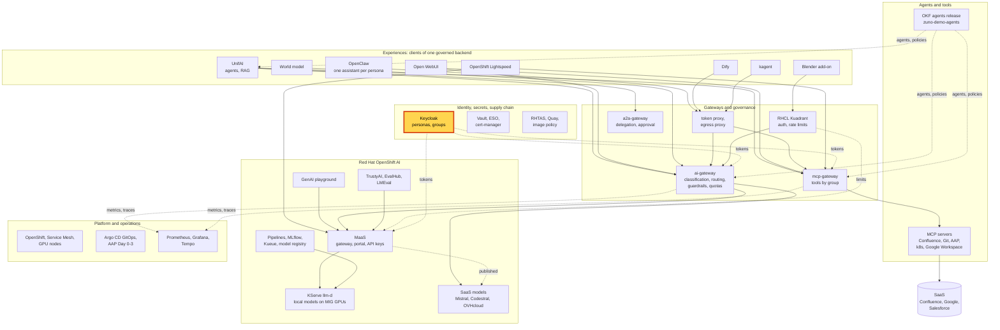
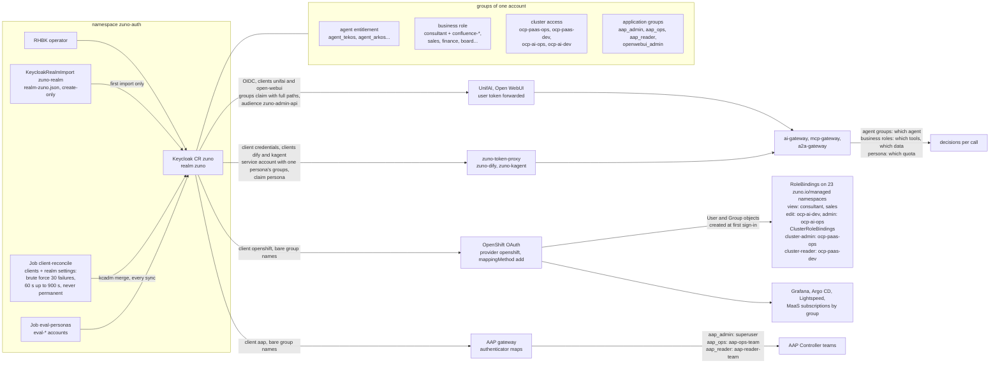

# Scenario: Keycloak - one identity, groups drive every entitlement

> **Status:** Not rehearsed in this format. Prerequisites checked read-only on demo333 on 2026-11-13 (about 00:20 CET):
> Applications `zuno-keycloak-d0`/`-d1`, `zuno-openshift-oauth-d0`/`-d1`, `zuno-openshift-rbac-groups-d0`/`-d1`,
> `zuno-open-webui-d1` and `zuno-unifai-d0`/`-d1` Synced and Healthy. Keycloak CR `zuno` (built-in instance, internal
> mode) with pod `zuno-0` Running; KeycloakRealmImport `zuno-realm` Done; Jobs `zuno-keycloak-client-reconcile` and
> `zuno-keycloak-eval-personas` Complete. ConfigMap `zuno-keycloak-clients` carries the brute-force settings
> (`bruteForceProtected: true`, `failureFactor: 30`, `waitIncrementSeconds: 60`, `maxFailureWaitSeconds: 900`,
> `permanentLockout: false`). OAuth `cluster` has the OpenID provider `openshift` (issuer
> `https://keycloak.apps.demo333.startx.fr/realms/zuno`, `mappingMethod: add`, claim `groups`) and the HTPasswd provider
> `startx-htpasswd_auth`. OpenShift users consultant-02, ai-ops-01, ai-dev-01 and paas-dev-01 exist; sale-01 and
> paas-ops-01 do not (no `sales` or `ocp-paas-ops` group yet). RoleBindings `zuno-personas-view` (view: `consultant`,
> `sales`), `zuno-ocp-ai-dev-edit` and `zuno-ocp-ai-ops-admin` in 23 namespaces; ClusterRoleBindings for `ocp-paas-ops`
> and `ocp-paas-dev`. `zuno-token-proxy` 1/1 in `zuno-dify` and `zuno-kagent`. Open WebUI and UnifAI 1/1.
> **Show-ready ([ADR-0606](../../../adr/0606-admit-new-experiences-with-a-definition-of-done-and-a-wip-limit.md)):**
> no golden-path probe. Rehearse it before showing it to an audience.
> **Personas:** see [Personas](#personas).
> **Used in workshops:** [sovereign and governed AI](../../workshops/sovereign-governed-ai.md).

## Introduction

Zuno has one identity provider: the Keycloak realm `zuno`, run by the Red Hat build of Keycloak operator in
`zuno-auth` (see [Appendix A](#appendix-a---hld)). It runs as the platform's own built-in instance again since
2026-11-09, after an external-mode trial for the demonstration day. Every application trusts it: UnifAI, Open WebUI,
the gateways, OpenShift itself through its OAuth server, and AAP. Each person has one account, and the account carries
groups. The groups are the only thing the applications read to decide what the person may do.

The persona model has three group dimensions:

| Dimension | Groups | What it decides |
|---|---|---|
| Agent entitlement | `agent_tekos`, `agent_arkos`, `agent_comage`... | Which agents the person may use (UnifAI team workspace, A2A, gateway checks) |
| Business role | `sales`, `consultant`, `finance`, `board`, `adv`, `cdp`, `recrut`, with Confluence ACL subgroups under `consultant` | Which tools and which data inside an agent (tool policy, RAG ACLs) |
| Cluster access | `ocp-paas-ops`, `ocp-paas-dev`, `ocp-ai-ops`, `ocp-ai-dev` | What the person may do on OpenShift, and the MaaS subscription it gets |

A few application groups sit beside them: `aap_admin`, `aap_ops` and `aap_reader` for AAP, and `openwebui_admin` for
Open WebUI. How the groups travel from the realm to each application is in [Appendix B](#appendix-b---lld).

**The message:** "One company account, and its groups decide everything: which agents, which tools and data, which
cluster rights, in every application."

**Decisions:**
- [ADR-0040](../../../adr/0040-separate-agent-entitlement-from-business-role-authorization.md): agent entitlement and
  business role are separate group dimensions; neither replaces the other.
- [ADR-0349](../../../adr/0349-restructure-demo-personas-cluster-access-groups-and-new-agents.md): the personas and the
  `ocp-*` cluster-access groups.
- [ADR-0320](../../../adr/0320-pre-provision-openshift-users-rbac-and-console-favorites-via-keycloak.md): OpenShift's
  OAuth server federated to Keycloak, groups synced at sign-in (still in effect for the OAuth part).
- [ADR-0530](../../../adr/0530-reconcile-keycloak-clients-instead-of-relying-on-a-create-only-realm-import.md): the
  realm import runs once; a Job reconciles the clients and some realm settings on every sync.
- [ADR-0352](../../../adr/0352-run-day-0-platform-services-in-internal-or-external-mode.md): Keycloak can run built in
  (internal) or as an external service.
- [ADR-0593](../../../adr/0593-key-the-per-user-quota-and-telemetry-by-persona-across-experiences.md): quota and
  telemetry are keyed by persona across the experiences.
- [ADR-0601](../../../adr/0601-inject-client-credentials-tokens-for-experience-clients-without-oidc-passthrough.md):
  a token proxy gives an experience that cannot pass a user token the identity of one persona.
- [ADR-0602](../../../adr/0602-harden-the-platform-trust-boundaries-before-a-customer-runs-it.md) (clause 3):
  temporary brute-force protection in both security profiles.

## Personas

The personas are fictional role accounts of the Keycloak realm `zuno`
([ADR-0349](../../../adr/0349-restructure-demo-personas-cluster-access-groups-and-new-agents.md)). They share one
password, kept in Vault at `keycloak/demo-personas`. The [catalogue](../../README.md#personas) lists all of them.

| Persona | Profile | What it can do here | Role in this demo |
|---|---|---|---|
| **consultant-02** | Consultant and architect, front office. Groups `consultant` with six Confluence subgroups (build OpenShift and OpenShift AI, the four architecture spaces), `agent_tekos`, `agent_arkos`, `aap_ops`. | UnifAI team workspaces `agent-arkos`, `agent-tekos` and `consultant`. Six tools in Open WebUI, Confluence included. `view` on the Zuno namespaces. | Profile 1, in both versions: the person the groups open doors for. |
| **sale-01** | Salesperson, front office. Groups `sales`, `agent_comage`, `agent_finage`. | UnifAI team workspaces `agent-comage` and `sales`. Three tools in Open WebUI, no Confluence. `view` on the Zuno namespaces once it has signed in to OpenShift. | Profile 2, in the 5-minute version: the same screens with other groups. |
| **ai-dev-01**, **ai-ops-01**, **paas-dev-01** | AI developer, AI platform operator, platform developer, back office. Groups `ocp-ai-dev`, `ocp-ai-ops`, `ocp-paas-dev`, each with `agent_tekos`. | `edit` (ai-dev-01) and `admin` (ai-ops-01) on the Zuno namespaces, `cluster-reader` (paas-dev-01). | Named in the 15-minute version: the cluster-access dimension. |
| **paas-ops-01** | Platform operator, back office. Group `ocp-paas-ops` (cluster-admin), `agent_tekos`, `aap_admin`, `openwebui_admin`. | Reads groups, bindings and ConfigMaps. | The presenter's `oc` terminal in the 15-minute version. |
| `tekos-entitlement-only-user-01`, `consultant-role-only-user-01` | Negative fixtures of ADR-0040: `agent_tekos` only, `consultant` only. Similar fixtures exist for Arkos, Comage, Advantage, Finage and Naveo. | Each must be refused: the first gets no Confluence, the second no Tekos. | Named in the 15-minute version. Never signed in on stage. |

Other identities:
- the Keycloak service accounts that carry the groups of one persona, for experiences that cannot pass a user token:
  `service-account-dify` and `service-account-openclaw-consultant-02` act as **consultant-02**,
  `service-account-openclaw-sale-01` as **sale-01**, `service-account-kagent` as **ai-ops-01**;
- `eval-consultant-01` and the other `eval-*` accounts, created by the Job `zuno-keycloak-eval-personas` for the probes
  and the evaluations;
- the HTPasswd provider `startx-htpasswd_auth`, kept as the break-glass sign-in to OpenShift. It is not a persona.

## Before you start

- [ ] Two browser profiles, so two personas stay signed in side by side. A shared browser session signs in the wrong
  account:
  - profile 1: **consultant-02**;
  - profile 2: **sale-01**.
  The password is in Vault, `keycloak/demo-personas`.
- [ ] In each profile, sign in to UnifAI (`https://unifai-ui-zuno-unifai.apps.demo333.startx.fr`) and to Open WebUI
  (`https://open-webui.apps.demo333.startx.fr`, **Continue with Keycloak**). Check the name in each application.
- [ ] In Open WebUI, start a **new chat** in each profile. Chats created before 2026-11-03 keep their tool switch off.
- [ ] Rehearse the sale-01 workspace step (1:30) the same day. It is not in a recorded run.
- [ ] 15-minute version:
  - [ ] a terminal at the repository root, logged in with `oc` as **paas-ops-01**. On 2026-11-13 paas-ops-01 had never
    signed in to OpenShift: sign it in once through the identity provider `openshift` (not `startx-htpasswd_auth`)
    before the session;
  - [ ] in profile 1, the OpenShift console `https://console-openshift-console.apps.demo333.startx.fr`, signed in as
    **consultant-02** through the provider `openshift`;
  - [ ] the tool policy open at
    [policies/tools/tool-policy.yaml](https://github.com/startxfr/zuno-demo-agents/blob/main/policies/tools/tool-policy.yaml),
    entry `search_confluence`.

## 5-minute version

| Time | Do | Say | You should see |
|---|---|---|---|
| 0:00 | Show the rows of **sale-01** and **consultant-02** in the [catalogue's persona table](../../README.md#personas) | "Each person has one company account in Keycloak. The account carries groups, and the groups decide what the person may do: which agents, which tools, which cluster rights." | |
| 0:45 | Profile 1, **consultant-02**: UnifAI, **Team**, open the workspace selector | "consultant-02 is a consultant entitled to Arkos and Tekos. Its workspaces come from those groups. Nobody created them by hand." | `agent-arkos`, `agent-tekos` and `consultant`. |
| 1:30 | Profile 2, **sale-01**: UnifAI, **Team**, open the workspace selector | "sale-01 is a salesperson. No Tekos group, no Tekos workspace. No consultant group, no consultant workspace." | `agent-comage` and `sales`. No `agent-tekos`, no `consultant`. |
| 2:30 | Profile 1, **consultant-02**: Open WebUI, new chat, tools button under the prompt | "Another application, the same account. The `consultant` group that opened the consultant workspace also opens our Confluence." | Six tools: Drive search, Gmail read, diagram generation, Confluence search, Confluence page read, technical-docs search. |
| 3:30 | Profile 2, **sale-01**: Open WebUI, new chat, tools button | "Same screen, other groups: no Confluence. Nobody configured that in Open WebUI. The platform read the groups." | Three tools: Drive search, Gmail read, diagram generation. |
| 4:15 | Close | "One company account, and its groups decide everything, in every application. Change a group, and at the next sign-in the agents, the tools and the cluster rights follow." | |

## 15-minute version

Run the 5-minute version, then:

| Time | Do | Say | You should see |
|---|---|---|---|
| 5:00 | Terminal: `oc get groups` | "OpenShift trusts the same Keycloak. When a person first signs in to the cluster, OpenShift creates a group for each group in the token." | `consultant`, `agent_arkos`, `aap_ops` and the six `confluence-*` groups with consultant-02; `ocp-ai-ops` with ai-ops-01; `ocp-ai-dev` with ai-dev-01; `ocp-paas-dev` with paas-dev-01. No `sales` group: sale-01 has never signed in to OpenShift. `admin`, `dev`, `ops` and a few others come from the cluster's base RBAC (`startx-cluster-rbac`), not from Keycloak. |
| 6:00 | `oc get rolebinding zuno-personas-view zuno-ocp-ai-dev-edit zuno-ocp-ai-ops-admin -n zuno-ai-run -o wide`, then `oc get clusterrolebinding zuno-ocp-paas-ops-cluster-admin zuno-ocp-paas-dev-cluster-reader -o wide` | "The cluster dimension. Only the `ocp-*` groups carry real rights: the AI developer edits the Zuno namespaces, the AI operator administers them, the platform developer reads the whole cluster, the platform operator is cluster-admin. Consultants and salespeople may read the Zuno namespaces, so that Lightspeed can answer them." | `view` for `consultant` and `sales`; `edit` for `ocp-ai-dev`; `admin` for `ocp-ai-ops`; `cluster-admin` for `ocp-paas-ops`; `cluster-reader` for `ocp-paas-dev`. |
| 7:15 | Profile 1, **consultant-02**: OpenShift console, project `zuno-ai-run`, **Workloads**, **Pods** | "The same person in the cluster console: it reads, it does not change anything." | The pods of `zuno-ai-run`. Not rehearsed. |
| 8:15 | The tool policy on GitHub, entry `search_confluence` | "Inside an agent, the business role decides the tools. The agent group only opens the door: that is why the two dimensions are separate." | `allowed_groups`: `consultant`, `board`, `cdp`, `lightspeed_readonly`, `ocp-ai-ops`. No `sales`. |
| 9:15 | Show the two fixture accounts in the Personas table above, and the check names in [`evaluations/tekos/security_checks.py`](../../../../evaluations/tekos/security_checks.py) | "We test that separation with fixture accounts. One has the agent group only, the other the business role only. Both must be refused." | `entitlement_without_business_role_denied_confluence` (the mcp-gateway answers 403) and `business_role_without_entitlement_denied_by_unifai`. |
| 10:15 | `oc get deploy zuno-token-proxy -n zuno-dify -o jsonpath='{range .spec.template.spec.containers[0].env[*]}{.name}={.value}{"\n"}{end}' \| grep -E 'CLIENT_ID\|HEADERS'` | "Dify cannot pass a user's token. A small proxy beside it fetches a token for the Keycloak client `dify`. Its service account carries exactly consultant-02's groups and a `persona` claim, so the quota and the audit count it as consultant-02." | `CLIENT_ID=dify`, `AI_HEADERS={"X-Zuno-Agent":"dify",...}` and `MCP_HEADERS={...}`. |
| 11:30 | Say only | "Other applications read the same token. `aap_ops` puts consultant-02 in an AAP team that may view and run the job templates. `openwebui_admin` makes ai-ops-01 an Open WebUI administrator. The MaaS subscriptions are bound to the `ocp-*` groups and to `sales`." | |
| 12:30 | `oc get configmap zuno-keycloak-clients -n zuno-auth -o jsonpath='{.data.realm-settings\.json}'` | "Password guessing is throttled. After 30 failures an account is locked for a minute, then longer, up to 15 minutes, never for good. A Job applies these settings to the live realm on every sync, because the realm import runs only once." | `"bruteForceProtected": true`, `"failureFactor": 30`, `"waitIncrementSeconds": 60`, `"maxFailureWaitSeconds": 900`, `"permanentLockout": false`. |
| 13:45 | Close | Repeat the message. | |

## If something goes wrong

| Symptom | Fallback | Say |
|---|---|---|
| The workspace selector or the tool list shows the other persona's view | Check the name in the application. A shared browser session signed in the wrong account. Sign out and sign in with the right profile. | "Wrong account, other groups: the platform did exactly what the token said." |
| No tools in an Open WebUI chat | Start a new chat. Old chats keep their tool switch off. | |
| sale-01 sees a workspace you did not expect | Say what you see and carry on with Open WebUI. The workspaces follow the UnifaiTeam members of `oc get unifaiteams -n zuno-unifai`. | "Each team workspace names the Keycloak group of its members." |
| Keycloak keeps refusing a persona's password that you know is right | Brute-force protection may have locked the account after repeated failures (30, possibly from a script). Wait the lockout out (a minute, up to 15), or switch to another profile. | "That is the protection against password guessing, and it never locks for good." |
| `oc get groups` has no `ocp-paas-ops` group and your `oc` commands are refused | paas-ops-01 never signed in to OpenShift. Use the session you prepared before the talk; do not sign in on stage. | "OpenShift learns the groups at the first sign-in." |
| The OpenShift console asks to choose a provider | Choose `openshift`, the Keycloak provider. `startx-htpasswd_auth` is the break-glass account store. | |

## Limits

- **The realm file is not the live realm.** `realm-zuno.json` is imported once, when the realm is created. The Job
  reconciles the clients and the brute-force settings on every sync (ADR-0530). Users, groups and memberships added
  later are applied by hand with `kcadm` (WP-103).
- **OpenShift learns the groups at sign-in.** A persona that never signed in has no OpenShift user and its groups do
  not exist there. On 2026-11-13 that was the case for sale-01 and paas-ops-01.
- **One shared persona password and the `demo` security profile**: no password policy, an 8-hour idle session, no OTP
  for the console administrator. The `hardened` profile adds a password policy, a one-hour idle session and that OTP ([ADR-0602](../../../adr/0602-harden-the-platform-trust-boundaries-before-a-customer-runs-it.md)
  clause 3); demo333 does not run it.
- **The brute-force values were read from the ConfigMap the Job applies**, not from the live realm: the check made no
  call to the Keycloak admin API.
- **A service-account experience acts as a persona, not as the person at the keyboard.** Dify, kagent and OpenClaw
  count every user as the persona of their service account (ADR-0601 clause 5).
- **Group names differ by client.** The tokens of the `unifai`, `open-webui`, experience and evaluation clients carry
  full paths (`/consultant/confluence-build-openshift`), which the gateways read; the `openshift` and `aap` clients
  carry bare names, which is why the OpenShift group is named `confluence-build-openshift`.
- **External mode is not shown.** Keycloak ran as an external service from 2026-11-08 to 2026-11-09
  ([ADR-0352](../../../adr/0352-run-day-0-platform-services-in-internal-or-external-mode.md)); it is built in again.

## Appendix A - HLD

Where Keycloak sits in Zuno. The highlighted box is the subject of this page. Plain arrows carry requests, dotted
arrows carry identity, policy or telemetry.

## Appendix B - LLD

How one realm feeds every entitlement. Drawn from `gitops/charts/keycloak/` (`files/realm-zuno.json`,
`templates/realmimport.yaml`, `templates/configmap-clients.yaml`, `templates/job-client-reconcile.yaml`,
`templates/job-eval-personas.yaml`), `gitops/charts/openshift-oauth/templates/oauth.yaml`,
`gitops/charts/openshift-rbac-groups/templates/` (`rolebindings.yaml`, `clusterrolebinding.yaml`),
`gitops/charts/zuno-token-proxy/`, `ansible/roles/aap_config/` (`README.md`, `tasks/wire_launch_rbac.yml`) and the
live objects listed in the status banner.

